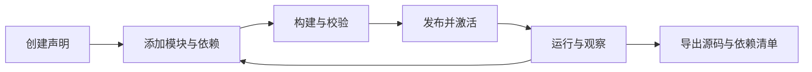

# Nofy — 让 Agent 开发 Agent

**以声明组合模型、工具、工作流、记忆、权限与会话的 Agent 开发框架。**

给编程 Agent 一个目标，让它通过 CLI 或 MCP 创建声明、添加模块、运行验证，再把源码与依赖清单交给你。不同用途的 Agent 共用 Rust 内核、Loader、执行路径和持久状态。

[开始使用](docs/getting-started.md) · [CLI／MCP 手册](docs/manual/README.md) · [当前版本范围](docs/release-notes.md) · [English](README.en.md)

> 当前为可使用的开发者预览。Rust CLI、入站 MCP、源码工程和模块化 Session 已实现；本发布不包含前端，页面将另行重做。pi、Codex、OpenCode 的完整行为预设尚未发布。

## 已经可以做什么

- **创建并组合 Agent。** 从空声明开始，配置模型、提示词、工具、上下文、策略、预算和会话。CLI 与 MCP 操作同一源码事实源。
- **接入外部实现。** 工具可以使用 Rhai、独立脚本／程序、HTTP 或外部 MCP 服务。常规业务能力无需修改内核 Rust。
- **构建、发布与恢复。** 将声明构建为完整系统，检查差异、激活 generation，观察运行事件、审批、取消及恢复。
- **保留会话状态。** 通过 17 项会话操作管理接纳、续轮、元数据、归档和轮次间策略切换。
- **交付可移植源码。** 源码包包含声明、模块源码与普通依赖清单；凭据单独注入，解释器、编译器及外部库由使用者安装。

开发协议为 `nofy.kernel/v1`，当前契约修订 `0.3`：68 项操作，其中 66 项通过 MCP 开放。密钥正文注入使用独立的本地私有入口。

## 快速开始

主要体验环境为 Linux。准备 [Rust 工具链](rust-toolchain.toml)，在仓库根目录编译：

```sh
cargo build --locked -p nofy-agent-host -p nofy-cli
./target/debug/nofy --help
```

按[启动指南](docs/getting-started.md)创建私有访问令牌、启动内核，然后使用 CLI 或接入 Codex 的 MCP。当前发布通过 CLI／MCP 使用。

```sh
./target/debug/nofy describe \
  --endpoint http://127.0.0.1:7331 \
  --token-file "$NOFY_STATE_DIR/access-token"
```

外部 Agent 的开发路径：



源码编辑允许暂时缺少模型或 Prompt；只有配置完整并校验通过的系统才能发布运行。模型服务、API key 和业务工具依赖由使用者提供。

## 编程预设与真实验收

[coding 预设](presets/coding/文件说明.md)是同一框架上的源码模板，提供文件读写、可选命令执行和只读代码审查。已有[真实模型修复项目记录](docs/verification/coding-real-model-build.md)：模型读取代码、执行测试、修复问题，6 项测试从失败变为通过。

另一次[真实 sub 验收](docs/verification/mcp-sub-agent.md)通过标准 MCP 从空声明创建 Agent、组合 9 个模块并运行真实模型。模型实际调用计算工具得到 `42`，运行完成，源码包逐文件往返核验通过。

这些记录分别证明其列明的能力。pi 的树状会话、双输入队列等参考行为仍有缺口；完整模块交叉矩阵与 pi 复刻尚未验收完成。

## 开发与检查

```sh
bash scripts/check-release.sh
```

该入口集中检查格式、工作区编译、CLI／MCP 开发模块、源码预设与依赖边界。完整运行时回归和真实进程树／模型验收另见[贡献说明](CONTRIBUTING.md)与[验证记录](docs/verification)。

- [模块接入](docs/manual/modules.md)：工厂、插槽、依赖和外部实现。
- [Session](docs/manual/sessions.md)：策略及生命周期。
- [MCP](docs/manual/mcp.md)：stdio、Streamable HTTP 和 Codex 接入。
- [源码文件说明](文件说明.md)：22 个框架包及目录职责。

## 许可证

[Apache License 2.0](LICENSE)。第三方代码保留原许可证与署名，见 [THIRD-PARTY-NOTICES](THIRD-PARTY-NOTICES)。
