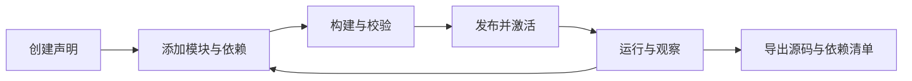

# Nofy — 让 Agent 开发 Agent

**以声明组合模型、工具、工作流、记忆、权限与会话的 Agent 开发框架。**

给编程 Agent 一个目标，让它通过 CLI 或 MCP 创建声明、添加模块、运行验证，再把源码与依赖清单交给你。不同用途的 Agent 共用 Rust 内核、Loader、执行路径和持久状态。

[开始使用](docs/getting-started.md) · [CLI／MCP 手册](docs/manual/README.md) · [当前版本范围](docs/release-notes.md) · [English](README.md)

> 当前为可使用的开发者预览。Rust CLI、入站 MCP、源码工程和模块化 Session 已实现；本发布不包含前端，页面将另行重做。pi、Codex、OpenCode 的完整行为预设尚未发布。

## 已经可以做什么

- **创建并组合 Agent。** 从空声明开始，配置模型、提示词、工具、上下文、策略、预算和会话。CLI 与 MCP 操作同一源码事实源。
- **接入外部实现。** 工具可以使用 Rhai、独立脚本／程序、HTTP 或外部 MCP 服务。常规业务能力无需修改内核 Rust。
- **构建、发布与恢复。** 将声明构建为完整系统，检查差异、激活 generation，观察运行事件、审批、取消及恢复。
- **保留会话状态。** 通过 20 项会话操作管理接纳、续轮、元数据、归档和轮次间策略切换。
- **交付可移植源码。** 源码包包含声明、模块源码与普通依赖清单；凭据单独注入，解释器、编译器及外部库由使用者安装。

开发协议为 `nofy.kernel/v1`，当前契约修订 `0.4`：79 项操作，其中 77 项通过 MCP 开放。密钥正文注入使用独立的本地私有入口。

## 核心概念：目标（Goal）与递归自我改进（RSI）

本框架的递归自我改进不是运行时改写内核，而是一个受控的声明式闭环：

1. **目标驱动。** 给 Agent 一个目标后，宿主通过 Goal 状态模块跨轮跟踪：状态编码、生命周期、快照与恢复、预算与停顿检测（`nofy-goal`）；规划模型与编排由宿主接入，目标状态本身持久、可暂停、可恢复。
2. **声明式改进。** Agent 通过 CLI／MCP 的 79 项操作把改进落成数据——创建源码工程、组合模块与依赖、构建校验、发布激活、运行验证、导出源码。改进对象是声明、模块与预设制品；常规能力更改不修改内核 Rust，每次调用由内核重新检查授权。
3. **递归结构。** 被开发的 Agent 与开发它们的 Agent 走同一 Loader 与执行路径；[coding 预设](presets/coding/文件说明.md)本身就是框架上的一份可编辑声明。Agent 可以用同一套操作开发其他 Agent，也可以改进自己这类预设与模块，形成「Agent 开发 Agent、Agent 改进 Agent」的递归。

边界：内核授权、审批、预算与取消是改进循环的强制边界。闭环各步骤分别有验证记录（[真实模型修复](docs/verification/coding-real-model-build.md)、[MCP sub-agent 端到端](docs/verification/mcp-sub-agent.md)），完整的自主改进闭环尚未整体验收。

## 快速开始

主要体验环境为 Linux。准备 [Rust 工具链](rust-toolchain.toml)，在仓库根目录编译：

```sh
cargo build --locked -p nofy-agent-host -p nofy-cli
./target/debug/nofy --help
```

按[启动指南](docs/getting-started.md)创建私有访问令牌、启动内核，然后使用 CLI 或接入 Codex 的 MCP。当前发布通过 CLI／MCP 使用。

```sh
./target/debug/nofy describe \
  --endpoint http://127.0.0.1:7331 \
  --token-file "$NOFY_STATE_DIR/access-token"
```

外部 Agent 的开发路径：



源码编辑允许暂时缺少模型或 Prompt；只有配置完整并校验通过的系统才能发布运行。模型服务、API key 和业务工具依赖由使用者提供。

## CLI 使用方法

完整命令、参数与退出码见 [CLI 手册](docs/manual/cli.md)。`nofy` 通过 HTTP 连接常驻内核；CLI、HTTP 与 MCP 操作同一源码事实源：

```sh
nofy --endpoint http://127.0.0.1:7331 \
     --token-env NOFY_ACCESS_TOKEN <命令组> <子命令>
```

| 常用全局选项 | 语义 |
|---|---|
| `--token-env` / `--token-file` | 访问令牌来源，二选一；同时显式指定互斥来源时报参数错误 |
| `--config PATH` / `--profile NAME` | 选择客户端连接配置 profile，不保存令牌正文 |
| `--format json\|text` | 默认 JSON；text 供人工阅读 |
| `--input PATH` / `--output PATH` | 从文件或 stdin 读取完整输入对象；输出默认拒绝覆盖已有文件 |
| `--help` | 命令层级、参数、作用域提示及 Schema 入口 |

创建 Agent 并逐步组合能力，三种添加模块的方式：

```sh
nofy agent create coder                    # 创建源码工程；未配模型/Prompt 返回 incomplete
nofy agent module add coder --module "$MODULE_REF" --slot tools      # ① 引用已有模块
nofy agent tool add coder --id search --factory tool.http_connected \
  --set /contract/name=search --set /path=search --set /method=POST \
  --bind connection=service                # ② 直接按工厂参数配置，并绑定依赖槽
nofy agent module add coder --from ./calculate.module.json --slot tools # ③ 导入模块定义 JSON
nofy agent inspect coder                   # 查看模块关系、缺项与源码 revision
```

构建、发布并激活：

```sh
nofy agent build coder --output deployment.json
nofy system validate --file deployment.json
nofy system publish --file deployment.json        # 回执给出 release，保存为 $RELEASE
nofy system plan coder --release "$RELEASE"       # 查看与当前系统的差异
nofy system apply coder --release "$RELEASE" \
  --expected-generation none --command-id "$COMMAND_ID"   # 已有系统传查询到的精确 generation
```

运行、观察、审批与会话续轮：

```sh
nofy run start --input run.json
nofy run events "$RUN_ID" --after "$CURSOR" --follow      # 事件有原 cursor，断线续读
nofy run approvals "$RUN_ID"                     # decide 提交刚读到的完整原请求 + allow
nofy run cancel "$RUN_ID" --command-id "$CANCEL_ID"

nofy session start --input session.json          # 原子创建首根会话；20 项 session 操作见专册
nofy session turn --input turn.json
```

交付与回滚：

```sh
nofy agent export coder --output coder-source.tar.gz      # 源码 + 普通依赖清单，凭据单独注入
nofy system rollback coder --release "$OLD_RELEASE" \
  --expected-generation "$GENERATION" --command-id "$ROLLBACK_ID"
```

也可以在本地目录用同一格式编辑工程：`nofy project init ./coder --empty --agent coder`，构建用 `nofy project build ./coder`。复杂请求可用 `nofy call <operation-id> --input request.json`；凭据正文只走 `nofy credential put` 的 stdin/私有文件入口，不出现在命令行或日志。

## MCP 接入方法

完整协议说明见 [MCP 手册](docs/manual/mcp.md)。入站 MCP Server 与 CLI 共用操作契约，`tools/list` 固定公开 77 项已实现操作；密钥正文注入不走 MCP，保留为独立本地私有入口。

stdio（Codex 等本地客户端）：

```sh
nofy mcp serve --transport stdio \
  --endpoint http://127.0.0.1:7331 \
  --token-env NOFY_ACCESS_TOKEN
```

Codex 配置（不会自动写入用户环境）：

```toml
[mcp_servers.nofy]
command = "nofy"
args = ["mcp", "serve", "--transport", "stdio", "--endpoint", "http://127.0.0.1:7331", "--token-env", "NOFY_ACCESS_TOKEN"]
env_vars = ["NOFY_ACCESS_TOKEN"]
```

Streamable HTTP（调用方自带 Bearer 身份，桥接器用同一身份请求内核）：

```sh
nofy mcp serve --transport http --listen 127.0.0.1:7332 \
  --endpoint http://127.0.0.1:7331
# MCP 地址为 http://127.0.0.1:7332/mcp
```

MCP 创建 Agent 与 CLI 一一对应：`nofy_agent_create` → `nofy_agent_module_add`（工具快捷入口 `nofy_agent_tool_add`）→ `nofy_agent_build` → `nofy_system_publish` / `nofy_system_plan` / `nofy_system_apply` → `nofy_run_start` / `nofy_run_events` → Session 工具组；审批与恢复用 `nofy_run_approvals` / `nofy_run_decide` / `nofy_run_recovery`。MCP 直接提供结构化参数，通常无需手写 JSON 文件。配置出现不代表连接或业务验收已通过，验收范围见[实现记录](docs/verification/agent-development-cli-mcp.md)。

## 编程预设与真实验收

[coding 预设](presets/coding/文件说明.md)是同一框架上的源码模板，提供文件读写、可选命令执行和只读代码审查。已有[真实模型修复项目记录](docs/verification/coding-real-model-build.md)：模型读取代码、执行测试、修复问题，6 项测试从失败变为通过。

另一次[真实 sub 验收](docs/verification/mcp-sub-agent.md)通过标准 MCP 从空声明创建 Agent、组合 9 个模块并运行真实模型。模型实际调用计算工具得到 `42`，运行完成，源码包逐文件往返核验通过。

这些记录分别证明其列明的能力。pi 的树状会话、双输入队列等参考行为仍有缺口；完整模块交叉矩阵与 pi 复刻尚未验收完成。

## 开发与检查

```sh
bash scripts/check-release.sh
```

该入口集中检查格式、工作区编译、CLI／MCP 开发模块、源码预设与依赖边界。完整运行时回归和真实进程树／模型验收另见[贡献说明](CONTRIBUTING.md)与[验证记录](docs/verification)。

- [模块接入](docs/manual/modules.md)：工厂、插槽、依赖和外部实现。
- [Session](docs/manual/sessions.md)：策略及生命周期。
- [MCP](docs/manual/mcp.md)：stdio、Streamable HTTP 和 Codex 接入。
- [源码文件说明](文件说明.md)：22 个框架包及目录职责。

## 许可证

[Apache License 2.0](LICENSE)。第三方代码保留原许可证与署名，见 [THIRD-PARTY-NOTICES](THIRD-PARTY-NOTICES)。
