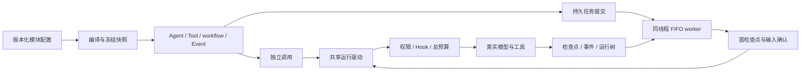

# 公共 Agent 内核文件说明

L7 传输及控制面范围已验收：durable/placement.rs 与 placement/fence.rs 定义固定逻辑身份、位置许可和物理库退役，transport.rs 完整复制 SQLite；retention.rs 提供原生管理流式扫描。预算、邮箱和 Hook 沿原身份恢复。Runtime 424 项首轮通过，修复后只补验 transport 3 项；详见 docs/verification/runtime-history-transfer.md。

L5 语义记忆通用轨道：ContextSource 增加默认无计划的 prepare 与 contribute_prepared；agent/source_host.rs 将纯计划、原操作作用域、输入/来源修订和已完成贡献保存在原 HookProgress。pending plan 纳入 has_pending_work，未知效果继续原版本；已知取消退休原计划，修订变化先结清再丢弃旧贡献。主模型请求提交后清理准备进度，检索消息不写入规范会话。tests/prepared_context.rs 覆盖修订变化、所有者丢失、取消、非持久检查点拒绝、Hook拒绝收尾及已知模型失败精确重试；agent/execution.rs 将原准备作用域纳入原票据匹配，不另建重试机制；已按完整功能块集中验证，结果见 docs/verification/semantic-memory.md。 本功能块最终相关1012项通过（Runtime424、Memory328、Host260）；原有Memory性能1项未运行。首波及定向修复记录均保留，不计为一次全量全绿；跨后端历史迁移、多套参考预设和发布仍开放。

L4：governance/view.rs 在 sqlite feature 下增加 SqliteStore::budget_page 和 BudgetPage，按原排序键分页读取并验证原 BudgetSummary 身份；不开户、查询时钟或变更预留/操作/事件。tests/budget_view.rs 覆盖未知派发预留、大整数、期限后的无写观察、重开一致性与损坏身份拒绝。控制台读取当前宿主同一 SQLite 事实源，不推断 SDK 自备预算存储。构建与相关测试按完整功能块集中运行。

L3c2当前：governance::await_resource和model_journal::enabled作为外部适配器公共接口，既有函数体、私有能力类型及执行语义不变。新增默认Host适配器通过取消/预算等待和原模型日志边界工作，不增加运行循环或旧宿主。严格Runtime文档及适配器/Host相关255项通过；完整Runtime行为沿L3c1的416项证据保留，本轮不重复计为新运行。见docs/verification/external-source-context-adapters.md/.json。

L3c1当前：agent.rs替换有效来源/策略句柄；supervisor/jobs/managed/actions.rs认可三个显式选择；transition.rs累计选择并提交live/v5，仅对显式工具来源更新退休旧tool_revision；transition/compatibility.rs保护未选及共享依赖、按完整闭包生成有效ContextPolicy身份；durable/retention/decode.rs识别v5。tests/parking/transitions/modules/sources.rs提供夹具，sources/{replacement,boundaries,sessions,identities}.rs分别验证替换/移除/回滚及失败原子性、未完成工作和保护边界、会话继承及完整依赖身份。Runtime416项、全工作区1622功能与5文档示例通过。契约与验收见docs/architecture/live-source-transitions.md、docs/verification/live-source-transitions.md/.json。默认Host外部适配器与Memory写入迁移仍未完成。以下为阶段历史。

L3b9当前：identity.rs新增显式HashedV2及能力追加折叠，Agent/Tool/Event/Workflow各入口沿同一格式；agent/identity_tests.rs验证完整追加链、内容/顺序和自身旧格式。governance/fingerprint.rs生成子组摘要并严格核对原Child请求，engine沿原记录发行reservation；fingerprint/tests.rs验证Memory/SQLite、重开和混合floor。composition.rs不再将完整组合/输入当预算指纹。tests/identity.rs保持混合声明并补V2的16层运行、12层重试/取消；地址继承不等于编译格式重写。Runtime409与完整1613测试/5文档示例通过。设计docs/architecture/bounded-composition-identity.md，验收docs/verification/bounded-composition-identity.md/.json。以下为阶段历史。

L3b6当前：parking/transition允许模型complete但仍有待处理收尾工作时的原预算停驻；已完全完成的状态不重开。hooks增加can_resume/resume_identity，journal在原意图中保存并核对恢复证明；governance以原scope与物理存储身份生成稳定摘要，不随额度或租约变化。缺原证明的普通未知记录、错后端或错命名空间不得重发。tests/parking/transitions/modules/budgets/composition.rs验证原子检查点与父预留保持。Runtime397项、完整1590功能与5文档示例通过；设计docs/architecture/budget-composition-resumption.md，验收docs/verification/budget-composition-resumption.md/.json。并发新输入及其他状态仍需独立证据。

L3b5以ParkReceipt.budget_suspended区分预算暂停的保留进度边界，整个RunState保持；模型/工具待派发、回滚、混改拒绝和期限后未知效果不重发的阶段事实见docs/verification/budget-resumption.md/.json。以下为各阶段历史记录。

L3b4以governance::BudgetLedgerBinding和transition/budgets.rs绑定声明Profile与原账本，保留历史身份供子调用/会话继承。budget_limits显式选择，私有计划在事务外解析；原停驻/CAS/租约内原子提交额度、live/v4及回执。governance/profile与runtime持有私有别名，继承规格和重试策略不被陈旧子Profile覆盖；engine重检未claim预留并按原创建时间调整期限，sqlite修改保留用量/预留/回执。sessions只读确认原会话预算根，retention识别v4。该阶段Runtime393项、全工作区1575功能与5文档示例通过；契约与证据见docs/architecture/live-budget-transitions.md及docs/verification/live-budget-transitions.md。以下为阶段历史记录。

L3b3为ModuleUpdate/LiveModuleState增加默认false且省略序列化的policy_set。原停驻事务提交live/v3，Agent只替换普通策略句柄，强制PolicyFloor、原组合/消息/审批及预算保留；累计选择经原会话种子继承。durable/retention/decode.rs同步识别v3并继续完整引用遍历，未知协议拒绝。Runtime383项与默认Host224项通过；契约docs/architecture/live-policy-transitions.md，实际失败及完整相关回归docs/verification/live-policy-transitions.md。完整有状态更新仍未完成。

CLEAN5d的ControlPlane保留原构造参数，内部以Arc共享只读启动ModuleRegistry；prepare/rebind等编译过程仍持有独立声明覆盖，不共享可变generation配置。公开声明/快照与事务、预算、审批协议未变；与Host共享修复的完整验证见docs/verification/host-registry-sharing.md。

本包复用一套模型、工具和控制驱动，支持独立 Agent、无模型 Tool 程序、workflow 及独立事件程序。基础运行不要求 SQLite；持久任务调度当前由 SQLite Supervisor 适配器提供。该适配器尚未抽象成可替换的事务存储协议，不能把单独替换 Checkpointer 等同于完整替换持久调度后端。

- Owner：内核维护者 / architect / builder。
- Read When：注册模块、修改执行/持久队列/事件或选择存储后端时。
- Update Trigger：对应公共契约、文件职责、来源授权或验证入口变化。
- Validation：运行内核 sqlite,pack,workflow,control-file 回归、独立声明模块与常驻Host回归；旧产品入口/API兼容不是当前门槛，详见闭环计划的实际日志。

目标与新增控制面/Loader/运行更新机制见[常驻内核与控制台规范](../../../docs/architecture/live-agent-console.md)。下表描述已存在文件；常驻管理API、有界配置转换及跨根种子已分阶段接入，完整有状态迁移和最终平台验收尚未完成。

## 执行边界

CLEAN5c 将 Workflow 统一为声明式图：`src/workflow.rs` 只导出该实现，`src/workflow/dag.rs` 私有持有依赖校验和确定性就绪选择。移出未交付的旧 Rhai 脚本适配及其独立 Journal，不保留 `workflow::run` 或 `WorkflowCheckpointer`；顺序/并行 Agent 派发和暂停恢复改由同一图路径验收。当前 Workflow 文档、冻结快照和检查点协议不变。通用外部 Rhai 工具仍是执行器的独立能力，不由此禁止外部模块选择语言。

首检查点保存与输入确认分为两个可恢复步骤。确认事务检查持久证明、租约和线程所有权，再提交输入状态、任务状态及来源事件。已派发但没有回执的外部效果保持待对账状态。

## 源码职责

| 文件 | 职责 |
|---|---|
| `src/lib.rs` | 公共契约和可选 feature 导出 |
| `src/artifact.rs` | 公共UTF-8源码制品、规范路径/摘要与纯resource.artifact工厂；已从执行器位置移出，无旧路径兼容导出，协议与工具共享同一Loader事实源 |
| `src/credentials.rs` | 通用 live CredentialProvider 与显式安装的环境前缀提供者；逻辑 authority 与真实值分离，不属于采样/登录包，无旧路径兼容导出 |
| `src/schema.rs`、`src/schema/tests.rs` | 本地JSON Schema编译复用；32项、8KiB单键、128KiB键数据上限，同键单次编译与逐值校验；不保存业务值或决策，大Schema走一次性编译 |
| `src/admission.rs`、`src/admission/tests.rs` | 可选提交策略/许可、持久受管authority标记与实际catalog防绕过/回滚测试 |
| `src/system.rs`、`src/system/` | 单文件系统声明、锁定、模块闭包、程序准备、导入校验和结构差异 |
| `src/control.rs`、`src/control/service.rs` | 草稿 CAS、不可变发布、幂等激活、回滚、历史与当前程序装载 |
| `src/control/file.rs` | control-file 可选配置仓库；Unix 文件锁、同步/原子替换及校验 |
| `src/agent.rs` | AgentSpec、Builder、运行输入/结果和公共调用门面 |
| `src/agent/invocation.rs` | 绑定根服务、取消监听、治理准备与调用终结 |
| `src/agent/execution.rs` | 验证并恢复检查点、固定工具视图、提交初始状态 |
| `src/agent/loop_host.rs` | 共享驱动中的阶段顺序与停止条件 |
| `src/agent/dispatch_host.rs` | 工具准入、执行、对账、回执与事件提交 |
| `src/agent/tool_host.rs` | 无模型 Tool 程序的调用绑定和初始化 |
| `src/program.rs` | Agent/Tool/workflow/Event 的 v2 ExecutionSnapshot 与纯恢复 |
| `src/event_program.rs` | 宿主安装的 EventProducer、配置事件程序、冻结快照与纯恢复 |
| `src/agent/event_host.rs` | 事件源事实先提交、订阅链推进、HookResult 保存；无伪模型或工具调用 |
| `src/registry.rs`、`src/compile.rs` | 工厂、模块依赖、冻结版本与宿主约束 |
| `src/registry/instances.rs` | 18 类 ModuleInstance 与类型化 ResourceHandle；仅导出资源身份 |
| `src/registry/build.rs` | 可选组合编译上下文、依赖传递闭包/强制floor与资源事实校验 |
| `src/policy/selection.rs`、`tests/policy_selection.rs` | policy.on_tools按声明的精确工具名委托Policy依赖；保留原准入/暂停/错误及上下文，不覆盖其他策略或硬编码编程工具分类 |
| `src/registry/prompt.rs` | 原公共 PromptFactory/StaticPromptFactory；导出路径保持 |
| `src/supervisor.rs` | 运行记录、子运行观察、审批策略及监督器类型 |
| `src/supervisor/execution.rs` | 根租约、续期、身份绑定与统一执行入口 |
| `src/supervisor/storage.rs` | SQLite 运行记录、线程所有权、审批读写 |
| `src/supervisor/jobs.rs` | 持久提交、队列检查和公共查询入口 |
| `src/supervisor/jobs/submission.rs` | v1/v2 提交及记录契约、边界校验与兼容转换 |
| `src/supervisor/jobs/worker.rs` | FIFO 选择、冻结程序恢复及未初始化任务续接 |
| `src/supervisor/jobs/initial.rs` | 首输入证明、来源确认、输入事件和过期收件清理 |
| `src/supervisor/jobs/lifecycle.rs` | 任务开始与 Waiting/Closed/Cancelled 转换 |
| `src/supervisor/jobs/replay.rs` | 已关闭任务的不可变结果读取与控制命令重放校验 |
| `src/supervisor/jobs/managed/parking.rs` | 版本化停驻请求/凭据、原根围栏内确认、解除及检查点漂移校验 |
| `src/supervisor/jobs/managed/transition.rs`、`transition/compatibility.rs`、`transition/history.rs` | 停驻配置转换与受保护闭包检查；事务外异步历史校验、私有完整边界证明、事务内精确复核及等待续租，保持原CAS/FIFO/失败回执 |
| `src/model.rs`、`src/governance/model.rs` | 异步request_bound及validate_live_history；接纳前取消/总期限与接纳后预算预留，不允许准入/历史阶段发送提供方请求 |
| `src/durable.rs` | 显式 SQLite 后端、CAS、租约和事务执行 |
| `src/durable/retention.rs`、`src/durable/retention/{decode,tests}.rs` | 独立只读配置引用折叠、已知版本/组合绑定解码、有界覆盖诊断及真实持久运行验证 |
| `src/durable/retention/commit.rs`、`src/durable/retention/tests/admission.rs` | 连接私有配置变更日志、提交内验证、辅助记录来源凭据与真实SDK执行/取消测试 |
| `src/mailbox.rs`、`src/mailbox/sqlite.rs` | 定址运行输入、取消游标与持久适配 |
| `src/governance/` | 原根预算、操作准入、模型失败票据与回执 |
| `src/hooks/`、`src/workflow/` | Hook 恢复、配置图和既有调度适配 |
| `src/hooks/emission.rs` | 原 HookBus 发射、订阅执行、控制结果与审计；与声明/注册分开 |

## 任务提交接口

| 用途 | 公共接口 |
|---|---|
| 旧 Agent 提交 | `JobSubmission::for_agent`、`RunSupervisor::submit` |
| 通用程序提交 | `ProgramSubmission::for_program`、`RunSupervisor::submit_program` |
| 同线程执行 | `RunSupervisor::run_next`、`execute_submitted` |
| 分类查询 | `SqliteStore::job`、`program_job` |
| 统一查询 | `SqliteStore::execution_job`、`execution_record` |
| 运行控制 | `control_program`、`reconcile_program_child` |

v1 公共默认类型、Saved 编码和摘要保持兼容。v2 仅 Agent 接受用户初始消息；Tool/workflow/Event 的实际调用及输入固定在快照中，提交中的 input 为 null。更换冻结配置或无模型调用参数须使用新的运行线程。

## 事件模块契约与选择

| 入口 | 适用边界 | 决策 |
|---|---|---|
| `Agent::notify_session` | 旧宿主明确通知 idle/end | 保留原语义；不获得独立源程序的恢复许可 |
| `EventProducer::new(owner, declarations)` | 宿主安装自定义事件来源 | owner/版本及 schema 受已注册模块约束，保留内核命名空间 |
| `EventProducer::session()` | 独立会话协调器 | 只授权 session_idle/session_end |
| `compile_event(EventProgramDefinition, registry)` | JSON 选择 producer、事件、operation、payload 与宿主模块 | 纯编译；不执行订阅，不创建假 AgentDefinition |
| `CompiledProgram::for_event` | 独立调用或 v2 持久队列 | 共享原租约、预算、模型恢复、定点取消与子树 |

`EventProgramDefinition` 包含 schema_version=1、host:ToolRuntimeDefinition、producer:ModuleRef、event、operation、payload。事件声明与实际 payload 固定在 EventCompilationSnapshot；执行前先提交原始源事实，HookBus 完成后再提交 HookResult。后一次检查点失败会重放原 HookJournal，未知 handler 效果须精确对账。事件宿主的普通 policies 也提升为后代不可移除的 floor。当前为单次、冻结来源；外部 webhook/定时器的接收适配由宿主负责，不隐式启动后台轮询。

## 验证文件

| 文件 | 验证边界 |
|---|---|
| `tests/program.rs` | 共享测试条件与真实 SQLite/效果日志 |
| `tests/parking.rs` | 活跃模型/工具/子 Agent、未知效果、输入/取消保留、最终回执丢失、漂移及明确不支持的停驻边界 |
| `tests/parking/transitions/history.rs` | 真正异步历史等待、不占SQLite写锁、checkpoint/park漂移、等待续租、失败持久化与并发精确重放 |
| `tests/governance_runtime.rs` | 预算及治理边界，含异步模型准入等待时无预留/无请求、完成/取消/总期限与等待资源释放 |
| `tests/program/roots.rs` | 根类型、审批、取消、旧格式和子模型恢复 |
| `tests/program/graphs.rs` | 人工等待、图运行树、事件及进程恢复 |
| `tests/program/queue.rs` | 队列测试共享辅助函数 |
| `tests/program/queue/admission.rs` | 纯提交、逐字节兼容、混合 FIFO 和非法重用 |
| `tests/program/queue/recovery.rs` | 首检查点/确认故障、明确模型重试及未知效果 |
| `tests/program/queue/expiry.rs` | 截止时间、完成缓存及未初始化取消 |
| `tests/program/queue/process.rs` | 独立进程退出和重启后的实际模型/工具调用次数 |
| `tests/event_program.rs` | 自定义 owner、冻结恢复、无SQLite消费、类型化控制结果及非法声明 |
| `tests/event_program/durable.rs` | 事件 FIFO、三处提交故障、未知效果对账与真实进程退出 |
| `tests/event_program/controls.rs` | 源工作流模型重试、定点取消、权限 floor、成功 peer 与新进程恢复 |

上述检查证明其覆盖的运行契约；通用失败节点新尝试、Rhai/Goal 编排、完整事务存储适配及原始编程预设最终矩阵仍按项目施工计划推进。

## 声明式配置与控制面（L1a）

`SystemFile::from_json` 是单文件入口，接受可编辑 SystemDocument 或含 document/lock/digest 的 SystemBundle。畸形/篡改锁定文件不会回退成未锁定源。`compile_system` 复用原 Agent/Tool/workflow/Event 编译器，把宿主隐式的可达定义收集进导出文件；workflow 局部定义提升到系统模块集合。目标宿主安装匹配工厂即可重建；当前尚不自动安装缺失工厂、解释器或资源。

`ControlPlane` 使用独立 CatalogStore 管理草稿、不可变发布及激活。`prepare`/`prepare_async` 只做准备；`install_file`/`publish` 发布，`plan` 给差异，`apply` 使用 command_id 和 expected_generation，`export`/`history` 查询，`load_active`/`active_program` 为同一进程的新调用装载当前版本。重复已完成命令返回原回执，不新增配置 revision 或 activation generation；回滚同样通过 apply 选择旧发布。已装载对象仍能执行原版本，执行中的组合更新继续 L3。

启用 control-file 可用 FileCatalogStore 的真实文件持久化，无须启用 SQLite。文件后端当前支持 Unix 的目录 fsync/rename 语义；其他平台须提供匹配 CatalogStore。配置文件仓库并未替换 SQLite 运行调度或迁移会话历史。提交后的目录同步失败返回 CommitUncertain，调用方须先重读回执，不盲目重试副作用。

系统源上限8MiB、64个程序和1024个解析后模块，锁定导出32MiB；首个单文件 catalog 后端上限64MiB、1024草稿、4096发布、8192命令和256激活系统，超限显式拒绝。配置校验与发布不执行模型/工具；纯编译放到阻塞工作池，控制服务不在事件循环内执行这部分计算。

验证入口：`tests/declarative.rs` 及 declarative/{catalog,file,programs}.rs，仓库外 `configured-system.json` 与 src/declarative_system.rs。包含真实文件效果、旧/新版本同时可用、工厂版本/锁篡改、source/locked同入口、无SQLite消费、进程退出与跨进程CAS。

## L1b 声明式模型资源

`ModuleKind::Resource` 是第18类模块，`ResourceHandle` 在进程内保存类型化句柄，`ResolvedModule.resource_identity` 只在资源模块出现。新增枚举变体影响 Rust 外部穷举匹配；旧非资源快照不新增 JSON 字段，既有 identity 不变。

历史 L1b 使用 `nofy-sampler/agent-runtime` 的 `SamplerResourceFactory`、`ConnectedModelFactory`，并将 SamplerConfig 字段映射为声明。这条旧采样依赖尚待 CLEAN3b 移除，不是最终兼容契约。CLEAN3a 已把 CredentialProvider、EnvironmentCredentials 重新归属到本包 `credentials`，旧路径移除、不兼容导出；Host/Loader/CLI 使用框架接口。新的 `nofy-agent-models` 将外部协议源码、显式连接和模型绑定分开，已进入 Host 的同一装载路径，完整三协议能力与最终依赖切断仍须单独验收。

上述历史路径曾复用 SamplerModel 的协议转换、流、参数/结构化修复与预算计算；用户纠偏后不再要求保留旧工厂或旧 Session/OAuth 接口。当前机制与边界见 `docs/architecture/model-program-runtime.md`，不把通用模型模块或新运行装载成功当作完整预设、进程隔离或运行中更新完成。

验证：L1b内核280项、原 Sampler234项、原 nofy-agent/executors 构建、默认依赖187项边界检查；原协议真实回环 HTTP/SSE 检查三协议、凭据轮换、连接身份、旧导出重建和纯编译无IO。

## L2a 持久管理接纳与原 Supervisor

`supervisor/jobs/managed.rs` 定义 ManagedRunRequest/ManagedRun 与恢复命令 DTO；managed/query.rs 提供轻量队首、状态和8MiB分页；managed/actions.rs 持久命令、原根租约执行和完成确认。新增 managed_runs/actions 表与旧 Job 同数据库，原表/版本和 v1/v2 wire 不变。管理请求与 ProgramSubmission 原子落盘，拒绝收编既有 unmanaged ID。明确 system/release/program 固定配置来源；重复 ID 拒绝不同请求。命令 ID 在全数据库不可重用到不同内容，控制子命令 ID 必须与外层一致。命令确认丢失时由原控制回执和检查点续接，未知副作用不自动重试。

原 worker 的冻结恢复移到 blocking pool，不在异步事件循环内同步编译。新下游 nofy-agent-host 管理网络和后台任务，实际工作继续用同一 RunSupervisor。原有调用方和队列入口保持。运行/命令总量上限10000/32768，分页和后台并发显式有界，当前没有历史清理/归档接口。

启动和 API 见[宿主文件说明](../nofy-agent-host/文件说明.md)。L2a 验证内核283项及真实 API/进程用例；它仍不包含代码制品安装、全部外部资源和执行中组合转换。

## L2c 可复用workflow资源

ModuleFactory.build_with_context默认调用原build。ModuleBuildContext.dependency_registry仅重建显式依赖传递闭包及当前宿主强制floor，保留工厂/能力/原定义；verify_dependencies核对已解析事实与资源identity，避免伪造空config代理丢失来源。旧工厂无需实现新方法，旧快照和顺序不变。

workflow/declarative.rs提供resource.workflow、tool.workflow_connected、hook.workflow_connected。资源配置document及bindings(kind map)，真正引用由ModuleDefinition.dependencies提供；原compile_workflow纯编译后返回标准ResourceHandle。工具/Hook以单图WorkflowLibrary复用原adapter，无须宿主预装整个图字典。16层编译深度和floor反向依赖拒绝防止递归失控。实际单文件及API验收见host/examples/workflow-system.json与宿主文件说明。

## 系统程序的运行参数（L2d1）

system/invocation.rs提供CompiledSystem::program_with_parameters和program_interface。None克隆原程序；Some(null)与省略分开。数据仅替换ToolCall.arguments、workflow入口或Event payload；不能覆盖工厂、连接、权限、事件归属或操作标识。生成的CompiledProgram仍使用原schema、composition、执行快照、检查点和恢复。ManagedRunRequest.parameters向后兼容省略字段，旧请求序列化摘要不变，具体输入与原ProgramSubmission同事务保存。

## 人工响应管理（L2d2）

supervisor/jobs/managed/human.rs仅从任务冻结快照选择workflow。ManagedCommand::Human包含target_run_id、workflow_path（根WorkflowProgram为空，模块路径最多16层）、expected_request和value。根租约下验证控制树、图身份、节点attempt及原请求，复用CompiledWorkflow::respond的schema/CAS/HumanReceipt，然后恢复原根。非法命令保存已结束的错误回执，后续命令可继续。human/tests.rs验证人工决策已保存、最终管理回执缺失两种边界重开数据库均不重复真实文件效果。

## 业务事件声明（L2d3）

event_program/declarative.rs导出EventProducerFactory和OwnedHookFactory。前者通过ModuleBuildContext.definition().reference确定owner，并拒绝内核保留身份/事件；后者复用HookRule、HookRegistration和生产者catalog。工厂构建不执行回调，不改全局catalog。与原EventProducer::new、HookFactory和原事件/Hook线协议兼容。

## 对账管理和候选投影（L2d4a）

supervisor/reconciliation.rs提取accept_child_reconciliation_leased，旧公开API继续自行持有根租约，管理worker复用其现有租约。新ManagedCommand::ReconcileChild强制epoch，原证据表/预算/控制器证明保留。supervisor/reconciliation/targets.rs提供ChildRecoveryPage/ChildRecoveryTarget和SqliteStore::child_recovery_targets；SQLite内投影身份和待处理call，跳过控制图标记，限制候选分页及响应体，覆盖旧kind/Unicode地址/组合变化。

## 系统自约束恢复（L2d4b）

managed::restore_scope仅用于已接纳管理任务，将冻结程序中的额外required策略/治理合入恢复registry，要求当前宿主强制约束全部仍在快照内。定义、工厂、资源、能力继续由原恢复器精确校验。worker、管理动作和Human编译使用同一上下文；普通SDK恢复及未管理任务保持严格等值检查，缓存结果不依赖重新编译。

## 可移植预算（L2e1）

governance/declarative.rs提供BudgetResourceFactory与ConnectedBudgetFactory，InstalledBudget::install_named显式建立逻辑身份。旧install仍保留含物理存储身份的原行为；新方式不改变实际BudgetStore和监督器同库验证。新工厂绑定ResourceHandle<InstalledBudget>，治理Profile及其limits/retry继续由原GovernanceProfile校验。BudgetResourceFactory的authority和上限由可信宿主安装，配置不能上传存储句柄、路径或扩大授予上限。

## 根工具对账（L2e2）

supervisor/reconciliation/root.rs定义RootToolReconciliation、RootRecoveryTarget、租约内根证据接纳与有界SQLite投影视图。ManagedCommand::ReconcileRootTool强制model_sequence；执行器在原根恢复时通过同一TreeObserver载入证据，仍由原dispatch执行原语/控制器判定与预算结算。证据表使用root作为目标ID，保持旧子运行键和存储协议。

根身份绑定冻结快照、当前thread owner、execution_run_id和完整待处理调用；同一证据可重放，不同结果不可覆盖。根workflow/Event要求定位内部原语。测试覆盖Agent/Tool、错误结果、预算、真实HTTP进程硬退出、接纳后重开、管理回执丢失、旧根已失去线程归属以及原workflow子对账。

## 治理模型对账（L2e3）

governance/recovery/evidence.rs定义ModelReconciliationTicket、Target、Result与回执journal；单独命名空间保留旧失败重试日志。governance/model/evidence.rs负责原sample_model边界的票据、证据和保守用量；真实预算回执优先，完成/失败沿原结果路径，未治理调用保持旧行为。

supervisor/reconciliation/model.rs在原根租约内验证冻结组合和目标归属，按主键读取后代Agent，接纳原生票据后恢复原根。ManagedCommand::ReconcileModel与model_reconciliation_targets为管理入口。新测试分别覆盖默认内核、并行scope、旧claimed意图、代次与用量、成功/失败及管理回执丢失，宿主另有真实HTTP进程退出验收。

模型证据journal同时记录接纳的command_id。管理最终回执丢失且线程已推进时，只有原已接纳命令可通过原cached_outcome校验读回旧任务结果；不会重新调用Agent或修改当前检查点。新命令仍需当前归属，旧日志缺省无该授权。

## 无预算模型日志（L2e4）

model_journal.rs提供ModelJournalBinding/ModelJournalFactory，使用原Binding装载路径，显式选择binding.model_journal且要求检查点。governance/model/unmetered.rs复用原采样流及恢复票据；governance/recovery/unmetered.rs将原生意图与结果写入同一检查点后端，先持久化派发意图，真实结果不可覆盖。每Agent 16MiB/8192操作有界，既有证据日志容量不变。

Agent绑定处理保留已选择标记，模型步骤保存待处理身份，显式重试允许该模式。无预算路径不调用预算bound、不创建预算记录、不注入治理元数据；原生响应用量照常累计。tests/model_journal.rs覆盖原结果提交丢失、失败重试、缺失检查点及绑定不可擦除，内部用例覆盖并行scope/证据；监督器用例同时覆盖两种模式及跨下一轮回执恢复。

## 管理放弃与线程封存（L2e5，内核验证完成）

supervisor/jobs/managed/abandonment.rs提供Abandonment、线程封存校验、无模块恢复的行政执行与SQLite原子回执。managed/actions.rs在不改变旧命令字段的前提下接纳Abandon；同根行政命令优先，普通命令保持FIFO，原已完成回执不改写。原预算、检查点与效果日志不修改，运行outcome保留最后观测，放弃事实单独返回。新增表沿用原schema1迁移方式，不改变旧数据格式。

jobs/initial.rs复用原Input事件拒绝被放弃根的待处理邮件；后续未启动任务沿原source证明取消。jobs/worker、storage.begin_run、mailbox.recipient及三类对账接纳边界拒绝继续封存线程。tests.rs与support.rs分别保存控制契约/事务回归和实际文件效果模型/时钟辅助；覆盖有/无预算、不可抢租约、缺失工厂、原生数据不变、事务回滚、已关闭结果及旧线协议。追加closed_receipts.rs覆盖后续运行封存后原已接纳模型命令的旧成功回执；相关内核80项、SQLite-only 36项、默认18项通过。权限更新后完整宿主35项（HTTP30、凭据5）通过，原端口/审批限制已解除。

## 持久安全停驻（L3a）

`ManagedCommand::Park` 使用原管理命令事务接纳，要求已初始化的根 Agent 声明治理或 `binding.model_journal`；未记录模型派发意图的旧配置、Tool/Event/workflow 根在写入前拒绝。`ParkBinding` 是受 RunServices 保护的私有根能力，子 Agent 不能确认父停驻。原循环排空已派发工具、Hook、模型、上下文与配方工作后、领取新输入前确认停驻。

停驻不保存新检查点；独立 `ParkRecord/ParkReceipt` 绑定原提交/组合摘要、当前 checkpoint revision/digest。在同一根租约事务中保存凭据、Park 管理回执、根 Paused 观察与 job Waiting。直接执行、持久任务和管理恢复在改写检查点前检查 parked；未到边界的请求不阻塞原对账及其他控制命令。`SqliteStore::parking` 提供最新状态；旧 action 保留原不可变回执。

`Unpark { park_command_id }` 可撤销 pending 请求，或在当前检查点精确匹配凭据时解除停驻；它不恢复模块、不执行业务、不清空预算或邮件，随后显式 Resume。Abandon 沿原封存事务关闭停驻。旧 v1/v2 快照、提交摘要及初始输入证明保持，协议与验证见[停驻契约](../../../docs/architecture/durable-agent-parking.md)。

## 有效执行版本转换（L3b1）

`supervisor/jobs/managed/transition.rs` 定义 `nofy.live/v1` 冻结提案、LiveExecution/LiveVersionInfo、版本 CAS、历史查询及根租约内原子转换。`transition/compatibility.rs` 按依赖闭包检查静态能力，只有模型、模型参数和静态 Prompt 可变；工具、权限、预算、Hooks、上下文、Recipe、身份与其传递依赖必须相同。单运行最多 32 个版本，单次完整证据最多 16 MiB。

`submit_transition` 接受同系统精确发布版本的已编译目标；原普通动作队列不能注入快照。原提交、RunRecord.snapshot、检查点 composition 和恢复日志命名空间不变；有效模型/Prompt 及真实组合摘要另行冻结。`restore_job_plan` 同时恢复原组合与有效配置，根围栏执行前核对有效版本；直接调用旧快照不能绕过此装载。只转换首条 System 消息，保留对话、已成功效果、模型序列、预算、取消和邮件进度。Unpark 校验最后已提交转换，而不改写原停驻凭据；回滚是版本递增的再次转换。

`Model::validate_live_history` 是有安全默认实现的纯适配契约，默认拒绝 Opaque。Sampler/ConnectedModel 仅放行可严格往返的普通 chat_completions Assistant 项，拒绝未知字段、推理及托管工具；既有采样入口不改变。`tests/parking/transitions.rs` 覆盖配置实际生效、原身份/效果不变、事务回滚、回执重放、版本/检查点漂移、并发 FIFO/CAS、旧版本回滚和新模型失联后的原日志对账。完整有状态模块迁移、跨运行继承及原始预设最终矩阵尚未完成，见[转换契约](../../../docs/architecture/live-agent-transitions.md)。

## 工具目录与 Hook 的有效能力版本（L3b2）

`ManagedCommand::UpdateModules` 在原安全边界显式选择 `ModuleUpdate.tool_catalog/hook_subscriptions`；`nofy.live/v2` 增加可选累积 `LiveModuleState`，旧 v1 序列化省略该字段，保持旧摘要。静态 tool_packs 和订阅子图可变，受保护能力及其传递依赖仍逐项相等；动态 ToolSource、权限、预算、Context、Recipe、绑定等迁移没有被此选项隐式放开。

`ExecutionPlan::effective_snapshot` 用于人工响应等实际能力查找；原 snapshot/agent 继续承担提交、组合及存储身份校验。运行时工具和 Hook 从目标配置装载，旧命令只能在当前有效能力上修改模型/Prompt，不能隐式撤销工具或订阅。Hook 回执 epoch 与根、版本及命令绑定，注册身份只包含相关依赖闭包；不改旧编译身份，不因无关 Prompt 改动漂移。启用订阅只处理未来事件，不补发历史生命周期；删除时退休未来停止义务，不伪造 Handler 成功、不清空 stop_attempts。

`ensure_live_owner` 在 Worker 初始化和 begin_run 前检查跨根配置：不同冻结任务不能把旧模型/配置与已更新前驱的对话混用，保留排队任务和原检查点；显式回滚到相同快照后普通接续仍可执行。跨运行继承须走 L3c2 显式会话协议，未接纳旧任务仍保持拒绝保护。`tests/parking/transitions/modules.rs` 覆盖效果、权限、共享依赖、双停驻间 Prompt/Hook 身份、v2 写回丢失、原票据及版本组合；真实宿主另验收新加入 workflow Hook 的 Human 恢复。

## 稳定会话与连续预算（L3c1）

`supervisor/jobs/managed/sessions.rs` 定义显式 SessionRequest/SessionRecord/SessionView/SessionTurn；会话与首个受管 Agent 根绑定，线程唯一，精确重试只读。当前执行者仍查原 threads.active_run。原 begin_run 事务在根租约下校验原 Job digest/快照/组合并写成员凭据，返回私有预算归属；SupervisedBudgetBackend 保留实际执行根与稳定账本根两个身份，子调用继承且绑定不能清除。旧任务、对话、原始输入和预算表不改写；未启用会话的入口仍按 Run ID 建账。

同配置 NextTurn 可经会话原快照证明装载原 system floor，仍核对当前 host floor；普通 SDK 恢复不放宽。已启动多个根的旧线程不允许回溯合并预算。`tests/sessions.rs` 覆盖额度/期限不重置、取消、原输入来源、事务回滚、凭据损坏、重开与旧入口。当前只支持同冻结配置的连续轮次，更新后的有效配置跨根交接仍受原保护，详见[会话契约](../../../docs/architecture/durable-agent-sessions.md)。

## 有效配置的跨根种子（L3c2）

`sessions/handoff.rs` 接纳 SessionTurnCommand，新输入使用原冻结存储身份建立任务；已排队输入必须显式给出原 Job digest。命令、绑定 revision 与 CAS 原子提交，可在未固化/启动前追加重绑版本，原回执不覆盖。接纳的 NextTurn 可登记为受管调度元数据，原 Job/source 不变。`handoff/seed.rs` 在前驱 closed、无未决工作、当前归属/输入证明/预期 live revision 全部满足时，以原根租约冻结 nofy.session.seed/v1；它不改写检查点或预算。开始前再次验证原检查点摘要，原 begin_run 和 InitialInputProof 负责实际归属与输入确认。

`transition::effective` 按本根 live → seed → 原快照选择双视图；有绑定但无种子的旧 SDK 不得绕过 Worker。种子使用本根 revision=0、独立 command_id，后续 live 版本仍从1开始，累积工具/Hook 状态从 seed 继续。旧 live v1/v2 摘要及存储身份不变。测试分布在 sessions/handoff.rs、parking/transitions/sessions.rs 与 modules/sessions.rs，覆盖 CAS、取消重绑、种子写入/开始失败、检查点漂移、继承模型/Prompt/工具/Hook 后再次更新、预算与原效果保留。权限、预算策略及其他有状态能力的迁移仍未开放。

## 持久声明引用折叠（L2f3b2，仅sqlite）

`SqliteStore::inspect_retained_modules(limits, initial, visit)`以泛型累加器返回`RetentionInspection<T>`。回调接收`RetentionOrigin`及声明`ModuleDefinition`，无Host/制品工厂依赖，不实例化模块或重放效果。它使用有效路径的独立read-only/deferred事务；原连接mutex、schema、队列、预算及检查点保持不变，不是资源删除围栏。

已知配置源包括v1/v2任务、执行记录、NextTurn、转换提议、全部live版本及before/after组合、会话种子、检查点与子运行组合。仅识别已知身份包装，不把用户JSON当声明。未知表/版本、损坏与超限失败；未知组合以opaque诊断保留，不能解释为没有引用。来源键返回`sha256:`摘要，原始完整键仍计入指纹/字节限额。

默认且最大100000行/256MiB，单SQLite值64MiB，忙等100ms，逐行与回调后检查最多2秒期限；回调须有界、无IO，不承诺任意回调抢占。每store共享2项检查许可；取消排队不启动读取，已进入阻塞任务的许可到实际结束才释放。WAL并发写入已验证，rollback-journal仍遵守SQLite读写锁语义。无sqlite构建不引入本接口或Host依赖。六项单元验证覆盖真实v1/v2执行、NextTurn、只读切点/WAL、opaque与长键隐私、损坏/限制及取消许可。

## 可选受管提交（L2f3b3）

`admission::{CommitAdmission,CommitPermit}`不依赖SQLite或Host。`FileCatalogStore::open_with_admission`与`SqliteStore::open_with_admission`显式绑定稳定authority；原构造入口继续支持未受管存储。authority标记在原目录锁/写事务内创建，旧句柄也在提交边界检查，匹配策略的重开不迁移/重置原业务状态。调用者是可信宿主，不把任意Rust实现或直接SQL冒充受管客户端。

SQLite私有TEMP触发器仅记录已知配置字段变化；声明解码复用只读扫描，不实例化工厂。预算/效果/取消/状态更新未改配置时不重扫。提交策略可执行有界本地依赖IO，逐记录合作期限10秒，与观察接口2秒/无IO契约不同。许可在原阻塞任务完成前不释放，断开/取消请求不代表回滚已完成提交。

辅助Hook/模型/图日志可以不含模块快照。实际GuardedCheckpointer或TreeObserver在根租约下，核验当前线程归属与已有运行快照，事务内追加`agent_runtime_retained_owners` v1凭据，绑定kind/key、根及组合摘要；任意新租约不够，未受管未知记录仍拒绝。该表不改原业务表/快照内容；已有不透明记录不猜测迁移。只读扫描把有证明的辅助组合计入covered，凭据也计入限制与指纹；未知凭据版本失败。持久卸载由下游Host实现，历史保留迁移仍为后续阶段。

## 维护期间的提交兼容性（L2f3b4）

SQLite先执行原纯SQL事务，只在TEMP日志含声明变更时非阻塞取得`CommitAdmission::enter`许可，验证后保持到commit；许可失败回滚整笔事务。普通查询、租约续期、预算/效果、取消和非NextTurn邮件不争用维护围栏。原未受管存储不启用此日志或策略。

`CommitAdmission::permits_inherited`为可选纯证明，默认false，不运行工厂或IO。仅在真实根租约、当前线程归属及已存运行记录均匹配时，辅助checkpoint/child可证明继承原根、所有有效版本及会话种子的已保留声明，避免维护阻断正在结算的调用。Host只认可资源键集合的子集；新键、其他记录种类和未知嵌套协议仍需正常提交许可。不透明辅助日志的归属证明保留，用户状态中的伪造字段不构成声明。继承读取仍受原行数/字节/期限限制；无声明辅助日志不遍历历史版本。

SessionPolicy 与 session_policy/ 定义可发现的规则/纯程序 ABI 和冻结闭包；supervisor/jobs/managed/sessions/profiles/ 在原运行库中保存元数据、入队凭据、首根准备/原子提交及命令回执。会话策略不拥有 Agent 主循环、预算或第二份数据库。

`supervisor/jobs/managed/sessions/branches.rs` 冻结历史来源、验证消息边界并提交新会话分支；`profiles/start.rs` 复用持久创建决策和回执，同事务保存分支 seed 与 lineage。`durable.rs` 和 retention 读写覆盖分支元数据，历史迁移保留原身份。fork/rewind 不重放工具，旧预算与效果仍归原 root。

`policy/command.rs` 保守分析显式 argv 与 POSIX 字符串；`policy/rules.rs` 在原 Policy 链匹配工具、参数和命令规则。`supervisor/scoped_approvals.rs` 记录由编译策略提出、由原 root/thread/Session 锚定的授权，提供精确版本撤销；`ApprovalRequest.policy_id` 隔离不同规则的决定身份。普通逐次审批沿原入口，记忆不覆盖其他 floor。

`model/image_fallback.rs` 提供可选图片与上下文超限恢复包装；`tasks/` 保存父运行拥有的异步子任务和根内消息，原预算/审批/恢复边界不变。`supervisor/jobs/managed/human/targets.rs` 从原冻结声明与真实 Human checkpoint 发现可提交的问询模板和答复 Schema；模板提交仍走原 Human 租约核验。
