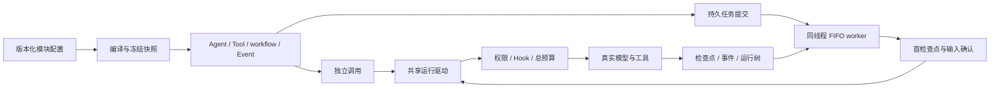

# 公共 Agent 内核文件说明

本包复用一套模型、工具和控制驱动，支持独立 Agent、无模型 Tool 程序、workflow 及独立事件程序。基础运行不要求 SQLite；持久任务调度当前由 SQLite Supervisor 适配器提供。该适配器尚未抽象成可替换的事务存储协议，不能把单独替换 Checkpointer 等同于完整替换持久调度后端。

- Owner：内核维护者 / architect / builder。
- Read When：注册模块、修改执行/持久队列/事件或选择存储后端时。
- Update Trigger：对应公共契约、文件职责、来源授权或验证入口变化。
- Validation：运行内核 sqlite,pack,workflow 测试、原宿主构建及仓库外 SDK 消费检查，详见闭环计划的实际日志。

目标与新增控制面/Loader/运行更新机制见[常驻内核与控制台规范](../../../docs/architecture/live-agent-console.md)。下表描述已存在文件；常驻管理 API 已接入；CompositionTransition 尚未实施，不能据此文件图宣称完整动态平台已完成。

## 执行边界

首检查点保存与输入确认分为两个可恢复步骤。确认事务检查持久证明、租约和线程所有权，再提交输入状态、任务状态及来源事件。已派发但没有回执的外部效果保持待对账状态。

## 源码职责

| 文件 | 职责 |
|---|---|
| `src/lib.rs` | 公共契约和可选 feature 导出 |
| `src/system.rs`、`src/system/` | 单文件系统声明、锁定、模块闭包、程序准备、导入校验和结构差异 |
| `src/control.rs`、`src/control/service.rs` | 草稿 CAS、不可变发布、幂等激活、回滚、历史与当前程序装载 |
| `src/control/file.rs` | control-file 可选配置仓库；Unix 文件锁、同步/原子替换及校验 |
| `src/agent.rs` | AgentSpec、Builder、运行输入/结果和公共调用门面 |
| `src/agent/invocation.rs` | 绑定根服务、取消监听、治理准备与调用终结 |
| `src/agent/execution.rs` | 验证并恢复检查点、固定工具视图、提交初始状态 |
| `src/agent/loop_host.rs` | 共享驱动中的阶段顺序与停止条件 |
| `src/agent/dispatch_host.rs` | 工具准入、执行、对账、回执与事件提交 |
| `src/agent/tool_host.rs` | 无模型 Tool 程序的调用绑定和初始化 |
| `src/program.rs` | Agent/Tool/workflow/Event 的 v2 ExecutionSnapshot 与纯恢复 |
| `src/event_program.rs` | 宿主安装的 EventProducer、配置事件程序、冻结快照与纯恢复 |
| `src/agent/event_host.rs` | 事件源事实先提交、订阅链推进、HookResult 保存；无伪模型或工具调用 |
| `src/registry.rs`、`src/compile.rs` | 工厂、模块依赖、冻结版本与宿主约束 |
| `src/registry/instances.rs` | 18 类 ModuleInstance 与类型化 ResourceHandle；仅导出资源身份 |
| `src/registry/build.rs` | 可选组合编译上下文、依赖传递闭包/强制floor与资源事实校验 |
| `src/registry/prompt.rs` | 原公共 PromptFactory/StaticPromptFactory；导出路径保持 |
| `src/supervisor.rs` | 运行记录、子运行观察、审批策略及监督器类型 |
| `src/supervisor/execution.rs` | 根租约、续期、身份绑定与统一执行入口 |
| `src/supervisor/storage.rs` | SQLite 运行记录、线程所有权、审批读写 |
| `src/supervisor/jobs.rs` | 持久提交、队列检查和公共查询入口 |
| `src/supervisor/jobs/submission.rs` | v1/v2 提交及记录契约、边界校验与兼容转换 |
| `src/supervisor/jobs/worker.rs` | FIFO 选择、冻结程序恢复及未初始化任务续接 |
| `src/supervisor/jobs/initial.rs` | 首输入证明、来源确认、输入事件和过期收件清理 |
| `src/supervisor/jobs/lifecycle.rs` | 任务开始与 Waiting/Closed/Cancelled 转换 |
| `src/supervisor/jobs/replay.rs` | 已关闭任务的不可变结果读取与控制命令重放校验 |
| `src/durable.rs` | 显式 SQLite 后端、CAS、租约和事务执行 |
| `src/mailbox.rs`、`src/mailbox/sqlite.rs` | 定址运行输入、取消游标与持久适配 |
| `src/governance/` | 原根预算、操作准入、模型失败票据与回执 |
| `src/hooks/`、`src/workflow/` | Hook 恢复、配置图和既有调度适配 |
| `src/hooks/emission.rs` | 原 HookBus 发射、订阅执行、控制结果与审计；与声明/注册分开 |

## 任务提交接口

| 用途 | 公共接口 |
|---|---|
| 旧 Agent 提交 | `JobSubmission::for_agent`、`RunSupervisor::submit` |
| 通用程序提交 | `ProgramSubmission::for_program`、`RunSupervisor::submit_program` |
| 同线程执行 | `RunSupervisor::run_next`、`execute_submitted` |
| 分类查询 | `SqliteStore::job`、`program_job` |
| 统一查询 | `SqliteStore::execution_job`、`execution_record` |
| 运行控制 | `control_program`、`reconcile_program_child` |

v1 公共默认类型、Saved 编码和摘要保持兼容。v2 仅 Agent 接受用户初始消息；Tool/workflow/Event 的实际调用及输入固定在快照中，提交中的 input 为 null。更换冻结配置或无模型调用参数须使用新的运行线程。

## 事件模块契约与选择

| 入口 | 适用边界 | 决策 |
|---|---|---|
| `Agent::notify_session` | 旧宿主明确通知 idle/end | 保留原语义；不获得独立源程序的恢复许可 |
| `EventProducer::new(owner, declarations)` | 宿主安装自定义事件来源 | owner/版本及 schema 受已注册模块约束，保留内核命名空间 |
| `EventProducer::session()` | 独立会话协调器 | 只授权 session_idle/session_end |
| `compile_event(EventProgramDefinition, registry)` | JSON 选择 producer、事件、operation、payload 与宿主模块 | 纯编译；不执行订阅，不创建假 AgentDefinition |
| `CompiledProgram::for_event` | 独立调用或 v2 持久队列 | 共享原租约、预算、模型恢复、定点取消与子树 |

`EventProgramDefinition` 包含 schema_version=1、host:ToolRuntimeDefinition、producer:ModuleRef、event、operation、payload。事件声明与实际 payload 固定在 EventCompilationSnapshot；执行前先提交原始源事实，HookBus 完成后再提交 HookResult。后一次检查点失败会重放原 HookJournal，未知 handler 效果须精确对账。事件宿主的普通 policies 也提升为后代不可移除的 floor。当前为单次、冻结来源；外部 webhook/定时器的接收适配由宿主负责，不隐式启动后台轮询。

## 验证文件

| 文件 | 验证边界 |
|---|---|
| `tests/program.rs` | 共享测试条件与真实 SQLite/效果日志 |
| `tests/program/roots.rs` | 根类型、审批、取消、旧格式和子模型恢复 |
| `tests/program/graphs.rs` | 人工等待、图运行树、事件及进程恢复 |
| `tests/program/queue.rs` | 队列测试共享辅助函数 |
| `tests/program/queue/admission.rs` | 纯提交、逐字节兼容、混合 FIFO 和非法重用 |
| `tests/program/queue/recovery.rs` | 首检查点/确认故障、明确模型重试及未知效果 |
| `tests/program/queue/expiry.rs` | 截止时间、完成缓存及未初始化取消 |
| `tests/program/queue/process.rs` | 独立进程退出和重启后的实际模型/工具调用次数 |
| `tests/event_program.rs` | 自定义 owner、冻结恢复、无SQLite消费、类型化控制结果及非法声明 |
| `tests/event_program/durable.rs` | 事件 FIFO、三处提交故障、未知效果对账与真实进程退出 |
| `tests/event_program/controls.rs` | 源工作流模型重试、定点取消、权限 floor、成功 peer 与新进程恢复 |

上述检查证明其覆盖的运行契约；通用失败节点新尝试、Rhai/Goal 编排、完整事务存储适配及原始编程预设最终矩阵仍按项目施工计划推进。

## 声明式配置与控制面（L1a）

`SystemFile::from_json` 是单文件入口，接受可编辑 SystemDocument 或含 document/lock/digest 的 SystemBundle。畸形/篡改锁定文件不会回退成未锁定源。`compile_system` 复用原 Agent/Tool/workflow/Event 编译器，把宿主隐式的可达定义收集进导出文件；workflow 局部定义提升到系统模块集合。目标宿主安装匹配工厂即可重建；当前尚不自动安装缺失工厂、解释器或资源。

`ControlPlane` 使用独立 CatalogStore 管理草稿、不可变发布及激活。`prepare`/`prepare_async` 只做准备；`install_file`/`publish` 发布，`plan` 给差异，`apply` 使用 command_id 和 expected_generation，`export`/`history` 查询，`load_active`/`active_program` 为同一进程的新调用装载当前版本。重复已完成命令返回原回执，不新增配置 revision 或 activation generation；回滚同样通过 apply 选择旧发布。已装载对象仍能执行原版本，执行中的组合更新继续 L3。

启用 control-file 可用 FileCatalogStore 的真实文件持久化，无须启用 SQLite。文件后端当前支持 Unix 的目录 fsync/rename 语义；其他平台须提供匹配 CatalogStore。配置文件仓库并未替换 SQLite 运行调度或迁移会话历史。提交后的目录同步失败返回 CommitUncertain，调用方须先重读回执，不盲目重试副作用。

系统源上限8MiB、64个程序和1024个解析后模块，锁定导出32MiB；首个单文件 catalog 后端上限64MiB、1024草稿、4096发布、8192命令和256激活系统，超限显式拒绝。配置校验与发布不执行模型/工具；纯编译放到阻塞工作池，控制服务不在事件循环内执行这部分计算。

验证入口：`tests/declarative.rs` 及 declarative/{catalog,file,programs}.rs，仓库外 `configured-system.json` 与 src/declarative_system.rs。包含真实文件效果、旧/新版本同时可用、工厂版本/锁篡改、source/locked同入口、无SQLite消费、进程退出与跨进程CAS。

## L1b 声明式模型资源

`ModuleKind::Resource` 是第18类模块，`ResourceHandle` 在进程内保存类型化句柄，`ResolvedModule.resource_identity` 只在资源模块出现。新增枚举变体影响 Rust 外部穷举匹配；旧非资源快照不新增 JSON 字段，既有 identity 不变。

原 `nofy-sampler/agent-runtime` 导出 `agent_model::declarative::{SamplerResourceFactory, ConnectedModelFactory, CredentialProvider, EnvironmentCredentials}`。宿主安装这两个稳定工厂一次，后续连接通过系统文档中的 `resource.sampler` 声明，模型通过 `model.connected` 的 connection 依赖引用资源。resource 配置包含 connection、models、credential_ref、header_refs、request_limits；connection 是原 SamplerConfig 的明确可映射字段，排除 api_key/model/env_http_headers。model 配置只含 model 名称。凭据只在调用时解析，逻辑凭据 authority 进入资源身份，实际密钥和本机变量前缀不进入导出。

新路径复用原 SamplerModel 的协议转换、流、参数/结构化修复与预算计算；旧 SamplerModel/factory 继续可用。`agent_model/mapping.rs` 仅拆出原协议转换辅助函数。暂未把原 Session/OAuth recovery 回调声明化，也未完成 process/http/memory 的通用资源配置，不把模型资源声明当作全能力资源闭环。

验证：L1b内核280项、原 Sampler234项、原 nofy-agent/executors 构建、默认依赖187项边界检查；原协议真实回环 HTTP/SSE 检查三协议、凭据轮换、连接身份、旧导出重建和纯编译无IO。

## L2a 持久管理接纳与原 Supervisor

`supervisor/jobs/managed.rs` 定义 ManagedRunRequest/ManagedRun 与恢复命令 DTO；managed/query.rs 提供轻量队首、状态和8MiB分页；managed/actions.rs 持久命令、原根租约执行和完成确认。新增 managed_runs/actions 表与旧 Job 同数据库，原表/版本和 v1/v2 wire 不变。管理请求与 ProgramSubmission 原子落盘，拒绝收编既有 unmanaged ID。明确 system/release/program 固定配置来源；重复 ID 拒绝不同请求。命令 ID 在全数据库不可重用到不同内容，控制子命令 ID 必须与外层一致。命令确认丢失时由原控制回执和检查点续接，未知副作用不自动重试。

原 worker 的冻结恢复移到 blocking pool，不在异步事件循环内同步编译。新下游 nofy-agent-host 管理网络和后台任务，实际工作继续用同一 RunSupervisor。原有调用方和队列入口保持。运行/命令总量上限10000/32768，分页和后台并发显式有界，当前没有历史清理/归档接口。

启动和 API 见[宿主文件说明](../nofy-agent-host/文件说明.md)。L2a 验证内核283项及真实 API/进程用例；它仍不包含代码制品安装、全部外部资源和执行中组合转换。

## L2c 可复用workflow资源

ModuleFactory.build_with_context默认调用原build。ModuleBuildContext.dependency_registry仅重建显式依赖传递闭包及当前宿主强制floor，保留工厂/能力/原定义；verify_dependencies核对已解析事实与资源identity，避免伪造空config代理丢失来源。旧工厂无需实现新方法，旧快照和顺序不变。

workflow/declarative.rs提供resource.workflow、tool.workflow_connected、hook.workflow_connected。资源配置document及bindings(kind map)，真正引用由ModuleDefinition.dependencies提供；原compile_workflow纯编译后返回标准ResourceHandle。工具/Hook以单图WorkflowLibrary复用原adapter，无须宿主预装整个图字典。16层编译深度和floor反向依赖拒绝防止递归失控。实际单文件及API验收见host/examples/workflow-system.json与宿主文件说明。

## 系统程序的运行参数（L2d1）

system/invocation.rs提供CompiledSystem::program_with_parameters和program_interface。None克隆原程序；Some(null)与省略分开。数据仅替换ToolCall.arguments、workflow入口或Event payload；不能覆盖工厂、连接、权限、事件归属或操作标识。生成的CompiledProgram仍使用原schema、composition、执行快照、检查点和恢复。ManagedRunRequest.parameters向后兼容省略字段，旧请求序列化摘要不变，具体输入与原ProgramSubmission同事务保存。

## 人工响应管理（L2d2）

supervisor/jobs/managed/human.rs仅从任务冻结快照选择workflow。ManagedCommand::Human包含target_run_id、workflow_path（根WorkflowProgram为空，模块路径最多16层）、expected_request和value。根租约下验证控制树、图身份、节点attempt及原请求，复用CompiledWorkflow::respond的schema/CAS/HumanReceipt，然后恢复原根。非法命令保存已结束的错误回执，后续命令可继续。human/tests.rs验证人工决策已保存、最终管理回执缺失两种边界重开数据库均不重复真实文件效果。

## 业务事件声明（L2d3）

event_program/declarative.rs导出EventProducerFactory和OwnedHookFactory。前者通过ModuleBuildContext.definition().reference确定owner，并拒绝内核保留身份/事件；后者复用HookRule、HookRegistration和生产者catalog。工厂构建不执行回调，不改全局catalog。与原EventProducer::new、HookFactory和原事件/Hook线协议兼容。

## 对账管理和候选投影（L2d4a）

supervisor/reconciliation.rs提取accept_child_reconciliation_leased，旧公开API继续自行持有根租约，管理worker复用其现有租约。新ManagedCommand::ReconcileChild强制epoch，原证据表/预算/控制器证明保留。supervisor/reconciliation/targets.rs提供ChildRecoveryPage/ChildRecoveryTarget和SqliteStore::child_recovery_targets；SQLite内投影身份和待处理call，跳过控制图标记，限制候选分页及响应体，覆盖旧kind/Unicode地址/组合变化。

## 系统自约束恢复（L2d4b）

managed::restore_scope仅用于已接纳管理任务，将冻结程序中的额外required策略/治理合入恢复registry，要求当前宿主强制约束全部仍在快照内。定义、工厂、资源、能力继续由原恢复器精确校验。worker、管理动作和Human编译使用同一上下文；普通SDK恢复及未管理任务保持严格等值检查，缓存结果不依赖重新编译。

## 可移植预算（L2e1）

governance/declarative.rs提供BudgetResourceFactory与ConnectedBudgetFactory，InstalledBudget::install_named显式建立逻辑身份。旧install仍保留含物理存储身份的原行为；新方式不改变实际BudgetStore和监督器同库验证。新工厂绑定ResourceHandle<InstalledBudget>，治理Profile及其limits/retry继续由原GovernanceProfile校验。BudgetResourceFactory的authority和上限由可信宿主安装，配置不能上传存储句柄、路径或扩大授予上限。

## 根工具对账（L2e2）

supervisor/reconciliation/root.rs定义RootToolReconciliation、RootRecoveryTarget、租约内根证据接纳与有界SQLite投影视图。ManagedCommand::ReconcileRootTool强制model_sequence；执行器在原根恢复时通过同一TreeObserver载入证据，仍由原dispatch执行原语/控制器判定与预算结算。证据表使用root作为目标ID，保持旧子运行键和存储协议。

根身份绑定冻结快照、当前thread owner、execution_run_id和完整待处理调用；同一证据可重放，不同结果不可覆盖。根workflow/Event要求定位内部原语。测试覆盖Agent/Tool、错误结果、预算、真实HTTP进程硬退出、接纳后重开、管理回执丢失、旧根已失去线程归属以及原workflow子对账。

## 治理模型对账（L2e3）

governance/recovery/evidence.rs定义ModelReconciliationTicket、Target、Result与回执journal；单独命名空间保留旧失败重试日志。governance/model/evidence.rs负责原sample_model边界的票据、证据和保守用量；真实预算回执优先，完成/失败沿原结果路径，未治理调用保持旧行为。

supervisor/reconciliation/model.rs在原根租约内验证冻结组合和目标归属，按主键读取后代Agent，接纳原生票据后恢复原根。ManagedCommand::ReconcileModel与model_reconciliation_targets为管理入口。新测试分别覆盖默认内核、并行scope、旧claimed意图、代次与用量、成功/失败及管理回执丢失，宿主另有真实HTTP进程退出验收。

模型证据journal同时记录接纳的command_id。管理最终回执丢失且线程已推进时，只有原已接纳命令可通过原cached_outcome校验读回旧任务结果；不会重新调用Agent或修改当前检查点。新命令仍需当前归属，旧日志缺省无该授权。

## 无预算模型日志（L2e4）

model_journal.rs提供ModelJournalBinding/ModelJournalFactory，使用原Binding装载路径，显式选择binding.model_journal且要求检查点。governance/model/unmetered.rs复用原采样流及恢复票据；governance/recovery/unmetered.rs将原生意图与结果写入同一检查点后端，先持久化派发意图，真实结果不可覆盖。每Agent 16MiB/8192操作有界，既有证据日志容量不变。

Agent绑定处理保留已选择标记，模型步骤保存待处理身份，显式重试允许该模式。无预算路径不调用预算bound、不创建预算记录、不注入治理元数据；原生响应用量照常累计。tests/model_journal.rs覆盖原结果提交丢失、失败重试、缺失检查点及绑定不可擦除，内部用例覆盖并行scope/证据；监督器用例同时覆盖两种模式及跨下一轮回执恢复。

## 管理放弃与线程封存（L2e5，内核验证完成）

supervisor/jobs/managed/abandonment.rs提供Abandonment、线程封存校验、无模块恢复的行政执行与SQLite原子回执。managed/actions.rs在不改变旧命令字段的前提下接纳Abandon；同根行政命令优先，普通命令保持FIFO，原已完成回执不改写。原预算、检查点与效果日志不修改，运行outcome保留最后观测，放弃事实单独返回。新增表沿用原schema1迁移方式，不改变旧数据格式。

jobs/initial.rs复用原Input事件拒绝被放弃根的待处理邮件；后续未启动任务沿原source证明取消。jobs/worker、storage.begin_run、mailbox.recipient及三类对账接纳边界拒绝继续封存线程。tests.rs与support.rs分别保存控制契约/事务回归和实际文件效果模型/时钟辅助；覆盖有/无预算、不可抢租约、缺失工厂、原生数据不变、事务回滚、已关闭结果及旧线协议。追加closed_receipts.rs覆盖后续运行封存后原已接纳模型命令的旧成功回执；相关内核80项、SQLite-only 36项、默认18项通过。权限更新后完整宿主35项（HTTP30、凭据5）通过，原端口/审批限制已解除。
