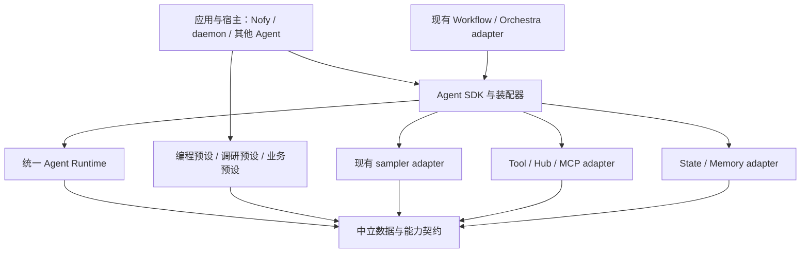

> 历史研究：所引用的旧产品源码已移出交付；历史路径用于溯源，当前源码入口见根文件说明。

# Nofy 可组合 Agent 框架调研

- 日期：2026-10-27。
- 状态：历史基线调研；下文保留当时提案。当前工程入口见[框架总览](../../README.md)与[源码归属](framework-source-tree.md)，旧SDK演进记录见[历史参考](composable-agent-runtime.md)。不要将提案包名或旧宿主接线当成现有实现。
- 基线：`65ed83b8d4a87c9a74ef4ac794a081d22ceed4e1`。
- 分支：`research/modular-agent-framework`。
- 范围：Rust 内核及宿主连接边界；不研究或修改 TUI、桌面和 Web 展示。
- Read When：抽取 Agent 内核、设计 SDK、增加非编程 Agent 或调整运行契约之前。
- Owner：Agent 框架架构维护者。
- Update Trigger：下述源码边界、组件契约、外部参考版本或实施里程碑改变。
- Validation：核对源码锚点、依赖图和定向测试；外部参考使用固定提交链接。

## 1. 目标与结论

用户要的是像积木一样组合能力，快速构建不同用途的 Agent。验收对象是另一个应用能否用公共 SDK 装配 Agent，不是 crate 数量或文件大小。

建议：保留 Rust，提炼组件契约与统一运行内核；上层提供 Builder、预设和组合操作。Nofy 编程 Agent 成为一组默认能力与策略的预设。第一版不依赖 Python 服务，不接入 LangChain 运行时，也不先实现完整 LangGraph 克隆。

可行性：工具协议、模型客户端、对话状态、压缩、工作流已提供可复用基础；但当前 `Agent` 仍绑定会话，类型层有反向依赖，执行逻辑分叉，尚不是通用 Agent SDK。结论基于静态源码与已有组件测试，不等于通用内核已经验证可用。

### 成功标准

1. 一个库使用者仅提供模型、提示词和自定义工具，就能启动 Agent；不要求 cwd、Git、终端、NOFY_HOME、ACP 或 daemon。
2. 同一进程可并发运行工具集、上下文、凭据不同的 Agent，不依赖启动前的全局注册顺序。
3. 增加新用途主要修改应用组合代码；不新增主循环分支、不修改内核枚举来识别每个业务工具。
4. 一个 Agent 能作为另一个 Agent 的工具或工作流步骤；取消、预算和错误可向父级传递。
5. Nofy 原有会话行为可通过宿主适配和编程预设保留；调用者可完全不选择这些预设。
6. 依赖闭包可检查：最小示例不得间接引入 shell、workspace、具体工具实现、ACP、pager、daemon、sandbox。

## 2. 已核实的现状与阻碍

以下链接相对本文件定位，数字表示基线的源码行号；迁移时以符号为准。

| 证据 | 源码 | 含义及处理建议 |
|---|---|---|
| Agent 实例明确绑定 session 和 ToolBridge | agent.rs（历史路径 `crates/codegen/nofy-agent/src/agent.rs#L13`，源码已移出） | 分开可复用规格、已编译配方和每次运行的状态/能力绑定 |
| Builder 构造要求 cwd、TerminalBackend、通知句柄，并默认 LocalFs | builder.rs（历史路径 `crates/codegen/nofy-agent/src/builder.rs#L192`，源码已移出） | 不能作为无文件系统业务 Agent 的最小入口；保留旧 Builder 为兼容 facade |
| AgentDefinition 持有具体 ToolServerConfig，文件中还有内置工具预设 | config.rs（历史路径 `crates/codegen/nofy-agent/src/config.rs#L742`，源码已移出） | 纯定义与预设装配拆开，核心定义使用组件引用和中立数据 |
| 主工具循环和会话调度分属两个函数，但仍共享大型 actor | turn.rs（历史路径 `crates/codegen/nofy-shell/src/session/acp_session_impl/turn.rs#L1838`，源码已移出）、run_loop.rs（历史路径 `crates/codegen/nofy-shell/src/session/acp_session_impl/run_loop.rs#L253`，源码已移出） | 抽取 Run 引擎；排队、会话归属、挂接客户端保留宿主 |
| daemon provider 还有另一套完整模型—工具循环 | provider_host.rs（历史路径 `crates/codegen/nofy-shell/src/agent/provider_host.rs#L193`，源码已移出） | 它是优先迁移的独立消费者；不能继续维护第三套新循环 |
| sampling-types 直接依赖 nofy-tools | Cargo.toml（历史路径 `crates/codegen/nofy-sampling-types/Cargo.toml`，源码已移出）、types.rs（历史路径 `crates/codegen/nofy-sampling-types/src/types.rs#L392`，源码已移出） | 原因包括重导出 ToolDefinition/FunctionTool；必须先下移中立 schema 类型，否则模型层仍拉入具体工具 |
| ConversationItem 暴露 Responses API 的 Reasoning 和后端工具类型 | conversation.rs（历史路径 `crates/codegen/nofy-sampling-types/src/conversation.rs#L77`，源码已移出） | 不可称为完全 provider-neutral；短期适配，后续中立事件加不透明 provider payload，保留原始顺序与 round-trip |
| 提示词使用工具注册表内的 TemplateRenderer | context.rs（历史路径 `crates/codegen/nofy-agent/src/prompt/context.rs#L269`，源码已移出） | 已有 render_with_renderer 切口；改用只读目录快照，不依赖执行器 |
| 统一 Tool / ToolDispatch 已存在 | [tool.rs](../../crates/common/nofy-tool-runtime/src/tool.rs#L37)、[dispatch.rs](../../crates/common/nofy-tool-runtime/src/dispatch.rs#L32) | 复用类型化 authoring 和类型擦除 dispatch，不再发明第二套 Tool trait |
| 注册器直接导入全部具体工具，并有进程全局 TOOL_PACKS | registry/types.rs（历史路径 `crates/codegen/nofy-tools/src/registry/types.rs#L1`，源码已移出） | 抽无默认业务工具的 instance-scoped catalog；旧全局注册仅留兼容层 |
| 通用 ToolCallContext 已支持 TypedExtensions、取消扩展 | [context.rs](../../crates/common/nofy-tool-runtime/src/context.rs#L1) | 可承载调用能力；TypeId/Arc 不能被当作可持久化状态，必须分层 |
| 设置合并与运行时解析分散 | loader.rs（历史路径 `crates/codegen/nofy-config/src/loader.rs#L667`，源码已移出）、agent/config.rs（历史路径 `crates/codegen/nofy-shell/src/agent/config.rs#L1952`，源码已移出）、reloader.rs（历史路径 `crates/codegen/nofy-shell/src/config/reloader.rs#L17`，源码已移出） | 通用配置解析与 Nofy 的磁盘来源、campaign、认证环境分离 |
| 生命周期贡献者已有 Local / Send 两种接口 | lifecycle/lib.rs（历史路径 `crates/codegen/nofy-agent-lifecycle/src/lib.rs`，源码已移出）、local/registry.rs（历史路径 `crates/codegen/nofy-agent-lifecycle/src/local/registry.rs`，源码已移出） | 可复用事件和贡献语义，不等于已有完整 middleware；本次检索 shell 未发现 turn_input_contributors 的消费点 |
| pack manifest 与两个组合投影已经存在 | packcore/lib.rs（历史路径 `crates/codegen/nofy-packcore/src/lib.rs`，源码已移出）、orchestra/compile.rs（历史路径 `crates/codegen/nofy-orchestra/src/compile.rs`，源码已移出） | 保留 host-plane / pack-plane 分界，通过适配编译到统一 AgentSpec |
| 实际 provider join 仅应用 audience/persona/skills | pack_join.rs（历史路径 `crates/codegen/nofy-shell/src/agent/pack_join.rs#L43`，源码已移出） | 不能把模型路由、工具策略、connector 等声明视为已经完整接到此执行路径 |
| Rhai workflow 已有预算、暂停、并行、journal/replay | workflow/engine.rs（历史路径 `crates/codegen/nofy-workflow/src/engine.rs`，源码已移出）、workflow/host.rs（历史路径 `crates/codegen/nofy-workflow/src/host.rs`，源码已移出）、workflow/journal.rs（历史路径 `crates/codegen/nofy-workflow/src/journal.rs`，源码已移出） | 复用 workflow host 适配，不先新增图 DSL 或另一套脚本引擎 |
| 存储存在多种不同语义 | chat persistence（历史路径 `crates/codegen/nofy-chat-state/src/persistence.rs`，源码已移出）、runtime journal（历史路径 `crates/codegen/nofy-shell/src/session/runtime_journal.rs#L149`，源码已移出）、rewind checkpoint（历史路径 `crates/codegen/nofy-workspace/src/session/checkpoint.rs#L91`，源码已移出） | 对话历史、运行投影、工作流结果日志、文件回退不是同一种 checkpoint，不能只改名字统一 |

实际依赖链：`nofy-sampler -> nofy-sampling-types -> nofy-tools -> 具体工具与执行环境`。这是第一优先级的编译边界问题。

### 图分析的使用边界

索引只覆盖 `crates/`、`prod/`，磁盘元数据对应上述基线，109,012 节点、260,496 条边。Rust 方法调用存在漏边，源码明确存在的主循环调用方未全部进入图，因此风险与消费者列表是辅助证据。

| 候选迁移点 | GitNexus upstream 结果 | 解读 |
|---|---|---|
| AgentBuilder::build | CRITICAL；12 个直接依赖，33 个受影响符号，6 个功能区 | 迁移前必须保留旧入口、验证会话创建和子代理 |
| load_effective_config | CRITICAL；47 个直接依赖，18 个功能区；partial=true | 数字不是完整闭包，先增解析服务与兼容 facade |
| run_provider_task | LOW；1 个直接依赖 | 入口较窄，适合作为第一条宿主迁移路径；不代表循环语义简单 |
| render_with_renderer | LOW；1 个直接依赖 | 源码还有其他渲染入口，不能按单个符号统计直接删除旧路径 |

本轮没有修改任何函数或类型；真正实施前须重新运行符号级 impact，不复用本文当时的数字作授权。

## 3. 外部参考：采用什么，不复制什么

调研同时读取官方文档和固定提交源码。它们是参考快照，不是决定引入的依赖版本。

| 参考 | 已观察的边界 | 对 Nofy 的设计启发 |
|---|---|---|
| LangChain | create_agent 接收模型、工具、prompt、middleware；middleware 包含阶段 hook 和模型/工具调用 wrapper | 公共装配入口与横切扩展点；不要只提供生命周期通知 |
| LangGraph | State、Runtime context、checkpointer、跨 thread store 各司其职；interrupt 需要可恢复状态 | 区分运行状态、不可序列化能力与长期数据；恢复单位和副作用语义先定义 |
| Rig | Rust core 与 agent facade 分层；Builder 组合模型、工具、context、hooks；工具契约和 registry 分层 | 采用 Rust SDK 的使用体验与类型擦除边界；不因参考它就重写已有 Tool/Hub SDK |

LangChain 支持将带 middleware 的 Agent 嵌入更大工作流；它的组装方式能回答“快速拼 Agent”，LangGraph 的恢复机制则回答“组合后能否可靠运行”。见[Agent 官方文档](https://docs.langchain.com/oss/python/langchain/agents)、[middleware](https://docs.langchain.com/oss/python/langchain/middleware/overview)。

阶段 hook 与调用 wrapper 必须区分：观察/上下文贡献不自动获得重复执行工具的权力。Nofy 建议比通用 wrapper 更严格，模型调用重试可组合，带副作用工具重试必须经过固定执行政策。参考 [custom middleware](https://docs.langchain.com/oss/python/langchain/middleware/custom)。

运行 context 是依赖注入载体，checkpointer 保存 thread 状态，store 保存跨运行数据。恢复时 interrupt 所在节点可能重新从头执行，因此恢复不等于序列化一个正在 await 的 future。参考 [runtime](https://docs.langchain.com/oss/python/langchain/runtime)、[persistence](https://docs.langchain.com/oss/python/langgraph/persistence)、[interrupts](https://docs.langchain.com/oss/python/langgraph/interrupts)。

Rig 的 Builder 与工具/模型装配证明 Rust 可以提供简洁组合入口；其当前 main 也在演进，不应照搬未经固定版本核实的旧 API 示例。参考 [Rig 官方 API](https://docs.rs/rig/latest/rig/agent/struct.AgentBuilder.html)。

固定源码快照：

- LangChain `0c09d024e0cec14f24b430c5fa9232227f3206a4`：[create_agent](https://github.com/langchain-ai/langchain/blob/0c09d024e0cec14f24b430c5fa9232227f3206a4/libs/langchain_v1/langchain/agents/factory.py#L892)、[ModelRequest / AgentMiddleware](https://github.com/langchain-ai/langchain/blob/0c09d024e0cec14f24b430c5fa9232227f3206a4/libs/langchain_v1/langchain/agents/middleware/types.py#L88)。
- LangGraph `58be6911defa9f26285a78512a6adfa4f28616af`：[Pregel](https://github.com/langchain-ai/langgraph/blob/58be6911defa9f26285a78512a6adfa4f28616af/libs/langgraph/langgraph/pregel/main.py#L460)、[Command / interrupt / Durability](https://github.com/langchain-ai/langgraph/blob/58be6911defa9f26285a78512a6adfa4f28616af/libs/langgraph/langgraph/types.py#L833)。
- Rig `48df14856e272427a9327a7be77beb68c5fbfb80`：[AgentBuilder](https://github.com/0xPlaygrounds/rig/blob/48df14856e272427a9327a7be77beb68c5fbfb80/crates/rig-agent/src/agent/builder.rs#L115)、[tool contracts](https://github.com/0xPlaygrounds/rig/blob/48df14856e272427a9327a7be77beb68c5fbfb80/crates/rig-core/src/tool/mod.rs)、[completion request](https://github.com/0xPlaygrounds/rig/blob/48df14856e272427a9327a7be77beb68c5fbfb80/crates/rig-core/src/completion/request.rs)。

### 备选方案

- 直接切到 LangChain/Python：生态丰富，但需改变运行边界、工具适配、分发与恢复契约；不能满足“从现有 Rust 系统提炼”的低迁移成本目标。暂不选。
- 全量替换成 Rig：Rust 装配体验可借鉴，但没有证据证明 Nofy 的会话恢复、工具管线和产品语义可直接映射。暂不引入该依赖。
- 只把 shell 文件移动到 runtime crate：保留所有隐式依赖和编程默认值，不能通过非编程 Agent 的验收。不选。
- 提炼小内核、适配现有模块、Nofy 作为预设：可逐段迁移并用第二个消费者检验，推荐。

## 4. 建议的 12 类组件

这里的 12 类是可组合契约族，不要求变成 12 个 crate。

| 组件 | 输入 / 输出 | 扩展方式 | 核心与预设分界 |
|---|---|---|---|
| Model | ModelRequest -> ModelEvent / ModelOutcome | Provider adapter | 核心不识别产品 URL、登录方法或私有 headers |
| Tool | typed args + ToolCallContext -> progress / terminal | 复用 Tool / ToolDispatch | 业务工具按包装载，不能自动注册全套编程工具 |
| Prompt | PromptInputs + ToolCatalogSnapshot -> PromptBundle | 模板、片段、渲染器 | AGENTS.md 发现和编程人格属于预设 |
| Context | RunView -> 有来源/位置/预算的片段 | 检索器、文档、动态上下文贡献者 | 不要求所有应用有仓库或文件系统 |
| Memory | namespace + query/write -> records | store + 检索/写入策略 | 与 thread 状态、checkpoint 分开；自动学习是可选策略 |
| Runtime | RunInput + bindings -> events + RunOutcome | 一个状态推进引擎 | 核心拥有调度，组件不能隐式启动下一轮 |
| Policy | RunFacts -> bounded decision | budget、stop、approval、retry | 不可绕过的宿主准入约束，与可选业务政策分层 |
| Middleware | model/tool request 或阶段 view -> patch/observation | 显式顺序的 hook/wrapper | patch 校验后才能生效，不接受裸 SessionActor |
| Workflow | typed/JSON 边界输入 -> steps + outcome | 顺序、路由、并行、已有 Rhai adapter | 不再内嵌第二套 Agent loop |
| Agent-as-Tool | child invocation -> ToolOutput | 子 Agent adapter | 继承预算并收窄能力，child 状态独立 |
| State / Checkpoint | versioned RunState <-> durable checkpoint | serializer + checkpointer | 不序列化锁、连接、Arc 或 future |
| AgentSpec / Builder | 组件引用 + 注册表 -> CompiledAgent | 代码优先，manifest adapter | 配方与宿主能力绑定分开，Nofy 是命名预设 |

## 5. 物理分层与依赖规则

建议新增的包名均为 planned；第一阶段可以先在现有包中建立边界，待 workspace 注册方式核实再建立新包。



- `nofy-agent-core`（planned）：规格、中立消息/事件、RunOutcome、能力契约；无产品实现、网络客户端和宿主协议依赖。
- `nofy-agent-runtime`（planned）：状态推进、固定准入、middleware pipeline、取消与 checkpoint 边界；依赖 core 与现有低层工具契约，不依赖 nofy-tools / shell / workspace。
- `nofy-agent-sdk`（planned）：Builder、实例级组件注册表、便利 invoke/stream、组合适配；最小默认 features 为空的业务工具集。
- 编程预设边界：先在现有 `nofy-agent` 提供兼容门面，再视依赖情况拆为 `nofy-preset-coding`（planned）。默认工具、Todo/Goal/Plan 策略、AGENTS.md、skills/plugins 发现属于此层。
- 现有 sampler、chat-state、memory、workflow、hub SDK 通过适配接入；不能把所有 adapter 放进默认依赖闭包。

根 `Cargo.toml` 被 README 标记为生成产物；本次查阅 scripts、crates/build、README 未发现 workspace members 的再生成入口。因此实施前有一个明确门槛：核实注册新包的方法，或先只做已有包内模块和叶类型调整。本文不假设可直接手改生成根文件。

## 6. 装配与运行契约

### 6.1 三层生命周期

1. `AgentSpec`：可序列化、带版本的逻辑配方；存组件 ID 和配置，不存秘密或服务句柄。
2. `CompiledAgent`：已校验的规格和解析后的组件工厂；可共享，不能共享每次运行的可变状态。
3. `AgentRun`：绑定本次 context、取消、凭据解析器、事件出口和状态，拥有 run_id、预算、调用账本。

`compile` 验证缺组件、重名工具、schema、不支持的模型能力与 middleware 顺序，不运行模型/工具，也不隐式扫描磁盘。`invoke` 是创建 Run 并消费相同 stream 的便利 API，不是第二个执行器。

运行上下文分为四类：

| 对象 | 可持久化 | 用途 |
|---|---|---|
| SettingsSnapshot | 是，秘密只存引用 | 本轮生效的解析后配置和来源、版本 |
| RunState + 业务扩展状态 | 是，显式 schema/version | 对话、阶段、预算、pending calls、中断、应用状态 |
| RunContext / capability bindings | 否 | DB、模型客户端、凭据 resolver、检索器等活对象 |
| MemoryStore | 独立持久化 | 跨 Run/会话的长期数据与租户命名空间 |

第一版业务扩展状态采用命名空间 + JSON schema + reducer；SDK 可提供 typed codec，内核固定基础字段。不要用一个任意 Any 容器同时承担持久化、业务状态和权限边界。共享 thread 的并发写入采用 revision 检查/单 writer，不允许最后写覆盖另一轮。

### 6.2 目标调用方式（伪代码，尚不存在）

```rust,ignore
let research = AgentBuilder::new("researcher")
    .model("primary")
    .prompt("research")
    .tool_pack("web")
    .context_source("documents")
    .policy("bounded_run")
    .compile(&components)?;

let run = research.start(input, RunBindings::new(app_context));
let result = run.collect().await?;

let reviewer = AgentBuilder::new("reviewer")
    .model("review_model")
    .prompt("review")
    .tool(research.as_tool("research"))
    .compile(&components)?;
```

Registry 是应用显式创建的实例，支持直接代码注册已有 `Tool`；配置中的组件 ID 只能解析到已注册实现。初版不做任意路径动态库加载、自动插件下载或配置中嵌入代码。第三方实现可以是独立 Rust crate，也可以通过 MCP/远端工具 adapter 提供。

### 6.3 一轮执行顺序

`prepare input -> context contributions -> context budget/compaction -> freeze request catalog -> prompt/request projection -> model middleware -> model -> response commit -> stop decision / tool batch -> result commit -> next iteration`。

- State writer 统一提交消息、工具结果和状态 patch；保留工具调用配对与 provider opaque item 顺序。
- schema、prompt 里的工具名称、实际 dispatcher 使用同一 catalog revision。工具替换在安全点生效；已准入调用保留旧版本执行句柄。
- Settings 更新通过差量事件，在轮次边界采纳；凭据解析单独支持调用时刷新。不能把整个配置永久冻结，也不能让任意组件每次自行读盘。
- 用户输入、运行控制、检索结果保留来源/authority；不能通过一个 context 插件把低权限资料提升成系统规则。
- 通用结构化输出和 max-steps 属于可用策略；TodoGate、PlanMode、编程验证提醒是预设贡献。

### 6.4 Middleware 与政策

提供 before/after run、before/after model、before/after tool batch，以及 model/tool 调用包装切口。初版不开放任意跳到内部状态机节点的能力。

固定执行链：`解析/schema -> 可选转换 -> 最终准入/审批 -> 调度 -> 每次尝试再次校验准入 -> 工具执行 -> 结果规范化/提交 -> 观察与后置贡献`。改写后的参数必须重新校验，middleware 不持有可绕过准入的裸 dispatcher。

注册顺序定义外层到内层，退出按相反顺序；观察 hook 默认不控制流。重试共享总 attempt/budget，避免 sampler retry × auth retry × middleware retry 相乘。observer 异常的处理与 admission/checkpoint 失败不同，必须分类型记录，不统一吞错。

### 6.5 中断、恢复和副作用

RunOutcome 至少区分 Completed、Paused、Cancelled、BudgetExceeded、Failed；approval 返回可序列化的 interrupt token 和 payload，恢复由新的 Run 绑定能力处理，不挂住旧进程里的 oneshot 作为唯一状态。

恢复单位是明确的模型/工具步骤，而不是任意指令。checkpoint 至少包含 spec/config 版本、thread/run/step ID、状态 revision、预算、pending tool intents、已提交结果、中断信息与恢复点。异步流进度事件不作为恢复真相。

工具需声明 replay policy（只读/幂等/需对账/禁止自动重放）。副作用发生后、结果落盘前崩溃，标记 uncertain 并要求 reconciliation；普通 JSONL 或 checkpoint 无法提供外部副作用 exactly-once。只读调用可按策略重试，业务 API 的幂等键由 adapter 明确传递。

低延迟展示事件可丢/合并；准入、预算、状态提交、结果账本必须等待持久化确认。老 runtime journal 提供的恢复线索与预算连续性可复用，但不能直接宣称它是完整 RunCheckpoint。

### 6.6 Agent 与 Workflow 的组合

Agent 节点执行统一 Run；顺序/分支/并行属于上层组合。先适配已有 `WorkflowHostRequest::SpawnAgent`、Rhai journal 和 orchestra DAG，不新增竞争的工作流事实源。Workflow owns 节点调度与其结果日志；Agent owns 节点内部模型/工具恢复状态。

Agent-as-Tool 的子调用使用稳定 child invocation ID、独立 thread 或显式传入父上下文的受控投影，预算 reservation 属父级账本；父取消向子传播，子工具能力只能收窄。父恢复时不能因为丢失 child handle 就再次提交同一非幂等任务。

## 7. 三种 Agent 的验收配方

| 配方 | 组件 | 必须证明 |
|---|---|---|
| 业务查询助手（第一验收） | fake/scripted model + 自定义 lookup 工具 + 租户 RunContext | 无 cwd、终端、Git、Nofy home；两个租户并发不串数据；新增工具不改内核 |
| 资料调研助手（第二验收） | 同一 Runtime + web 工具包 + 文档检索 + 引用 prompt | 仅换组合；检索可独立替换；不自动带入写文件、shell 或 Todo 策略 |
| Nofy 编程预设（兼容验收） | 现有工具 adapter + 编程 prompt/context + 现有权限/压缩等政策 | 同一 Runtime；保留工具顺序、取消、恢复、fork/prefix 和结构化输出行为 |

再将调研 Agent 作为业务助手工具，并用现有 Rhai workflow 串接两个 Agent。mock 轨迹提供确定性验收；真实模型 smoke 是补充，不能代替组合与隔离检查。

## 8. 验证与尚未验证的部分

已执行：

```sh
cargo test --locked --offline -p nofy-packcore -p nofy-agent-lifecycle -p nofy-workflow --lib
```

结果：packcore 7、agent-lifecycle 5、workflow 63，共 75 个测试通过。覆盖已有 pack 隔离约束、生命周期注册、工作流预算/暂停/重放等，不证明新框架、旧 shell 全路径或外部工具已通过。

静态核对：每个上述 crate 的 Cargo dependencies；sampling-types 的工具类型重导出；两个模型—工具循环；pack join 与 composition 投影；shell 中 lifecycle 的实际消费点。

实施前需要通过小样验证而非继续猜测的事项：

1. workspace 新包注册入口：生成根文件的维护方式未找到；不阻碍现有包内叶类型下移，但阻碍最终包布局落地。
2. 新模型中立表示能否无损保留 Responses opaque item、reasoning 与 hosted-tool 语义；必须做 round-trip fixture。
3. 对话 checkpoint 与运行账本的提交边界、迁移/恢复旧会话的方法；目前不能假设多份日志已原子一致。
4. `?Send` 的旧宿主与新引擎桥接：先保留本地执行器，再测试公共 SDK 的多 Run；不在第一刀顺便重写全部线程模型。
5. MCP 动态工具刷新与 catalog revision、in-flight dispatch 的一致性。

## 9. 演进记录与下一步

- 2026-10-27：目标从“Nofy 内部分包”明确为“可组合 Agent SDK”；UI 不在本轮范围。
- 2026-10-27：选择小内核 + SDK + 可选预设方向；LangChain/LangGraph/Rig 仅作设计参考，未新增依赖。
- 2026-10-27：确认双循环、类型层反向依赖、已有 pack/workflow/Hub 能力；先以无文件系统业务 Agent 作提炼验收。
- 下一步按[实施蓝图](../superpowers/plans/2026-10-27-composable-agent-framework.md)进入 P0/P1，不开始大搬迁 shell。
