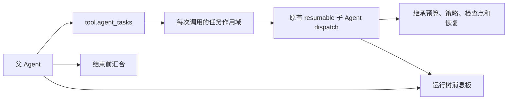

# 子任务与运行树通信

| 决策 | 实施 | 约束 |
|---|---|---|
| 并发所有权 | 父调用持有任务 owner，完成前汇合 | 不让子任务越过父事务租约继续写入 |
| 调度 | resource.agent_tasks + binding.agent_tasks + tool.agent_tasks | 使用已装配的 resumable 工具，不生成第二套模型循环 |
| 恢复 | 独立 CAS 检查点保存任务输入、调用身份与回执 | 显式恢复父运行时沿原 child 恢复路径，未知效果仍需 reconciliation |
| 控制 | 每个后台任务独立 ChildControl | 后台暂停不写入父 Agent 已结束的工具调用控制通道 |
| 通信 | tool.agent_messages，按可信 RunLineage 分区 | sender 来自当前 RunContext，消息 ID 幂等，游标递增 |

任务接口为 `{action:spawn,task_id,tool,arguments}`、`{action:poll|wait|cancel,task_id}`、`{action:list}`。task_id 在父运行内唯一，重复相同输入返回已有任务，改变输入拒绝。wait 可设 timeout_ms；超时只停止等待。父完成时等待全部子任务；父暂停、取消或失败时终止当前 owner，已持久意图保留给恢复流程。

消息接口为 `{action:send,message_id,to,body}`、`{action:read|wait,after,timeout_ms}`。to 为接收者 run_id 或 `*`；读者只看广播、发给自己或自己发出的消息。数量和正文限制属于运行时资源预算，不是源码包体限制。
