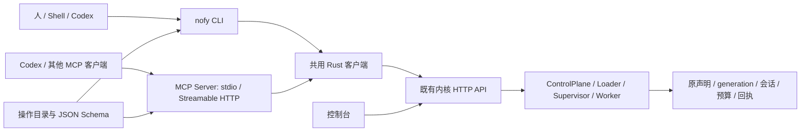
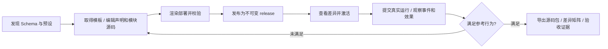

# Agent 开发 CLI 与 MCP 方案

## 本轮实施锁定

用户已要求优先完成 CLI/MCP，停止前端施工。实现采用共用的 `nofy-agent-project`、`nofy-agent-client`、`nofy-agent-mcp` 和 `nofy-cli`，不新增 Agent 主循环。Session 后端接同一操作目录；CLI/MCP 与原生接口按实际验收分别标注。

MCP 采用官方 Rust SDK rmcp 3.6.0，协商上限为 2025-11-25，支持该 SDK 覆盖的更早握手版本。stdio 固定继承身份，HTTP 采用无状态 Streamable HTTP，每次验证并转交请求方令牌，不使用固定管理员后备；SDK 负责握手、分帧与请求取消。依据[官方 SDK](https://docs.rs/rmcp/3.6.0/rmcp/handler/server/trait.ServerHandler.html)。

源码工程使用同一个 Rust 纯数据引擎：托管副本在内核 projects 目录按文件锁/CAS/原子替换保存，本地副本由 CLI 明确读写，不隐式同步。引擎支持既有 preset 的 file/json/parameter/module/when 表达式，以及 literal、lookup、merge、values、select、concat、if、coalesce 等受限纯数据变换；prepare.json 只声明参数推导，不能执行脚本、安装依赖或访问声明文件集合以外的路径。

模块参数按字面值写入，源码通过独立 source_bindings 显式绑定；JSON 数据中的同名模板关键字不被重新解释。缺少模型、Prompt 或参数时保留 incomplete，构建才解析完整声明。跨发布引用采用受控 nofy URI 并导入确切依赖闭包，冲突明确报告；不扫描业务 JSON 重写引用。

普通原生 DTO 的结果通过 native_json 保留精确字节；公共 refs 中显式投影控制标识。Source/Session 使用专用结果类型。打包只收集声明的源码和普通依赖清单，不执行旧 build.py，不加入依赖字节或包体配额；输出默认不覆盖。MCP 大归档使用内核登记句柄、HTTP 下载和带明确 offset/eof 的资源分块，避免把截断内容冒充完整归档。

状态：2026-11-04，契约 `0.3` 实现。本文记录锁定架构与接口边界，实际集中检查以 [CLI/MCP 记录](../verification/agent-development-cli-mcp.md)为准。前端暂停，CLI/MCP 优先；pi 参考提交保持独立能力复现验收。

完整操作说明与机器索引见[Agent 开发手册](../manual/README.md)。手册进一步定义 agent create、模块增删/接线、直接参数添加工具，以及源码工程草稿。当前原生 AgentDefinition 必填 model/prompt，原 Draft 保存 SystemDocument，不能直接用缺失必填字段的对象冒充空 Agent；托管源码工程与只读源码 preview 是需要新增的公共能力，仍未实施。

推荐一个 Rust CLI `nofy`，附带 MCP Server，共用操作契约及 HTTP 客户端，调用现有常驻内核。控制台、文件和外部 Agent 使用同一声明与持久状态。内核继续拥有执行、权限、预算、版本和恢复；适配器负责发现、请求、观察与结果转换。



## 当前依据与职责

现有 [API](../../crates/common/nofy-agent-host/src/api.rs) 已提供 modules/dependencies、validate、import、draft、publish、export、plan、apply 和版本历史；[运行 API](../../crates/common/nofy-agent-host/src/api/runs.rs) 已提供提交、分页事件/SSE、审批、输入、取消、恢复及持久 action。现有 [main.rs](../../crates/common/nofy-agent-host/src/main.rs) 是宿主启动入口，还没有面向外部开发者的完整 CLI。

[已交付的 MCP HTTP 工具源](mcp-http-tools.md) 负责框架 Agent 调用外部 MCP 服务。本方案增加 MCP Server，供外部 Agent 开发和控制本内核中的 Agent。这两个方向独立命名、共享既有权限边界。

| 决策 | 方案 |
|---|---|
| 入口 | `nofy` 管理项目和连接内核；`nofy-agent-host` 保留宿主执行职责；MCP 适配器不另建执行队列或数据库 |
| CLI | 默认 JSON，事件为 NDJSON，日志写 stderr；另提供人类可读格式、稳定退出码和逐层 help |
| MCP | 同一 Server 实现提供 stdio 与 Streamable HTTP；本地优先 stdio，HTTP 通过显式监听独立桥接进程提供 |
| 契约 | 一份版本化操作目录描述名称、输入/输出 Schema、作用域提示和 HTTP 映射；CLI、MCP、文档共用，并用真实 API 契约测试防止漂移 |
| 动态能力 | 从内核读取工厂、配置 Schema 和依赖槽；新增普通工具/Prompt/Hook/预设沿声明装载，不为每套 Agent 新增 Rust 命令或分支 |
| 会话模块化 | 拟新增 SessionPolicy 与 Agent.session_policy，规则/纯源码返回建议，原内核执行一致性检查；存储复用 resource.runtime_store，策略首期在轮次间静止边界显式切换 |
| 项目格式 | 沿用可移植声明与 `nofy.deployment/v2`；本地项目渲染及源码打包抽为通用工具，pi/coding 共用 |
| 凭据 | CLI/stdio 用环境变量或显式私有凭据文件；HTTP 桥接转交调用者凭据，不用固定管理员令牌替所有人调用；业务凭据只展示引用 |

Codex 官方说明支持 stdio 和 Streamable HTTP，并可通过 `env_vars` 转交环境变量。对接配置以[官方 MCP 文档](https://learn.chatgpt.com/docs/extend/mcp?surface=cli)为依据，不修改用户当前 Codex 配置。

## 操作与工具

下表为首期明确接口。MCP 的工具输入采用固定 Schema，开发者不需要自行拼 HTTP 路径。其余管理能力以同一操作目录按资源组扩展，避免一个任意 URL 请求工具承载全部操作。

| 用途 | CLI | MCP 工具 | 内核映射或本地职责 |
|---|---|---|---|
| 发现 | `nofy describe` | `nofy_describe` | 协议版本、作用域、工厂及操作目录 |
| Schema | `nofy schema <operation-or-factory>` | `nofy_schema` | 公共操作 Schema 与 modules/dependencies |
| 空 Agent | `nofy agent create <name>` | `nofy_agent_create` | 新增源码工程，允许未绑定能力；不伪造默认模型 |
| 模块编辑 | `nofy agent module add/set/bind/detach/remove` | 对应 `nofy_agent_module_*` | 通用数据编辑；支持引用、CLI/MCP 参数及 JSON 导入 |
| 工具快捷入口 | `nofy agent tool add` | `nofy_agent_tool_add` | 同一模块编辑引擎，自动选择 tools 插槽 |
| 起项目 | `nofy project init <dir> --preset <id>` | `nofy_project_template` | 返回版本化声明、源码及普通依赖清单；CLI 在指定本地目录落地 |
| 构建/打包 | `nofy project build/pack <dir>` | `nofy_project_build`、`nofy_project_pack` | 共用纯项目引擎；build 渲染部署；pack 只收齐源码，不探测或打包外部依赖 |
| 校验 | `nofy system validate --file <file>` | `nofy_system_validate` | POST /api/v1/validate |
| 草稿 | `nofy draft put --file <file> --expected-revision <rev>` | `nofy_draft_put` | PUT /api/v1/drafts/{name} |
| 发布 | `nofy system publish --file <file>` | `nofy_system_publish` | 文件走 import；明确指定草稿及 revision 时走 publish；发布回执返回 release |
| 差异 | `nofy system plan <system> --release <digest>` | `nofy_system_plan` | POST /api/v1/plan；目标为已发布 release |
| 激活 | `nofy system apply --file <command>` | `nofy_system_apply` | 原 ApplyCommand，保留 command_id 与 expected_generation |
| 启动 | `nofy run start --file <request>` | `nofy_run_start` | 原 ManagedRunRequest，返回 run_id/thread_id 与接纳状态 |
| 观察 | `nofy run inspect/events <id>` | `nofy_run_inspect`、`nofy_run_events` | 原执行记录、分页事件；CLI 可 follow SSE |
| 审批 | `nofy run approvals/decide <id>` | `nofy_run_approvals`、`nofy_run_decide` | 原精确 ApprovalRequest，不把工具描述中的安全注解当授权 |
| 控制 | `nofy run control --file <action>` | `nofy_run_control` | 原 ManagedAction 与 action 回执；取消沿独立 cancel 路由 |
| 取消 | `nofy run cancel <id> --command-id <id>` | `nofy_run_cancel` | POST /api/v1/runs/{id}/cancel |
| 命令结果 | `nofy action inspect <command-id>` | `nofy_action_inspect` | GET /api/v1/actions/{id} |
| 会话 | `nofy session start/create/list/inspect/turn/turns/binding` | 对应 `nofy_session_*` | 原生会话入口及拟新增原子 start；模块化版本校验仍待实现 |
| 会话策略与生命周期 | `nofy session route/plan/policy/metadata/close/reopen/archive/unarchive/reconfigure/command` | 对应 `nofy_session_*` | 拟新增领域 API，静止边界、原预算身份与持久回执 |
| 导出/历史 | `nofy system export/history <id>` | `nofy_system_export`、`nofy_system_history` | 原 release 导出与激活历史 |
| 回滚 | `nofy system rollback <system> --release <digest>` | `nofy_system_rollback` | 旧 release 经 plan/apply 产生新 generation |

`project init` 由已发布预设模板产生文件；pi 未完成复现和发布前，发现结果明确标为开发中。MCP 返回模板文件或资源句柄，由调用者写入自己的工作区；不会把调用者的本地路径解释成服务端任意文件访问。大型源码通过显式制品传输，MCP 返回摘要/句柄与后续读取方式，不静默截断后宣称完整。

模板索引是新增开发能力，按版本化源码清单登记；CLI/MCP 共同读取显式预设目录或内核已登记的源码制品。不得把当前还没有的模板服务写成已有 API，也不得把预设列表编译成按产品名分派的 Rust 分支。常用操作同时提供具名参数、JSON 文件及 stdin 输入，命令示例中的 `--file` 不是唯一使用方式。

MCP build/pack 接收可移植文件集合或受控源码制品句柄及显式参数，返回部署或归档句柄。它们不接受任意服务端路径，不执行项目自行提供的构建脚本；CLI 负责将本地目录转换为同一输入。渲染与归档由共用纯项目组件完成，用户工具/业务代码的执行仍走内核的既有执行边界。

`build` 的本地参数渲染和 `pack` 的源码归档相互独立。用户自行安装外部依赖；普通依赖版本、文件摘要或完整环境闭包不成为源码打包门槛，也不设置包体配额。框架声明的内容身份、运行权限与 generation 继续保留。

## 协议语义

协议标识 `nofy.kernel/v1`；操作目录新增只读发现入口，既有领域 API 沿用其请求和回执。操作 Schema 与当前 Rust DTO 逐项对照，工厂 Schema 直接来自实际 registry。源码工程接口已注册，统一记入实际源码路由索引。

CLI 与 MCP 共用一个适配器结果对象，原 API 的数组/null 等结果放入 data；MCP structuredContent 始终为对象。

| 字段 | 约定 |
|---|---|
| protocol / operation | 协议版本及操作名 |
| status | ok、accepted、unconfirmed 或 error；描述这次操作，运行的业务状态仍看 data |
| data | 经操作 Schema 明确映射的领域结果；原始声明可通过 JSON 文本/制品引用无损传输 |
| error | 原 code/message 与结构化详情；未知结果不得标为确定未执行 |
| refs | 原 command_id、run_id、thread_id、release 及精确控制版本；用于后续查询与重放 |
| next_cursor | 需要分页时返回原 cursor 的无损表示 |

退出码固定区分成功/已接纳、参数错误、权限错误、版本冲突、连接或未确认结果、领域拒绝及本地文件错误；CLI 输出与 MCP 工具错误必须保持可对应。CLI 不因为任务刚被接纳就声称业务执行成功。

以 `system.apply` 的适配器输入为例：

```json
{
  "type": "object",
  "additionalProperties": false,
  "required": ["command_id", "system", "release", "expected_generation"],
  "properties": {
    "command_id": {"type": "string", "minLength": 1},
    "system": {"type": "string", "minLength": 1},
    "release": {"type": "string", "minLength": 1},
    "expected_generation": {
      "type": ["string", "null"],
      "pattern": "^(0|[1-9][0-9]*)$"
    }
  }
}
```

generation/revision/cursor 等控制元数据在跨语言适配层使用精确十进制字符串或原不透明句柄，再无损映射到原 API 数值；业务文档中的数字不按字段名猜测改写。需要无损传输声明时支持原始 JSON 文本/制品句柄，避免外部 JS 客户端先丢失大整数精度。

- CLI 正常结果返回一个 JSON 对象，MCP 通过 structuredContent 返回同一业务结果，并附简短文本。错误保留原 code/message、操作和业务标识；内核领域拒绝作为 MCP 工具错误返回，JSON-RPC 参数/方法错误使用协议错误。
- 接纳、运行、完成分别表达。发布成功不等于激活；任务接纳不等于执行成功；根任务 completed 也不等于外部工具业务成功。
- RPC id 只关联一次传输。run_id/thread_id、command_id、revision/generation、事件 cursor 仍用内核原身份。重试复用原业务标识；不同请求复用同一标识必须拒绝。没有幂等机制的操作不宣称可安全重发。
- 写请求失联后返回“结果未确认”和可查询的原标识；只查询回执，不自动换新标识重发。未知效果沿原恢复票据对账，不能根据超时伪造失败或回滚成功。
- MCP 取消和 CLI Ctrl-C 默认终止本次等待/订阅。取消内核任务必须显式提交 cancel；MCP 连接关闭不隐式停止内核或删除任务。
- MCP 事件读取采用分页 cursor 和有界 wait，返回 next_cursor/运行状态；持续 SSE 由 CLI follow 使用。观察期限与任务自身预算分离。
- 作用域沿用 read/edit/publish/resources/execute，由内核最终判定；操作目录只提供提示。模板、源码和 Prompt 不能获得适配器或宿主的访问令牌。

MCP 使用标准 JSON-RPC 2.0：initialize、notifications/initialized、tools/list、tools/call，以及明确声明的 Schema/模板 resources。stdio 按 UTF-8 换行分帧，stdout 只输出协议；Streamable HTTP 支持 JSON/SSE 响应与协议版本协商。MCP 连接会话只承载传输，不替代内核的运行会话。未提供的 sampling/roots/elicitation 等客户端能力不协商为可用。

Codex 本地接入配置如下；NOFY_ACCESS_TOKEN 由环境独立注入，配置不含令牌值：

```toml
[mcp_servers.nofy]
command = "nofy"
args = ["mcp", "serve", "--transport", "stdio", "--endpoint", "http://127.0.0.1:7331", "--token-env", "NOFY_ACCESS_TOKEN"]
env_vars = ["NOFY_ACCESS_TOKEN"]
```

HTTP 使用同一适配器显式监听，例如 `nofy mcp serve --transport http --listen 127.0.0.1:7332 --endpoint http://127.0.0.1:7331`，对外端点为 `/mcp`。HTTP 模式使用请求方提供的身份访问内核；不会读取 stdio 的固定令牌作为跨用户后备凭据。

## 外部 Agent 的开发闭环

### Session 方案补充

[Session 模块化方案](session-modularization.md)与[会话专册](../manual/sessions.md)补齐完整职责、声明与 ABI。0.3 共 68 项操作、66 个 MCP 工具，其中会话操作 17 项。SessionPolicy 模块是行为定义，Session 是内核持久实例，MCP 传输连接独立；三个概念分别管理。

新实例的 start 拟把首根 Job 和会话在同一运行库事务接纳；已有首根 create 沿原身份、租约与预算检查。既有会话路径也必须统一执行所选策略，不允许直接原生请求绕过。源码模块仍经通用 add/set/bind/detach/remove 编辑，现有运行库资源负责存储和显式迁移。

SessionPolicy/插槽、两种工厂与生命周期 API 已接入新框架，声明和协议通过能力入口发现。策略切换不跟随系统 apply 自动发生：已有会话通过原版本 CAS 在轮次间静止边界选择指定发布模块，后继种子冻结策略版本。首期不宣称运行中切换。实施顺序扩展为“协议/声明 → 策略 Loader 与原会话事务 → CLI/MCP/HTTP 统一接入 → 集中行为验收”。

### 完整闭环



pi 是这套入口的首个完整使用场景。外部 Agent 应只依赖源码、普通依赖、Schema 和对外协议完成开发；模块更改经同一 Loader 装载，不修改 Rust、不重启内核。缺口归属通用能力及外部模块，不新增按 pi/Codex 名称分派的内核分支。

## 文件归属与实施顺序

| 拟新增或复用位置 | 职责 |
|---|---|
| `protocol/kernel/v1/` | 操作目录、输入/输出 Schema、版本说明及可执行契约案例 |
| `crates/common/nofy-agent-client/` | 共用 Rust 请求、鉴权引用、无损 JSON、错误与事件客户端 |
| `crates/common/nofy-agent-project/` | 纯模板渲染、源码/依赖清单归档、可移植文件集合与制品输入；CLI/MCP 共用 |
| `crates/common/nofy-cli/` | `nofy` 命令树、本地项目渲染/打包、JSON/NDJSON 与退出码 |
| `crates/common/nofy-agent-mcp/` | stdio/HTTP Server，工具发现、Schema 与同一客户端；可由 `nofy mcp serve` 启动 |
| 现有 Host API | 增加必要的只读协议发现；继续承载既有领域请求、权限和持久回执 |
| `presets/coding/`、`presets/pi/` | 共用项目约定；pi 增加来源锁、差异矩阵与实际行为证据 |

实施 DAG：`操作契约与共用客户端 → CLI 开发闭环 → MCP 双传输 → pi 全流程对照`。先以完整一块交付契约、适配器、接线、文档与案例，再集中测试；不能每加一个子命令就编译或测试。

验收须证明：CLI/MCP 操作与原 API 得到相同领域状态；同一命令重放无额外业务效果；CAS 冲突、权限拒绝、断线与大整数不被适配层弱化；stdio stdout 只有 MCP 消息；真实 Codex MCP 客户端可完成发现、创建、编辑、发布、执行、观察和导出；pi 行为矩阵仍按固定提交逐项验收，不能用能连接或单元测试通过代替完整复现。

集中 impact、源码边界、编译/回归与客户端互通结果分别保留于实现记录。运行实例的升级与页面重做独立记录，不把二进制构建当作已有实例已升级。
