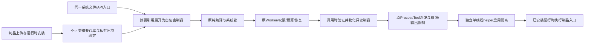

# 制品与受限进程 Loader（L2f1）

## 契约与阶段

阶段 DAG：制品/环境协议 → 仓库与解析 → 隔离 helper 与原派发适配 → API/文件/Worker → 实际隔离及恢复验证；角色 C → A → X。本节先锁定，之后实施。

| 决策 | 规则 |
| --- | --- |
| 制品 | ArtifactBundle={schema_version:1,files:{相对路径:UTF-8文本}}，规范JSON摘要；1..128文件、单文件1MiB、总文本2MiB；路径拒绝绝对、空/父段、反斜杠与NUL |
| 资源 | resource.artifact 的锁定 config={bundle}；管理入口可用 {digest}，Loader先展开，导出/快照必须自包含，纯编译不访问仓库或启动代码 |
| 仓库 | POST artifacts 需 resources，GET列表/摘要需read；内容寻址、幂等、原子写入、重开校验；本阶段追加保留，无删除/GC |
| 运行时 | resources 权限显式安装本地解释器：id、文件路径、预期SHA256、前缀参数及只读库路径绑定；复制并保留确切可执行文件，旧版本不被系统升级覆盖 |
| 可移植身份 | 系统只引用运行时 id/revision；revision锁定二进制摘要、平台、参数和隔离协议，不含本地路径、整个宿主安装集合或临时目录 |
| 环境 | resource.process 使用已声明运行时；Factory只读取已准备元数据缓存，原Worker/管理解析在编译前刷新；缺失/版本不匹配拒绝 |
| 工具 | tool.process_artifact 通过 environment/artifact 两项Resource依赖，声明contract、入口相对路径、固定args、JSON input映射及最多16个scratch_files相对文件槽；复用原ProcessToolFactory/dispatch，不新增Agent循环 |
| 生命周期 | 调用时摘要验证、只读物化；每调用独立私有scratch，只能读写预建的声明槽，不允许任意创建文件、目录或链接；不承诺隐式文件状态持久化，数据须通过JSON输出或显式资源协议返回 |
| 引导 | 发行宿主以自身隐藏helper入口启动隔离，嵌入宿主显式选择兼容helper；这是一项宿主引导绑定，不是每个模块手工Rust注册 |

新工厂一次安装后，普通代码/工具/Hook更改通过制品与系统配置完成，不重编译或重启内核。Artifact完整内容进入既有SystemDocument/Lock，不修改其v1/v2序列化。无关新制品/运行时不改变既有模块身份。旧HTTP/Rhai/Process工厂行为保留；Hook沿hook.executor，workflow/Agent沿原模块引用装配。

## 隔离协议

首个实际执行环境为 Linux single-process-v1。仅在独立helper内使用固定landlock 0.4.4，硬性要求ABI3权限并检查FullyEnforced；常驻内核不施加不可逆限制。可读当前制品、锁定运行时与宿主显式绑定的系统库；仅可写本调用的声明文件槽。运行时读授权只能收窄到规范化的 /usr/lib、/usr/local/lib、/lib、/lib64、/etc/ld.so.cache，且不得覆盖内核私有状态根；不授予 /proc、/sys、设备或任意宿主目录。缺失能力或部分隔离不允许降级为普通进程。系统库是显式宿主依赖，manifest.dependencies=host-system-libraries-unlocked-v1，不宣称已打包/锁定整个OS或解释器标准库；Landlock不隐藏无权读取文件的全部元数据。

额外seccomp拒绝socket/socketpair/io_uring、派生进程/线程、会话/进程组逃逸、ptrace/跨进程内存访问、SysV/POSIX消息IPC、用户keyring及向其他进程发送信号；禁止namespace和权限/限额变化。清空effective/permitted/inheritable/ambient capabilities；root执行时锁定NOROOT等securebits，禁止exec恢复特权。输入使用原JSON stdin，环境清空，无凭据或访问令牌继承；stdout/stderr/超时/取消沿原有界派发。父进程死亡时SIGKILL helper，单进程限制阻止遗留后代。CPU受限、地址空间512MiB、FD64、core dump与消息队列额度为零；最多16个8MiB文件（每调用128MiB），拒绝fallocate及除FIOCLEX外的ioctl，防止绕过尺寸上限分配磁盘。拒绝派生是本环境的明确能力边界，不把它当成完整通用容器或所有运行时均可用。

隔离/运行时探测为显式管理操作，不能在纯validate中执行业务脚本。发布冻结代码与逻辑运行时契约；实际调用仍验证可执行文件与物化文件摘要。执行中切换沿原Park/UpdateModules/Unpark/Resume及显式会话种子，已派发调用仍用原版本。

## 一致性与验证门槛

上传接纳、制品文件落盘、运行时缓存刷新与发布是不同阶段。持久文件原子替换/不覆盖已有摘要，目录fsync；响应不确定时读回精确摘要而不生成新版本。公开元数据不返回本地绑定路径或环境秘密；原资源/发布/执行作用域不合并。缺失制品、错误摘要、路径穿越/符号链接、元数据损坏、运行时缺失、helper或隔离不可用均有明确错误，不影响旧发布。

验收要求：真实发行二进制在同PID下上传/更新外部源码工具和Hook、无Cargo参与运行期操作；读取内核秘密/写越界/联网/派生/逃逸被内核实际拒绝；合法JSON运行、超时/取消及原恢复语义有效；导出到新状态目录，解释器绑定后不手工Rust注册即可恢复相同系统摘要；旧版本与不相关新资源稳定。仓库外默认SDK依赖不引入Loader/OS隔离。

本阶段不涵盖远端大型制品取得、完整解释器依赖复现、任意平台隔离、网络授权配置、制品来源签名/引用回收、可持久文件资源、全部Memory/Policy/Recipe外部协议或原预设最终验收；这些保留在总目标，不以本阶段代替最终Loader。

异常退出可能留下有界的私有scratch；恢复不读取它作为业务成功或自动重发的证据。未知效果仍须原根/子工具对账，显式确认失败后才恢复，成功回执不被伪造。当前无孤儿目录GC；正常完成、超时和取消回收本次目录，完整生命周期回收属于后续里程碑。
