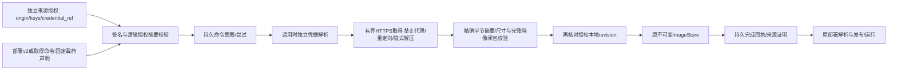

# 可验证运行时来源与取得（L2f3a）

## 阶段与协议

DAG：来源/签名契约 → 授权与意图存储 → 有界取得/凭据/接纳围栏 → API/文件/签名CLI → 实际取得/撤销/重开验证；角色 C → A → X。M3d3按用户要求调整Agent交付为仅声明及依赖锁，当前交付边界见dependency-reconstruction-contract.md，不将来源取得等同全部依赖包管理器或最终平台完成。

| 决策 | 契约 |
| --- | --- |
| SourcePolicy | 外部管理的id、规范base_url、Ed25519公钥映射、可选credential_ref、显式allow_loopback_http；信任根不从待导入部署文件自动接纳 |
| 授权身份 | 逻辑policy_digest覆盖完整公共配置，跨机器不含本地revision；修改/墓碑使用原式CAS，本地revision单调防ABA；取得最后接纳必须仍匹配本次尝试的实际revision |
| 声明 | ImageAttestation覆盖manifest_digest、payload_digest、payload_size、key_id；Ed25519签名域为nofy.runtime-image.source/v1，使用明确顺序的JSON数组，不签不规范的任意JSON文本 |
| 命令 | AcquireImage={command_id,source,policy_digest,path,attestation}；同ID精确重放，不同请求冲突；意图在取得前持久化，最多16次显式重试，网络GET不承诺exactly-once |
| 取得 | 只从授权base_url下的规范相对路径请求；HTTPS验证服务器，关闭环境代理/重定向/解压；仅显式数字loopback可允许HTTP。总期限30秒、连接/读期限5秒、载荷最大24MiB、状态200与声明尺寸/SHA256必须匹配 |
| 凭据 | 仅引用现有FileCredentials/provider，实际取得时解析；不写入部署、意图、回执、URL或日志；错误不回显服务响应体或令牌。运行中轮换作用于后续请求，不能撤回已发出的请求 |
| 接纳 | 完整映像校验后在来源授权锁内复核本地revision，再接纳映像并保存完成回执；锁不跨网络。映像接纳和来源回执是两个fsync边界，崩溃窗口由原意图精确重试修复，不伪装跨文件事务 |
| 历史 | 已完成回执精确重试返回历史事实，不重新接纳/取得；来源撤销不删除已发布/运行中的字节，也不重置预算/效果。缺少本地字节需新命令和当前有效授权 |
| 部署 | nofy.deployment/v2只含system与runtime_sources，拒绝runtime_images。来源声明仅可指向系统实际引用的锁定映像；validate对完整manifest及受信来源锁纯校验，缺少载荷可延迟到导入，但仅有摘要无法离线恢复manifest。import/启动仍须经资源权限取得并完整校验，再走发布 |

最多64来源、1024取得意图/回执，存储8MiB。来源列表/回执列表有界分页，公开metadata只含公共授权、声明、revision与成功/失败类别。直传映像仍是显式Resources操作员接纳，不冒充已验签来源。

取消或关闭会终止等待/传输；已经进入不可撤回接纳提交的blocking工作可能继续完成，调用方必须读取持久回执，不能将连接中断当作事务回滚。完成回执重放不再读取凭据；若本地字节损坏或缺失，部署/执行明确失败，重新取得需当前授权和新命令。

依赖遍历覆盖根模块、内联Workflow及嵌套resource.workflow的document.modules，最大4096模块、16层资源；仅访问已声明模块位置，不扫描任意JSON。未改变的嵌套原始JSON保持不动，避免补默认字段导致锁摘要漂移。系统交付导出默认且仅支持来源式v2，同样覆盖该闭包；full模式及填充依赖字节的导出实现已删除，无有效来源证明时失败。

## 管理与信任边界

来源授权通过Resources作用域API或独立受信source-policy-file引导，凭据独立注入；它与系统部署使用不同信任层，不以“配置可移植”为由自动信任配置携带的公钥。签名CLI从本机受保护种子文件生成声明，不输出私钥、不覆盖文件，不执行映像。来源配置与签名/载荷是外部制品，普通变化无需Rust注册、重编译或重启。

验收包含：真实loopback仓库传输及实际Ed25519签名；拒绝错误签名/摘要/尺寸、超限/压缩/重定向、凭据泄漏及越界路径；完整manifest来源计划的纯校验零网络/凭据读取；取得过程中撤销/修改授权后不得接纳；精确重放/冲突/重开恢复；同进程凭据和信任更新；部署v2在空缓存使用独立授权取得后运行，导出不含依赖载荷。来源授予显式选择的origin，不宣称已实现多租户或任意网络目标的通用SSRF代理。

来源/取得并非最终平台交付；语言原生依赖适配、工具链实际构建、完整资源/历史迁移及有状态更新、剩余C8、干净源码树、新控制台和多套版本化预设仍须按总计划继续。
