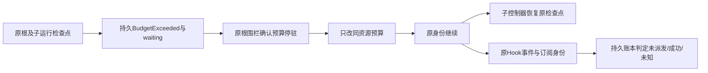

# 预算暂停的组合与收尾恢复（L3b6）

子Agent与收尾Hook仍属于同一逻辑执行；预算暂停不能重置其检查点、成功效果或账本。业务complete只表示模型已给出最终结果，不代表收尾工作已完成。

| 决定 | 约束 |
| --- | --- |
| 收尾边界 | complete=true时仍须has_pending_work=true；原持久BudgetExceeded、waiting、状态/提交/检查点/围栏完整校验保持。已完全结束的执行不重新打开。 |
| 更新内容 | 继续只允许budget_limits，非预算定义与完整RunState保持；不重新提交输入或清除complete/stop_done。 |
| Hook恢复契约 | HookHandler.resume_identity(context)默认沿已安装控制器recovery_identity，can_resume默认查询它；通用执行器将全部持久账本的原scope与非空物理存储身份排序、摘要后作为恢复身份。JSON不能开启此能力。 |
| 效果判断 | 重入只进入原预算dispatch边界：未claim才派发，成功回执重放，已claim未知意图继续暂停；不因外层Hook有意图就重发原HTTP/进程。 |
| 无持久账本 | 普通Hook与内存预算仍保持uncertain_hook，不能借预算恢复协议自动重复效果。 |
| 日志与身份 | Hook的event/registration/bus、已有controller字段与账本operation/fingerprint保持。私有Saved增加省略None的resume，首次意图写入即记录，恢复时必须匹配；完成时保留原证明。成功日志不清空，无新数据库表。 |
| 旧的未知记录 | 原controller已保存静态恢复契约者继续精确核对；没有原恢复证明的普通未知记录仍为uncertain_hook，不能因后来增加账本而提升为可重试。原证明对应不同物理存储或命名空间时拒绝。 |
| 子控制器 | 子Agent/原生Skill从原child/run/thread/checkpoint恢复，共享原账本及预留；不得新增子调用额度或重新执行成功工具。 |

接口新增纯查询governance::has_durable_receipts(context)->bool、receipt_identity(context)->Option<String>，以及默认实现的HookHandler::can_resume(&RunContext)->bool与resume_identity(&RunContext)->Option<String>。恢复身份以budget.receipts/v1前缀和SHA256保存，不暴露物理路径；不包含可变额度、重试策略或租约轮次，所以同一原账本调额和重开仍成立。身份在原意图中持久保存，当前上下文本身不能追认旧未知效果。调用方继续通过原journal、Factory、Loader与围栏核对已安装实现。

实施DAG为复现收尾拒绝→确认持久效果恢复契约→原根边界及Hook适配→子控制器/收尾真实行为与崩溃验收→集中回归。角色C→A→X。原源码包与普通依赖清单、外部依赖用户安装边界保持；其他模块迁移和完整平台仍单独验收。

本阶段完整实现及验收见[证据](../verification/budget-composition-resumption.md)。原输入恢复已验证，暂停期间新输入与收尾的顺序和未知Hook管理恢复入口仍须后续专门核对。
