# 纯JSON源码方法的执行边界

## 范围与决策

C8c只处理`tool.rhai`及经同一ToolPack调用它的Hook。工作流值绑定、事件筛选和目标策略是受限Rust声明计算，不改装为另一套脚本VM。模型协议沿C8b的常驻池，Prompt与Scope沿既有一次性helper；不引入旧产品宿主、语言安装器或源码包校验门槛。

```mermaid
flowchart LR
    Declaration[外部tool.rhai声明] --> Factory[纯语法与契约构建]
    Factory --> Dispatch[统一ToolDispatch / Hook]
    Dispatch --> Mapping[原输入映射 / Schema / 字节边界]
    Mapping --> Executor[显式Executor]
    Executor --> Loader[Loader实际拥有者 / 两个工作许可]
    Loader --> Supervisor[共用一次性helper监督器]
    Supervisor --> Isolation[原OS隔离 / 无凭据及IO能力]
    Isolation --> VM[原Rhai语言与complete]
    VM --> Result[类型化结果 / 原输出映射与Schema]
```

| 决策 | 边界 |
|---|---|
| 工厂绑定 | `RhaiToolFactory::new(Arc<dyn Executor>)`，独立SDK仅显式`trusted()`；默认Host由Loader注入，不在裸native注册中默认选择信任 |
| 声明身份 | 保留`tool.rhai`、`pure-json-v1`及原config；物理执行器和路径不进入模块身份，无开发期旧API兼容层 |
| 输入/输出 | Executor请求包含source、映射后的JSON、max_operations、timeout_ms和原输入/输出字节上限；回复为JSON或完整ToolError，不在argv/环境传递源码、输入或凭据 |
| 语法/语言 | 构建只解析，不做可能求值的常量折叠；保留原函数、complete、操作/调用/表达式/变量/字符串/容器上限，不以缩小语言规避隔离 |
| 物理执行 | 新`--evaluate-code`模式在相同固定helper完成隔离后求值，一次调用一个进程；原512MiB地址空间和文件/网络/进程限制，模型级16MiB栈，不改变Scope的2MiB |
| 期限 | 工具原1..600000ms包含工作排队及实际求值；CPU硬界为ceil(timeout_ms/1000)+1秒、最高601秒。Prompt/Scope仍为原2秒CPU和5秒实际IO期限，不降低工具原上限 |
| 生命周期 | 独立实际任务拥有工作许可，调用者丢弃只发取消，许可随实际kill+wait结束才归还；同原Host关闭路径drain。SDK trusted明确不具备OS隔离 |
| 管道 | 有界JSON封套与`nofy.code-program-evaluate/v1`标识，只使用stdin/stdout；16MiB工具数据加源码/JSON转义的封套余量不是打包配额 |

## 实施与验证边界

DAG：显式执行器及纯构建 → Loader/helper与共用监督器期限参数 → 工具/Hook、错误、取消/丢弃/关闭/父死及真实进程边界 → 集中回归。角色C → A → X。

GitNexus工厂upstream为LOW/0，Dispatch为LOW/6；关闭入口upstream为HIGH/4，涉及shutdown、run_worker、worker.run及常驻任务。共用监督器图谱漏掉两个动态调用，由Prompt/Scope实际源码补证；API文件没有路由图，以共享router和Read授权源码补证。阶段按HIGH控制，归档`/tmp/nofy-code-isolation.mx1iit/before.tar.gz`；变更只覆盖这些调用、对应测试及说明。

当前默认Host完整222项通过（72单元+5凭据+134HTTP+11进程树，0失败/忽略），含最终信任绑定断言与物理边界；SDK原17项及修正弱夹具后的源码6项按未变范围覆盖，严格文档/格式与实际Cargo边界通过。详细结果、首轮失败与未测边界见`docs/verification/code-program-isolation.md`。未知wait/kill内核错误故障注入、全部运行中状态迁移、物理旧源码树、新控制台和多预设仍开放，不以本阶段替代全目标验收。

## 默认装载与SDK编排的区分

实际normal依赖闭包仍含nofy-workflow。Runtime的workflow::run是SDK专用Rhai编排适配器，由两个SDK测试文件调用；默认Host的WorkflowDocument/ProgramDefinition没有script字段，使用统一DAG编译与执行路径。工作流值绑定/事件筛选等受限Rust声明计算不等于该SDK脚本VM。C8c只收敛tool.rhai，不把无默认声明入口当成该SDK适配器已经隔离或最终能力已经交付，也不为旧DSL建立永久兼容义务；后续须按能力归属与统一装载要求处理。
