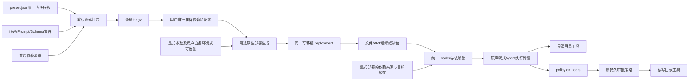

# 编程基线预设与外部能力制品

编程Agent不是第二套执行器：预设声明连接/协议、模型、Prompt、目录、制品工具、审批、预算和只读审查Skill，经同一Loader、SystemDocument与RunSupervisor运行。编程工具全部来自外部代码/Schema，内核只提供通用能力边界。

| 决策 | 契约 |
|---|---|
| 策略组合 | 新policy.on_tools只对tools中精确名字委托Policy依赖；未选工具不增加限制，不覆盖其他策略。工具名由声明提供，不在Rust写文件工具分类；原审批工厂与旧记录形状不改 |
| 工具来源 | 同一UTF-8源码制品及manifest，固定操作参数来自ToolConfig而非模型输入；读/列举/搜索只绑定只读目录，写/编辑绑定读写目录 |
| 路径 | 只接受相对路径，逐级openat与O_NOFOLLOW；拒绝绝对、父级、符号链接及特殊文件，无HOME/工作区发现 |
| 写入前提 | write_file的expected_sha256必填，null表示仅创建；edit_file必须提供原摘要，替换次数明确。不会盲目覆盖或隐式模糊匹配 |
| 一致性 | 协作工具以父目录FD advisory flock序列化；同目录临时普通文件、fsync与原子发布。创建使用不覆盖的原子链接；替换前复查原像。外部不遵守锁的编辑器仍有检查到rename窗口，不宣称全局原子CAS |
| 元数据 | 保留可支持的普通权限/所有权；遇不支持的特殊位、扩展属性或组归属在发布前拒绝，不能静默损坏ACL。读取保留原始UTF-8/CRLF，摘要按原字节计算 |
| 有界性 | 限制输入、单文件大小、读取片段、遍历深度/条目、扫描字节和输出。截断/跳过显式计数；regex在已隔离进程中受CPU/墙钟限制，不在内核执行 |
| 结果 | 应用结果为显式ok布尔值；失败含code/message/effect。调用者必须检查ok，根任务completed不等于文件操作成功。进程/传输失败不能假定无效果，不自动重发写入 |
| 打包 | 默认按source-files.json收齐并原字节归档源码及普通依赖清单；不要求模型/设置/锁文件或已安装依赖。提供settings.environment即可生成同一nofy.deployment/v2，dependency-lock只用于可选锁定模式；不嵌入依赖载荷、不执行模型/安装/代码、不读取环境凭据 |
| 更新边界 | 制品/配置发布经同一管理API，无Rust重编译或内核重启；新运行采用新发布不等于运行中热切换。历史状态、目录内容及正在运行授权的迁移仍需显式验收 |

文件工具：read_file按字节片段返回文本/原文件SHA-256；write_file创建或有前提地替换；edit_file按顺序执行明确次数的精确文本替换；make_directory显式创建目录；list_files返回有界相对路径；search_files提供有界文字/regex搜索及文件名glob。文件内容发布是原子的，目录创建可能产生显式partial效果；发布后同步失败返回committed_unconfirmed，不猜测回滚。只有ok=true才是应用操作成功；普通业务结果不被内核按字段名重新解释。

源码打包只检查文件清单与模板直接源码引用完整，不展开参数、不检查Python语法或依赖环境。只有可选原生部署模式才解释模板中精确的$file/$json/$parameter/$module对象，以及列表项限定的$when：读取包内UTF-8文件、读取包内JSON及可选JSON Pointer、复制显式参数、引用模块、按显式布尔参数选择一个列表项。该模式关闭分支不展开；用户参数值和文件正文不递归解释为指令。模块版本由factory/config及依赖版本的规范摘要按DAG计算，未改变的目录/预算/策略不会因为某工具代码更新而无故改版；不是对所有业务JSON猜测id/version字段后替换。循环、未知模块、越界/符号链接包含、凭据字面值及非法参数在部署输出前失败。两种输出都拒绝覆盖；源码tar.gz不是Deployment，最终运行验证仍由原Loader承担，不用归档成功冒充环境验收。外部依赖由用户安装，不再开发强制语言安装适配器，详见dependency-reconstruction-contract.md。

声明源为preset.json，编译产物是平台原生部署事实源，不是另一套Agent配置/主循环。协议配置取已有models/manifest.json明确profile，不按模型名猜协议或别名；凭据只包含引用。预算和强制工具下限覆盖审查子运行，写工具经原持久审批；只读审查使用外部scope资源和相同Skill/Agent路径。

实施DAG：通用策略选择器及契约测试 → 外部文件工具/单元与并发/崩溃边界 → 唯一声明模板与确定性打包 → 真实Loader/API工具/审批/会话/恢复验收。M3c构建进程树、完整状态迁移、C8、旧源码树清理和新控制台仍是全目标要求，不能用本阶段替代。

命令能力按command-module-contract.md接入同一模板：默认启用且显式提供process_tree，或关闭后完全不装载命令资源；用户自备环境通过resource.process_local使用，不强制整套Python/GCC或依赖映像。单进程及整树共用显式程序/路径权限，正常venv保留调用位置，用户修改依赖不要求重锁或重编译应用。该目录只有一份基线事实源不代表产品最终只提供一套预设；多套参考Agent仍须逐版锁定能力矩阵并沿相同框架验收。
