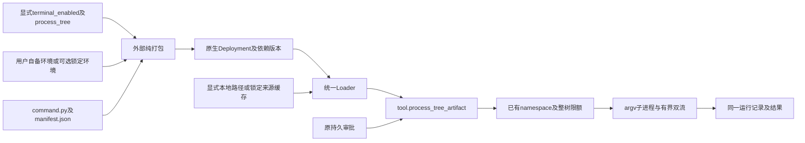

# 外部命令模块与按需工具链

本阶段锁定为有界、非交互命令执行，不提供PTY、后台作业或网络。实现属于外部编程能力制品，不新增Rust业务执行器、产品名分派或第二套Agent循环。Python仅是该制品选择的语言；框架不要求Python或GCC。源码包只保留普通依赖清单，外部依赖由用户自行安装，不随Agent包内嵌，也不在源码打包时探测或锁定工具链。下图描述可选原生部署执行路径，不是源码打包前提。

| 决策 | 锁定契约 |
|---|---|
| 可选能力 | 编程预设默认启用命令，须显式提供process_tree；terminal_enabled=false不生成命令、执行目录或树限额模块，不要求委托设施 |
| 依赖 | 源码交付不检查依赖，由用户安装。部署可用settings.environment及可选command_environment声明已安装程序/路径/环境；不复制依赖、不要求摘要/版本、不隐式开放宿主PATH或库。可选锁定模式才复用runtimes.files或提供runtimes.command，语义不混用；不开发语言自动安装器 |
| 模板条件 | 仅模板列表项允许精确的$when对象，字段为parameter(JSON Pointer)与value；条件必须是布尔值。关闭分支不展开，普通参数/$json数据不递归解释，未知引用仍失败 |
| 目录 | 命令只绑定声明的read_write_execute项目目录；cwd为项目相对路径，逐级O_NOFOLLOW目录FD取得后fchdir。代码及本地/锁定依赖均只读；本地依赖只有显式execute=true才可执行，不开放内核私有目录 |
| 输入 | argv明确分词，不隐式插入shell；stdin为有界UTF-8文本，默认空。需要shell时须显式声明并提供该可执行文件，以argv调用 |
| 结果 | 只有退出码0且完整收束双流时ok=true；非零、信号、超时或输出超限返回ok=false、明确错误与实际观察结果。completed不是命令成功；观察字节不是未读总量，UTF-8替换显式标注 |
| 效果 | 启动前拒绝为none；执行后的失败均unknown，不因kill/取消推断无文件效果或自动重试。成功命令也不承诺事务性回滚 |
| 生命周期 | 模块以非阻塞selectors并行写stdin/读stdout/stderr；有界截止及输出，失败kill进程组并wait主进程。逃离进程组的后代由已有PID1/整树拥有者在制品退出后杀死并回收，不能以模块killpg替代内核整树保证 |
| 审批与作用域 | run_command为non_idempotent，进入相同policy.on_tools精确审批集合；只读review不暴露此工具，关闭能力时也不残留工具下限授权 |
| 版本与恢复 | 源码/Schema/声明配置按同一DAG内容寻址，应用/回滚走原入口。用户管理的外部文件不进入generation，回滚声明不等于回滚用户依赖；依赖暂缺不阻断历史或成功效果恢复。已成功命令不得再次派发；正在运行切换另按显式迁移契约 |

输入Schema：对象仅含argv、cwd、stdin、timeout_ms、max_output_bytes；argv为1..128个字符串，argv[0]非空，每项不超过4096 UTF-8字节且无NUL，总计65536字节；cwd默认`.`；stdin不超过65536字节；timeout_ms为1..300000，默认60000；max_output_bytes为1024..262144，默认65536，两流合计保留字节不超该限额。工具外层截止330000ms、输入262144字节、输出2097152字节；JSON转义仍须落在外层真实输出限额以内。

成功结果为`{ok:true,result:{status,exit_code,signal,cwd,stdin_bytes_written,stdout,stderr,observed_stdout_bytes,observed_stderr_bytes,stdout_truncated,stderr_truncated,stdout_lossy,stderr_lossy,duration_ms}}`。失败为`{ok:false,error:{code,message,effect,result?}}`；未启动无result，已启动保留相同观察结果。超限即停止读取，截断标志不声称知道未读流的完整长度。stdin_bytes_written仅表示已写入管道，不保证子程序消费；stdin允许换行但不含NUL。

IO失败额外返回result.io_error的stage/errno，不回显argv或环境；无法确认主进程回收时状态为reap_unconfirmed，效果仍unknown。外层进程树失败或取消可能没有应用JSON，此时以原运行状态/对账契约处理，不能猜测无效果。历史真实模型编译测试见docs/verification/coding-real-model-build.md；本地环境专项另验证用户模块、真实venv和Guest内GCC编译/执行、审批、取消与缺依赖恢复，见docs/verification/local-environment.md。该专项使用Tool程序验收，不冒充新真实模型请求；PTY/后台作业仍未交付。

实施DAG：本契约 → 外部模块及真实进程单元 → 同一预设声明/源码打包 → 显式环境中的Loader/审批/命令/取消/恢复 → 既有文件预设回归。若验收GCC等项目构建，须在用户准备的实际环境中取得真实构建证据，宿主编译测试探针不算；不据此要求源码打包器重建或内嵌工具链。最终还须完成运行中转换、C8、干净源码树、新控制台及版本化多预设，不缩小总目标。
