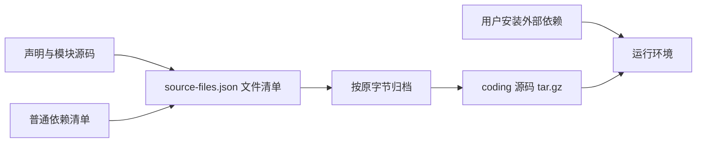

# 源码交付与用户自备依赖

2026-11-03 用户进一步明确：外部依赖由用户自行安装处理，只需保证源码打包正确。本契约取代此前把完整环境锁定和自动重建作为交付前提的规定，不继续开发语言包管理器适配器，不设置 Agent 包体配额。



## 默认源码打包

```sh
python3 -B /home/none/nofy-build/presets/coding/build.py --output /absolute/coding-source.tar.gz
```

归档根目录固定为 `coding/`，文件列表来自 `source-files.json`。清单本身、`preset.json`、打包脚本、设置 Schema、外部模块及其 manifest、Prompt、规则、Skill、测试和 `requirements.txt` 一并交付。没有目标机器路径、模型连接、凭据或已安装依赖；不复制 Python/GCC、虚拟环境、构建目录和缓存。

打包只检查源码清单和模板直接引用是否齐全，包括尚未启用的条件分支；按原字节保存文本及二进制文件，不检查 Python 语法，不导入模块、不执行业务源码、不探测/安装外部依赖。只解释源码清单与入口模板的 JSON，不将包含文件中的业务数据递归解释为模板指令。

拒绝重复或越界路径、符号链接、特殊文件、缺失文件以及读取中发生修改的文件；保留执行位，清除归档所有者与时间差异。发布拒绝覆盖已有文件，失败不留下半成品。源文件由受信任管理员维护；打包不是跨所有文件的事务快照，应在没有并发修改的工作树上进行。

`requirements.txt` 只描述此预设实际使用的依赖：Python 模块使用标准库，无第三方 Python 包。Python 解释器、项目自己的包、shell、GCC 或其他工具由用户按需要提供。不要求 uv、某个 Python/GCC 精确版本、解释器摘要、依赖闭包或签名来源锁，不能因用户没有安装业务依赖而拒绝源码打包。

## 已有显式部署路径

需要生成平台原生部署时，提供 `--settings` 并以其中的 `environment` 声明用户已安装环境即可，不要求依赖锁。可选 `command_environment` 为命令指定另一环境。两者使用通用 `resource.process_local`，只检查实际运行所需的路径可用性，不锁定依赖版本/摘要，详见 `local-environment-contract.md`。

需要字节级锁定环境时才显式增加 `--dependency-lock`，不能同时混入本地environment选择。该可选模式原有的manifest、来源签名与目标授权继续适用；两种模式均生成同一 `nofy.deployment/v2`，都不是源码归档要求，也不自动安装语言依赖。

源码 `tar.gz` 不是原生 Deployment，不能直接提交 `/api/v1/import`。先解包，由用户准备环境并用包内build.py及settings生成部署，再经同一API装载。环境路径和权限必须显式声明，不因依赖自备就暗中授予宿主PATH、整个文件系统或内核私有状态的访问权。

框架 generation、幂等应用、状态/预算/效果恢复、版本回滚及执行权限不因依赖自备而取消；HTTP 传输与进程资源约束也不是源码包体配额。源码包成功不代表模型可用、依赖已安装或 Agent 端到端验收完成。

## 验证边界

真实归档逐项核对原始字节、确定性、执行位、二进制与未安装模块源码；缺失源码、遗漏条件分支、重复/越界/链接/FIFO、不覆盖输出均有负例。默认 CLI 在禁用 site 包且 PATH 不含外部工具的环境中打包成功。历史锁定部署验收见 `docs/verification/dependency-reconstruction.md`，不把它重新列为源码交付门槛。
