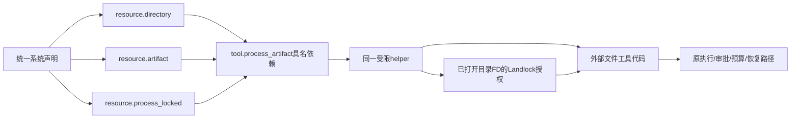

# 显式目录资源与编程预设前置能力

目标是让外部编程工具在统一Loader下操作明确授权的项目目录，不将文件工具、旧工作区宿主或工具分类写入内核。目录资源只提供文件系统权限；模型工具准入、父权限、审批、预算与未知效果恢复仍由原框架执行。



| 决策 | 约束 |
|---|---|
| 目录来源 | 系统显式声明绝对path与access；不扫描HOME、current_dir或仓库，不由模型参数增加目录 |
| 单进程权限 | read_only或read_write；不额外授予Execute、符号链接/设备创建、网络、进程派生或元数据修改；树工具扩展见末节 |
| 工具绑定 | directories为环境别名到Resource依赖槽的映射；没有映射就没有项目访问权，不能覆盖environment/artifact依赖 |
| 执行传递 | Loader独立解析可信资源，将NOFY_DIRECTORY_别名注入清空后的环境；模型调用参数不能改写根目录 |
| 身份 | path/access与模块依赖进入声明锁；运行时物理FD、PID不进入内容身份；外部制品常规更新不要求改Rust或重启 |
| 预检 | validate保持语法/依赖检查，不替只读调用者探测任意宿主目录；持久导入及实际执行做真实目录预检，无目录创建 |
| 保护 | 拒绝根目录、虚拟系统树及内核private_root的祖先/后代；helper对已打开FD确认目录和真实路径，再以同一FD授权，避免检查后重新打开 |
| 可移植边界 | 配置保留显式环境路径，目标须提供同一挂载路径或通过声明差异更改；项目可变文件不冒充不可变代码制品，内容迁移须另走显式状态迁移 |

声明形状：

```json
{
  "reference": {"id": "project", "version": "1"},
  "factory": "resource.directory",
  "config": {"path": "/workspace/project", "access": "read_write"}
}
```

tool.process_artifact的config新增可选`directories:{"WORKSPACE":"workspace"}`，dependencies中的workspace引用上述Resource。别名只允许大写ASCII字母、数字和下划线，首字符为字母，最长32，最多8个，不重复使用依赖槽；NOFY_DIRECTORY_前缀保留，禁止运行时映像自行伪造。无目录映射不会增加项目权限，也不继承宿主cwd；已明确授权的运行时/代码读取或其他目录授权按并集生效，read_only不是覆盖其他授权的拒绝规则。编程预设采用私有缓存中的锁定映像，项目资源不得与内核private_root重叠。每次调用均重新验证资源，失效关闭；工具权限只在本次helper中生效，不改变常驻进程权限。

注册表分别合并descriptor静态依赖和config_dependencies新增槽；工具工厂只返回目录动态槽，不重复返回environment/artifact，也不放宽重复依赖拒绝。目录预检在部署准备及持久接纳publication/job边界执行，直接使用已缓存编译结果也不能发布或排队缺失目录。owner、execution、checkpoint及已继承child的保存不重新依赖目录可用性，避免已成功效果丢失回执；它们不免除后续实际工具调用的重新验证。纯继承证明同时检查代码/映像引用子集和目录声明内容摘要子集，不能把新增路径或read_only到read_write升级当作已继承权限。

阶段DAG：M3a目录资源/依赖/OS边界验收 → M3b外部读写/编辑/搜索工具与唯一系统声明 → M3c受控构建进程树与完整编程运行 → 运行中转换/显式状态迁移及最终清理。M3a不会放开现有单进程seccomp，不能以能读写文件宣称终端、完整预设或任意不可信项目沙箱已完成。目录内已有文件/硬链接内容属于操作者授权的数据；主机管理员并发替换挂载或硬链接不属于同UID进程隔离承诺。

Linux Landlock ABI3不隔离stat/readlink等元数据读取；本边界限制内容访问与写入，不承诺隐藏宿主路径或进程命名空间。每文件大小、地址空间、CPU及墙钟沿现有helper限制，目录总配额、专用进程树和完整不可信代码隔离仍须后续验收，不能由一次读写授权推导为已完成。

验收要求：同一API导入/导出与锁、只读与读写分离、未绑定工具拒绝、越界/符号链接访问拒绝、内核目录保护、非法/缺失目录、依赖/别名冲突、外部代码同进程更新与回滚、成功写入跨重开保留。实际Linux helper必须执行这些断言，纯Schema或SDK测试不足以替代；后续完整预设仍需真实模型与会话/取消/流式/恢复证据。

## 受限进程树扩展（M3c3）

目录Schema新增`read_write_execute`，仍以同一path/access摘要参与声明锁、持久接纳与纯继承证明。只读或读写声明都不能在子运行中隐式升级到这一权限；必须显式变更系统配置并经资源授权路径接纳。

| access | 单进程tool.process_artifact | 树工具tool.process_tree_artifact |
|---|---|---|
| read_only | 内容读取，原单进程限制不变 | 只读/noexec绑定，元数据也不可修改 |
| read_write | 内容读写，原单进程限制不变 | 可写/noexec绑定，允许授权目录内普通构建文件操作 |
| read_write_execute | 工厂与实际helper都明确拒绝 | 可写/可执行绑定，项目产物才可作为子程序执行 |

树工具在私有根中将目录绑定到`/nofy/directories/ALIAS`，按同一别名注入环境；项目路径之外的宿主文件、proc/sys/cgroup不被带入。它还必须绑定显式锁定映像、代码制品与整树限额资源，不能仅凭目录授权启动任意宿主程序。新的Execute能力不放宽单进程helper，也不更改常驻Host自身权限。

具体namespace、挂载、能力清除、Landlock/seccomp及取消回收契约见[进程树契约](process-tree-contract.md)。本扩展不证明整目录磁盘配额、完整C8、运行中授权迁移或编程工具链已经交付。
