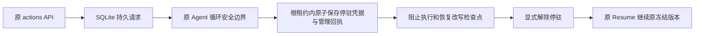

# L3a 持久安全停驻

L3b5增加[预算暂停边界](budget-resumption.md)：业务未完成的持久BudgetExceeded可以在原根租约内核对完整检查点后，产生budget_suspended=true的回执，只允许同资源预算配置调整并保留所有待处理进度。未知效果仍须原对账。下文为L3a阶段历史范围，当前实现以新契约及[验收](../verification/budget-resumption.md)为准；不将旧宿主兼容要求带回目标工程。

状态：2026-10-30 阶段验收通过。范围是已初始化、声明预算治理或 binding.model_journal 的 managed 根 Agent；未记录模型派发意图的旧配置和 Tool、Event、workflow 根在接纳前明确拒绝。组合转换继续后续阶段。



| 决策 | 实施 | 理由 |
|---|---|---|
| 请求入口 | ManagedCommand::Park / Unpark，通过原持久 actions | 复用鉴权、命令幂等、根租约和后台 worker |
| 应用边界 | 根 Agent 无未闭合模型、工具、Hook、上下文、配方及输入工作 | 已派发工作按旧版本结算，不截断副作用 |
| 子运行 | 等待父工具链按原协议返回，不对子 Agent 单独停驻 | 保留子树结果和原归属 |
| 未知效果 | 停驻保持 pending，原恢复/对账命令可先执行 | 停驻不能代替效果证据或授权重发 |
| 模型证据 | 要求声明治理或 binding.model_journal | 未记录派发意图的旧路径无法证明崩溃后的安全边界 |
| 持久凭据 | 独立版本化记录，绑定原提交摘要、组合、检查点 revision/digest | 不改写旧 v1/v2 快照和初始输入证明 |
| 解除 | 引用原停驻 command_id，检查点仍精确匹配；仅解除，再显式 Resume | 解除与执行分离，崩溃后无需推测是否重发 |
| 兼容 | SQLite 可选，原 RunOutcome::Paused；旧命令序列化不变 | 默认 SDK 和旧宿主继续原路径 |

## 管理契约

POST `/api/v1/actions` 使用原外层 `{command_id,run_id,command}`。

```json
{"command_id":"park-1","run_id":"run-1","command":{"kind":"park"}}
```

```json
{"command_id":"unpark-1","run_id":"run-1","command":{"kind":"unpark","park_command_id":"park-1"}}
```

Park 未到安全边界时 finished=false；已确认后 outcome 为原 Paused，reason.kind=parked 并含停驻凭据。GET runs/{id} 的 parking 返回最新请求、状态和凭据。Unpark 可以撤销 pending 请求或解除已确认停驻；不调用模型/工具，不消费输入。取消沿原持久通道保留，解除后原恢复流程处理。Abandon 保持最高优先级并关闭停驻。

ParkRecord 包含 schema_version、command_id、run_id、thread_id、submission_digest、composition_digest、status(requested/parked/released/rejected)、receipt、released_by。ParkReceipt 包含 checkpoint_revision、checkpoint_digest、parked_at_ms。请求和原管理命令同事务接纳；停驻凭据、管理成功回执、原根 paused 记录和 job waiting 同事务保存。未完成 Park 不阻塞对账/人工/取消恢复命令；其余普通命令仍按原 FIFO，Abandon 优先。

## 影响与验证

2026-10-30 GitNexus invoke_plan_leased 上游 HIGH/17，直接调用 execute_plan、execute_submitted_leased、managed_action_leased；管理执行/接纳 MEDIUM/8，任务入口 MEDIUM/10，其余存储/队列/契约入口 LOW。Rust 方法漏边与同名 advance、API 路由索引缺口以源码补查，不能据 LOW 推断无风险。采用追加契约和根租约内适配，不重构展示层。

验收覆盖：活跃模型与工具、原结果不重发、Hook 和子运行排空、未知意图 pending 与证据续接、重复/冲突命令、检查点漂移拒绝、取消/封存、进程退出/重开、停驻确认与根最终回执的故障窗口、默认与 SQLite-only feature，以及原宿主/仓库外消费。无新证据时不重复已通过基线。文件职责在 runtime 与 host 的 `文件说明.md` 登记。

当前机验证：内核 42 个套件累计 325 项通过（全套运行及失败项修正后的定向复验，含停驻 8 项）；默认 feature 23 项、SQLite-only 34 项、宿主 37 项（HTTP32、凭据5）、原 nofy-shell 构建检查及仓库外公共 API 消费通过。默认正常依赖仍为187项。旧 workflow 进程测试改用系统临时目录，修复 macOS 路径在 Linux 上不存在的问题；插话验收保留原包装语义，确认 pending 输入恢复后只投递一次。真实 HTTP 测试在有/无预算两种配置下硬退出，重开后模型/工具/Hook次数保持1；显式解除不执行，恢复后仅新增下一次模型调用。

停驻是组合转换的前置边界。当前既不切换进行中运行的发布号，也不迁移状态后端；没有提供原始编程 Agent 最终全行为兼容矩阵。受信任的外部原始存储写入不在监督器控制面保证内，检查点漂移会拒绝解除。
