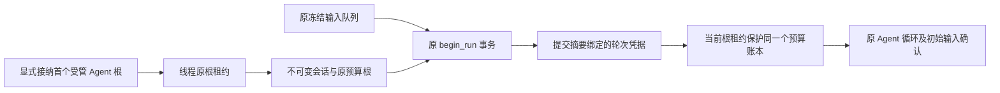
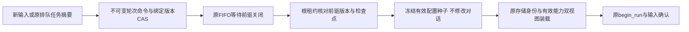

# 持久逻辑会话

## L3c1：稳定身份与连续预算

本阶段只开放同冻结配置的跨根轮次；不是更新后有效版本的跨根迁移。后者必须另有冻结交接证据，在实现前继续由 live owner 检查拒绝。

阶段 DAG 为身份契约 → 事务及预算别名 → HTTP 管理入口 → 连续轮次/恢复/兼容回归；角色序列 C → A → X。里程碑分别是不可变接纳、预算不重置、外部入口验收。

| 决策 | 规则 |
| --- | --- |
| 启用 | POST /api/v1/sessions，SessionRequest={id, root_run_id}；仅首个受管 Agent 任务可作为起点 |
| 一致性 | 会话 id 与线程唯一，接纳与根成员回执同事务，持有原线程租约；响应丢失精确幂等读取 |
| 既有运行 | 可接纳唯一已启动首根；若其他根已启动，拒绝回溯合并旧预算 |
| 后续轮次 | 仍用原 runs/NextTurn 队列；begin_run 同事务绑定原 Job digest，不重写提交或输入来源 |
| 配置 | 原 snapshot 摘要及 composition 必须相同；已有 live owner 保护仍生效 |
| 预算 | 实际 RunLineage 仍是当前根；只有私有受管后端可选原 ledger root，子调用继承该能力 |
| 归属 | 当前执行者仍以 threads.active_run 为唯一事实源，不额外维护一个可漂移的会话指针 |
| 不变量 | 原账本 used/reserved/deadline/operation 及成功效果不复制、不清空；操作仍用实际 Run ID 区分 |
| 历史 | GET sessions/{id} 与 sessions/{id}/turns；分页有界，已接纳成员保留即使任务被取消 |
| 兼容 | 未启用会话时仍按原 Run ID 建账；不改变旧 Job/Run/Checkpoint/live v1/v2 线格式 |

SessionRecord 使用 nofy.session/v1，包含 id、root_run_id、budget_root_run_id、agent_name、thread_id、system、program、release、created_at_ms。存储另含 thread_key、原提交/组合/快照摘要，规范摘要校验防止身份错配。SessionTurn 包含原任务 sequence、run_id、submission_digest、admitted_at_ms；不复制对话。会话读视图另带 active_run_id，查询原线程表。

GET /api/v1/sessions?after=会话id&limit=100 按 id 排序；turns?after=原任务sequence&limit=100 按任务顺序查询已绑定执行的成员，附原任务状态投影。两者 limit 均为 1..=256；未开始的排队任务继续从原 runs 读取，不伪造执行接纳。创建需 execute，查询需 read。缺失会话返回 404，身份冲突返回 409。

新根运行只有通过原 FIFO、归属、停驻、未决工作检查才能进入 begin_run；新增成员凭据与原运行/线程变更一起提交。事务失败没有半成员，事务提交后进程退出可由原 initializing/InitialInputProof 恢复；预算准备在之后执行，重复 enroll 读取原期限与用量。持续时间预算过期可在输入应用前拒绝，但原输入与成员凭据仍保留，不能假报已交付。取消、审批、邮件仍按实际根地址处理，不将旧根输入重定向给新根。

接纳不依赖工厂执行，不调用模型/工具；有效租约不抢占。封存线程拒绝新增会话；同 id 不同根、同线程不同 id、非 Agent、已取消/放弃起点、此前已启动其他根均拒绝。原冻结工厂恢复与 host floor 检查不改变。

原 NextTurn 没有独立 managed request。恢复时只有已经显式接纳会话、且原任务摘要和完整快照精确匹配起点的任务，才使用受管 system floor 装载；当前宿主新增强制约束仍须包含，普通 SDK 仍严格匹配。最终成员与所有权验证仍在根租约内，不因预检通过跳过围栏。

回滚采用停止使用新增入口并恢复未启用会话的独立新线程；已启用会话不得通过删元数据重置额度。表为增量创建；旧数据库保持 schema=1，旧二进制不能安全调度已启用会话的线程，因此降级前须停止调度并保留数据库。无自动拆分或删除会话 API。

以上为 L3c1 的交付边界；有效配置种子、预期版本 CAS、安全源根凭据及 at-handoff 输入绑定在以下 L3c2 扩展。两者均不等于完整有状态模块热更新。

## L3c2：显式轮次绑定与有效配置种子

阶段 DAG：显式输入/版本契约 → 种子事务与装载/后续更新 → 控制面入口 → 跨轮/故障/兼容验收；C → A → X。先冻结本节架构，再写业务实现。

POST sessions/{id}/turns 接受 SessionTurnCommand：command_id、source_run_id、expected_source_revision、expected_binding_revision（缺省0），以及 turn。turn.kind=new 含 run_id/input；turn.kind=queued 含 run_id/submission_digest，精确接纳原排队输入而不改写 Job/source/InitialInputProof。接纳需 execute；创建的新根仍使用会话原冻结快照，并在同事务登记为受管任务供原 Worker 调度。绑定协议为 nofy.session.turn/v1；它明确表示有效配置在安全交接时解析，不把原 ManagedRunRequest.release 伪装为新版本。

前驱必须是同会话中紧邻的非取消任务，且是原根、已接纳成员或已绑定轮次。expected_source_revision 是该根自己的 live revision（无 live 时为0，可继承它的种子）；源种子与命令身份另写入交接证据。源未关闭时继续等待；源取消、版本不符或未知效果不能自动猜测后继配置。目标未开始且无种子时，可通过新 command_id、原 target Job digest 和 expected_binding_revision CAS 追加重绑版本；原命令回执不可覆盖。每根最多32个绑定版本，任务/管理容量沿原限制。

Worker 在模块恢复前，以原线程租约一次性核对目标 FIFO、绑定版本、原提交摘要、前驱 closed 状态、原线程当前归属及 checkpoint 的 composition/execution_run_id/InitialInputProof、无未决工作、前驱的实际有效版本。nofy.session.seed/v1 原子冻结目标有效快照、真实组合摘要、累积工具/Hook epoch、来源版本/种子、原检查点 revision/digest、目标提交与接纳命令。种子不修改检查点，不提前转移线程归属，不释放/重置预算，不重定向旧邮件。

种子一旦冻结即不可重绑；编译/进程中断后精确恢复。开始业务前再次校验种子与前驱检查点，原 begin_run 才原子转移归属；初始输入确认仍按原协议。已经初始化的新根走原恢复，不要求旧检查点仍是当前状态。源 closed 回执不因后来交接改变；取消未启动目标继续保留原输入和种子证据。

有效视图优先该根自己的 live 版本，再取 seed，最后原快照。seed 使用根本地 revision=0 和独立 command_id，避免改写 live v1/v2 历史；旧直接 SDK 无相符有效身份不得绕过。新根上的下一次 Transition/UpdateModules 从 seed 比较并继承累积模块状态，不能静默还原旧工具/Hook。原 Hook session_started/turn 与历史事实随检查点连续保留；新输入继续原生命周期，不重发旧事件。原策略、预算、动态来源、Context/Memory/Recipe 等仍受既有兼容约束。

源轮次在输入应用前取消时，原线程当前 owner 可能是其初始化记录，而检查点仍属于更早的已关闭根。显式重绑仅在该 owner 有原 cancelled 任务、原检查点仍完整证明实际源根时允许；种子额外冻结 previous_owner_run_id，开始前再核验，不删除取消事实。Worker 的既有失败退避仍适用，修改绑定后唤醒不保证立即跳过已开始的30秒退避。

GET sessions/{id}/turns/{run_id} 返回精确轮次接纳及有界 seed 摘要，不复制完整对话或快照；查询需 read。运行归属仍由原 threads.active_run 唯一确定。有效版本回滚是新根或新 live 版本显式继承已批准版本，不回退历史/预算。降级约束沿 L3c1；无删除种子或静默拆会话入口。

实现位于 sessions/handoff.rs（DTO、命令幂等与绑定 CAS、队列接纳）和 handoff/seed.rs（围栏、源检查点证明、不可变种子及开始前核验）。单种子最多16MiB，不复制整个检查点。真实 HTTP/SSE 验收含同进程交接及硬退出94：旧根已完成、新根已派发时退出，按该新根原模型票据结算起点会话账本中的预留，无重发；第三根沿种子继续、第四根按原额度拒绝。仍未开放权限/预算/动态工具来源/Context/Memory/Recipe 的状态变更、跨线程/跨数据库历史迁移或自动合并旧独立预算。
