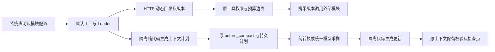

# 默认 Host 的外部工具源与上下文策略

本功能块提供 `tool_source.http` 和 `context.programmed`，通过默认 Host 装载实际外部能力。实现、注册、契约文档和用例全部完成后统一验证。外部依赖由用户安装，源码包、普通依赖清单与无包体配额保持。

| 决策 | 契约 |
|---|---|
| HTTP 工具源 | 依赖已声明 `resource.http`，接纳时不联网或读凭据；GET 获取只读目录，POST 执行业务调用，继续禁用代理/重定向及基址逃逸 |
| 目录格式 | `{"revision":"版本","tools":[ToolDefinition]}`；快照身份同时绑定连接/配置与外部版本，工具名称和 Schema 经过原 ToolCatalog 校验 |
| 调用格式 | POST `{"revision":"原目录版本","tool":"工具名","arguments":{}}`，回复 `{"revision":"原目录版本","value":结果}`；外部服务须在执行前校验版本，版本不符不得执行 |
| 外部语言 | HTTP 服务可由用户用任意语言实现；快照请求是可重复读取，不代表业务效果。实际调用仍通过原 ToolDispatch、策略、预算和未知效果恢复 |
| 上下文程序 | 外部声明的纯 JSON Rhai 代码，通过现有 `code::Executor` 隔离执行，不安装文件/网络/任意工具宿主函数；默认 Host 不回退到进程内执行 |
| 计划阶段 | `args.phase="plan"`，提供 state 和 parameters；返回 null 或有界 JSON 计划，原 Runtime 持久化计划并执行 before_compact |
| 更新准备 | `args.phase="prepare"`，提供原 state、plan、parameters；返回 `{"kind":"update","update":{messages,retained_from,retained_at,metadata}}`，或 `{"kind":"sample","request":ModelRequest,"data":JSON}` |
| 模型压缩 | 只有显式 Model 依赖、原 operation_scope 及持久模型日志/治理才可采样；不允许附带工具调用。通过原 sample_model 执行，模型回执可重放，未知请求沿原对账路径处理 |
| 模型后处理 | `args.phase="finish"`，提供原 state/plan、data 和实际 ModelResponse；直接返回 messages、retained_from、retained_at、metadata。用量取真实响应，不能由脚本伪造 |
| 状态保护 | 原 Runtime 校验 System 前缀及当前回合逐字保留、更新大小和输入位置；本模块不写会话、预算、回执或凭据 |
| 更新与回滚 | 使用现有 live/v5 和冻结模块依赖；只在安全停驻点替换来源/策略，未完成计划继续原版本。普通配置更改不修改 Rust 或重启内核 |

`tool_source.http` 配置目录/调用相对路径、可选 query、credential_ref 和超时/输入/输出边界，固定依赖 `connection: Resource`。连接必须准许 GET 与 POST；凭据引用须已被资源接纳，实际密钥只在请求阶段注入。

`context.programmed` 配置 source、parameters、执行边界及可选 `model: true`；该选项声明 `model: Model` 依赖。纯更新不要求模型依赖。更新结构为 messages、retained_from、retained_at、metadata；样本结构为 request、data。程序不能直接回报 token 用量或递归采样。计划只保存可恢复的决策数据，长历史通过 state 读取，避免把完整请求塞入 64 KiB 计划。

每个执行阶段还提供 `retained_turn_start`。已有当前回合边界时沿用原边界；在尚无边界的运行中新增策略时取 1，保守保留整个非 System 历史。程序须从冻结 state/plan 稳定构造采样请求；请求指纹改变会被原模型日志拒绝，不能用于再次发送已知或未知的原操作。

集中验收覆盖默认工厂纯装载、外部目录动态 Schema/版本、凭据和路径边界、正常权限/预算、版本漂移、隔离纯转换与模型压缩、错误更新不改变当前回合、未知模型恢复不重发、运行中模块更新及回滚。Memory 写入迁移、新控制台和多套参考 Agent 行为预设继续后续交付。
