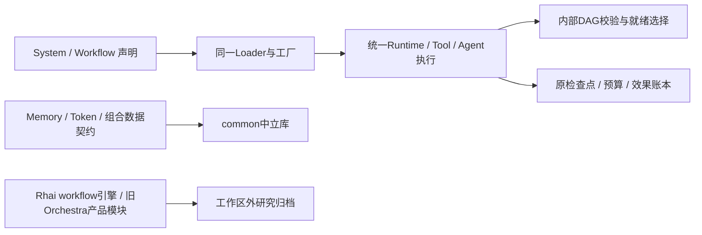

# CLEAN5c：公共能力归属与统一 Workflow

## 本阶段锁定边界

本阶段移除的是原产品专用源码和未交付的SDK脚本适配，不取消当前框架所需的组合、并行、暂停/恢复、预算或成功效果保护。原代码作研究资料在工作区外归档，不以更名或兼容feature留下第二执行路径。

| 对象 | 归属与动作 | 验收边界 |
|---|---|---|
| Memory | 迁入common，明确存储根/配置/HTTP注入；当前执行源码与API保持 | 完整包测试、Host记忆和持久恢复；内部旧模型/路径启发式的后续职责审核不因此关闭 |
| TokenEstimation | 迁入common，只提供估算/显示算术，不提供模型容量保证 | 原16项算术测试；不得据估算值声称真实256k支持 |
| PackCore | 迁入common，保留纯JSON组合边界与命名空间契约；删除只被自身测试调用的builtin_packs/file-steward编译期数据 | 原解析/平面隔离、Runtime pack绑定和独立SDK测试；不以此库代替声明预设或源码打包器 |
| Orchestra | 仅采用Workflow实际使用的DAG校验/就绪选择；不把项目发现、daemon任务日志、内置persona等旧产品模块搬入内核 | 重复/缺失/循环依赖、确定性就绪、运行/已完成节点排除及现有Workflow回归 |
| Rhai Workflow | 移出整个旧引擎、Runtime workflow::run和WorkflowCheckpointer；workflow feature仅选择统一DAG实现 | 原编译Agent派发、顺序/并行暂停恢复两项测试转到现有Workflow编译/执行路径，保留效果与身份漂移断言 |

## 契约与接口

保留现有WorkflowDocument、WorkflowSpec、ModuleRef和WorkflowCompilationSnapshot格式。图仍由compile_workflow纯编译，经resource.workflow、tool.workflow、hook.workflow及ProgramDefinition装载，执行仍进入原ToolRuntime/Agent及检查点/预算账本，不新增模型或工具主循环。DAG内部类型不成为新的产品配置格式。

未交付的SDK脚本字符串、Rhai Journal及WorkflowCheckpointer不构成对旧Nofy产品的兼容目标；不增加空feature、别名或旧主机适配。原SDK测试覆盖的有效能力在声明式图中继续验证；旧适配原本不支持的模板/工作区/每调用模型覆盖，不虚构成已经完成的通用能力。普通业务代码继续通过外部工具/Hook模块实现，不要求使用旧DSL。

PackCore的typed host binding仅是可选SDK嵌入接口，不能宣传为已具备默认Host的独立Pack管理路径。平台预设仍以同一System声明/外部模块发布；后续管理能力和多版本参考预设继续按实际能力矩阵验收，不用SDK快照替代常驻产品。

## 影响、恢复与阶段门控

实施前builtin_packs LOW/1，唯一调用为其自身测试；run_workflow HIGH/27主要为待移出的引擎/验证测试，已报告。WorkflowSpec/工厂的图谱LOW/0不能代表共享编译安全：实际调用包括所有Workflow编译、冻结恢复及默认Host，按人工HIGH控制。两个SDK测试入口LOW/0，全部消费者经精确源码和当前Cargo闭包补证。

DAG为归档/调用矩阵 → 内部DAG与测试路径迁移 → 三包归属/旧源码移出 → 全工作区构建与Runtime/Host集中回归 → 文档/索引收尾；角色C → A → X。不在实际测试中修改源码或重编译。失败先修复，不通过删除有效行为测试、降低安全边界或重接旧代码求绿。

初始归档与diff位于/tmp/nofy-clean5c-ownership.xyDbvE，工作区外恢复目录在本阶段证据中记录。根Cargo/lock只调整实际路径/成员与不再使用的依赖，不升级外部版本或安装工具。源文件交付仍无依赖安装/版本/摘要及包体配额门槛。

本文件锁定的归属与统一执行路径已实现。18包/40本地边、仓库外SDK、377项Runtime及CLEAN5c分组覆盖见[归属验收](../verification/framework-capability-ownership.md)。该阶段留下的HTTP并发回执超时已由[CLEAN5d注册表共享](../verification/host-registry-sharing.md)定位、修复并经相同期限八路并发及完整105入口矩阵验证，历史失败记录保留。完整状态更新、控制台、多套参考预设、CI/发布及此前故障证据继续开放。
