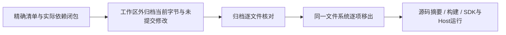
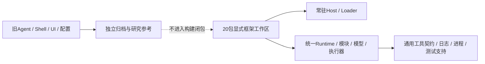

# 干净框架源码树与归属

## CLEAN5c：公共能力归属与统一执行路径

当前18包全部位于crates/common，40条本地path依赖留在同一工作区。Memory/Token/组合数据契约完成归属，旧Rhai Workflow与Orchestra移出到工作区外归档；只采用当前图所需的私有DAG逻辑，不保留旧脚本适配或内置file-steward预设。框架功能由原声明/Loader/Runtime路径装配，源码包仍只交付源码与普通依赖清单。

CLEAN5c的1555项功能和5项文档示例按冻结制品分组通过；Memory一项release性能基准未运行。其首轮HTTP并发回执超时随后由[CLEAN5d](../verification/host-registry-sharing.md)定位为只读启动注册表深复制，修复后相同期限八路并发及完整105入口矩阵通过；进程树提前采样的测试修复保留。精确归属、恢复和历史失败见[本阶段验收](../verification/framework-capability-ownership.md)及同名JSON。以下CLEAN5b/CLEAN5a为各自阶段事实，不代表当前仍有codegen候选或20包工作区。

## CLEAN5b：旧源码物理移出边界

精确清单先记录于docs/verification/retired-source-tree.json：69个旧codegen包、8个旧common包，以及旧proto构建、UI、服务、研究/基准、工具入口、CI和五份旧验收/同步脚本，共97个不重叠目标。当前20包及其43条本地依赖边、modules/presets/fixtures、当前框架文档、根许可证和来源通知不在移出范围。

| 决策 | 执行边界 |
|---|---|
| 归档 | /home/none/nofy-build-retired.jdnpc7，私有目录，保留原路径、字节、权限、时间与未提交diff；不发布或上传 |
| 源码事实 | 10425文件、427889399字节，含目录共11491条记录；不追随链接，当前清单无链接或特殊文件 |
| 移出 | 归档比对通过后才按固定97项目标移动；目标不得覆盖已有项，不移动工作区根、.git或保留包，不删除用户数据 |
| 影响 | 人工HIGH；旧产品入口impact存在同名误选/漏项，准确context有旧Agent/Shell调用方；它们共同移出，不以LOW标签代替实际Cargo闭包及源码核对 |
| 验收 | 保留源码和构建配置保持原字节；检查20包完整feature/target构建与纯交付，在原旧源码不再存在时运行独立SDK、Loader/预设/恢复用例 |
| 不宣称 | 这不是五个公共候选已最终裁剪、完整热更新、新控制台或多预设均已完成；历史文档与现行能力仍需继续归属梳理 |

97项目标已全部移出，11491条记录的字节/权限/所有者/时间核对一致，暂存区未改。旧源码缺席后完整构建、107测试入口编译、独立SDK、6项Host HTTP、2项进程树及53项Python测试通过，保留执行源码未改。详细证据见[物理移出验收](../verification/retired-source-tree.md)。原产品CI与旧兼容验收脚本随其目标一起移出，不补旧入口来使它们继续运行；新的框架发布/CI另按真实执行环境完善。下面CLEAN5a为此前阶段记录。

## CLEAN5a：工作区收束与中立叶子迁移

最终工程只保留声明式框架、可复用中立实现、预设及其构建/验收资料。旧产品源码只作研究参考，不能作为并排项目长期留在最终源码树；仅从Cargo排除不是清理完成。本阶段先关闭实际构建依赖边界，后续按恢复清单物理移出剩余旧源码，不重置未提交工作。

| 决策 | 本阶段范围 |
|---|---|
| 根入口 | Cargo显式保留20个当前框架/公共能力包，default-members为nofy-agent-host；完整闭包含可选feature、build/dev及所有平台声明，不按默认Host能编译就宣称整体干净 |
| 中立叶子 | nofy-tty-utils、nofy-sqlite-journal、nofy-test-support从codegen迁到common；保留包名、API和执行代码，只有TTY公开文档注释及职责说明调整，不留旧路径转发 |
| 旧桥接 | 删除Executors的NofySandboxGuard与nofy-sandbox feature/依赖；EnvironmentGuard接口及新Loader的真实隔离不变，不复制旧配置/全局沙箱或添加空兼容feature |
| 消费者 | 根成员收束使旧Agent不再参与框架解析；旧产品Cargo/源码不为新feature修补。通用guard拒绝的测试保留并直接证明进程不启动 |
| 外部依赖 | 使用原依赖版本和flags，清除仅旧产品需要的workspace依赖及patch；Cargo.lock由Cargo离线重算，不安装工具、重建用户依赖或恢复包体配额 |
| 回退 | 当前源码、根构建/锁及未提交diff归档在/tmp/nofy-clean5-leaves.vy7rmv；回退只处理本阶段准确路径，不覆盖历史状态或其余用户修改 |

保留包的角色分组：Host/Runtime/Models/Modules/Executors；ToolProtocol/ToolRuntime/ToolTypes/Interjection；Memory/MemoryTypes/Compaction/TokenEstimation/Goal；Workflow/Orchestra/PackCore；SQLiteJournal/TTYUtils/TestSupport。共20包。后五个仍位于codegen的公共候选和SDK专用编排/Pack能力必须继续归属收敛，迁移目录不等于其内部所有代码均已最终裁剪。

## 影响与门控

NofySandboxGuard upstream LOW/0；EnvironmentGuard LOW/10，实际目标调用方为Loader Guard与SDK测试。JournalMode图谱LOW/0，由Runtime/Memory实际Cargo与源码补证。detach_command上游CRITICAL/152（25直接调用）；chat_completion_script_exact CRITICAL/54（11直接调用）。这些函数本阶段不改代码，只迁移路径。根Cargo解析入口人工HIGH，包含20包及旧成员退出，不通过修改旧产品消费者保持兼容。

DAG：明确包闭包/前后归档 → 叶子迁移/旧桥移除/根工作区 → 可选能力与中立包回归 → 完整Host → 剩余旧树逐项移出。角色C → A → X。每个依赖阶段验收通过后才进入下一阶段，不在测试运行中编辑源码/重编译或刷新索引。

## 后续物理移出范围

本阶段不直接清空工作树。剩余清单须逐项核对：codegen中的旧Agent/Shell/Tools/配置/采样/认证及原服务；common中未归属的原ComputerHub/Tracing/旧辅助包；旧desktop/nofy-desktop/ref-desktop、prod、原bin/bench/ab-eval；旧CI/发布脚本、原产品说明及不再使用的vendored前端/图形源码。每项先证明不在20包各feature/build/dev闭包，归档当前字节/权限与未提交修改，再物理移出项目。当前modules、presets、fixtures、目标架构/验收与许可证不得按旧目录外观误删。

## 当前阶段证据

20包分批覆盖1725项单元/集成测试通过，另有5项文档示例通过；Memory的一项既有release性能基准未运行，不计作通过。首轮停在原提交已失真的Orchestra固定LOC门槛：3980行超过3693上限，而本阶段没有改其业务源码。依用户已替换固定行数机制的要求，撤出Orchestra和PackCore两份旧LOC门槛，不抬上限或拆业务文件；原行为测试保留，撤出文件已归档可恢复。首轮原始失败日志保留，不能宣称原命令一次全绿。

原全工作区编译的剩余20个测试二进制已在其实际包目录直接执行，保持原all-features图和16MiB测试线程栈；另有九包Cargo all-features矩阵通过。Host222项和Runtime375项均来自首轮实际运行，不重复计数。详细范围、摘要和日志见[阶段验收](../verification/framework-source-tree.md)。

工作区收束不是最终CLEAN5验收，物理旧树、SDK能力的统一装载、完整运行中状态迁移、新控制台及多套版本化预设仍开放。
