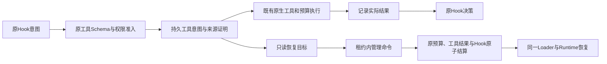

# 原生 Hook 效果与管理恢复

目标是通过统一原生管理入口处理Hook的未知工具效果及已知暂停/失败决策，不包裹旧宿主，不新增执行主循环或依赖打包门槛。

阶段链路为C → A → X：先锁定接口和记录边界，再接通存储及原生管理，最后用真实HTTP/SQLite/进程退出验证并集中回归。

| 决策 | 约束 |
| --- | --- |
| 原生工具意图 | 在原权限准入通过后记录，保持原事件、订阅、总线、源检查点指纹、工具指纹及原账本Scope |
| 未知结果 | 显式结果只结算原意图；不重新派发HTTP、进程或代码 |
| 已有预算回执 | 只接受原已记录结果，不允许操作员替换成功/失败事实 |
| 已知Hook暂停或失败 | 保留实际工具结果，只显式完成对应决策；权限暂停因没有通过准入的工具记录而不成为目标 |
| 控制器 | Workflow/Agent等可恢复控制器继续使用自己的子运行、人类响应和模型恢复接口 |
| 无预算执行 | 由同一持久工具意图区分已准入的未知效果和权限暂停；不强迫用户添加预算或依赖锁 |
| 存储与来源 | 原根租约、线程拥有者、源检查点、事件/订阅/总线和版本共同验证；跨根、过期来源或改变证据拒绝 |
| 崩溃与重放 | 原子提交预算、工具结果、外层决策和命令回执；同命令重放返回原结果，不能重发效果 |

接口采用GET `/api/v1/runs/{id}/recovery/hooks`和既有POST `/api/v1/actions`。查询遵守Read权限和分页，管理命令遵守Execute权限及原FIFO、租约和generation验证。SDK经同一Supervisor/存储方法处理。

恢复目标包含版本化ticket、原事件和工具名。ticket绑定工具意图id/版本、Hook日志版本、不可变意图摘要及目标类型：未知效果、已有回执或已知决策。`reconcile_hook`命令的receipt携带ticket和决策/错误/采用已有回执三种结果；已知决策只能以合法的最终HookDecision完成，不能用此接口替代原审批。

底层以现有Checkpoint表保存工具意图和命令回执，不新增数据库表。原生执行器记录普通工具的TypedToolOutput/ToolError格式；预算仍通过原engine结算，成功、错误及已使用量不被删除。可回退源码与实际行为证据随阶段记录。

已有记录只能依据原回执恢复；缺失派发证据时保持未知，不能用当前新权限或新账本追认旧调用。实际受支持的迁移和验收范围以阶段验证报告为准，不以本设计宣称所有历史状态已完成。

L3b8实际验收覆盖原生根、有预算Tool后代、无预算Agent后代及workflow_start图事实，见[验证报告](../verification/hook-effect-recovery.md)。RunServices保留私有NativeControl；后代路由按根冻结快照恢复scope_identity。大型Hook组合的Agent子组指纹、全部loop/subflow组合及历史无预算证明迁移仍开放，不能将本设计外推为所有状态均可恢复。
