# 控制台驱动的常驻 Agent 内核

运行历史资源页（L7）读取原发布 resource.runtime_store，管理整实例 Runtime 库计划、准备、提交、撤销及命令恢复。原位身份和反向最新数据沿原执行路径；直接浏览器与相关回归见 ../verification/runtime-history-transfer.md。CJK 字体与全页装饰图标色彩的验收边界保留。

L6 已验收：记忆资源页增加显式历史迁移，沿原发布资源选择器计划、准备真实副本、提交、撤销准备和原命令恢复，以整个命名空间为单位。运行先沿原路径停驻，迁移后再应用目标模块声明；实际进程退出与原会话/预算/成功效果连续性已覆盖。实现边界见 memory-history-transfer.md，实际失败及补验证据见 ../verification/memory-history-transfer.md。

L5 当前：默认 Loader 已装载 context.memory_semantic_connected，外部 embedding 协议、Model、范围和预算来自同一声明；来源计划和模型操作绑定原作用域恢复。相关1012项最终通过，初轮失败与定向补验见 ../verification/semantic-memory.md；真实 embedding 上游尚未验收。控制台沿同一模块、源码、版本和恢复 API，无专用执行分支。其余迁移、多套参考预设和发布继续开放。

L4 当前：新的外部常驻控制台通过同一 Host 的 --console-dir 装载，声明/模块源码、版本激活与回滚、运行/会话、审批、原事件流、恢复票据、资源与原预算账本沿统一 API 工作。最终相关270项通过：Host253、Runtime15、JavaScript2；首轮两个失败集中修复，仅补跑受影响范围。默认 Runtime 编译、严格文档、框架边界与格式通过。浏览器实际完成模块及源码编辑、generation 1→2→3、精确审批后一次工具效果与稳定会话续轮；本机模型协议3次、真实上游0次，不重计既有26次真实请求。原真实模型两运行和四账本在无模型凭据的独立状态副本逐字段一致。

系统页移动视口无横向溢出、axe 0违规；复杂运行页0违规但颜色对比1类未判定。测试环境缺中文字体，中文字形排版尚需复核。临时浏览器/服务关闭，缓存执行位恢复。全树detect(all)10793文件/2903符号/196流程/CRITICAL为累计范围，非本块新增；无stale、无新依赖、无commit/push。契约docs/architecture/resident-console.md，验收docs/verification/resident-console.md/.json，证据/tmp/nofy-console.il8cpqrp，恢复/home/none/nofy-build-retired.jdnpc7/console.c3c7ixs6。完整状态迁移、Memory职责与embedding、多套锁定参考版本预设及最终发布继续，整体active。以下为阶段历史。

L3c3：受管记忆捕获与写入绑定更新已通过560项相关验证；7既有/1新增生产Rust，Runtime核心未改。普通/学习资源共用关闭控制，原Hook作用域、预算及模型回执支撑关闭/重开、运行中切换/回滚、exit69对账和整理中断恢复。666源码/31制品冻结匹配，原失败与定向补验完整保留。契约/验收见docs/architecture/managed-memory-capture.md、docs/verification/managed-memory-capture.md/.json。跨后端内容迁移、其余状态能力、Memory职责、新控制台、多套参考预设与发布仍开放；整体active。

L3c2当前：默认Host的HTTP动态ToolSource及隔离context.programmed已通过实际装载、运行、更新/回滚与原模型票据恢复。相关255项最终通过；集中波次的两处夹具失败与补验分别记录，未重跑无影响的工作区检查。详见[外部适配器契约](external-source-context-adapters.md)及[验收](../verification/external-source-context-adapters.md)。Memory写入迁移、其他状态能力、新控制台与多套版本化参考预设继续；以下为阶段历史与目标规范。

L3c1当前：原停驻更新已接入context_sources/context_policies/tool_sources及live/v5，保留原消息、账本、成功效果与待处理计划；待处理模型/Hook/压缩须原版本收尾，不通过丢弃工作形成更新点。18包1622功能与5文档示例通过，详见[来源更新契约](live-source-transitions.md)及[验收](../verification/live-source-transitions.md)。Runtime三类选择已验证；默认Host本轮交付已有context.rules的实际来源更新，外部ToolSource/ContextPolicy工厂、Memory写入迁移、新控制台和多套版本化参考预设仍开放。以下为阶段历史与目标规范。

L3b9当前：原失败组合的预算指纹已改为有界摘要，显式V2完整折叠组合身份；原账本、租约、地址与成功效果保持，编程预设采用hashed_v2。18包1613测试、5文档示例及Python53项通过，见[验收](../verification/bounded-composition-identity.md)。下一基线入口为ContextSource/ContextPolicy和动态ToolSource等状态更新，新控制台及版本化参考预设仍待实施。下文为阶段历史与目标规范。

L3b6当前：预算暂停的子运行和收尾Hook恢复已沿原管理/Loader/Worker验收，原Hook恢复身份记录并匹配，不用当前新账本追认旧未知效果。完整18包1590功能、5文档示例通过，见[组合验收](../verification/budget-composition-resumption.md)。新增输入与收尾顺序、未知Hook管理入口、其他状态及控制台/多预设目标仍开放；以下为阶段历史与目标规范。

L3b5当前实施范围：预算暂停后的原根停驻、仅同资源预算更新及原位Resume已接通统一管理/Loader/Worker，保留未派发请求与未知效果。18包1580功能与5文档示例通过，见[验收](../verification/budget-resumption.md)。这不关闭其他状态与组合边界、新控制台或多参考预设目标；外部依赖用户安装，源码打包仅负责源码完整与归档正确。

> 2026-11-03 用户目标明确：最终上线“统一底层框架 + 多套开源 Agent 的声明式行为预设”。先形成底层基线，再逐套复现并据能力差异补齐通用架构。此前“一套编程预设”是基线样本，不是最终预设数量上限。该更新不撤销下述干净源码、统一执行、版本与状态连续性要求，也不表示当前底层或任一对标预设已经完成。

> 2026-11-01 用户目标纠偏：交付干净的声明式 Agent 框架与一套声明式编程预设；旧 Nofy 源码只用于研究能力，不进入目标依赖闭包或发布制品。旧产品的入口、配置、API、会话格式及未交付开发接口不承担默认兼容义务。本文后续阶段历史中与此相反的旧兼容要求已被取代；新框架自身的系统版本激活、恢复、回滚和状态连续性仍是验收条件。此次修正规范，不代表源码已完成依赖切断或清理。

- 状态：2026-10-29 用户校准后的目标规范；本文不是已实现能力清单。当前事实与证据仍见[闭环计划](../superpowers/plans/2026-10-28-agent-modularity-closure.md)。
- Owner：内核与控制面维护者 / architect。
- Read When：继续模块化、模块加载、配置发布、运行更新、管理 API 或控制台实施前。
- Update Trigger：可管理对象、执行边界、加载协议、更新语义、阶段顺序或验收标准变化。
- Validation：常驻同一内核进程，通过控制台或其真实 API 完成创建、发布、执行、修改、边界更新、重启恢复及声明式编程预设验收；目标依赖与制品不包含旧宿主/主循环或双轨兼容层，不能以 SDK 示例或构建通过代替。

## 产品目标

最终产品包含控制台、常驻运行内核、共享能力模块与多套声明式 Agent 预设。控制台管理能力与运行，内核根据外部定义装载模块并驱动执行。SDK 是内核内部与外部客户端的复用接口；完成标准是用户可以操作的平台及实际可用的预设，而不是仅能构造SDK对象。

内核启动后，用户可以创建或修改 Agent、系统提示词、工具、Hook、自定义事件、workflow、模型路由、记忆、上下文、权限、预算、执行环境、运行阶段与组合策略。通过配置、脚本或标准执行协议实现的新能力，应在相同内核进程中加载，无须更改内核 Rust 源码、重新构建应用或重启服务。

最终产品的控制台页面属于后续实施里程碑；当前优先完成其控制面、加载、发布与执行更新机制。原 TUI/Web/desktop 展示层不做重构。“当前先做内核”不能用于排除常驻宿主或最终控制台验收。

## 以开源 Agent 复现驱动架构完善

先完成可真实运行、可验证和可恢复的底层基线，再逐个复现参考Agent。基线不等于提前证明所有行为都可表达；复现过程正是发现通用架构缺口的验证过程。Codex、OpenCode、pi为参考候选，不在未核对源码和版本时固定能力清单或完成度。

| 阶段 | 工作 | 必须留下的证据 |
|---|---|---|
| 基线 | 收束声明、Loader、执行、权限、上下文、会话与恢复边界 | 实际运行与能力边界验收，不以Trait或示例可构造代替 |
| 对标 | 固定参考版本，拆解工具、策略、调度、上下文及状态语义 | 来源版本与能力/行为差异矩阵 |
| 组合与补齐 | 用同一路径组合声明/外部实现，缺口归属通用模块或执行协议 | 依赖与接口决定，不新增产品名分支或原宿主执行路径 |
| 验证 | 对照实际执行轨迹，并回归全部既有预设 | 模型/工具、权限、流式、取消、状态与重启恢复证据 |
| 发布 | 版本化交付预设与可解析的模块制品，然后进入下一套 | 系统声明、依赖锁、环境前提、凭据引用、差异矩阵和验收报告 |

声明负责选择、参数化和连接实现，复杂逻辑可来自受支持的脚本/制品；不要求将所有算法写成配置字段。模块应可跨预设复用，每套预设有单一声明事实源与独立版本。不能仅替换Prompt或工具别名就宣称复现；缺失/部分实现必须保持为未完成项，不能通过缩小既定能力范围关闭差距。

模型能力、私有服务及原产品界面/协议不能因行为预设而被默认宣称一致。若某项需要新增真正通用的执行语义，可以迭代内核，但须先做影响分析并验证既有预设；常规预设变化仍不得要求修改Rust、重编译或重启。第三方源码仅作能力研究与有清晰归属的复用参考，不将其整套宿主/主循环包裹为所谓声明预设。

## 声明式系统：单文件入口与可迁移装配

2026-10-29 用户进一步明确采用类似 NixOS 的声明式体验：一份系统配置即可共享、装配与迁移整套 Agent。这里描述的是目标使用体验，不宣称已实现 Nix 的构建系统或已具备完整环境复现能力。

- 配置即系统入口：声明 Agent、Prompt、Tool、Hook、workflow、loop 配方、模型、记忆、权限、预算、资源、模块代码/制品及依赖引用。控制台编辑同一份系统定义，文件和页面不维护两套事实。
- 单文件可以包含小型定义/源码，也可引用内容摘要锁定的模块与制品。被引用内容由 Loader 自动解析、取得和验证，不能要求用户手工补 Rust 注册代码或拼装宿主。
- 发布导出为完整可移植系统定义；所有传递依赖、工厂实现、资源协议及代码摘要必须确定。未固定的开发引用在发布时解析并锁定；允许生成锁文件/缓存，但必须能导出为一个自包含清单入口，不能依赖不可见的机器本地注册表。
- apply 语义：读取声明 → 解析/锁定依赖 → 校验配置及宿主能力 → 生成差异与执行计划 → 准备资源/版本 → 激活。失败保留原可用版本；支持版本历史、比较和回滚。这里的 apply 是待实施领域操作，不代表当前已有同名 CLI 命令。
- 控制台保存草稿、发布与应用都使用同一协议和定义格式；文件导入、API 和控制台产生等价的系统状态，导出后仍可独立导入。
- 跨机器复现固定模块版本、系统结构与运行策略。环境相关路径、端点、平台能力、解释器及资源绑定必须显式声明或参数化，并由导入预检报告差异；不能把相同配置承诺成外部模型每次输出相同。
- 配置携带凭据引用与所需注入项，不内嵌明文密钥。目标机器注入对应凭据后即可应用；配置共享不泄露运行凭据。
- 系统声明与运行数据分离。会话、记忆、检查点、待处理输入/审批及未确认效果通过配置声明的状态后端或迁移包迁移，并验证版本与引用完整性。单独一份配置能重建系统定义，不能凭空恢复未包含或未连接的历史数据。
- 完整状态迁移必须先确定源实例所有权及未完成效果，保证源/目标不会同时派发同一运行；恢复保留原运行版本、更新轨迹、预算、取消与对账事实。
- 应用新声明沿前述执行边界更新规则生效；稳定逻辑会话不能因重新 apply 被隐式清空。状态后端/图结构等变更必须先得到可执行迁移计划。

目标交付物为“常驻内核与控制台 + 多套可移植预设声明及模块/制品与依赖锁 + 可选独立状态迁移包”。首个编程基线及后续开源Agent行为预设均以同一协议导出、装载与应用。

## 拓扑与职责

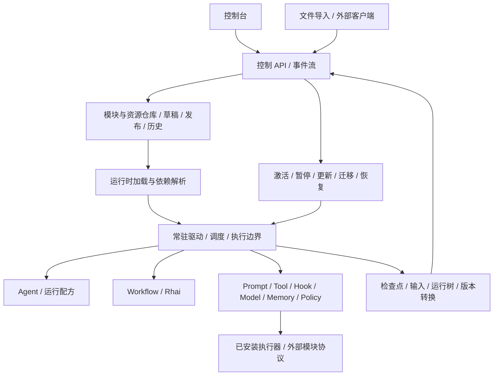

| 层 | 所有权 | 不能缺少的行为 |
|---|---|---|
| 控制台 | 用户操作与可视化 | 编辑模块和代码、连线、预览/探测、发布、执行、运行更新、审批与观察 |
| 控制面 | 配置、版本、权限与运行指令 | CRUD/CAS、校验、发布历史、依赖与使用关系、资源安装、更新状态、事件流 |
| Loader | 定义到可调用模块 | 按需加载、固定所用版本、依赖解析、缓存/失效、缺失版本诊断；不要求应用重编译 |
| Kernel | 通用驱动协议 | 调度、取消、状态与事件、模块调用、控制结果、运行边界与恢复 |
| 模块实现 | 实际能力与行为策略 | 通过受支持执行协议提供实现；Agent 的业务流程与策略可外部定义 |
| Store | 配置和执行事实持久化 | 配置版本与原子激活、运行 CAS/fence/事务；必须声明实际能力 |

内核保留执行协议与一致性规则。业务行为、运行配方和能力实现不应继续增加到硬编码分支中。各套Agent作为版本化声明预设，经同一控制面、Loader与运行内核装载；旧源码只作行为参考，不新增旧入口或配置兼容适配。最终工程源码树也不保留并排的旧项目，不能只靠构建排除或打包过滤声称清理完成。

## 外部模块与代码加载

| 可变对象 | 外部管理内容 | 执行/加载形式 |
|---|---|---|
| Prompt、规则、Skill | 文本、变量、片段、作用域与版本 | 模板/规则加载器；需要逻辑时使用受支持脚本 |
| Tool、Hook、自定义事件 | 输入/输出、代码/入口、事件、匹配、超时、依赖 | HTTP、进程/脚本、MCP、workflow、Rhai 或内置适配 |
| Agent、runtime loop、workflow | 模块引用、阶段、路由、控制条件、子调用、错误处理 | 外部配方/图/脚本，由共享驱动执行 |
| Model、Memory、Context、Policy | 连接、行为策略、资源、参数与权限 | 版本化资源与对应模块协议；使用原真实能力适配 |
| Checkpoint、调度存储、执行环境 | 后端、持久语义、资源限制与绑定 | 完整存储/环境协议；不能只替换一个 Checkpointer 就声称全后端可换 |

普通用户定义新方法时，不应以“编写 Rust trait、修改宿主注册代码、重新编译应用”为必经路径。代码型模块需要可从控制台保存和版本化的源码/制品、明确的运行时、入口、schema、依赖及资源引用。解释器和执行器按环境安装与管理；缺失时返回可定位诊断，不伪造成功。

内置原生实现可复用。外部原生扩展可通过标准进程/服务协议接入，不能依赖 Rust trait 对象的序列化或不稳定的动态库 ABI。每一种可执行模块类型都必须列明外部定义和加载方式；仅能由开发者在 Rust 中构造的类型应标记缺口。

工厂实现版本、资源版本和发布版本分开记录。加入无关资源、工作流或 Agent 不得改变既有模块的实现身份，导致旧运行无法恢复。凭据保存引用，实际值由资源提供方解析。

## 目标控制契约

以下是待实施的控制面领域契约，不代表现有 HTTP 路由已经提供：

| 对象 | 必要字段/操作 |
|---|---|
| ModuleArtifact | id、version、kind、runtime、entrypoint、source/artifact、config/input/output schema、dependencies、resources、digest |
| Draft | id、revision、definition；带 expected_revision 的保存、删除、校验、预览 |
| Publication | 不可变发布号、模块/资源版本集合、依赖清单、编译快照、摘要；发布、历史、回滚、in-use 查询 |
| Activation | 名称到发布号的原子指针；加载、激活、失效诊断与回滚 |
| LiveSession | 稳定逻辑会话、当前发布、当前执行边界、运行/子树/输入/审批/事件游标 |
| UpdateCommand | command_id、目标会话、expected_revision、目标发布、应用边界/迁移模式 |
| CompositionTransition | 源/目标发布、源检查点、应用位置、转换结果、幂等证明与时间 |

控制 API 必须串起上述对象到真实执行；不能把 CRUD 返回成功、SDK 构造或一次性命令当成常驻管理闭环。校验/预览不执行网络或业务副作用；连接探测、工具试运行是明确的独立操作。鉴权区分查看、编辑、发布、资源管理及执行/更新权，不能依赖页面隐藏按钮。

配置仓库采用独立存储接口，可从文件导入导出。首个后端可以是文件或 SQLite；必须交付实际后端的版本冲突、原子发布和重启恢复语义，不能把内存注册表当配置仓库。运行调度的事务存储是另一契约，不能混为同一个“存储模块”。

## 运行中的更新

“活”同时包含常驻加载和执行中的受控更新。只在新建进程或新建运行时读取配置，不满足完整目标。

1. 编辑产生草稿；发布得到不可变版本；激活更新可选发布指针。同一个服务进程接收变化并装载对应模块。
2. 新运行使用当前激活版本。进行中的会话可以提交更新指令，并返回 pending/applied/rejected 以及明确原因和应用位置。
3. Prompt、模型路由、工具视图、Hook、脚本和运行策略按各自允许的安全边界应用。已经派发的调用用原版本结算，后续调用使用已确认的新版本。
4. 内核先核对源检查点、未完成调用、消息/工具配对、schema、权限、预算和资源兼容性，再持久化转换事实。更新不能抹去旧副作用、预算、审批、未处理输入或取消状态。
5. 图结构、记忆/存储后端等有状态变更需要明确的暂停/迁移边界和转换策略。无法迁移时保持原状态，返回原因与可执行的迁移路径；不能暗中换空会话或直接丢弃上下文。
6. 恢复按原运行版本及已提交的 CompositionTransition 继续。重复指令不重复应用；应用前后退出进程都应能确定下一步。
7. 旧 v1/v2 冻结快照的恢复语义保留。新的实时执行契约需明确版本化，不能篡改旧快照来假装热更新。

所有可变项都要有可调用的管理和生效路径；对具体变更使用合适的边界，不把“配置可编辑”和“运行已使用新配置”混淆。

## 与当前实现的差距

已有阶段证据：公共模块/编译/共享驱动、单文件控制面与常驻宿主、HTTP/Rhai/workflow/事件装配、原任务/审批/取消/模型与工具对账、独立凭据和连续预算。L3a–L3c2已支持根Agent安全停驻、模型/Prompt/静态工具/后续Hook更新及显式版本种子跨轮次交接；原不可变提交保留，不再是仅固定根快照。

L2f1已有有界源码制品仓库、自包含导出、可移植解释器身份和Linux受限进程Loader的阶段证据，复用原派发；详细契约与边界见[artifact-process-loader](artifact-process-loader.md)。其旧resource.process仍依赖未锁定宿主库，新锁定路径见下述L2f2。远端取得、来源签名/卸载/GC、权限/预算/动态来源/Context/Memory/Recipe等有状态迁移、完整原能力声明、剩余Rhai/Goal/节点控制、事务存储迁移、新控制台与原预设最终矩阵仍未完成。不能把部分安全更新或单进程隔离等同全能力热更新/完整最终Loader。

L2f2新增[锁定映像与部署](locked-runtime-images.md)：resource.process_locked显式锁定解释器、ELF DT_NEEDED及所声明的标准库/动态扩展等文件字节，映像内loader启动时没有宿主库授权；同份部署文件携带依赖，运行快照仅保存锁清单。旧resource.process继续明确标记未锁定宿主库，不冒充已迁移。该路径不是跨OS/任意ABI、任意动态业务依赖推导或通用容器；生命周期与其余上述里程碑仍需继续。

L2f3a已阶段验收[可验证来源取得](authenticated-runtime-sources.md)：独立受信来源与Ed25519声明、精确载荷摘要/尺寸、调用时凭据、授权撤销围栏和持久意图/回执；部署v2可携带来源引用，validate离线，import/原启动入口取得后仍走原编译发布，默认v1完整字节导出保持。来源配置、凭据及载荷不混成一份自动授信文件。根/内联/嵌套Workflow共享有界依赖遍历，旧未改配置身份保持。来源取得不等同引用保护、卸载/GC或完整历史迁移；最终产品及其余里程碑保持未完成。

L2f3b1已阶段验收[生命周期基础](loader-lifecycle.md)：父进程和helper独立持有跨exec租约，受保护FD避免提前释放；外部API预览、CAS回收派生缓存，原发布/依赖/成功效果保留，Pending隔离/删除可恢复且不删除新同名目录。隔离区计入原映像配额。只清缓存不是模块卸载；引用扫描、资源接纳/发布提交围栏、持久对象GC与其余里程碑继续。

L2f3b2已阶段验收持久声明引用观察：Runtime以独立只读事务折叠v1/v2任务、执行、NextTurn、转换、全部有效版本/种子及检查点/子运行组合；Host补充草稿、全部发布、未完成取得及嵌套workflow。API提供有界计数/样本、revision/覆盖摘要及未知诊断，原递归键只显示SHA256；不执行工厂、不读凭据、不改变状态。`not_observed`只是当前切点未观察到，响应始终不授权删除；提交围栏、显式卸载与持久对象GC尚待后续阶段。

L2f3b3已阶段验收受管提交围栏：可选公共CommitAdmission令catalog/SQLite及资源接纳共享跨进程租约；在实际提交内复核精确依赖，受管标记阻止无策略重开/旧句柄绕过。辅助日志以真实根租约与冻结运行归属写入独立来源凭据，原快照、业务结果和预算不改写；旧未受管SDK保持原入口。提交拒绝不伪称跨库回滚，显式持久卸载/GC仍需独占租约、重检和恢复日志，不因围栏存在就宣称完成。

## 里程碑与依赖

L3 的首个实施边界为根 Agent 的持久安全停驻，契约见[durable-agent-parking](durable-agent-parking.md)。它提供原 actions 通道上的 Park/Unpark、独立检查点凭据及恢复拦截；正在执行的组合转换仍需后续协议和故障窗口验收。

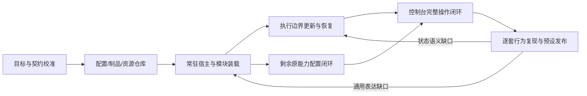

- L1：持久配置/制品、草稿 CAS、纯校验、不可变发布、按所用资源版本恢复；先连通已有能力，不等待所有 C8 尾项。
- L2：复用 registry/compiler/supervisor 的常驻可选管理宿主，提供真实 API、运行资源管理、代码模块装载及事件流。同一进程中新建工具、Hook 和 Agent 并执行。
- L3：版本化更新指令、执行边界和组合转换 journal；延续消息、配额、权限和未完成工作，覆盖更新窗口故障/重启。
- L4：新控制台消费实际接口，完成编辑、连线、探测、发布、运行、更新、审批和观察；不重构原展示层。
- L5：先完成编程基线，再逐套锁定参考版本、组合复现、补齐通用缺口并回归既有预设；发布多套声明预设与能力验收矩阵，不保留旧入口/主循环，不以原产品兼容回归替代新框架验收。

核心文件范围：复用 `nofy-agent-runtime/src/{registry,compile,program,supervisor}` 与既有 executors/workflow/原能力 adapters；新增控制面、存储/制品、加载/资源和更新模块及可选管理宿主，具体新文件在各实施阶段 impact 后登记。禁止引入第二套模型/工具执行循环。

## 产品验收

保持内核进程 PID 与二进制摘要不变，验收期间不运行 Cargo 构建：

- 控制台创建并运行两种不同用途 Agent；现场新建脚本/HTTP Tool、Hook、Prompt，并组成 workflow 或自主 Agent。
- 在同一逻辑会话修改提示词、工具、Hook 或运行策略，观察更新指令在声明的边界生效；对话上下文和已成功节点保持。
- 更新期间遇到活跃工具、审批、取消、已知失败或未知效果，得到正确的等待、续接或对账行为。
- 服务退出再启动，恢复模块版本、配置、会话、未完成工作、更新指令、配额及事件游标。
- 发布和加载失败不损坏正在运行的旧版本；可检查依赖、定位错误并回滚。
- 将控制台导出的单文件系统声明交给另一台干净目标环境；通过预检、凭据注入和自动依赖装载，复现同一模块版本、结构与策略，无手工 Rust 注册或应用构建。
- 文件导入、控制台编辑、API 导出往返一致；重新应用同一声明不重复创建资源或派发业务效果，修改后的差异与实际生效版本一致。
- 单独验收配置迁移与带运行数据的迁移：后者保留会话、记忆、检查点、预算及待处理工作，不启动源/目标双执行。
- 编程基线以及每套已纳入交付的开源Agent行为预设，均经相同声明/装载/执行路径运行，依据锁定能力矩阵验证对话、工具、权限、取消、流式、恢复、Hook、上下文/记忆、压缩、子Agent、消息调度与结构化输出；不依赖原入口、旧配置或独立旧执行路径。未完成项不得因预设文件已存在而被宣称完成。
- 同一内核实际装载多套具有可观察行为差异的预设，共享能力模块；导出/异机导入、版本应用/回滚及重启恢复成立。新增预设不能破坏既有预设的受支持版本、预算、审批和已成功效果。

只通过现有数百项模块测试、只证明 JSON 编译或无界面 API 可用，都不足以宣布本目标完成。

## L1a 已实施接口与当前边界

已实现 `system::{SystemFile,SystemDocument,SystemBundle,compile_system}` 与 `control::{ControlPlane,CatalogStore,InMemoryCatalogStore}`；启用 control-file 可使用 FileCatalogStore。现有 Agent/Tool/workflow/Event 可通过同一个系统声明准备、发布、激活、导出和恢复。实际可运行源文件见[仓库外系统配置](../../fixtures/agent-runtime-consumer/configured-system.json)。

当前 factory 与环境资源仍由宿主安装，系统导出包含确切工厂/资源契约及完整可达模块定义，不能伪称已能自动下载缺失执行器或复现任意环境。新激活供同进程后续调用使用，未提供正在执行的组合转换；常驻网络管理宿主已在 L2a 接入；完整资源管理、外部模块协议与 L3 更新仍待实施。文件配置后端也未替换运行调度后端。

## L2a 常驻宿主实施契约

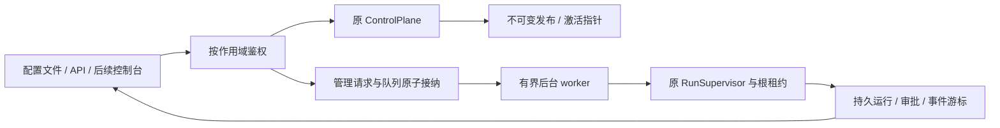

| 决策 | 实施选择 | 原因 |
|---|---|---|
| 宿主位置 | 新可选 nofy-agent-host crate | 默认内核不引入 HTTP/provider；原宿主入口不变 |
| 管理运行接纳 | 在原 SQLite 中与 ProgramSubmission 同事务写入请求 | API 成功后进程退出仍可恢复，不依赖内存任务表 |
| 配置定位 | 请求明确携带 system/release/program | 重复请求不随当前激活变化；新旧版本可并存 |
| 恢复控制 | 命令先持久，原 Supervisor 根租约内执行与确认 | 客户端断开不丢失控制；未知副作用仍需明确对账 |
| 执行结果与事件 | 原 execution_record/events/approval | 不增加第二套模型或工具循环 |
| 模型连接 | 安装稳定声明工厂一次 | 后续连接和模型改变不用改 Rust 注册表 |

运行请求 Schema：`{run_id,thread_id,system,release,program,input?:{text,attachments}}`；release 是已发布摘要，input 仅 Agent 必填。相同 run_id 只有完全相同请求可重放，原请求/冻结快照与队列同事务落盘。恢复请求：`{run_id,command_id,command:{kind:resume|resume_after_cancel|control,...}}`，命令 ID 在数据库内不可复用到不同内容。命令完成回执持久，发生根租约丢失时不伪造已完成。

管理宿主提供只读、编辑、发布、执行等独立权限作用域，令牌值来自环境引用并仅持有摘要；不把值写入系统导出。API 包含配置校验/导入/发布/计划/应用/历史/导出、模块 schema、运行接纳/状态/审批/取消/恢复和持久事件读取。网络服务与有界 worker 常驻同一进程，worker 不绑定 HTTP 请求生命周期。编译使用 blocking pool。该阶段仍不提供运行中 CompositionTransition；已有线程变更组合仍显式拒绝，禁止假冒完整热更新。

## L2b1 凭据轮换实施契约

密钥值由宿主独立文件仓库保存，系统声明只包含逻辑 authority 与引用。默认常驻二进制使用该文件仓库，兼容以原环境提供初始值；存在本地条目时优先条目，删除写入有版本墓碑，绝不回退到旧环境值。访问授权令牌仍是独立引导来源，本阶段不改变访问角色管理。

文件仓库使用绝对固定路径、严格引用字符集、受限字段和值/条目/文件大小、进程间锁、CAS、0600临时文件、fsync/原子替换/目录fsync。结果不确定时明确报告并要求读取 metadata；解析错误不回显内容。运行读取当前值，配置编译和导出不读取值；值变化不改变组合摘要。环境来源本身不会从外部 shell 自动刷新。

API 需要 resources 作用域：GET `/api/v1/credentials` 只列 reference/revision/available；PUT `/api/v1/credentials/{reference}` 接受 `{expected_revision,value}`；DELETE 接受 `{expected_revision}` 并保存墓碑。输出仅 metadata。配置/运行数据与密钥仓库分别迁移，单系统导出不含密钥。原无凭据管理的嵌入接口继续可用；未接文件仓库的宿主明确报告管理入口不可用。

## L2b2 HTTP资源声明

选择稳定的 resource.http 工厂声明基址、允许方法与凭据引用；tool.http_connected 通过标准Resource依赖引用它，并声明contract、相对路径、method、输入/输出映射。一个HTTP资源与任意多个工具共享惰性客户端，工厂不执行业务IO。资源身份包括声明摘要和凭据authority，新增其他连接不改变原程序身份。

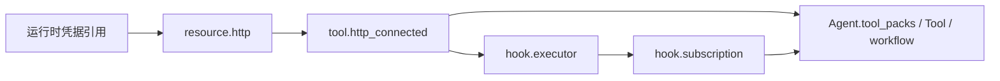

普通模块配置无权选择任意宿主执行器或通过输入改写基址，资源写入/发布需要resources作用域；运行仍经过原Policy/Hook/预算。HTTP资源允许控制台配置新的外部服务方法；这不等于已装载任意进程代码制品，后者继续独立Loader阶段。

## L2b3 可编辑源码方法

`tool.rhai` 是可选Rhai执行器的纯JSON方法profile，配置包含`{contract,source,input?,max_operations?}`。源码和schema随ModuleDefinition版本冻结，发布不执行脚本。工厂用与调用相同的有界Rhai解析器编译语法；调用在blocking pool计算，只接收JSON参数，关闭模块导入、动态eval、stdout/debug，未安装Agent/工具/文件/网络宿主函数。方法可直接返回JSON，或用complete(value)结束。它可作为普通工具、Tool程序或hook.executor的handler，实现外部配置源码方法。

计算量、表达式/调用深度、变量/函数数、递归数据大小、输入/输出字节、timeout和取消分别有界；这些是进程内VM限制，不声称OS内存隔离。新源码不获宿主密钥/capabilities。原workflow脚本编排继续使用原nofy-workflow入口和宿主准入，纯方法不能借Agent选项绕过预算。复杂workflow模块装载、完整Rhai编排选项、进程/制品和组合转换仍属后续阶段。

## L2c 可复用workflow模块编译上下文

新增可选ModuleFactory.build_with_context默认转发既有build；旧工厂和快照不增加必填字段。ModuleBuildContext仅提供已声明依赖的传递闭包与当前宿主强制floor构成的隔离registry，保留当前工厂/能力契约；不会把其他系统模块定义暴露给内层编译。编译后核对已解析的依赖事实，拒绝同名配置绑定到变化的资源身份。

resource.workflow配置`{document:WorkflowDocument,bindings?:{alias:ModuleKind}}`，ModuleDefinition.dependencies把alias连接到真正模块引用。资源复用compile_workflow，内层可组合声明Agent、Tool、DAG/循环/子图等已有能力。tool.workflow_connected与hook.workflow_connected通过标准Resource依赖引用该冻结图，复用原WorkflowToolFactory/WorkflowHookFactory；不依赖宿主提前维护整个workflow字典。单次嵌套纯编译限16层，floor与当前资源形成反向依赖时明确拒绝。

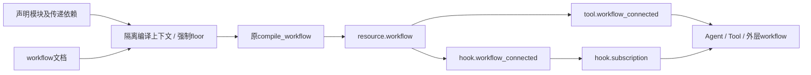

工厂构建只做纯编译，执行、输入确认、审批、预算、取消、事件和子运行恢复全部使用原workflow host与监督器。发布/恢复须保留依赖、图、host floor与资源身份，新增不相关模块不改变既有图身份。

## L2d1 每次运行的参数

配置发布保存默认调用/输入；管理运行可提供parameters覆盖Tool参数、workflow输入或事件payload，不改模块定义/模型/权限/事件owner。Agent继续使用input消息，拒绝parameters。parameters有1MiB上限、按已有工具/图/事件schema纯校验，并在接纳前生成具体ExecutionSnapshot；该实际快照与原请求同事务提交。不同参数不需要新发布，恢复只使用已接纳的冻结值。

ManagedRunRequest新增可选parameters；缺省不序列化，保留旧请求摘要/持久数据。显式null与缺省区分。相同run_id改参数拒绝。模型外根当前仍一thread固定composition，改变参数的独立任务使用新thread_id；不把它伪装成执行中组合更新。只读program接口返回参数schema和发布默认值，供控制台构建输入。

## L2d2 人工响应的管理边界

管理命令使用根run_id、已记录的human控制节点target_run_id、不可变workflow资源引用路径、expected_request和value。客户端不提交原始检查点键、线程归属、事件owner或任意图身份。空路径仅选择根WorkflowProgram；非空路径逐级选择冻结快照中实际可达的resource.workflow，最大16层，每层校验Resource类型及编译身份。根租约接纳响应前验证控制树归属、图检查点、节点/attempt和请求；值按原Human节点response_schema校验。

响应通过原CompiledWorkflow::respond保存CAS和幂等HumanReceipt，再以原RunSupervisor恢复根程序，已有节点、外部效果、费用和输入回执不重置。管理命令先持久化；恢复使用原任务快照及同一命令ID。非法目标或响应产生已结束的命令错误回执，不派发业务效果，也不永久堵塞后续命令。该阶段只完成Human节点，未完成的未知效果对账/停止/放弃保留后续阶段。

## L2d3 可声明的业务事件生产者

业务事件也必须可由系统文件装配。新增event.producer工厂，owner取构建上下文中的模块reference，配置只含events的name/payload_schema/deny/pause/patch/stop；拒绝runtime namespace和原生命周期事件名。新增hook.owned_subscription，标准依赖为producer:EventProducer及handler:HookHandler，配置复用HookRule。订阅从该生产者取得声明，再进入原HookRegistration/HookBus；不修改全局catalog。

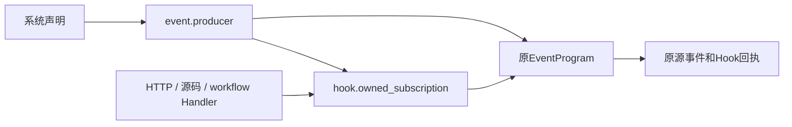

| 边界 | 决策 | 验证 |
| --- | --- | --- |
| owner | 等于声明模块的reference，不接受配置上传owner | 不能占用nofy.runtime |
| 生命周期 | 仍由原runtime和宿主生产 | 新工厂拒绝原事件名 |
| 数据 | payload_schema本地验证，parameters按次冻结 | 错误输入在接纳前拒绝 |
| 执行 | 原事件驱动/Hook journal/控制器 | 无模型执行、重放不重复、workflow Human恢复 |
| 迁移 | 工厂版本、模块、依赖、声明进入原锁 | 单文件导出跨目录恢复 |

本阶段不开放任意宿主生命周期的生产权，也不引入第二套事件循环。

## L2d4a 子工具对账管理

ReconcileChild管理命令包含原ChildReconciliation并强制提供model_sequence。证据仍以root/child/epoch/call绑定，调用方不指定检查点键。原监督器接纳方法提取租约内实现，旧API的获得/释放租约语义保留；管理worker复用其已持有的原根租约，随后恢复原根。

只读recovery分页返回root_run_id、run_id、thread_id、kind、checkpoint_revision、model_sequence和完整call。内容是有界的当前操作视图，命令执行时仍在租约下重验原记录和待执行操作。只返回已记录Agent/Tool子执行中的真实in_flight且与pending_tools首项一致的操作。图控制节点不作为外部效果对账对象。

本阶段不声称已完成根原语对账、模型未知结果、停止/放弃或运行中组合转换。

recovery视图在SQLite内投影所需元数据，并在数据库内比较组合身份，不把子执行的完整组合和消息记录整批载入内存；分页限制1..256条候选，返回体8MiB。组合校验留在服务器，调用方不上传组合摘要作为权威。

## L2e1 可迁移的预算资源

当前GovernanceFactory绑定宿主预装InstalledBudget；其旧身份含实际存储标识，不能直接用作跨state-dir的配置锁。新增显式命名安装API，身份基于可信逻辑authority、revision、ceiling、retry ceiling和持久化语义；实际store仍保留原值，监督器继续检查其与根检查点属于同一数据库。旧install/API/身份保持兼容。

resource.budget由常驻宿主绑定原SQLite账本，config为空对象；逻辑资源名由可信authority及声明reference确定。governance.budget_connected依赖budget:Resource，config为limits/retry，使用原GovernanceProfile及其ceiling约束。构建只绑定句柄，实际enroll/预留/结算继续在原根租约下发生。

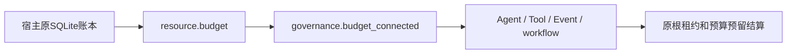

| 关切 | 决策 |
| --- | --- |
| 配置迁移 | 同一authority/资源声明/ceiling产生相同锁，不写本机DB路径 |
| 数据迁移 | 配置锁不携带运行账本，既有数据另行迁移 |
| 存储归属 | 仍使用原storage_identity检查，逻辑同名不能授权另一个DB |
| 兼容 | 旧InstalledBudget::install与GovernanceFactory行为和身份保留 |
| 日常配置 | limits/retry均在系统文件，编译/校验阶段不产生预算记录 |

验收包含跨目录锁恢复、实际共享quota限制及resume保留已消费费用、错类型/超ceiling拒绝、同名异库在运行前拒绝。

## L2d4b 系统自约束的恢复上下文

compile_system会将文件中的required_policies/required_governance合入私有registry，并冻结到程序快照。管理worker必须恢复这份约束上下文。对已由submit_managed接纳的任务，在恢复快照前要求当前宿主强制floor为快照floor的子集，再合入快照自带的额外约束。定义/工厂/资源及所需能力继续由原snapshot.restore精确验证；增加宿主新floor仍拒绝旧任务。

普通SDK/unmanaged任务保持原严格恢复规则，缓存关闭任务/已完成命令保持提前回放。该调整不依赖重新读取激活指针或发布默认值，也不降低宿主约束。实际验证使用配置文件required审批策略，保证首次执行暂停、审批/恢复后只产生一次效果，并拒绝遗漏当前宿主floor的恢复。

## L2e2 根原语对账与内核优先级

当前施工优先内核闭环；控制台展示层后置。新增命令只管理原监督器，不引入另一套运行循环。

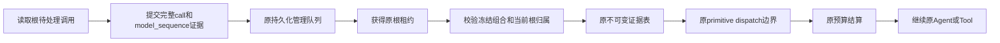

| 接口 | 契约 |
| --- | --- |
| GET /api/v1/runs/{id}/recovery/root | read作用域；返回RootRecoveryTarget或null，字段run_id/thread_id/checkpoint_revision/model_sequence/call |
| POST /api/v1/actions | execute作用域；command.kind=reconcile_root_tool，receipt包含必须的model_sequence、完整call、result、is_error |
| 最终命令回执 | 继续使用GET /api/v1/actions/{command_id}；HTTP接纳不等于执行完成 |
| 证据身份 | 原表键(root,root,model_sequence,call.id)；相同证据可重放，不同结果不可覆盖 |

根视图只在SQLite内投影单个待处理调用，限制返回体8MiB，不批量载入系统配置/历史。视图为候选信息；动作执行仍在根租约内验证根快照、当前thread owner、checkpoint execution_run_id、完整call和pending队首。旧轮次、旧根以及被覆盖结果均拒绝。

根Agent和普通Tool可使用该命令；根workflow/Event控制器必须选择记录的原语子运行。即使Tool内部包裹可恢复控制器，原dispatch仍拒绝外部替换控制器结果。原子工具证据到达原边界后结算原预算，效果不重新发送；已存在的预算回执仍优先使用。没有预算的运行也通过持久证据继续执行。

沿用原证据表，无schema升级；旧reconcile_child、普通resume及旧RunInput接口保持。模型未知结果、停止/放弃、运行中CompositionTransition与完整原编程预设验收仍属未完成范围。

## L2e3 治理模型意图对账

治理模型在原sample_model边界获得派发资格后，先记录当前尝试，再调用提供方。检查点使用独立model-evidence-v1命名空间和原围栏/CAS，不更改旧预算表、ModelRetryTicket或预算结果格式。旧版本已有claimed预算意图可在普通恢复暂停时补出同一原生票据；这一步不重发请求。

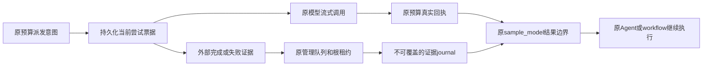

| 接口/数据 | 契约 |
| --- | --- |
| GET /api/v1/runs/{root}/recovery/models | read；target_run_id缺省为根，也可指定该根记录的Agent后代；返回有界候选数组 |
| ModelReconciliationTarget | ticket、reserved、unbounded_tokens、evidence_accepted |
| ticket | request为原ModelRetryTicket身份字段，额外attempt区分同一generation的提供方尝试 |
| POST /api/v1/actions | execute；command.kind=reconcile_model，receipt包含ticket与result |
| result.kind=completed | response为原ModelResponse，保留原消息、工具、用量及完成信息语义 |
| result.kind=failed | failure为原ModelFailure，继续原重试策略及显式重试票据链 |

接受证据时核对根冻结组合、根线程当前归属、目标Agent检查点的composition/execution_run_id及完整原生票据。客户端不能提交检查点地址、预算句柄或改写请求；子目标按主键读取，避免载入整棵子运行树。scope、fingerprint、generation或attempt不匹配均拒绝。目标列表是候选视图，最终接纳仍在原根租约内校验。

真实预算回执优先于外部证据。完成证据按原预留与报告用量逐维取较大值；失败证据按原预留上界结算，保留原失败/重试语义。报告超出模型上界仍记入账本并阻断预算；不清零、不重置期限。Token未声明上界时继续原unbounded_tokens规则，不能虚构未知Token用量。实际预留由原request_bound决定，可能被具体请求的输出限制收窄。

同一尝试的证据不可覆盖，已接纳证据和最终管理回执可以重放。每个Agent使用自己的journal；同一Agent并行scope共享进程内互斥以保护CAS，跨进程仍受根租约约束。journal上限4MiB、待处理尝试256项、历史证据8192项（先到容量限制为准）。证据不绕过上下文revision、权限、工具Schema或原预算期限检查。

模型证据与接纳它的管理command_id在同一次CAS中关联，命令关联上限8192。若最终管理回执丢失，而该线程已进入下一轮，只允许已经关联的原命令读取旧关闭任务的不可变结果；结果仍核对原提交digest、快照、状态及运行身份，不改写新一轮检查点。新命令没有该接纳凭据，仍须通过当前线程归属验证。旧journal缺省无命令关联，不凭证据内容相同推定命令已接纳。

该阶段覆盖启用治理并持久化模型意图的运行。未治理旧入口尚无同等模型意图保证；它的持久化加强、停止/放弃、运行中组合切换及完整编程预设验收继续后续阶段。

## L2e4 独立模型日志模块

binding.model_journal是既有Binding类型的新标准工厂，config为空对象；将其reference加入Agent或workflow host的bindings即可选择。模块保存在系统声明与锁中，默认宿主已安装工厂，普通配置更新不需要改Rust或重新编译Agent包。未选择该模块的旧配置保持原行为。

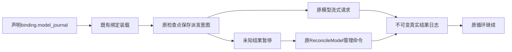

该模块要求检查点；直接SDK可注入内存后端做进程内恢复，跨进程持久性取决于真实后端，常驻宿主仍使用原SQLite和根租约。绑定一旦选择会在后续绑定清理及后代Agent中保留。无预算时不调用request_bound、不enroll预算，也不伪造预留或治理元数据；实际用量保持原ModelResponse语义。

无预算原生结果使用独立model-unmetered-v1命名空间，单Agent 16MiB/8192操作有界。派发前写意图，返回后先写真实结果再提交主状态；主提交丢失时读原生结果，不重复模型请求。未知派发使用既有模型证据接口，目标带unmetered=true且reserved无预留，真实结果优先。失败走原显式重试票据/generation，已知取消保留原语义；开启治理时继续原预算边界。

可装载单文件为examples/model-journal-system.json；它组合模型、提示词、源码工具及日志绑定，不声明治理预算。停止/放弃、运行中组合切换与最终原编程预设矩阵仍需继续。

## L2e5 管理放弃契约

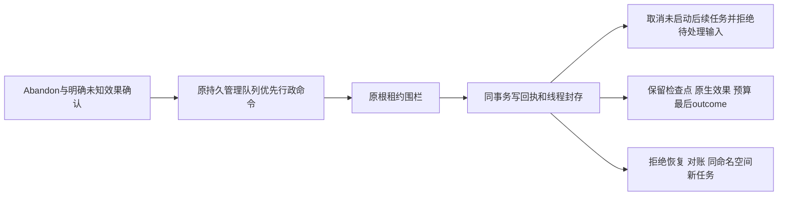

| 选择 | 决策与边界 |
| --- | --- |
| 合作停止 | 继续原cancel及取消游标；不宣称外部请求必然停止 |
| 管理放弃 | command.kind=abandon，reason为1..4096字节且非空，acknowledge_unresolved必须true |
| 对活跃执行 | 不抢有效租约；先由原cancel停止本地执行或等租约到期 |
| 不可逆封存 | 同一Agent命名空间和thread_id不得继续；新线程显式开始新运行，不自动迁移未知效果 |
| 事实源 | 原SQLite新增agent_runtime_abandoned_runs；旧检查点/预算/结果日志不变 |
| 回执 | ManagedActionRecord.abandonment为可选字段；GET actions/{id}继续read，POST actions继续execute |
| 已关闭任务 | 返回原不可变业务结果；不对后续轮次施加封存 |
| 失败工厂 | 放弃路径不restore模块，不要求模型凭据仍可用 |

Abandonment记录原提交/组合摘要、实际根检查点revision与摘要、根pending观测、子运行数量、取消任务/拒绝输入计数及时间。根pending不是整个子树的完整状态证明。回执不把未知模型或工具结果改为失败，也不释放或退款未知预算。放弃封存与最终管理回执原子提交；HTTP响应丢失可精确读回。

待处理Abandon优先于同根普通管理命令，避免坏工厂卡住放弃。取得根围栏后其余未完成命令收取superseded管理错误，实际已发生效果仍以原生日志为准。已完成命令不改写；其他根和新线程不受影响。本阶段不是CompositionTransition，也不提供放弃后的自动迁移或解除封存。

## L3b1 有效配置转换

在 L3a 根 Agent 停驻之后，通过原 actions 提交 `transition`，从同系统精确发布版本装载兼容模型、参数和静态 Prompt。`nofy.live/v1` 明确分离不可变提交/执行存储身份与有效组合，保留原日志、预算和成功效果；同根租约内 CAS 提交检查点、版本记录和命令回执。转换本身不恢复执行业务，需显式 Unpark 与 Resume。当前版本与有界历史分别由 runs/{id}.live 和 runs/{id}/versions 提供，单次证据最多 16 MiB、单运行最多 32 次转换。

Sampler 对已知普通 chat_completions Assistant 历史提供无损校验；未知原生项、推理、托管工具、工具/权限/预算等有状态模块变化拒绝，不通过删历史或重置预算绕过。当前仅覆盖同一进行中根运行，不意味着后续运行自动继承，也不是完整模块热更新。协议、决策表和恢复边界见[有效版本转换](live-agent-transitions.md)。

## L3b2 工具与 Hook 的有效能力更新

追加 update_modules 显式选择静态工具目录及后续 Hook 订阅，使用 nofy.live/v2 累积迁移事实；原 transition 和 v1 摘要保持。原执行身份与有效能力分离，实际调用及人工响应按目标冻结能力恢复；受保护权限、预算、动态来源与上下文不隐式替换。Hook 新epoch处理未来事件，不重发历史生命周期，相关依赖闭包身份避免无关Prompt变更影响回执。详见[转换契约的 L3b2](live-agent-transitions.md#l3b2有效能力双视图与工具hook-转换)。

后续必要阶段包括稳定逻辑会话/跨运行交接、权限与预算等有状态迁移、进程/制品 Loader、完整原能力声明与最终控制台。不同冻结任务不能与已更新对话混用；当前保护边界不是跨运行交接的交付证明。

## L3b3 普通权限策略的运行中更新

原update_modules新增显式policy_set，目标发布的AgentDefinition.policies控制后续根工具准入；强制权限及共享受保护依赖保持。live/v3累积选择，经原停驻/CAS/事务提交和会话种子恢复；历史、成功效果、审批及预算不重置。持久引用扫描同步识别v3，未知协议仍拒绝。契约见[权限更新](live-policy-transitions.md)，[实际验收](../verification/live-policy-transitions.md)包含Host/Runtime完整607项功能、5文档示例及两个硬退出位置；首轮扫描器漏接导致拒绝提交的失败保留。

本阶段只完成普通Policy集合的更新。完整权限的其他状态边界、预算、Context、动态ToolSource与Memory迁移继续实施，不等同所有运行配置已可热更新。

## L3b4 同资源预算额度的状态迁移

原update_modules新增budget_limits，以live/v4保存当前Profile、原账本、资源及历史别名。确认停驻后，在原根租约/CAS事务中同时提交额度、版本和回执；用量、预留、成功回执不归零，期限仍从原创建时间计算。旧/中间子Profile继承当前账本规格及重试策略，会话下一轮继续同一预算根。实际Host同进程及接纳/提交后两硬退出、预算增加/缩减/回滚和完整18包回归见[验收](../verification/live-budget-transitions.md)，契约见[预算迁移](live-budget-transitions.md)。

下一优先额度耗尽后的待派发工作更新边界；资源替换/拆分合并、完整权限及其他模块迁移、预算用量管理视图与最终控制台继续实施，不把本阶段作为全能力热更新证明。

## L3c1 稳定会话身份与连续预算

显式创建 nofy.session/v1 后，同冻结配置的后续 Agent 根仍通过原任务/NextTurn 队列运行，原 begin_run 事务绑定成员与输入提交摘要；当前归属查原线程表。私有受管后端分离实际执行根和稳定账本根，不复制或重置用量、预留、操作及绝对期限。HTTP 提供接纳、会话与成员历史查询；接纳首根后可持久重放，已独立启动多个根的线程不允许回溯并账。协议与降级约束见[持久会话](durable-agent-sessions.md)。

该阶段仅解决同冻结配置的连续轮次与预算归属。有效版本种子、源根完成证明、预期版本 CAS 及 at-handoff 新输入绑定属于后续 L3c2；原 live owner 跨根保护继续启用，不把只对原运行生效的更新称作完整热更新。

## L3c2 显式输入绑定与跨根有效配置

会话 turns 入口显式接纳新输入或凭原摘要接纳既有排队任务，绑定前驱和预期本根 live revision。Worker 在前驱关闭且检查点/输入证明、版本与当前归属一致时冻结独立种子，随后由原执行/输入确认路径接手，不改原提交/存储身份或预算。继承的模型、Prompt、工具与 Hook 状态成为本根有效基线；本根后续热更新从该基线递增，旧配置不能静默覆盖它。种子固化前可 CAS 重绑，固化后恢复同一证据。详见[持久会话 L3c2](durable-agent-sessions.md#l3c2显式轮次绑定与有效配置种子)。

已验证真实同进程和硬退出后的原票据对账、持续预算和成功效果保留。普通 runs/NextTurn 未显式绑定时仍保持原冻结语义，更新不会静默污染旧任务。完整权限/预算/动态来源/Context/Memory/Recipe 迁移、跨线程状态导出导入、Loader/隔离、完整原预设声明、新控制台和 C10 仍需后续验收，不以当前种子交接冒充全部热更新能力。

## L2f3b4 持久对象卸载与维护边界

控制面支持显式选择无引用制品、锁定映像和本机运行时绑定，在使用/提交双独占租约内重检引用、CAS及物理身份，再经持久意图、隔离删除和启动恢复完成卸载。共享解释器仅在最后绑定移除时回收；草稿/发布/历史运行/版本/种子/未完成取得继续保留依赖。新同名对象和完成命令重放不得被恢复误删，unknown不视为零引用。

维护期间拒绝新声明与缓存使用，运行查询、普通输入、预算结算、取消及已保留资源的辅助继承继续；不重置原会话、效果或账本。API与公共Host方法同事实源，具体协议见[Loader生命周期](loader-lifecycle.md)。这是资源生命周期控制面，不是历史清理、完整能力热更新、新控制台或原Nofy最终产品矩阵的完成证明。
