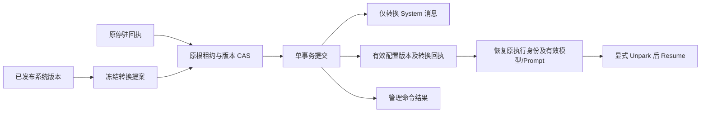
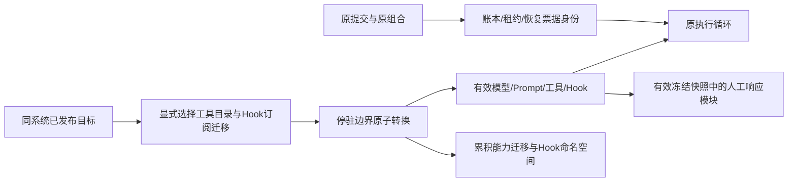

# 安全停驻后的执行版本转换（L3b1）

L3b5已补[预算暂停后的原位恢复](budget-resumption.md)：确认保留未派发工作，独占选择budget_limits，非预算定义与整个RunState保持；原模型/工具身份恢复，未知效果不因增加额度而重发。实际范围与18包1580功能回归见[验收](../verification/budget-resumption.md)。子控制器、终止工作及其他模块状态仍需各自证据。

后续L3b4增加显式`budget_limits`和`nofy.live/v4`，在同资源、已确认停驻边界保留原账本调整额度/重试，历史身份随子调用与会话继承；见[预算迁移契约](live-budget-transitions.md)及[验收](../verification/live-budget-transitions.md)。额度耗尽后仍有待派发工作的转换边界未由该阶段完成。

后续L3b3增加显式`policy_set`和`nofy.live/v3`，支持普通根策略集合的更新、回滚与会话继承；强制权限、共享受保护依赖和预算保持。新增语义见[普通权限策略契约](live-policy-transitions.md)及[实际验收](../verification/live-policy-transitions.md)。下文v1/v2描述各自支持的范围，完整有状态更新仍未完成。

## 契约与边界

`nofy.live/v1` 将不可变的提交/执行存储身份与有效配置分离。原 `JobSubmission`、`RunRecord.snapshot`、检查点 `composition`、模型恢复日志、预算与 Hook 身份不重写；另存目标冻结快照、真实目标组合摘要和单调版本。此协议仅适用于已初始化的受管根 Agent，不能推断为所有模块均可热替换或后续新任务自动继承配置。



| 决策 | v1 规则 | 原因 |
|---|---|---|
| 可变能力 | 模型连接、模型参数、静态 Prompt | 无需迁移工具效果或状态模块 |
| 保持能力 | 工具、策略、预算、Hooks、上下文、绑定、Recipe、身份、步数及其依赖闭包逐项一致 | 不放宽权限、不重置预算、不误认旧效果 |
| 历史 | 除首条 System 消息外，检查点状态完整保留 | 保留对话、已成功效果和恢复游标 |
| 提供方历史 | 目标适配器异步校验历史，不发送提供方请求；默认拒绝 Opaque，外部协议须明确理解其原生格式 | 不删除或改写提供方历史，特殊格式另需迁移器 |
| 回滚 | 再转换到旧发布版本，版本继续递增 | 不倒退预算、执行序列或成功效果 |
| 生效 | 停驻边界内原子转换，释放与恢复分开 | 转换本身不调用模型或工具 |
| 崩溃 | 冻结提案、检查点、有效版本、回执由 SQLite 与根租约保护 | 接受后重启不重新选择配置，提交后重试不重复转换 |

## 管理接口

使用既有 `POST /api/v1/actions`，命令形状为：

```json
{"command_id":"change-1","run_id":"run-1","command":{"kind":"transition","park_command_id":"park-1","expected_revision":0,"release":"<64 位已发布版本摘要>","program":"chat"}}
```

宿主只从同一系统的已发布版本解析目标，SDK 使用 `submit_transition(action, compiled_system)`；普通 `enqueue_managed_action` 不接受无冻结提案的转换。`expected_revision` 初始为 0，后续必须匹配当前有效配置版本。目标定义通过兼容性检查后冻结，执行时再次验证停驻、原提交、有效版本及检查点。

C8a将历史回调移出SQLite事务：短事务读取边界，事务外await校验，最终事务重读并验证内部证明。证明绑定原提交/目标提案、源及有效版本、完整停驻回执、检查点原始载荷与revision、迁移选择和任务状态；不是API可提交的字段。校验期间发生漂移不得套用旧结果。执行侧在异步等待期间续原根租约，仍保留最终事务的租约/FIFO/所有权及检查点CAS检查；历史拒绝持久化为命令失败，不改写预算或成功效果。并发相同命令若已接受/完成，等待中的提交返回该精确记录，而非再转换一次。

有效版本记录包括 `protocol`、`revision`、`command_id`、`run_id`、`submission_digest`、`composition_digest`、`release`、`program`、`snapshot`、原始/转换后检查点及其摘要。原停驻回执保持不变；释放时使用该停驻下最后一条已提交转换的检查点证明，不把合法转换当成意外漂移。同一停驻可连续转换，但每次均要求版本 CAS。

`GET /api/v1/runs/{id}` 的 `live` 为当前有效版本摘要；`GET /api/v1/runs/{id}/versions?after=0&limit=16` 是需 Read 权限的有界历史摘要，单页最多 32 条，不重复返回完整对话。摘要含原/目标组合、发布版本、检查点 revision/digest 和模型序列；完整冻结快照及前后状态仍保存于原子证据。单次证据上限 16 MiB，单运行最多 32 次转换，达到上限明确拒绝。原模型日志按不倒退的 `model_sequence` 继续，转换记录内边界状态用于归属有效版本，不重标旧效果。

## 阶段里程碑与验收

依赖：L3a 安全停驻 → 兼容性验证/冻结提案 → 原子转换/恢复装载 → HTTP 真实连接与崩溃回归。角色顺序：C → A → X。

验收覆盖模型及 Prompt 实际生效、转换不产生模型/工具调用、原提交及预算不变、检查点及版本漂移拒绝、无效模块变更不入队、精确重放、重启恢复、旧版本回滚与原停驻行为兼容。尚不覆盖工具/权限/预算/有状态模块迁移、新控制台和跨运行继承。

恢复仍要求原冻结组合与目标组合的工厂/资源定义均可装载；旧工厂或制品的卸载/回收需要后续 Loader 生命周期协议，不能用当前安装的任意实现替代冻结身份。原静态 v1/v2 SDK 行为不变，已转换运行必须经受管 Worker/管理命令恢复。

## L3b2：有效能力双视图与工具/Hook 转换

该阶段追加 `nofy.live/v2`，不改变旧命令、旧提案或 v1 记录的线协议与摘要。DAG 为 L3b1 → 有效快照查询/能力视图 → 显式工具与 Hook 迁移 → 恢复/人工控制及真实宿主故障验收；角色顺序 C → A → X。



| 决策 | 规则 |
|---|---|
| 管理命令 | 新增 update_modules；保留 transition 的原模型/Prompt语义 |
| 显式迁移选择 | update.tool_catalog / update.hook_subscriptions；至少一个为 true，不自动扩大权限 |
| 工具范围 | 静态 tool_packs 及其依赖可换；tool_sources 及其状态/视图协议继续保持，不假冒有状态迁移 |
| Hook 范围 | 替换/增加/删除订阅，只处理后续事件；不补发已经发生的 session_start/turn_start/user_input |
| 回执命名空间 | Hook迁移时生成与根、命令及版本绑定的 epoch；新运行时订阅身份加入epoch，不改旧Hook日志 |
| 进度转换 | 已排空事实和prepared状态；启用Hook建立当前运行的前向游标，移除Hook退休未来停止游标，不写伪造成功回执、不重置stop_attempts |
| 不可变项 | 根身份、策略/floor、预算、上下文、Recipe、绑定、Middleware、Checkpointer、动态ToolSource及其可达依赖保持一致 |
| 再次更新 | 每条边从当前有效快照比较，旧transition不能隐式撤销已更新的工具/Hook；累积迁移元数据驱动恢复 |
| 原生历史 | 不变的模型、参数及Prompt不涉及历史迁移，原生消息原样保留；发生相应变更时仍须适配器校验 |
| Prompt | v2未改变Prompt时不重渲染已有System，保留历史Hook补丁；改变时首批仍只允许纯静态Prompt |
| 能力查找 | 实际调用和人工响应读取有效能力/冻结快照；执行身份、票据、预算与原提交校验使用不可变视图 |

命令示例：

```json
{"command_id":"modules-1","run_id":"run-1","command":{"kind":"update_modules","park_command_id":"park-1","expected_revision":1,"release":"<64位发布摘要>","program":"chat","update":{"tool_catalog":true,"hook_subscriptions":true}}}
```

v2记录增加可选 `modules`：`{tool_catalog:bool,hook_epoch?:string}`，缺省/缺失为旧v1；该字段在v1序列化时省略，旧摘要保持。工具迁移选择累积保留，Hook epoch在明确迁移Hook时递增替换；后续仅改模型的命令仍恢复当前有效能力。每个版本的迁移选择均可由其不可变管理命令核验。恢复核对原受保护依赖、当前有效组合与累计迁移状态；不能直接把旧快照换成新快照。

阶段验收包含：原工具成功后替换/新增/删除工具并继续同一根；新Hook仅处理未来事件且恢复不重复；新工具失联后原根票据对账；新加入workflow Hook中的Human响应；未选择能力/共享受保护依赖变更拒绝；v1后接v2、v2后仅改模型、显式回滚；转换窗口故障与旧快照摘要兼容。完整权限、预算、动态ToolSource、记忆/存储和运行配方迁移仍为后续必要工作，不据此标记总目标完成。

旧编译器的Hook注册身份包含完整解析快照；v2运行时不复用这种无关能力耦合，而将注册引用与其依赖闭包形成稳定身份，再与 epoch 组合。原编译器和 v1 日志不修改。双停驻测试在实际运行中执行Hook后只换Prompt，验证运行时总线身份保持且旧效果不重复。

同线程后续冻结任务与当前有效快照不同时，先保持排队并拒绝初始化，检查点不改。此处需要后续稳定会话/版本化交接协议，不能隐式使用旧模型、新System或重置历史；显式回滚到相同快照的既有连续运行保持。完整交接需另验收旧根关闭证明、版本 CAS、会话状态及新输入原子归属。
