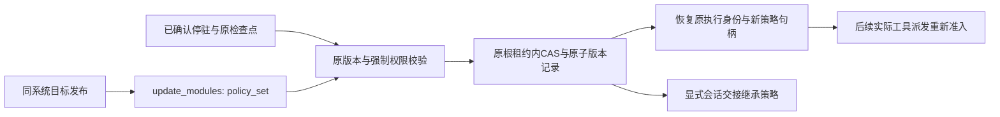

# 运行中权限策略更新

本阶段在现有 `update_modules` 协议中加入显式 `policy_set` 选择，完成普通 Policy 集合在同一进行中根运行的更新、恢复、回滚和后续轮次继承。预算、Context、动态 ToolSource、Memory 及执行存储迁移分别实施，不以本阶段替代完整状态更新。



| 决定 | 语义 |
| --- | --- |
| 显式选择 | `update.policy_set=true` 才能更换普通 policies 及其专属依赖；未选择仍拒绝变更 |
| 应用位置 | 复用原已确认 park、检查点摘要、有效版本 CAS、FIFO、根租约与原子回执；不在已派发调用中换策略 |
| 强制权限 | required_policies 集合及其传递依赖身份完全保留；恢复只换普通策略句柄，原 PolicyFloor 仍由内核保护并传给子调用 |
| 共享依赖 | 仍被 checkpointer、binding、governance、未选择的工具/Hook/上下文或强制权限引用的模块必须保持一致 |
| 执行 | 根 Agent 从目标声明取得有序普通策略，后续直接工具派发先检查强制权限、再检查普通策略。Hook 和子调用继续按各自声明及继承的强制权限执行，不增加产品专用分支 |
| 状态 | 不改消息、工具/模型结果、成功效果、旧审批记录、预算账本、输入或取消事实；不会把旧调用重新派发 |
| 策略资源 | Policy 契约按每次实际派发求值，没有内核托管的独立策略检查点。声明连接的外部资源继续自行持久化；本操作不复制或清空资源内部数据，不声称迁移 Memory/存储后端 |
| 积累与回滚 | 一旦显式更新，恢复及会话种子记住 `policy_set=true`；后续仅改模型/Prompt不能隐式恢复原策略。回滚是另一个显式版本 |
| 版本 | 使用过 policy_set 的有效版本为 `nofy.live/v3`；未使用仍按原 v1/v2 解释。新增布尔字段缺省 false 并省略序列化，保持已支持历史命令/版本摘要 |
| 管理权限 | 继续使用发布与执行更新的既有 API 作用域；页面或模型输出不能直接写入私有 PolicyFloor |

管理命令沿用原路由：

```json
{
  "command_id": "policy-update-1",
  "run_id": "run-1",
  "command": {
    "kind": "update_modules",
    "park_command_id": "park-1",
    "expected_revision": 0,
    "release": "<目标发布摘要>",
    "program": "chat",
    "update": {"policy_set": true}
  }
}
```

`ModuleUpdate` 与 `LiveModuleState` 增加可选 `policy_set: bool`。目标声明的 AgentDefinition.policies 是事实源；未选择能力、强制 floor 及其受保护依赖仍按原快照比较。`Agent::with_live_modules` 只替换普通 policies 和其 spec 标识，不修改原组合、持久命名空间、required_policies 或预算。

持久引用扫描器同步识别 v3，继续遍历有效快照以及 before/after 原组合；资源接纳和生命周期管理不得因新版本遗漏已用声明，未知协议仍拒绝。首轮默认宿主专项发现该读取路径尚未接入并拒绝提交，补充 upstream HIGH 分析后再修改；失败保留为验收记录。

阶段验收要求实际策略允许/拒绝影响后续工具；旧成功效果只发生一次；强制权限及共享依赖变更被拒绝且不改检查点；精确重放、原子失败、重启、显式回滚和跨轮次种子继承成立；默认 Host 经真实 HTTP 发布/更新及恢复走同一路径。只验证序列化或 SDK 可构造不算完成。

预算后续需显式绑定新旧逻辑账本，原子保留 used/reserved、操作回执、原绝对期限及主从范围；不能仅替换 GovernanceProfile，因为其身份包含 limits/retry，直接换句柄会新建空账本。该缺口保持开放，普通源码打包不因此增加环境或依赖门槛。

本阶段实现与相关完整回归已通过，范围、首轮引用扫描失败、真实宿主硬退出和恢复证据见[验收报告](../verification/live-policy-transitions.md)。完整权限的其他状态边界及其余模块迁移未由本阶段关闭。
