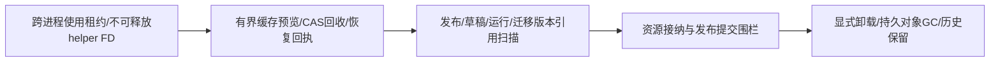
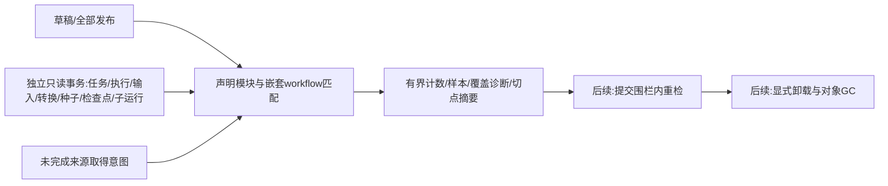
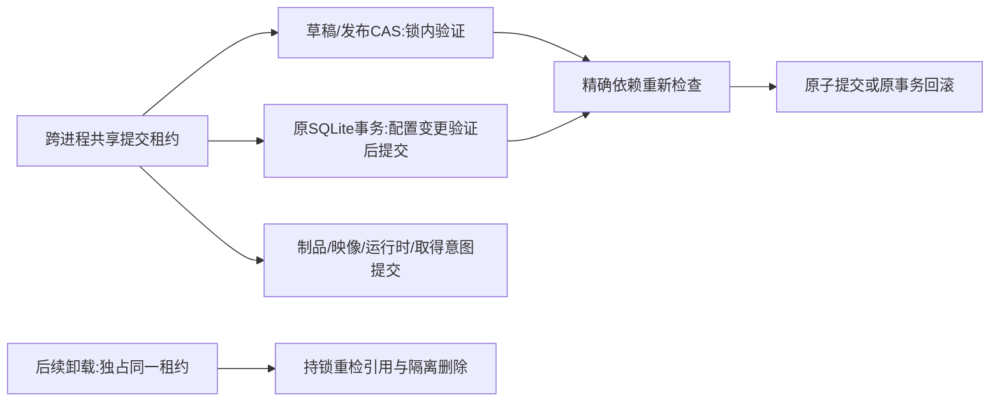

# Loader 生命周期（L2f3b）

## 交付顺序与边界

角色 C → A → X。本阶段L2f3b1实现前两项基础设施，后续引用/卸载不得绕过这些租约；不把缓存清理冒充模块卸载或完整生命周期。原发布追加保留，旧发布、运行、恢复与回滚均可能使用依赖；按“非当前版本”删除是错误的。

| 决策 | 契约 |
| --- | --- |
| 使用租约 | 每次进程调用在准备缓存前取得共享flock；覆盖物化、执行与清理。helper在父身份/PDEATHSIG核验后独立取得同一共享锁，跨exec保留。回收必须取得独占非阻塞锁，使用中明确503，不排队堆积blocking任务 |
| FD保护 | 仅helper清除该FD的CLOEXEC；seccomp拒绝其close、dup/dup2/dup3的复制源或覆盖目标、flock、fcntl、ioctl，并禁止close_range；原其他FD与FIOCLEX语义保留。补齐chmodat2和全部ACL/xattr写入变体，避免破坏租约文件权限。业务代码不能主动释放租约；父退出/取消后子进程实际死亡才释放其锁 |
| 回收范围 | 仅loader/artifacts/trees、images/trees、scratch的已识别直接子项；不接受用户路径，不遍历符号链接，不删objects、解释器bin、来源目录、catalog、SQLite、凭据或检查点 |
| 预览 | 分页after/limit（默认8、1..16），显示逻辑kind/name与文件/字节计数。指纹覆盖排序后节点的类型、设备/inode、尺寸及纳秒mtime/ctime；每项最多65536节点/1GiB，整页最多1048576节点。只stat不执行/解压/读取秘密 |
| 提交 | 命令包含command_id、expected_revision、fingerprint、after、limit。独占锁内重算预览，版本/指纹不符则409、零删除；持久Pending意图先于任何rename。所有字段deny_unknown_fields |
| 回执 | 操作身份为(expected_revision,command_id)，revision严格递增。保留最近64个回执；过保留窗的旧revision拒绝，不当作新命令执行。精确重放返回旧回执，不清理随后新生成的同名缓存 |
| 恢复 | 原缓存先原子rename至私有trash/revision，再持久记录该项source_checked，之后删除，最后完成回执。两个目录fsync边界显式；硬退出后同命令恢复。设备/inode与完整指纹辨认原对象，source_checked之后绝不再次移动源路径，即使新目录复用了inode也保留；部分清理可继续，失败保留Pending及已有事实，不宣称整体回滚 |
| 并发 | Pending阻止其他回收命令，需先恢复原命令；正常调用可继续重建缓存。回收管理复用重型管理许可，cancel/approval/runs/events/回执读取不被队列挡住 |

映像隔离区仍占原1GiB解压缓存配额；准备新树时读取Pending回执及实际隔离项，部分删除保守按原字节数计，隔离项真正消失才释放额度。不得通过移动到trash把旧字节隐去后再分配一份完整额度。

GET `/api/v1/loader/cache?after=&limit=8`（read）→ `{revision,pending,plan:{fingerprint,after,limit,entries}}`；POST同路径（resources）→回执；GET `/api/v1/loader/cache/receipts/{revision}`（read）读取回执。大请求拒绝；常驻内核可通过API回收，无需改Rust/重编译/重启。

本地Linux文件系统与支持flock的存储是当前边界；不是分布式对象存储或任意NFS/SMB锁协议。启用生命周期的宿主可并行保护同一目录。升级须先停用没有租约协议的旧内核实例；不能与未升级旧二进制混跑后声称已有租约保护。原入口、配置、系统/执行快照格式和资源身份保持，不迁移业务历史；缓存为可重建派生数据。

Linux的flock绑定open-file description并跨exec保留，最后引用关闭释放，见[Linux flock](https://man7.org/linux/man-pages/man2/flock.2.html)。递归删除仅用于已解析的私有隔离目录；Rust在Linux提供不跟随符号链接与TOCTOU保护，见[remove_dir_all](https://doc.rust-lang.org/std/fs/fn.remove_dir_all.html)。这些文档不代替实际FD攻击、父退出、缓存重建与硬退出验收。

Landlock ABI3本身不限制chmod、xattr、flock、fcntl等元数据操作，故额外seccomp不可省略，见[Linux Landlock边界](https://docs.kernel.org/userspace-api/landlock.html)。本机asm-generic/unistd.h与x86_64头文件确认新调用452/463/466；新未知内核调用不宣称已由当前拒绝表全面覆盖。

验收：独立打开/跨进程互斥；实际工具执行时预览/清理拒绝且输入/取消照常；真实helper对租约FD的释放攻击被拒，第二次exec仍保护；预览无删除、指纹/版本冲突零删除、权限/分页；缓存清理后旧发布仍执行、持久字节与成功效果不变；rename后与purge后硬退出恢复不删除新同名目录；旧宿主完整回归、默认SDK隔离及最终冻结审计。持久对象引用扫描、卸载与GC继续后续阶段。

## L2f3b2：持久引用清单与预检

本阶段实现引用观察，不先开放缺少围栏的持久删除。后续卸载必须在使用租约、接纳/发布/运行配置提交围栏下重新检查；一次读请求发现零引用，不是未来删除许可。

公共Runtime只导出泛型`SqliteStore.inspect_retained_modules`折叠接口及来源/覆盖元数据，不依赖Host或具体制品工厂。使用实际effective DB路径的独立read-only连接和deferred事务，不占原连接mutex、不写schema/任务/预算/检查点；已知无配置表明确列出，新增未知agent_runtime表拒绝。最多100000行、累计256MiB（含键）、单值64MiB；SQLite忙等100ms，每行及回调后检查2秒期限。回调必须有界且无IO，期限不是对任意回调或文件系统调用的抢占承诺。超限失败，不把截断结果冒充完整。

覆盖配置行：原v1/v2排队任务、执行记录、NextTurn输入、转换提议、全部有效版本（含旧版本）、会话种子；补查检查点与子运行composition。只识别已知组合包装/冻结绑定，不搜索用户消息、工具参数、事件载荷或任意JSON中的相似字段。无法识别的组合计入opaque覆盖诊断，不能报无引用。未知版本/损坏JSON明确失败，编译工厂不实例化，不读取凭据。

Host复用声明模块遍历，匹配三类对象键：`{kind:"artifact",digest}`、`{kind:"image",digest}`、`{kind:"runtime",id,revision}`，支持源摘要别名、内嵌包/清单、嵌套workflow及原运行时引用。完整发布和草稿分别计来源；未完成取得命令保守保留映像引用，已完成来源回执只是历史来源证明，不永久钉住字节。格式不完整的草稿/声明标记未知，不伪造不存在的对象身份。

POST `/api/v1/loader/references`（read，16KiB）接受`{objects:[对象键],sample_limit?:16}`，最多16个不重复对象，样本1..64；返回catalog revision、来源revision、runtime快照行/字节/摘要、opaque/声明诊断，以及每对象来源计数和有界样本。原始配置/对话/结果/凭据不返回。控制与来源revision在扫描前后核对，变化则冲突，避免混装不同管理版本。响应明确`deletion_authorized:false`；零匹配只能表述为在当前切点未观察到，opaque存在时为未知。

运行库来源key统一为`sha256:摘要`，不直接输出旧递归run/thread/checkpoint键；这些旧键可能包含组合或调用内容。完整键仍参与切点指纹及字节预算，不靠截断或虚构短键兼容旧状态。草稿/发布/取得命令仍显示其独立逻辑标识。

宿主完整检查与每个SqliteStore的只读扫描各限2项；许可在异步排队阶段取得，进入阻塞工作后一直保留到结束。取消等待不启动扫描，取消已开始检查也不提前放出其配额，避免断连制造无界后台读任务。只读事务不占原连接mutex；WAL写入仍可进行，rollback-journal存储仍受SQLite本身读写互斥约束，不承诺任意文件系统无阻塞。

验收包括已发布/未应用/草稿引用，原v1/v2排队与已执行任务，实际执行和嵌套声明，NextTurn、旧有效版本及种子、未完成取得，损坏/未知协议与超限、用户输入伪造字段不计引用、独立读事务不阻挡WAL写入，以及根配置/输入和成功效果不改变。扫描不按任务状态筛掉历史行；完整能力声明、提交围栏与卸载/对象GC仍继续。

## L2f3b3：受管提交围栏与依赖复核

| 决策 | 契约 |
| --- | --- |
| 公共扩展 | 可选`CommitAdmission`/`CommitPermit`仅传声明模块/来源，无Host或具体工厂依赖。SqliteStore与FileCatalogStore提供显式受管构造入口；原未受管入口/数据格式保持 |
| 防绕过 | 受管文件旁持久记录固定authority的admission标记；没有匹配策略的独立打开或旧句柄写入拒绝。标记创建与原写事务/目录锁串行；旧二进制须先停用，不宣称兼容绕过新协议的实例 |
| SQLite | 配置提交阶段取得共享租约并持有到原事务完成；连接私有TEMP触发器只收集配置变化，不改原业务表/快照/检查点内容。独立追加v1来源凭据表；普通读取、状态、效果、预算、取消和非NextTurn输入不争用维护租约；配置验证失败整体回滚 |
| 组合覆盖 | 复用已知声明解码；组合变化需要时在同一事务收集已知快照覆盖。原根租约内且当前线程归属已有运行快照的辅助检查点/子运行可冻结来源凭据；不是任意租约即获授权。无归属的新未知组合拒绝，旧不透明状态不重写、不假迁移 |
| Catalog | CAS提交前在目录锁与共享租约内复核。草稿继续允许不完整定义；可执行发布必须有可用依赖。完整内联制品可重新接纳，锁定映像与本机绑定必须存在 |
| 资源接纳 | 所有仓库写入和来源意图/完成提交取得同一共享租约，网络传输不持锁；未完成意图仍保护映像。独占维护中拒绝新提交，不在阻塞线程中无限排队 |
| 验证边界 | 不实例化工厂、不执行模型/工具、不读凭据或访问网络；真实检查当前对象/清单/绑定，不能信任预检前缓存。失败可能留下已接纳但未被引用的不可变字节，后续GC处理，不伪称跨库回滚 |

提交验证的逐记录期限为10秒（含有界本地依赖IO），不复用观察接口2秒的CPU回调契约；组合覆盖读取仍用其原100000行/256MiB/2秒限制。映像完整验证可按设备/inode、尺寸、mtime与ctime纳秒身份缓存，最多64项；命中前核验真实普通文件，变化或重开后重新完整验证。缓存不是对任意外部文件系统篡改、网络文件系统时间戳或直接SQL写入的安全承诺；受管目录与原租约一样以本地文件系统、可信宿主和停用旧协议实例为边界。

来源凭据在`agent_runtime_retained_owners`中与原事务一起提交，绑定kind/key、组合摘要及已存根运行；只从实际GuardedCheckpointer/TreeObserver的根租约生成，不接受API/状态字段自报owner。原Hook/模型/图日志不含声明快照，不能仅因它们不透明而破坏原执行。观察扫描核对凭据与根记录，把覆盖计入covered诊断；凭据自身也计入行/字节限制和切点指纹。未获新证明的旧日志仍保持unknown，不通过猜测键名或用户JSON“升级”为完整覆盖。

维护兼容性采用纯`permits_inherited`证明：仅原根租约及线程归属匹配的checkpoint/child，可从根、全部live版本和种子中继承已保留资源键的子集；新键/其他配置仍须共享许可。证明不执行工厂或依赖IO，默认拒绝；不透明辅助日志沿原来源凭据保存，无声明时不加载历史版本。这样已有运行的结算、流式取消与普通邮件不被对象维护拒绝，也不为新依赖开后门。

catalog/资源接纳的锁顺序为提交共享租约 → 原事务 → 对象锁。SQLite先执行原事务，若TEMP检测到新声明，再非阻塞尝试提交共享租约并验证到commit；维护中立即回滚，不持SQLite写锁排队等待。卸载先取得使用独占租约和提交独占租约，再以独立只读事务重检，因此不引入反向等待环。许可由实际阻塞任务持有到配置事务结束，调用方取消不得提前释放。B3完成提交基础，显式持久卸载见下一节。

## L2f3b4：显式持久卸载与可恢复对象回收

| 决策 | 契约 |
| --- | --- |
| 范围 | 显式1..8个唯一artifact/image/runtime键；不接路径、通配符或“删除全部”。制品/映像对象及其摘要缓存树、本机绑定及不再被其他绑定使用的私有bin可删除；不碰草稿/发布/任务/检查点/预算/来源/凭据/业务效果 |
| 授权 | plan需read，提交需resources；提交重新检查，任何referenced/unknown或扫描失败均零删除。不因预览eligible或一次not_observed直接授权未来删除 |
| 预览 | 返回对象键、逻辑部件、字节/文件计数、物理指纹及引用诊断，不返回源码/清单载荷/绝对路径。最多16部件，每部件65536节点/1GiB，整次最多1GiB；拒绝根替换/越界/跨文件系统 |
| 版本 | 独立revision/CAS与command_id；命令绑定objects和完整预览指纹。最近64回执精确重放，过期revision拒绝；已有Pending只恢复原命令，不接纳另一个删除 |
| 中断 | Pending先fsync再移除/隔离，source_checked先fsync再purge，Complete最后保存。检查点不是跨文件事务，发生删除后不宣称可整体回滚；失败保留原意图与进度 |
| 防误删 | 只隔离原设备/inode及物理指纹匹配对象；已source_checked不再触碰源路径。恢复只清原隔离项，保留新同名对象，即使原inode被复用 |
| 共享字节 | 删除一个runtime绑定不等于删除解释器；同一bin摘要还有其他绑定时保留。批量选择最后一组绑定才回收其bin，绑定目录元数据修改幂等且有独立进度围栏；内存仅驱逐所选绑定，无关旧发布不依赖worker/显式刷新即可继续装配 |
| 待恢复边界 | Pending时新资源/配置提交、缓存使用/回收均拒绝；不通过搬到隔离区隐藏字节后再分配配额。运行查询、结算、取消及普通输入继续，只有新声明被冻结；重开先恢复已授权意图，再开放worker |
| 升级 | Loader提交协议升到v2；在使用/提交独占租约下从精确v1升级，不改原业务状态或authority。必须先停止旧实例；旧v1二进制不再能重新打开v2目录，不能宣称与未升级实例混跑受保护 |

POST `/api/v1/loader/unload/plan` 接受`{objects}`；POST `/api/v1/loader/unload`接受`{command_id,expected_revision,fingerprint,objects}`；GET同路径读取revision/Pending，GET `/api/v1/loader/unload/receipts/{revision}`读取回执。请求16KiB、有界管理许可在完整后台任务结束前持有；断连不回滚已执行步骤。新接口与KernelHost公共方法同事实源，不靠手工文件删除或重启执行普通卸载。

准入使用独立小型校验屏障，而不是每次解析完整64项历史：屏障Pending先持久，再保存删除意图；完整Complete回执持久后才打开屏障。两文件间失败按原日志恢复，不能把屏障当另一事实源或许可；启动或持锁重检可修复尚无删除意图/已经完成的屏障。回执保存原catalog/source版本及运行/引用切点摘要，恢复不伪造新授权。旧派生缓存Pending仍能重开宿主并走原恢复API，不被对象准入初始化锁死。

验收必须覆盖全部三类对象及派生缓存、共享bin、草稿/发布/队列/历史运行/种子/取得引用拒绝，预览后新引用/CAS/物理变化零删除，运行中租约拒绝，真实rename/删除硬退出与新同名保留，启动恢复和旧v1升级，以及完整原入口回归。历史保留/显式状态迁移及更广能力模块仍为后续里程碑；本阶段不把资源对象回收当全部平台已完成。
