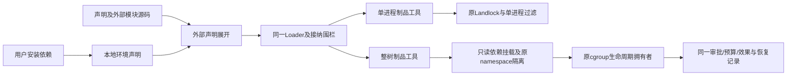

# 用户自备的本地执行环境

## 已锁定边界

源码交付不要求依赖安装、版本锁或环境闭包。实际执行允许用户提供已安装解释器/工具链，以通用 `resource.process_local` 声明程序、参数、环境和可见依赖路径；不是自动安装器，不复制依赖，不读取包管理器锁，不为 Python/GCC 增加专用内核分支。



| 决策 | 契约 |
|---|---|
| 路径 | 程序及依赖路径显式绝对指定；依赖在Guest中保留原绝对路径，不引入另一套路径映射DSL。常见/lib别名可解析到实际安装目录，但解析后的FD不得指向内核私有目录或虚拟系统根。程序保留原调用路径，不将venv等符号链接入口改写成基解释器 |
| 权限 | 依赖仅可读；只有显式execute=true路径可执行。项目写入/执行仍来自独立目录资源，依赖声明不自动授予工作区权限。**动态库目录同样需要 execute=true**：Landlock 的 Execute 权限同时覆盖 execve 与共享库的 mmap(PROT_EXEC)，内核无法区分“可加载”与“可执行”，缺少它时动态链接器加载库会得到 EACCES（进程退出码 125）。因此 `/lib`、`/lib64`、`/usr` 等库所在目录必须声明 execute=true；“程序必须落在可执行路径内”由 Host 在 validate/preflight 中单独校验，不依赖该位限制库加载 |
| 可用性 | 纯build/validate不探测依赖文件。import、发布和新job仅检查显式路径/程序是否可用，不检查版本、摘要或库闭包；失败报未满足的执行条件，不安装或改写用户环境 |
| 状态连续性 | 本地环境配置参与模块版本；checkpoint、已有成功效果和历史恢复不因用户暂时卸载依赖而失效。新增/子运行不能借继承跳过另一份环境声明的接纳 |
| 可变依赖 | 用户管理的文件不会进入源码/映像缓存或GC。外部安装变化不自动生成框架generation，回滚只回滚声明，不声称回滚用户安装目录；需要字节级可重建性时可显式选择已有锁定环境 |
| 执行 | 单进程仍禁止派生/联网；整树仍走原父死、取消、超时、资源与回收机制。无隔离失败回退，不开放宿主根目录、FD、私有状态或隐式环境变量 |

## 资源接口

配置类型为对象，字段仅包含必填 `executable`、`paths` 和可选 `prefix_args`、`env`。`paths` 的元素只包含必填 `path` 及可选布尔 `execute`（默认false）。常规Linux安装的解释器配置例如：

```json
{
  "executable": "/usr/bin/python3",
  "prefix_args": ["-B"],
  "env": {"PATH": "/usr/bin:/bin", "LANG": "C.UTF-8"},
  "paths": [
    {"path": "/usr", "execute": true},
    {"path": "/lib", "execute": true},
    {"path": "/lib64", "execute": true},
    {"path": "/etc/ld.so.cache"}
  ]
}
```

用户按自己的安装位置提供路径；这不是自动发现结果。路径必须规范化，不能是 `/`、`/nofy`、`/proc`、`/sys`、`/dev`、`/run` 或后五者的子路径，不能相互嵌套，也不能覆盖/指向内核私有根。不得开放宿主 `/tmp` 整体，但可显式提供其中一个环境子目录；Guest仍使用自己的临时目录。文件或目录在使用时以同一FD检查并授予权限/挂载，特殊文件拒绝。程序必须落在显式可执行路径内，允许依赖目录内正常的解释器符号链接，不要求文件摘要。

本地依赖目录递归绑定已有子挂载，并递归添加只读、nosuid、nodev及按声明的noexec属性，不清除原有更强限制；这是显式目录授权，不自动发现更多根。现有映像和工作区绑定保持原行为。venv入口保留原绝对调用路径，目录及基解释器/库仍由用户明确提供；没有内核Python版本或包管理器分支。

环境仅来自 `env`，保留原Bootstrap的参数/环境/64KiB传输边界，禁止覆盖 `NOFY_DIRECTORY_` 目录绑定。凭据仍独立注入，不应写入可共享配置。依赖目录只读，项目写/执行权限及审批另行声明。

审批冻结调用参数与声明模块源码，不承诺冻结用户独立管理的解释器/库字节。用户选择可变本地依赖时自行管理环境更新；需要固定环境内容可显式选择已有锁定后端，不能把两种保证混为一谈。

## 编程预设接入

默认 `build.py --output` 继续只生成普通源码包。实际部署可提供 `--settings`，其中 `environment` 使用以上配置，启用命令时仍显式提供 `process_tree`；可选 `command_environment` 指定另一份已安装工具链环境。只有需要已有锁定运行环境时才提供 `--dependency-lock`，不能同时混入本地环境选择，以免静默丢弃用户配置。

产物仍是同一 `nofy.deployment/v2`，本地环境模式的 `runtime_sources` 为空；没有第二个Agent循环、安装阶段或隐藏宿主。文件工具和命令使用同一预设、Loader、外部代码制品及既有控制API。

## 阶段验证与回退

先完成配置/接纳与共享启动协议，再接预设，最后运行实际Python、用户安装的外部模块与GCC构建、审批、权限反例、取消和恢复。新配置缺失不影响纯源码归档。既有锁定环境专项必须回归，不能只测试本地分支。

GitNexus集中upstream覆盖RuntimeSource、TreeArtifactFactory、Sandbox、LoaderAdmission及compile_preset。Rust图谱缺边/LOW不能代表调用不存在；源码证实影响Loader注册、导入/发布/job围栏、单进程helper与整树Bootstrap，按HIGH管控。使用重构技能将两种环境纳入同一启动协议，不开第二条运行主循环。修改前快照为 `/tmp/nofy-local-runtime.1eKTRv/before.tar.gz`，仅回退本阶段目标文件，不恢复/清除整个脏工作树。
