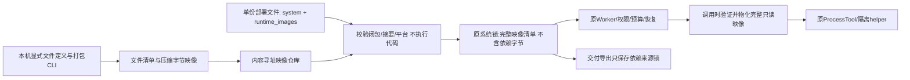

# 锁定运行时映像与可移植部署（L2f2）

M3d3调整：本文件定义的是首个依赖制品后端，不是Agent项目交付格式。当前Agent只打包源码声明与可重建来源锁，系统导出也只返回来源式v2，full字节导出已删除；完整边界见dependency-reconstruction-contract.md。原生v1嵌入导入仍属于显式资源接纳，不作为新的Agent交付路径。下文映像自身资源上限不等于Agent打包配额。

## 契约与阶段

阶段 DAG：映像/部署协议 → 纯校验与不可变仓库 → 原派发接入 → API/文件/CLI → 实际隔离/版本/迁移验收，角色 C → A → X。先锁定架构，不改旧运行时身份、系统快照格式或原执行循环。

| 决策 | 规则 |
| --- | --- |
| RuntimeImage | manifest + blobs，清单记录平台、逻辑id、入口、可选glibc loader、相对库目录、固定参数/环境及每个文件的SHA256/长度/执行位；blob按SHA256去重，使用gzip+base64 |
| 身份 | 映像身份是规范manifest摘要，覆盖全部依赖文件和启动约定；不含打包机器路径、mtime、压缩器输出或无关映像。blob必须与清单精确闭合，不允许额外/缺失blob |
| 限制 | 每映像最多4096文件、128MiB/文件、256MiB解压总量、24MiB编码；这些是该依赖后端的接纳上限，不是Agent交付包大小。系统8MiB编译、16MiB运行版本及HTTP传输资源边界未因此放宽 |
| 仓库 | 原子/fsync内容寻址写入，最多64映像、1GiB编码及1GiB声明解压量；物化/暂存另有1GiB解压保留额度，孤儿暂存仍占额度；追加保留。读取/调用验证摘要、长度、gzip CRC与路径，拒绝链接、特殊文件和额外目录 |
| Resource | 新增resource.process_locked，规范config={manifest}；源配置可用{image:清单摘要}，Loader在编译前展开。纯Factory只验证清单并绑定Loader，不读磁盘/执行代码 |
| 派发 | 仍用tool.process_artifact的environment依赖；静态ELF直接执行，动态ELF通过映像内glibc loader --inhibit-cache/--library-path启动映像内入口；不存在宿主库读取授权或回退 |
| 环境 | 固定literal或相对映像根的path值；helper进程始终env_clear，声明值在隔离成功后才注入目标程序，避免LD_PRELOAD等在helper启动前运行。根路径在调用时解析，不进可移植身份；显式literal本机路径仍是用户选择的非可重定位配置。不自动携带凭据或历史状态 |
| 部署 | v1映像接纳可包含runtime_images；当前Agent项目及系统导出只用v2源码声明/runtime_sources，不带依赖字节，缺来源证明不退回嵌入依赖。系统锁保存完整manifest，文件/API使用相同Loader |
| 预检 | validate验证嵌入/已存映像闭包及平台而不持久化/物化/启动；import经resources授权接纳映像，再沿原发布。缺少依赖明确失败，不暗中使用本机库。资源写入和发布为不同提交边界，失败不伪装回滚已接纳资源 |
| 并发 | 每Loader最多2个大载荷管理请求通过鉴权后、JSON解析前背压；取消/审批/运行/事件不等待该许可，关闭会唤醒排队请求。最多2个进程准备任务，先异步取得许可再启动blocking IO，等待中取消不遗留阻塞工作 |

映像可包含解释器标准库、动态扩展、共享库及普通依赖文件。安全解析所有可执行ELF/共享库的program headers、动态段和字符串表，要求DT_NEEDED位于声明库目录；动态入口必须显式提供无PT_INTERP的映像内loader。文件定义明确选择闭包，打包器不执行来源程序推断依赖；未声明的动态import/dlopen/运行时文件不获宿主授权，静态DT_NEEDED校验不宣称能证明任意业务分支的依赖完整性。兼容内核ABI仍属部署环境要求，不宣称跨OS/架构或整个Linux内核可移植。

## 外部路径与边界

本机nofy-runtime-image CLI从显式文件/目录定义制作依赖制品，不是Agent项目打包器；只捕获普通文件，不保留符号链接、设备、原权限位或来源路径。目录遇到链接拒绝；用户可以明确排除该路径，并用单文件定义捕获已知链接的目标内容。POST/GET runtime-images提供上传、按摘要分页列表（after/limit，缺省8、1..16，仅紧凑metadata）和精确读回，写入需resources、读取需read。列表不解压payload。GET releases/{release}/deployment导出来源式系统声明，releases/{release}仍返回SystemBundle。完整依赖字节不写入Agent项目交付、每轮Job、检查点或live版本。

打包定义包含id/executable、可选loader/library_dirs/prefix_args/env、files（目标相对路径到来源绝对路径）、trees（目标目录到{path,exclude}）、executable_files。exclude为相对路径前缀，不是shell glob；目录创建、遍历、文件/字节与编码均有上限。CLI输出新文件，拒绝覆盖已有文件；输出先fsync再原子不覆盖提交，父目录同步失败可能已提交，读回摘要再判断。

验收必须使用实际ELF解释器/loader/标准库：不授予宿主库目录仍可执行；读取宿主库或未声明模块被拒绝；缺失依赖、摘要漂移、gzip炸弹/尾部数据、路径冲突和缓存损坏被拒绝；同PID装载新映像、原版本不变；导出的声明在新状态目录由独立管理员信任及来源锁重建依赖，再恢复同一系统摘要并执行，不以目标裸机预装或旧产品兼容作为验收依据。

本阶段接续L2f1，不代替全部目标。远端取得/来源签名、卸载/引用GC及孤儿scratch回收、持久资源/历史状态迁移、完整原能力声明、有状态更新、剩余C8、新控制台与C10最终矩阵仍须继续。
