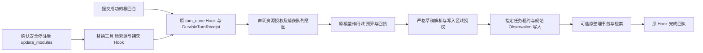

# 声明式受管记忆捕获与写入绑定

本功能块为默认 Host 装载自动捕获，复用现有规范 Memory 引擎、Hook、模型预算和效果回执，不增加后台主循环或内核产品分支。架构按本文件锁定；实现、装配、文档与用例完成后集中验收，失败仅补验受影响范围。

| 决策 | 约束 |
|---|---|
| 资源 | `resource.memory_learning` 显式允许 `grants.capture`；原 `resource.memory` 的描述符和禁用捕获语义保持 |
| 捕获接口 | `hook.memory_capture_connected` 绑定 `connection: Resource`、`model: Model`；配置提供 `instructions`、`write`、`settings`、`max_items` 和 `consolidate` |
| 成功屏障 | 仅接收 Runtime 签发、匹配原 thread/run 的成功顶层回合证明；拒绝模型参数伪造，不学习 System、工具输出或合成输入 |
| 采样 | 使用原 Hook 操作作用域和模型日志，实际用量记入既有预算；未知效果先沿原票据对账，恢复不能盲目重发 |
| 写入 | 先验证全部草稿的数量、格式及区域授权，再取得指定队列任务；资源绑定参与任务身份，不抢其它项目或任务。记录采用原任务创建时间，重放保持规范内容稳定 |
| 整理 | `consolidate` 需资源授权；沿既有整理事务生成可检索记忆，成功捕获后恢复仍执行必要整理，避免中途退出漏掉此步 |
| 生命周期 | 原资源控制同时约束普通和学习视图；实际持久工作由原 Work 许可持有至完成，关闭后不再接纳新写入 |
| 运行中更新 | 复用 `tool_catalog`、`context_sources`、`hook_subscriptions` 的显式选择；共享给未选择能力的资源仍保护，原回执、消息、预算、输入及已成功效果保留 |
| 恢复和回滚 | 按原冻结快照恢复；回滚生成新版本。切换后端不复制历史内容，旧数据保留在原后端；跨存储内容迁移仍需显式迁移 |

草稿协议沿用 `ObservationDraft`：`statement`、`kind`（`preference/personal_fact/project_fact/correction`）、`scope`（`personal/project`）、`confidence`（`certain/uncertain`），及可选 `keywords`、`aliases`、`supersedes`。未知字段、工具调用、拒绝或截断的提取结果不可写入；原敏感类别排除、威胁隔离、争议状态与规范引擎继续生效。声明依赖和凭据按现有 Loader 路径注入。

验收须覆盖默认 Host 真实 API/Worker/回环 HTTP 模型传输、同进程绑定切换与回滚、关闭/重开、原模型票据硬退出恢复及写入不重复；SDK 用例补充区域授权、指定任务与幂等边界。仅验证本块相关范围，不以历史全工作区结果充当本轮新验收。控制台、多套参考预设与完整发布仍在总目标中。
