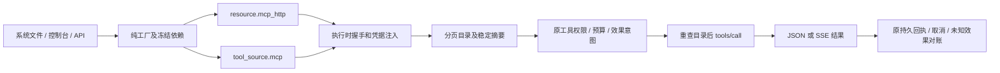

# 声明式 MCP HTTP 工具

本功能块锁定 MCP `2025-11-25` 的 Streamable HTTP 工具客户端。默认 Host 的同一声明、Loader、ToolSource、ToolDispatch、权限、预算和持久回执承载实际工具调用；不建立第二个 Agent 主循环。协议依据为官方 [传输](https://modelcontextprotocol.io/specification/2025-11-25/basic/transports)、[生命周期](https://modelcontextprotocol.io/specification/2025-11-25/basic/lifecycle)和[工具](https://modelcontextprotocol.io/specification/2025-11-25/server/tools)。本块不宣称完整 MCP 功能覆盖。



| 决策 | 约定 |
|---|---|
| 装载 | `resource.mcp_http` 绑定端点、凭据引用及宿主凭据 authority；`tool_source.mcp` 依赖 `connection: Resource`。构建不联网、不读取密钥 |
| 传输 | 精确端点，HTTP POST，禁用重定向及环境代理。支持 JSON 和增量 SSE；不跟随 SSE 内给出的其他地址 |
| 协议 | initialize → 校验版本及 tools 能力 → notifications/initialized → tools/list → tools/call；客户端不宣告采样、roots、elicitation 或 tasks 能力 |
| 会话 | 每个目录快照建立独立会话；MCP-Session-Id 仅在内存中，后续请求带原会话和协议头。快照摘要不包含临时会话 ID，使审批/进程恢复可以重建同一目录 |
| 目录 | 分页、重复名称/游标检查、输入和输出 Schema 校验。摘要绑定资源、配置、服务实现信息及完整目录元数据；工具注解不授予权限 |
| 调用 | namespace 前缀及显式 aliases 产生本地名称，保留原远端名称。每次调用前读取同一会话目录并核对摘要；漂移拒绝执行。MCP 没有原子版本参数，远端在检查与执行之间改变实现的竞态仍存在 |
| 输出 | 保留 content、structuredContent、isError 及扩展字段；成功结果按 outputSchema 校验，业务错误进入原工具错误回执并保存远端结果 |
| 取消 | 原取消/超时约束覆盖排队、目录和调用。已发出的请求尽力发送 notifications/cancelled；失联和取消都不证明远端效果未发生，不自动重发业务 POST |
| 恢复 | 普通不可重放 ToolDispatch；原 Runtime 保存成功或错误回执。进程退出等留下的未完成持久意图按原未知效果路径处理；已返回的传输/协议错误按原错误回执保存，错误不证明远端未产生效果。会话过期拒绝当前调用，后续新快照重新握手，不自动重发原调用 |
| 释放 | 快照最后一个绑定释放后，尽力发送有界 DELETE；服务不允许 DELETE 时由服务端回收。不会持久保存密钥或会话令牌 |

资源配置：

```json
{"endpoint":"https://example.org/mcp","credential_ref":"MCP_TOKEN"}
```

`endpoint` 是无 URL 凭据、query 和 fragment 的 http(s) 端点。`credential_ref` 可省略；密钥由原凭据接口独立注入，每个请求重新解析，不能写入系统文件。

工具源配置：

```json
{"namespace":"project","allowed_tools":["files.read"],"aliases":{"files.read":"read"},"timeout_ms":30000,"max_input_bytes":1048576,"max_output_bytes":1048576,"max_catalog_bytes":4194304,"max_tools":1024,"max_pages":64}
```

默认 namespace 为 `mcp`；本例本地工具名为 `project_read`。省略 allowed_tools 时装载远端全部工具；显式清单缺失工具时拒绝。本地 ToolId 无法表达的远端名称必须配置 alias，不静默改名。字节、页数、工具数与期限是运行资源边界，与源码打包大小无关。服务端 instructions 不自动成为系统 Prompt。

完整系统示例为 [mcp-system.json](../../crates/common/nofy-agent-host/examples/mcp-system.json)。先由用户启动所需 MCP 服务，将端点、远端工具名及 arguments 改为该服务的契约，再经原凭据 API 注入 MCP_TOKEN、导入系统并执行 read。示例未附带服务器或依赖；没有令牌的服务可删除 credential_ref。该工具源也可直接加入 Agent definition 的 tool_sources，模型及其他能力沿原声明绑定。

已锁定范围之外：stdio、旧 HTTP+SSE 传输、OAuth 授权流程、独立 GET 通知订阅、SSE 断流续传、资源/Prompt/采样/elicitation/tasks。当前连接中 ping 以空结果响应，其余未协商的服务端请求以 JSON-RPC method-not-found 拒绝。没有自动依赖安装、依赖打包或产品名分派。

影响分析：`native.rs`/`HttpResourceFactory` 的图上影响为 LOW/0；同名 registry 查询会选错入口，已用路径限定 context 确认实际 Host 入口。补充 `register_factory` 的全局上游为 CRITICAL/278、93 个直接调用、8 条流程；该共享实现不修改，只增加默认注册。图未完整覆盖文件注册边，已通过源码补充 KernelHost 和独立 SDK 装载路径。修改前原文件已归档，统一实现、接线、文档和案例完成后再集中验证；结果见同名验收记录。
