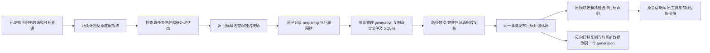

# 显式记忆历史迁移

本功能块完成新框架记忆命名空间的真实数据迁移：同一 Host 内将一个命名空间的规范文件、SQLite 历史、撤销及删除记录复制到新的物理 generation，再原子切换归属。整个命名空间是迁移单位，包含 Personal 和各 Project；不是单个 Agent 的隐式复制。运行检查点、预算库或整个 Host 的跨存储迁移仍属后续要求，不以本块替代。



| 决策 | 实施契约 |
|---|---|
| 事实源 | Loader 私有记忆迁移 SQLite 只保存命名空间归属、generation、阶段及命令回执；业务内容仍在原 Memory 引擎，不增加第二套记忆实现 |
| 原子发布 | 源与目标 binding、命令完成回执在同一事务提交；preparing 持久围栏在进程退出后仍拒绝源/目标接纳 |
| 物理副本 | 使用原 SQLite backup API，保留 ID、状态、时间、Undo token、Tombstone 与完成回执；规范文件保留字节，SQLite 内部绝对规范路径显式映射到新根 |
| 派生内容 | 向量、FTS 索引和临时锁不属于规范迁移包，按目标维度/分块配置重建；不会携带外部解释器、工具链或凭据 |
| 接纳 | 源/目标各有独立命名空间共享/独占租约；默认提交入口在创建任务期间持有共享租约，Worker 在有记忆依赖的实际执行前持有到执行结束。迁移准备与退休状态阻止新任务；管理更新、取消和历史回读保持可用。依赖只从编译后的模块定义提取，不扫描提示词和工具参数 |
| 缓存 | MemoryProvider 通过可选 storage_generation 提供明确代际；连接仅在显式代际变化时重建安装视图，现有默认 provider 行为保持 |
| 未完成工作 | 未停驻运行、未确认效果、未完成记忆操作/捕获/撤销阻止计划或迁移；迁移不丢弃它们，也不通过新库获得空历史 |
| 目标 | 首次迁入要求未使用的命名空间；同一 dataset 已退休的旧命名空间可以作为反向迁移目标，历史目录不覆盖 |
| 恢复 | 同 command_id 与同计划重放原准备阶段或原完成回执；若复制未封存，使用新隔离 generation 重做复制，保留已有未发布目录作恢复证据 |
| 元数据缺失 | 命名空间首次受管时建立独立、不可覆盖的 managed 标记；数据库、binding 或标记损坏时保持关闭，不能回退打开原始目录。准备事务后到标记写入之间退出，由原命令核对 preparing 归属后补齐 |
| 回退 | 反向迁移复制当前活跃端的最新规范状态，而非重新开放旧快照；旧声明不自动重定向 |
| 管理 | 选择器沿原 system/release/module/program/parents；预览需要 read+resources，应用需要 resources；控制台与文件/API 共享原声明 |

管理接口为 POST `/api/v1/memory/transfers/plan`、POST `/api/v1/memory/transfers/prepare`、POST `/api/v1/memory/transfers/apply`、POST `/api/v1/memory/transfers/abort`、GET `/api/v1/memory/transfers/{command_id}`。计划请求不接受任意磁盘路径：

```json
{
  "source": {"system":"example","release":"published-digest","module":{"id":"source-store","version":"1"}},
  "target": {"system":"example","release":"published-digest","module":{"id":"target-store","version":"1"}},
  "scope": "namespace"
}
```

预览返回版本协议、源/目标命名空间身份、源指纹、目标配置指纹、规范数据统计和计划摘要。准备以相同选择器及 `command_id`、`fingerprint` 提交；后端重新核对源、归属及目标前提，复制真实数据，持久保存 prepared 阶段。准备期间两个命名空间停止接纳，完成准备后也不会自行恢复。提交和撤销准备仅需要以下原命令身份，因此进程重启后无需再次解析来源发布才能恢复：

```json
{"command_id":"memory-transfer-01","fingerprint":"original-plan-fingerprint"}
```

提交重新核对封存副本和原数据指纹，在一个事务中退休源并激活目标。撤销只适用于未提交命令，原归属 revision 前进，保留未发布副本作恢复证据；已提交命令必须反向迁移当前数据。终态命令重放只返回原回执，后续反向迁移不会让旧命令再次改变归属。目标资源的原 read/write/child/capture 授权继续生效，迁移管理不向 Agent 增加权限。

`examples/memory-transfer-system.json` 提供源/目标两个资源和相同项目的工具、上下文及 Agent 声明。数据迁移后，通过原 `update_modules` 的 tool_catalog/context_sources 选择目标声明；停驻、会话检查点、预算和已成功工具效果仍由原 Runtime 负责。目标维度改变只重建派生索引。直接使用独立 Memory service 的 SDK 调用方必须自行保证迁移期间没有写入；`transport` 本身不管理宿主调度。

功能块已按实现、接入、文档和用例收齐后集中验证，相关605项最终通过；首次失败和定向补验均保留。该文是架构和接口契约，实际完成范围、复核方法和仍开放的跨存储要求见 ../verification/memory-history-transfer.md。

路径转换只作用于原根下的绝对历史路径；相对路径按原值保留，即使文本以归一化标记 `@root/` 开头也不能转成绝对路径。该边界已通过真实SQLite回归及迁移组补验。
