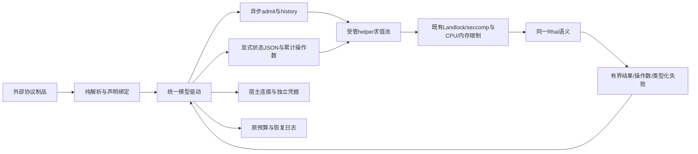

# 模型协议求值的受管隔离

## 当前落地状态

C8a已完成异步控制边界：Model::request_bound及validate_live_history改为async，预算在准入返回后才预留，等待受原取消/总期限约束；历史校验移出SQLite事务，以私有证明在最终事务内重读同一边界，执行等待期间续租。原发布、提交、检查点及管理命令线协议未改，没有为旧产品增加同步兼容入口。

C8b已接通默认Host的隔离Executor和两个物理helper；模型admit/history/request/event/finish/http_error全部经同一内部通道，纯构建仍只解析。SDK须显式选择ProtocolFactory::trusted()或注入执行器，缺helper不切回宿主。32项SDK模型及最终冻结源码的完整默认Host215项通过，覆盖真实helper取消/内存压力/父死及三协议流式与原生历史；同一CLI默认540秒CPU轮换实测也通过，单根609次本地协议调用/608次工具效果及原预算连续。未知wait/kill内核错误注入和其他求值引擎仍开放，不关闭整个平台。完整事实与C8a历史见docs/verification/model-program-isolation.md。

## 范围与接口边界

默认Host的模型协议admit、history、request、event、finish及http_error全部放入既有受限helper，不在宿主求值Rhai。网络、凭据、物理请求计数与预算仍由Rust模型驱动拥有；协议仍来自同一外部源码制品，没有厂商分支、第二套Agent循环或依赖安装器。源码打包与用户自备依赖规则不变。

| 决策 | 契约 |
|---|---|
| 模型接口 | request_bound及validate_live_history为异步逻辑校验，不发送提供方请求；不保留宿主同步求值回退 |
| helper占用 | 两个物理worker，仅求值步骤占槽；网络或Hook等待不持槽。AST按声明缓存，模型状态及累计操作数由宿主按会话保存，worker重建不重放已完成步骤或重置操作预算 |
| VM | 使用原源码、JSON精度、函数和所有阶段语义；不靠删除运算/流式协议降低承诺。纯build只解析，不执行协议脚本 |
| 生命周期 | 每步独立实际拥有者持工作许可，调用方丢弃/取消不提前归还。失败kill+wait，Host关闭收束活跃与空闲worker，父死由既有helper规则保护 |
| 资源 | 原512MiB地址空间及系统调用/文件边界；模型helper栈16MiB，原Scope栈2MiB不变。每步VM期限加5秒IPC宽限；单线程CPU硬上限601秒，累计CPU达540秒在下一步前退役。无凭据、网络、目录加载器或新进程能力 |
| 恢复身份 | 协议定义与逻辑资源摘要不混入PID/helper路径。会话状态、模型序列、物理请求统计和预算不重置；已失败步骤不自动重发 |
| SDK | 独立SDK可明确选择trusted执行器；默认Host只绑定隔离执行器，缺helper明确失败，不按错误切回宿主执行 |

## 求值与管道协议

执行器输入为协议定义、JSON输入、累计spent、输出cap及取消信号；输出为JSON结果与实际累计spent，必须单调且不超过定义上限。会话按顺序提交步骤，网络驱动继续持有原显式state；spent不是脚本可覆盖的业务字段。

helper管道使用u32 little-endian长度前缀JSON帧和nofy.model-program-evaluate/v1标识；64MiB帧上限为原32MiB数据cap留信封空间，不是源码包体限制。Prepare按定义摘要装入最多8份AST的LRU；Evaluate含定义摘要、单调请求序号、输入、spent和cap。回复核对协议、序号、缓存状态、结果及累计操作数；类型化ModelFailure保留原category/code/details，未知或过大帧失败关闭。worker不获得连接凭据或网络句柄，输入输出不放入进程参数或临时文件。Rust父侧累计spent，淘汰/重建不重置或重发步骤。

Loader拥有池，ProtocolFactory只持有其Executor绑定而不把物理信息加入model-protocol-v1内容身份。每步独立任务持工作许可；元数据准备不因调用方丢弃而脱管。会话另有顺序拥有者，close取消后等待实际步骤结束，才归还原连接/调用接纳。Host关闭取消新求值、收束活跃与空闲worker；待机监督者仅持Weak池引用，不形成Loader环。清理错误保留原worker槽、报告cleanup_failed，不在不确定子进程上启动替代者；此内核错误故障注入尚未验收。

GET /api/v1/models/status沿原Read授权返回协议、槽位、in_flight、started、worker_pids、helper_bound、stopping和cleanup_failed；不求值、探测磁盘或读取凭据。API图谱未匹配旧Scope状态路由，已人工核对共享router→authenticate→Read→Loader只读投影，没有更改原预览或权限下限。

此管道属于内核内部求值通道，不是新的Agent部署格式或外部依赖锁。源码/模块/连接声明仍经同一Loader、控制API和generation路径。

## 历史校验与转换原子性

C8a前的历史回调位于SQLite写事务内，当前转换为：事务读取准确边界 → 异步隔离校验 → 原事务重读并验证同一证明 → 冻结提案/提交转换。证明绑定source/target快照、完整检查点状态和迁移选择，不接受API传入的伪证明。

接纳和执行转换两处均复核；校验期间改变revision、park、检查点、源/目标或先序命令即拒绝。外部计算不跨写事务，不以异步化放松CAS，不改写原提交、旧成功效果或预算。已接受命令重放仍按原冻结提案处理。

## 实施与验收

DAG：异步回调及历史证明 → 通用执行器/有界worker帧 → 默认Host注入与实际拥有者 → 三协议/取消/故障/恢复验收。角色C → A → X。公共契约和迁移入口按HIGH分阶段，快照/tmp/nofy-model-isolation.1HBg0C/before.tar.gz；旧Nofy源码不作为适配或兼容目标。

验收包括：admit/history/流式全部经helper；限额内的中间内存/CPU异常只影响worker，Host查询与后续正常请求可用；实际取消、断开、关闭、父死及工作许可；三协议及原生历史/unsigned JSON精度；嵌套调度不因网络占槽死锁；历史校验期间漂移拒绝且不持SQLite写锁；原模型请求/预算/重启恢复行为不变。未完成项保持开放，不把接口分离、SDK测试或静态新运行冒充完整隔离/热更新交付。
