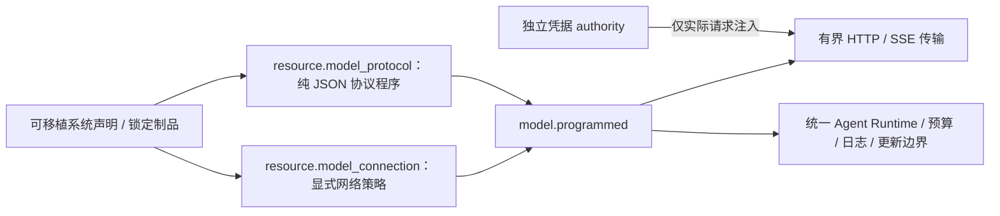

# 声明式模型协议与连接边界

2026-11-03 C8a/b：公共Model的request_bound与validate_live_history为异步计算接口，治理在准入完成后才预留，取消及总期限覆盖等待；运行中历史回调不再跨SQLite写事务。默认Host已将六个模型求值阶段统一绑定到受限helper池，网络/凭据/预算仍由Rust驱动拥有；SDK显式选trusted或自备Executor，没有缺helper宿主回退。Models32及最终冻结源码的完整Host215项通过；同一CLI默认540秒CPU轮换实测保持单根会话、609次本地协议调用/608次工具效果和预算连续。详见model-program-isolation.md及其验收记录；下文更早阶段的计数为历史。

最新边界CLEAN4：ToolRuntime移除旧工作区侧带及gRPC工具配置依赖，Models/Modules普通内部闭包各6，Host16（含构建/测试18）；工具运行时137项/1既有忽略及完整Host162项通过。新二进制恢复此前真实会话并再完成一次真实模型请求，旧运行记录不变、没有工具重发；累计4运行/5次请求。下文17/4次为CLEAN3b-2历史证据，仍不代表256k容量或完整平台验收。

状态：CLEAN3a/b-1通用机制与三套外部协议已验证；CLEAN3b-2已移除Host旧采样工厂/依赖，实际普通内部闭包17，四项专项、33项交叉和完整默认并发Host162项通过。旧源码树删除、完整唯一预设和C8进程隔离未完成，不是整个平台验收。目标是不引入旧采样、登录恢复、产品默认头与环境发现依赖，不创建另一套Agent主循环。

2026-11-01追加真实提供方验收：实际CLI使用外部Chat Completions协议，3个运行/4次请求通过普通回复、流式工具往返以及Host重启后的会话历史续接；不是受控模型响应。请求路由`gemini-3.8-flash-high`，提供方返回`gemini-3.8-flash-n`，不证明路由别名等价或上游真实身份。256k容量、其他协议及审批/取消的真实模型组合仍未验证；详细范围与观察器失败记录见闭环计划。凭据独立注入，未进入可移植声明或源码。

| 决策 | 选择 | 约束 |
|---|---|---|
| 可变协议 | 外部 Rhai 源码，输入/输出均为 JSON | 不访问文件、网络、环境和凭据；声明中可版本化、锁定、应用、回滚 |
| 传输权限 | 固定连接原点与目录前缀，禁止重定向和隐式环境代理 | 协议程序不能选择任意 URL、Host 或凭据 |
| 身份 | 声明、工厂版本、依赖身份与逻辑凭据 authority | 不含真实密钥；凭据轮换不改可移植文档 |
| 执行寿命 | 默认Host两个受管helper，只在求值时占槽；SDK显式选择trusted执行器 | 非Send AST只留在worker或明确可信SDK线程，不改变全工作区sync feature；取消后实际拥有者等待退出再归还接纳 |
| 请求计费 | 每次物理 HTTP 请求计数，最大尝试数声明并进入 admission bound | 不做隐式网络重试；程序显式 next 才可发下一次请求，累计 token 用量 |
| 清理顺序 | 接口与通用执行器 → 完整协议程序与 Host 切换 → 旧源删除清单 | 不能将新示例通过或临时并存称为采样清理完成 |

## JSON 协议 ABI

协议工厂配置`source`选择明确的`{kind:"inline",text}`或`{kind:"artifact",entries,settings_schema?}`。后者依赖Runtime的`ArtifactBundle`，有序拼接同一制品中1..16个规范相对入口，组合源码最多64KiB；设置Schema可从同一制品取出，不允许再同时给内联设置Schema。没有裸字符串兼容分支，也不在纯构建中读取文件或发现环境。

`admit`为实际请求做纯接纳：输入model/request、声明次数上限及公开端点保证，返回`{max_requests,max_output_tokens?}`；内核拒绝零值或超过声明/端点界限。输入token硬界只能来自端点真正强制的保证，不能估计。后续修复遵守此次接纳而非全局最大值。

`request` 输入包含模型名及规范 `ModelRequest`，返回 `{path,body,mode,state}`；path 是已接纳连接内的相对路径，mode 为 `json` 或 `sse`。

`event` 输入包含私有 state 与 `{event,data}` 帧，返回 `{state,deltas,finished}`；deltas 使用内核 `ModelDelta` 结构，finished 由协议明确声明。JSON 响应作为一个 `event: "json"` 帧传入。SSE EOF 不等于成功，只有 finished 后才允许完成。

`finish` 输入包含最终 state，返回且仅返回以下一种：

- `{response: ModelResponse}`：产生一次 Completed；
- `{next: {path,body,mode,state}, input_tokens, output_tokens}`：显式后续请求，先计入本次用量并检查尝试上限。

`history` 输入包含规范消息，返回 JSON boolean；必须明确接纳保留的 provider-native opaque 数据，不得静默丢弃。

任一阶段可`fail(ModelFailure)`或返回单一`{failure:ModelFailure}`，失败仍有字节/字段限额；标准HTTP状态和物理计数不能伪造。`http_error`只获得有界响应体、状态和Retry-After，不接收请求认证头；错误回退仍是失败。通用`json_parse/json_stringify/json_schema_valid`不授予IO，保留完整JSON u64（不是浮点或字符串替代），拒绝不可序列化值与过深输出。

程序不接收 HTTP 认证头、客户端证书或上下文 capability 容器。输出仍受累计字节、帧数、状态体积、Rhai 操作量和墙钟期限约束；程序源码不授予额外网络权限。

管理代码的加载仍要求原受信任管理员授权。默认Host模型求值在512MiB地址空间、CPU/栈及原Landlock/seccomp边界内执行，物理worker池独立于网络等待；明确trusted的SDK执行器不具备OS隔离。该模型边界不能外推为其他脚本引擎或整个扩展系统已全部加固。

## 分段验收

CLEAN3b实施顺序：中立制品契约归属Runtime → 协议源选择/接纳/失败ABI → 外部Chat Completions、Responses、Messages程序及完整能力回归 → Host声明与唯一预设接入、移除旧采样闭包。现有`resource.artifact`即代码事实源，不另建模型代码仓库：协议从声明的artifact依赖中按有序entry列表取源码，纯构建不读磁盘；内联代码仍是同一source选择契约的一种明确形式，不接受旧开发期裸字符串别名。

新增`admit`纯阶段按实际请求选择最多物理调用次数及输出token界限，内核核对声明硬上限和端点保证；无结构化修复的普通调用不能一律预留所有修复额度。结构化失败可在任一阶段显式返回/终止，标准HTTP状态、截止和调用次数仍由内核掌握。公共JSON解析/Schema验证只提供协议无关纯函数，不能借此增加网络或凭据权限。

1. CLEAN3a：通用执行器、独立凭据归属、公共模块装配与真实传输/取消/上限反例已通过；同一Host中外部源码新版本装载及锁定旧版本重跑通过，不宣传为会话内热更新。旧采样闭包尚未切断。
2. CLEAN3b：从参考源码迁入完整协议能力到外部程序，保留规范消息、图像、推理、工具增量、原生 opaque、结构化输出与有界恢复；更新 Host 声明和真实运行验收，移除旧采样/auth/version 依赖。不得以较小协议子集替代本段。
3. 最终树清理：按依赖与删除清单移除旧产品源码；框架 generation 恢复与回滚保留，新控制台和唯一编程预设另按总体里程碑验收。
