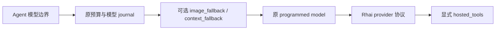

# 模型协议与恢复策略

| 能力 | 所属 | 规则 |
|---|---|---|
| 自动重试 | governance.budget_connected.retry | 已有持久 attempt、指数退避和 Retry-After；超过最大等待不提前请求 |
| 图片回退 | model.image_fallback | 仅在配置的明确拒绝状态、未向调用方交付任何 chunk 时重试一次；不改原始历史 |
| 溢出恢复 | model.context_fallback | 确认超限后保留 system 与最近完整轮次，显式标记省略，最多重试一次；不伪造摘要、不改原历史 |
| 压力与手动压缩 | 外部 context-compaction@0.2.0 | context.programmed 的持久 plan/prepare/finish；自动阈值，或 Session 新输入 /compact |
| hosted tools | provider 协议 settings.hosted_tools | 原生服务端工具定义直传，输出保留 opaque 消息及 provider 元数据，不进入本地工具 dispatch |
| 截断挽救 | runtime.recipe + stage.length | 复用原续写和累计机制 |
| 重复调用检测 | runtime.recipe + stage.repeat | 复用原 nudge/hard-stop 机制 |

图片回退的 request_bound 为原模型的两倍上界，调用次数包含失败请求；预算不足时在 IO 前拒绝。回退输出在 provider 元数据记录首次拒绝状态、removed_images 和 calls，首次失败的 token 用量按声明上界保守记账。带 hosted tools 的请求不做自动剥图重试，防止未知服务端效果重放。

溢出包装复用同一采样边界与恢复实现，配置 keep_turns 和 provider codes，HTTP 413 表示请求体被明确拒绝。只有存在可移除的旧轮次且未收到任何 chunk 才预留两次请求。输出记录 _context_fallback.removed_messages；当前轮自身过大仍失败。自动压缩按字符视图除以四估算压力，不声称是精确 tokenizer。手动输入匹配 manual_prefix，仅汇总当前轮之前的历史；空前缀关闭该入口。持久 ModelJournal、原始输入证明和预算继续使用内核已有实现。
