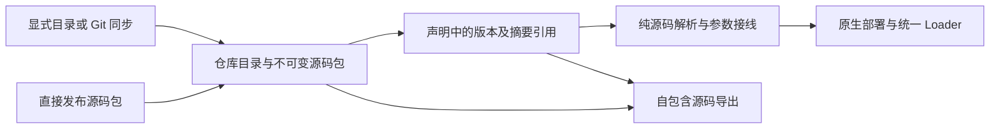

# 模块仓库与声明组合

本功能块锁定源码层架构，接口契约修订为 `0.4`。仓库保存可复用模块包，Agent 工程保存精确引用、参数和接线；发布运行仍使用原生 ModuleDefinition、Loader、generation 与执行主循环。

## 决策

| 项目 | 约定 |
|---|---|
| 执行 | 不新增 Agent 主循环，不增加按预设名称分派的内核分支 |
| 存储 | 复用 nofy-agent-project，新增 ModuleStore；目录注册与版本索引使用 CAS，源码按内容摘要共享存储 |
| 来源 | managed 由源码上传发布；directory 指显式 Host 目录；git 由显式 sync 获取指定 reference |
| 同步 | 不 checkout、不运行客户端 Git Hook、构建脚本、语言依赖安装或模块代码；Git 采集放在 Host 层 |
| 版本 | repository/name/version 对应不可变源码摘要；相同内容重试幂等，不同内容必须使用新版本 |
| 组合 | system.module_imports 保存引用、参数、输入端口绑定、导出及工厂元数据；不保存实现代码 |
| 构建 | 只解析已取得的源码；缺少缓存明确失败，不隐式 Git 拉取 |
| 导出 | 在内存工作副本加入所需源码包，归档可离线重建；不修改托管工程，不打包运行依赖、不设包体配额 |
| 移除 | 删除仓库注册停止后续同步；保留不可变版本供现有声明恢复；引用中的导入不能直接删除 |

## 文件与接口

仓库目录的 module-repository.json 为 `{format:"nofy.module-repository/v1",packages:["包相对目录"]}`；空字符串表示根目录包。每个模块包有 module.json 和显式源码清单。可用 module-files.json 为已有 Agent 工程提供独立模块源码视图，避免复制工具实现。

module.json 字段为 format=nofy.module-package/v1、name、version、description、parameters_schema、inputs、modules、exports。modules 使用现有声明表达式；内部引用用 $module，外部端口用 $input。exports 将公开名称映射到内部模块 ID，inputs 声明端口需要的 ModuleKind。requirements.txt 等普通依赖清单作为源码文件保留。

模块导入以别名隔离内部 ID。包参数可引用 Agent 设置，端口绑定可连接工程内模块或其他包的导出；包实现不直接读取 Host 文件或环境。参数与类型最终经源码及原生工厂校验，业务语言语法不作为源码发布或打包前提。

新增操作及 CLI/MCP 使用同一目录、Schema 和客户端：

| 操作 | 职责 | 主要作用域 |
|---|---|---|
| repository.add/list/inspect/sync/remove | 注册、查询、显式同步和解除来源 | read/edit；目录与 Git 登记和同步另需 resources |
| module.publish/list/inspect/export | 上传、发现、查询与导出不可变源码包 | publish/read |
| agent.module.use/unuse | CAS 写入或移除声明导入，选择公开模块并挂载插槽 | edit/read |

主要 HTTP 路径：/api/v1/module-repositories、/api/v1/module-repositories/{repository}、其 /sync 与 /packages、/api/v1/module-repositories/{repository}/packages/{name}/{version}、/api/v1/module-packages 与 /api/v1/module-packages/{digest}。托管导入复用 /api/v1/projects/{id}/edits。

目录来源使用 host_path，语义明确为 Host 端路径；客户端文件使用完整 Source 上传。仓库路径与索引相对路径不得穿越或通过符号链接读取未声明文件，Host 私有状态不能作为目录来源。Git 仅允许明确的本地路径及支持的标准协议，不接纳命令型远端助手、行内密码或选项注入。

## 实施与验收

链路：C → A → X。完整功能块为：仓库及包格式 → 共享存储与纯解析 → Host/CLI/MCP → 手册、共享文件工具包与行为用例 → 一次集中构建及回归。

验收必须覆盖：两个 Agent 引用同一版本且参数独立；跨包端口；版本冲突及 CAS；目录/Git 显式同步的原子性；私有路径及权限拒绝；旧发布不随新包改变；导出后脱离仓库离线重建；实际 MCP 配置、发布与运行。静态构建通过不代替工具结果或实际文件效果。
