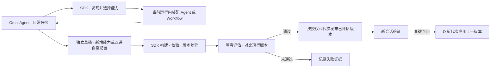

# Nofy Omni Agent 设计与实施计划

子 Agent 与 Workflow 的统一任务视图、SDK 和恢复语义见 [Omni 内核编排架构](omni-orchestration/README.md)。

Nofy 默认提供一个 Omni Agent，以 `programs.main` 作为稳定入口。它持有用户目标，按任务选择能力、调用工具或委派，核验结果后负责交付。编码、调研、数据处理和文档工作同属能力模块，用户通过同一个 Agent 使用它们。Claude Code 的模型、工具、验证循环适用于其中的编码行为，也是通用任务循环的参考。

## 架构决策

| 决策 | 实施契约 |
|---|---|
| 统一产品入口 | 以可组合声明为基础，发布单一默认预设 `omni@0.1.0`。现有 Coding 的工具、Schema、审批和目录绑定进入能力包。既有版本供已发布运行复现和迁移。 [Omni 预设](../manual/omni-agent.md) · [Coding 模块](../../presets/coding/preset.json#L35) |
| 按任务发现能力 | 主 Agent 先读任务目标与可用资源，通过 SDK 的能力描述、Schema 和模块目录选择依赖。对模型只暴露当前授权范围内需要的工具；挂载依赖与具体工作区、数据源、网络等资源的授权分别校验。 [SDK 自描述契约](self-describing-agent-development.md) |
| 运行内自扩展 | 主 Agent 可以调用已有 `assemble`，用本次已绑定的模型、工具包和 Prompt 组合临时子 Agent 或 Workflow。子调用共享取消和预算，权限受父任务制约，结果回到主 Agent。现有默认 `child-tools` 只有消息，实施时须显式装配验证任务所需的窄权限。 [Omni 声明](../../presets/omni/preset.json) |
| 跨任务自扩展 | 当既有能力只缺组合或参数时，主 Agent 可以生成声明、Skill 或 Workflow 候选，由 SDK 构建成可复用的版本化包。缺底层能力时，SDK 应返回明确的缺失依赖，供 Agent 提议引入获准的新组件。 [模块仓库与版本](module-repositories.md#决策) |
| 自演进 | 主 Agent 用版本和执行证据提出对自身配置的改动。独立评估器以固定门槛验证候选，由持有授权的发布入口应用精确版本。已有发布和运行记录提供回退依据。 [候选评估与回退](../manual/omni-agent.md#preauthorized-prompt-evolution) |

## SDK 自演进闭环

1. **发现与起草。** 接入受限的 SDK 操作，由 Agent 调用 `describe`、`schema`、工程检查与模块查询，再向独立草稿提交修改。第一批候选允许修改提示词、Skill、Workflow 和已授权能力的接线。草稿使用 revision CAS，构建及计划生成精确摘要与结构化差异。 [SDK 操作目录](../../crates/common/nofy-agent-client/contracts/operations.json#L384)
2. **评估。** 候选和当前版本使用相同任务、输入资源和预算上限，在隔离环境运行。由候选之外的评估器检查任务结果、权限差异、错误恢复和成本。记录基线版本、候选摘要、评估方案版本、运行 ID、结果与失败原因。首版允许能力新增和任务质量改善，权限基线由现有授权独立控制。
3. **应用。** 用既有发布入口激活精确候选 release，绑定评估摘要、预期 generation 和幂等命令 ID。申请跨既有授权范围的变更时使用现有授权入口。授权可提前覆盖限定的变更类型、资源和预算，范围内的候选通过评估后可自动应用。候选修订或当前代次变化时重新校验，防止以新内容使用旧证据。 [发布命令与回执](../../crates/common/nofy-agent-runtime/src/control.rs#L57)
4. **观察和回退。** 先让新会话使用新发布，活动运行沿用其已锁定版本。关键回归触发一次以当前 generation 为条件的回退命令，重新激活上一 release 并保留候选及全部证据。回退恢复 Agent 版本，已发生的外部效果按各自回执处理。 [代次与回执](../../crates/common/nofy-agent-runtime/src/control/service.rs#L197) · [运行中显式更新](live-source-transitions.md)

现有 SDK 已有发现、源码编辑、构建、模块发布和发布激活契约，`assemble` 已覆盖运行内装配。实施还需把这些能力以限定的 SDK 入口交给 Omni Agent，并把草稿、评估证据、授权和生效回执串成一个可恢复的流程。SDK 的底层管理身份由受信任的应用持有，模型只能选择授予它的操作和目标。 [SDK 入口](../../crates/common/nofy-agent-client/src/lib.rs) · [模块发布契约](module-repositories.md)

## 交付顺序与验收

| 阶段 | 完成条件 |
|---|---|
| 1 · 一个默认 Omni Agent | 通过相同的 `main` 入口完成一个仓库修复和一个非编码任务，例如对已有文档生成带出处的摘要。两项任务使用各自受授权的能力包，保留结果和证据。 |
| 2 · 运行内自扩展 | 主 Agent 识别已有子任务接口无法直接满足的组合需求，调用 SDK 发现能力，在当前运行内组装并执行一个 Workflow。缺失能力、预算耗尽和不在授权范围的资源返回明确结果。 |
| 3 · 跨任务自扩展 | 主 Agent 从重复任务提出一个新 Skill 或声明式 Workflow，构建并评估后发布为不可变包。后续会话经 SDK 发现并复用同一版本。验证失败候选无法进入默认能力目录。 |
| 4 · 自演进和回退 | 用一项可复现的行为改进跑完草稿、评估、激活和回退。注入代次冲突、应用后响应丢失和应用后回归，验证重启后能确认唯一生效版本，重复命令沿用原回执。 |

优先修改预设和模块包，SDK 侧复用现有操作契约。只有端到端验收发现可重复的运行缺口时，再将该缺口归入 Runtime 工作。

交付入口见 [Omni Agent 手册](../manual/omni-agent.md)。Omni 在 Host 进程内调用 SDK 契约、模块模板和本地模块目录。阶段 4 的首个闭环限定为单一基线上的静态提示词修改。可信配置固定系统、代次、评估和观察用例，Host 记录候选摘要、逐条证据及发布回执，使用原 Supervisor 和 ControlPlane 自动执行评估、激活与回退。Skill、Workflow 和工具接线的自动演进继续需要各自的评估和授权契约。
