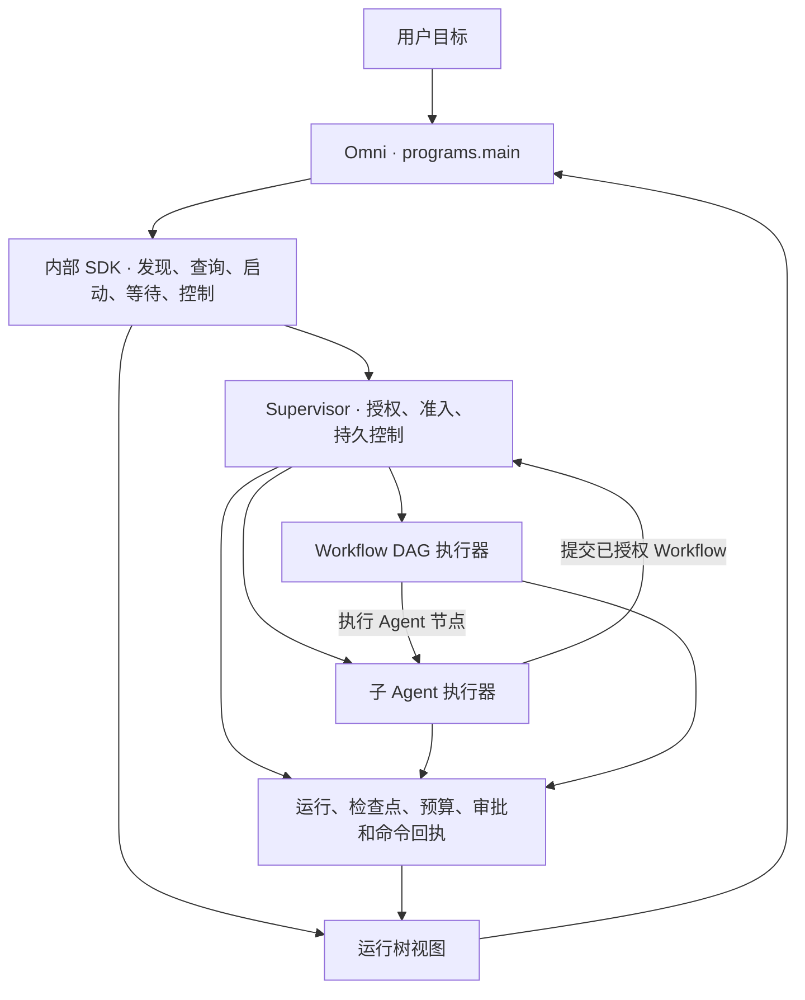
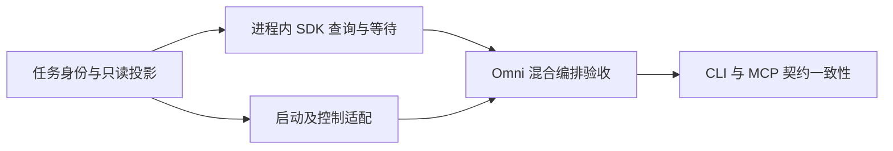

# Omni 内核编排架构

Omni 持有用户目标，决定把工作直接做完、委派子 Agent，还是运行 Workflow。Host 进程内提供统一的任务查询和控制，内核持久化执行身份、状态、权限和回执。Workflow 在自己的 DAG 内推进节点，子 Agent 在自己的模型循环内完成目标。Omni 依据结果决定下一步，并负责验证和交付。

## 当前实现

| 入口 | 已接入的行为 |
| --- | --- |
| `work.targets`、`work.start` | 已发布的 Omni 工具模块以 `background_targets` 声明允许的 Agent 和 Workflow。准入冻结精确的 release 与 program，并在现有托管队列事务内将独立运行登记给会话。 |
| `work.list`、`work.inspect` | Supervisor 从持久记录生成根、子运行、Workflow 节点及阻塞。会话查询返回各回合和该会话拥有的后台根。运行树查询返回指定根的节点。 |
| `work.wait` | 从同作用域的持久水位读取变化。状态、审批、停车和管理回执在原提交事务写入变化日志。分页和等待均有上限。 |
| `work.control` | 依据工作身份与版本登记原生控制。运行目标支持取消、恢复和带票据的模型重试，人工节点接受有执行权限的操作者回复。 |
| `sdk_work_attached_targets`、`sdk_work_task` | 临时子工作沿原任务绑定和父级预算运行，父级关闭前汇合。后台所有权在独立准入时建立。 |

## 运行拓扑



## 选型

| 决策 | 实现 | 现有依据 |
| --- | --- | --- |
| 一套任务视图 | 在 Supervisor 聚合根运行、后代记录、任务意图、Workflow 节点及阻塞回执。首版从现有持久记录读取，按稳定键分页。 | `run.inspect` 已返回根、后代和停车状态，`RunLineage` 提供根与父身份。 [运行查询](../../../crates/common/nofy-agent-host/src/api/runs.rs) · [事件身份](../../../crates/common/nofy-agent-runtime/src/events.rs) |
| 两类执行器 | 子 Agent 走已有任务作用域及可恢复派发，Workflow 走编译后的图及节点检查点。挂起、取消和恢复分派到持有该执行身份的控制器。 | 子任务已有 `spawn/poll/wait/cancel/list`，Workflow 已产生控制节点记录，Agent 节点已有子调用链。 [子任务工具](../../../crates/common/nofy-agent-runtime/src/tasks/declarative.rs) · [Workflow 节点](../../../crates/common/nofy-agent-runtime/src/workflow/graph/tree.rs) · [Agent 节点](../../../crates/common/nofy-agent-runtime/src/workflow/graph/node.rs) |
| 一份操作契约 | Omni 通过进程内 SDK 调用同一套用例。CLI、MCP 从共享操作目录获取 Schema 和可见操作，按调用身份实施授权。 | SDK 已有 `OperationView` 和运行工具集，控制已使用持久命令与回执。 [工具集](../../../crates/common/nofy-agent-client/src/toolset.rs) · [控制命令](../../../crates/common/nofy-agent-runtime/src/supervisor/jobs/managed.rs) |

## 身份与所有权

- 外部客户端使用 `session_id` 或 `run_id` 选择作用域。内嵌工具从当前带租约的根上下文解析会话，利用相同数据库验证成员身份。分支有各自的会话所有权。
- `work_id` 是逻辑工作的稳定引用，`run_id` 标识执行。后台工作 ID 从会话和启动命令生成，子运行及 Workflow 节点沿用已持久化的各自标识。恢复和原生模型重试沿原检查点运行。
- 初始会话回合是后台工作的逻辑父级。后台工作拥有独立执行线程和有上限的会话准入配额，原回合结束后仍由同一会话持有。临时任务继续在其父级作用域内汇合。
- `background_targets` 绑定明确的已发布程序。运行与恢复使用锁定版本及程序声明的治理、资源和记忆授权。全局可用的个人记忆和项目记忆以持久资源及其读写授予为边界，Workflow 的 Agent 节点仍需相应的 `child_read` 和 `child_write`。

## SDK 契约

| 操作 | 输入 | 回执 |
| --- | --- | --- |
| `work.targets` | `session_id` | 可启动的 Agent 和 Workflow、精确 release 和 program |
| `work.list` | `session_id` 或 `run_id`、`after`、`limit` | 精简节点、变化水位及下一页游标 |
| `work.inspect` | `work_id`、可选 `include_result` | 当前节点、版本、可用控制、阻塞及有界结果 |
| `work.start` | `session_id`、`command_id`、`release`、`program`、Agent 的 `text` 或 Workflow 的 `parameters`（JSON 值） | 工作 ID、执行 ID、会话和准入回执 |
| `work.wait` | `session_id` 或 `run_id`、`after`、可选 `work_ids`、`timeout_ms` | 当前作用域内的已提交变化和新水位 |
| `work.control` | `work_id`、`command_id`、`expected_revision`、`action` | 命令受理或已结算、执行身份及原生回执引用 |

`action` 支持 `cancel`、`resume`、`retry_model` 和 `human`。执行时核验版本与状态。模型重试提供原生票据，人工输入由操作者提交并经 Workflow 的原生请求和响应 Schema 校验。工具审批沿原有审批入口处理。

精简节点的建议数据形态如下。

```json
{
  "work_id": "work_7",
  "parent_work_id": "work_2",
  "kind": "workflow_node",
  "name": "review",
  "run_id": "run_32",
  "root_run_id": "run_24",
  "status": "waiting",
  "revision": "rev_8",
  "blocked_by": {"kind": "approval", "run_id": "run_32", "call_id": "approval_6"},
  "actions": [],
  "cancellation_pending": false
}
```

统一状态为 `queued`、`running`、`waiting`、`completed`、`failed`、`cancelled`、`skipped`。等待原因带类型，例如 `dependency`、`approval`、`human_input`、`parked`、`budget`、`reconciliation`。拒答、截断、预算耗尽等原始结算信息通过结算原因表达。结果、完整事件及产物按引用读取。模型默认拿到精简视图，调度依靠持久状态及游标，会话压缩后可重新查询。

## 一次协调回合

1. Omni 读用户目标及当前 `work.list`。现有任务能复用时先读取它的结果与版本，再从 `work.targets` 选取仍需启动的目标。
2. 独立的开放式判断交给子 Agent，数据依赖明确的多步执行交给 Workflow。Omni 可以并行提交相互独立的工作，准入由内核按作用域、预算和并发容量执行。具体 DAG 就绪判定留在 Workflow 执行器。
3. 遇到阻塞时用 `work.inspect` 取原始回执。等待审批时把正确的审批目标交给授权方。未知外部效果进入既有对账流程，结算后才从恢复票据决定下一步。
4. 有可用进展时由 `work.wait` 返回变化，Omni 继续核验。等待超时保留当前工作。会话后台任务可以跨回合继续，当前回合只汇合本次调用内的临时任务。

## 一致性与权限

- `work.start` 以作用域和命令 ID 去重。同一命令及同一规范化输入返回相同回执，输入不同返回冲突。登记成功先写持久意图，再由执行器领取。同库能原子登记时一起提交；跨已有检查点时使用稳定派发身份重放并对账，恢复时先查原回执。
- 节点列表和水位来自同一个读取事务。列表使用绑定作用域的键集分页，持续变化由 `work.wait` 从水位补齐。等待先登记本地通知，再读持久日志，并周期性复读以覆盖跨进程提交和丢失唤醒。水位跨进程重开继续有效。
- 权限从可信 `RunContext` 和作用域授权取得。子 Agent 可用的工具、资源、深度、并发和预算受父级约束，Graph 节点沿用既有准入。读取、启动、控制和审批分别校验。外部传入的 `run_id`、版本名和请求正文均经服务端解析为实际授权目标。
- 控制命令使用稳定身份。取消确认分为已受理和已结算。恢复使用原暂停回执，重试使用内核签发的安全重试票据。相同动作重复送达沿用同一回执，陈旧控制返回当前版本及可执行动作。
- 首版保留有界等待和现有 worker 配额，验证父调用等待时子任务仍可获得执行机会。若长等待需要释放 worker，沿既有停车及恢复链路实现可恢复等待。

## 实施 DAG 与验收



| 里程碑 | 验收 |
| --- | --- |
| 1 · 感知 | 一个 Omni 根运行下展示子 Agent、Workflow、节点及审批目标。重启后用作用域重新查询，状态和执行身份吻合。一次上下文压缩后复查成功。 |
| 2 · 管理 | 重复启动只产生一次派发。验证等待超时、取消受理及结算、审批恢复、陈旧控制和未决效果对账。验证隔离分支无法控制其他运行。 |
| 3 · 调度 | 本机 NInfer Qwen 27B 只接收目标和操作授权，自行发现并并行启动已授权的子 Agent 和 Workflow。验证 Workflow 调用子 Agent，子 Agent 发起获准 Workflow，Omni 发现阻塞、续跑并交付。用任务树、审批、预算和最终产物的真实回执验收。 |
| 4 · 接口一致 | 同一授权下，内部 SDK、CLI 和 MCP 的工具可见性、Schema、状态和命令回执吻合。MCP 继续作为外部访问入口。 |

实施顺序为 `C → A → X`。先确认任务身份及权威状态来源，再把查询和控制接入 Supervisor，最后在真机做混合调度及恢复验收。
