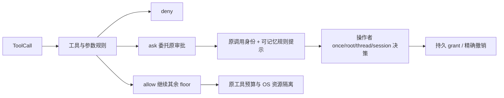

# 声明式权限规则与审批记忆

权限规则是原 Policy 链的一部分，不能覆盖 Host/父 Agent floor，也不安装独立执行循环。规则匹配工具、参数 JSON Schema 和保守命令前缀分析；集合内 deny 优先于 ask、allow，ask 委托已有持久审批。规则 category 自定义，可分别约束文件写入、网络、命令、外部 MCP 和升级操作。

| 接口 | 决定 |
|---|---|
| policy.tool_rules | 工具选择、参数 Schema、命令 pointer/prefixes、allow/deny/ask，按原 Policy 插槽装配 |
| command.analysis | 纯分析 argv 或 POSIX 命令，返回分段、动态构造、重定向及诊断；不执行命令 |
| 命令不确定性 | 变量替换、环境改写、未知 shell wrapper、重定向等不能自动命中静态 allow；转默认规则或 ask |
| 审批记忆 | 命名规则只能记住该规则当前的约束；默认 ask 只能记住同一工具与参数，不泛化成所有命令 |
| scope 身份 | 从原监督 root、thread 和已登记 Session 计算，调用方不能提交另一个 anchor |
| grant | 持久保存版本、规则身份及来源审批；规则内容或模块身份变化后不能沿用旧 grant |
| revoke | 精确 grant_id 与 revision 比较，重复撤销读取原终态，不修改已发生效果 |
| OS 模式 | namespace 资源分别声明 read_only、workspace_write、full_access；full_access 使用全部已显式供给的目录授权，仍受 Host 资源边界约束 |
| 升级 | 选择明确发布的较宽资源与操作者决策；未知部分效果不能自动换 profile 重放 |

核验范围包括规则冲突、引号/管道/命令替换、参数范围、继承 floor、跨线程/会话隔离、Host 重启记忆、精确撤销和读取模式的真实文件效果。
