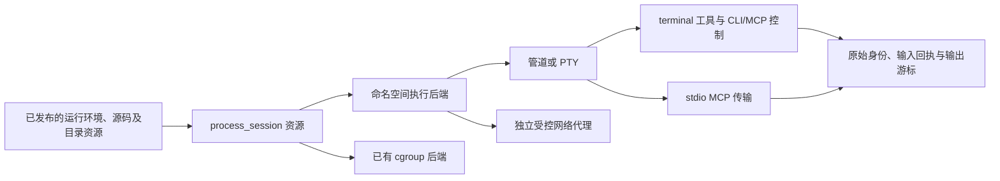

# 执行会话、stdio MCP 与网络供给

本功能块为通用执行原语，接在现有 Loader、版本化资源与工具调度上；不增加按参考 Agent 名称分派的主循环。实现前锁定下列接口与保证。

## 后端与生命周期

| 事项 | 决定 |
|---|---|
| cgroup | 保留现有硬聚合配额后端与真实委派前提 |
| 无 cgroup | 新增显式 PID/user/mount/network namespace 后端，复用现有 bootstrap、隔离文件系统与过滤器；声明实际支持的单进程资源限制，不伪称 cgroup 聚合配额 |
| 进程拥有 | 受跟踪 owner 保留原 helper 和缓存租约；调用方断开、取消、超时与 Host 退出都请求停止并等物理返回；PID namespace init 死亡终止整个后代树 |
| 交互会话 | 管道与 PTY 均有稳定 session_id、owner、配置摘要、状态、输入 command_id、版本及输出游标 |
| 重试 | 相同 start/input ID 只查询原回执；不同内容冲突，不重复写 stdin |
| 重启 | 保留输出和已提交输入回执；活进程无法在 Host 真正死亡后重建，明确记录 abandoned/结果不确定，不伪装恢复 OS 进程 |
| 文件与资源 | 运行环境、制品、可写/可执行目录均由声明显式提供；不暴露任意 Host 可执行路径 |
| stdio MCP | 复用同一 ToolSource/ToolDispatch 与 JSON-RPC 会话校验，仅替换传输；启动延迟到实际 IO，取消不重发远端效果 |
| 网络 | 默认继续拒绝直接网络；可选代理按显式目标/端口及身份授权。命令侧网络放行必须有可实施的强制路由/连接边界，不能仅设置 HTTP_PROXY 环境变量就声称隔离成立 |

## 声明与控制契约

新增 process_session 资源关联 environment、artifact 及命名 directories；入口与参数模板属于声明，运行输入只能填入声明允许的参数。管道/PTY 共享物理进程与回执管理，TTY 只增加终端描述符、尺寸和信号语义。

terminal 工具调用 start/write/poll/resize/close；开发 CLI/MCP 提供对应受授权控制接口。启动通过固定 release 和 ModuleRef 选择已发布资源；读取/写入不能把一个会话 ID 换成另一个资源或 owner。输出包含实际游标、丢弃边界、退出码与 eof，不能将取消等待当作进程终止证明。

stdio MCP 资源同样选择显式环境与制品，派生 connection 依赖交给现有 tool_source.mcp。初始化、工具目录、命名/允许列表、取消、断线和错误复用相同协议规则；无自动重连重发 tools/call。

## 集中验收

网络实现选用「新 network namespace 中只有 loopback + 可信转接进程」。loopback 上的 HTTP/CONNECT 代理将连接描述符交给 Host broker；Host 按明确 host/port 规则解析、筛除禁止地址，并连接一次解析得到的固定 SocketAddr。业务进程没有宿主接口、外部路由、Unix socket 创建、namespace 变更或 proxy 控制描述符。即使忽略代理环境变量，直接外连也没有出口。HTTP_PROXY/HTTPS_PROXY 只提供应用发现地址，网络隔离由 namespace 和描述符边界实施。默认拒绝私有、loopback、link-local 与特殊地址；单条目的 allow_private 是显式授权。每条连接受数量、字节数和超时约束。进程停止时代理及 broker 连接一起回收。

同块实现、接入、手册和用例完成后验证：无 cgroup 的真实命令/子进程及整树停止；PTY isatty、输入、窗口大小、控制字符和关闭；相同输入命令不重复执行；Host 重启后的明确终态与输出；真实 stdio MCP 服务的发现、调用、取消及断线；代理允许/拒绝及命令无法绕过声明网络边界。回归已有 cgroup 后端与各阶段已完成的开发协议。
