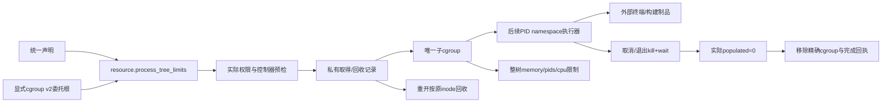
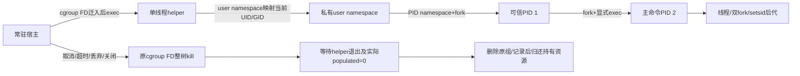
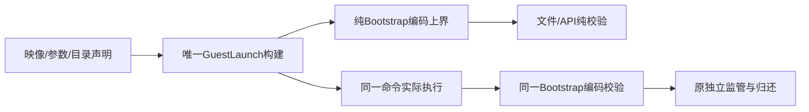

# 受控进程树契约

进程树是新框架的中立执行能力，不是旧Shell/PTY主循环。实施依赖为：M3c1硬资源边界与持久回收 → PID namespace执行/取消与实际归还 → 外部终端及工具链制品 → 唯一编程预设和真实构建验收。第一层不能冒称终端已完成。



| 决策 | 边界 |
|---|---|
| 单进程保持 | 不放宽现有tool.process_artifact、Prompt或Scope的fork/网络/元数据限制；后续树执行是显式新工厂 |
| 权限资源 | resource.process_tree_limits只声明cgroup_root及limits；不包含工具名、命令、解释器发现或项目目录 |
| 运行环境 | 锁定映像仍经resource.process_locked引用；目录与是否可执行必须独立声明，不因名字叫terminal获得权限 |
| 硬限制 | cgroup v2原生pids.max、memory.max、memory.swap.max=0、memory.oom.group=1及cpu.max；不能用轮询计数或RLIMIT_NPROC代替整树限额 |
| 环境预检 | cgroup_root须是显式、规范、当前UID拥有的cgroup v2真实目录，已启用cpu/memory/pids且无直接进程；当前进程须拥有迁入它的共同祖先权限，不自动搬动宿主或修改共享控制树 |
| 单独注入 | systemd Delegate及宿主引导属于显式基础环境，不由模型参数获得；缺失时拒绝新权限，不退化为无约束执行 |
| 校验与接纳 | 纯validate只验Schema/路径语法/限额；持久部署与publication/job提交核对真实设施，owner/checkpoint回执不因设施失效丢失 |
| 持久性 | 先写私有意图，再创建唯一子组，持久化dev/inode后才交给执行层；回收只操作记录指向的精确对象，不删除调用方委托根 |
| 跨实例 | 私有全局短锁限制最多两个未归还组；每组独立flock表示活跃所有者，恢复跳过仍被其他实例持有的组，fork继承不能替父释放/清理 |
| 失败回收 | cgroup.kill后以cgroup.events的populated=0证明无实际工作，再删除原组和记录；超时、路径替换或不可用保留记录并阻止新树取得，不伪报空闲 |
| 继承 | 子运行只允许复用父声明中相同的树配置摘要；不能仅因映像相同就提高进程数、内存、CPU或换委托根 |
| 后续执行 | PID namespace的可信init须覆盖会话逃逸/双fork，父死、取消、超时、调用者丢弃和关闭都须kill+wait；未完成之前保持原单进程拒绝 |

资源配置：

```json
{
  "cgroup_root": "/sys/fs/cgroup/explicit-delegated-unit/jobs",
  "limits": {
    "max_processes": 32,
    "max_memory_bytes": 536870912,
    "cpu_percent": 100
  }
}
```

limits有同样的默认值，未知字段拒绝。max_processes为4..512（包括后续监管/任务进程与线程），max_memory_bytes为64MiB..8GiB，cpu_percent为1..800（100代表一核，固定100000微秒周期）。整数按实际内核单位写入；未设置内核限制成功前不能把子组交给任何业务执行。文件总配额、可执行目录、设备、网络、凭据、完整C8隔离及控制台不是本层已实现声明。

常驻宿主应在明确委托的服务环境运行，kernel进程放在独立叶子，jobs为空的控制器父组。模块预检不自动创建或重配这样的服务。当前机器支持非特权user/PID namespace及用户systemd委托；验证通过独立临时用户服务，不能为测试迁动现有SSH/Codex会话或占用其他服务的cgroup。

cgroup_root是显式目标环境前提，跨宿主须提供同一设施路径或提交配置差异；内核cgroup对象和原inode不能作为可移植运行状态导出。该层的启动恢复不等于完整历史迁移或运行中授权热转换，后者仍须独立证明。

恢复记录是框架自己的持久状态，不是旧产品兼容格式。Root目录或同名组被替换、组存在但身份记录不完整时保持未知，即使组为空也不猜测所有权，不按路径字符串杀新进程。实际设施可用性只门控新资源授权；已有模型/工具效果的保存与读取不受其可用性影响。状态文件删除发生在已确认原cgroup消失或原空组删除之后；未知状态不能通过抹记录解除。

## PID namespace 生命周期（M3c2）

本层为受信内核调用者提供`Manager::supervise`，不是Agent工具、任意脚本沙箱或终端。命令必须显式给出绝对程序路径、工作目录、参数及完整环境；不继承宿主环境或搜索PATH。对Agent开放前仍须组合锁定映像、Landlock、能力清除及树专用seccomp，不能将本层直接注册为无隔离工具。



helper入口在Tokio之前执行，只运行可信监管代码；任一步namespace、映射、父身份或exec失败均终止，不回退到普通执行。外层对宿主设置PDEATHSIG并在两侧核对父PID。PID 1以独占管道校验外层存活，再设置自身父死SIGKILL；它不可转交写端给命令。主命令退出后PID 1杀剩余namespace成员并wait到ECHILD，setsid及双fork不能绕开。外层等待PID 1并传播主命令退出码；它本身不执行业务。

每个Manager最多两个监管任务，跨实例仍受同一私有物理记录上限约束。调用Future丢弃只触发停止，不丢弃监管任务；监管任务持有cgroup拥有权以及调用方传入的缓存、scratch或许可，直到kill、helper wait及原组空且删除均成功。清理错误先返回明确错误，但监管任务保留拥有权/资源并重试，不伪报可用。关闭先拒绝新监管、取消已有任务，再有界等待；不能及时归还须报错而非声称已清空。内嵌宿主须保持runtime存活并等待drain，进程硬退出后的最后防线仍为父死链与持久cgroup恢复。

原始Job/迁组API收敛为模块内部实现，外部调用只走完整监管，不能绕过跟踪后声称drain成功。等待当前任务后还须重查持久记录，未知或其他仍活跃拥有者保留并返回未完成。Host独立等待树、Prompt、Scope及Memory各类拥有者，再传播错误；某一类失败不能跳过其余等待。当前开发期Rust入口不作为旧产品兼容承诺。

输入最多8MiB；stdout和stderr各自最多8MiB且实际读取有界，超限或IO失败同样走整树收束。超时1..600000毫秒覆盖取得、启动及命令IO；清理独立于调用超时，不为了准点返回释放仍在工作的资源。生命周期完成不证明网络/文件隔离、可执行项目权限、工具链移植、热更新或完整C8已验收。

## 树制品执行边界（M3c3）

声明入口为`tool.process_tree_artifact`，必需依赖`environment`（仅resource.process_locked）、`artifact`和`tree`（resource.process_tree_limits）；具名目录仍经同一resource.directory装载。配置沿用contract/entrypoint/args/input/directories，不允许单进程scratch_files，也不把模型参数插入命令行或解释器。原tool.process_artifact保持单进程、无项目Execute，明确拒绝新增read_write_execute目录。

| 决策 | 执行边界 |
|---|---|
| 私有根 | 仅在一次性helper自己的user/mount/PID/network/IPC namespace内组装，不挂载或修改宿主共享树 |
| 依赖 | 锁定映像顶层只读绑定到相同guest绝对路径；内核ELF解释器/子程序只可能读取声明映像，不回退宿主lib/PATH；最多256个声明可执行文件，Execute按文件精确授予，不因缓存mode改变扩权 |
| 挂载协议 | 映像不得占用nofy/tmp/proc/sys/dev/run；/nofy/artifact只读、/nofy/scratch为64MiB/4096 inode tmpfs，具名目录为/nofy/directories/ALIAS；不递归引入宿主嵌套挂载 |
| 目录授权 | read_only只读且noexec，read_write可写且noexec；read_write_execute才允许项目产物执行。只读挂载也禁止chmod/ACL等元数据写入 |
| 设备与内核树 | 仅显式/dev/null，不挂载宿主proc/sys/cgroup、随机设备、socket或凭据目录；新根之外不可见 |
| 业务权限 | chroot后清除全部能力、锁定root/ambient提权规则，安装硬要求Landlock及树专用seccomp；可信PID1不执行制品代码 |
| 派生 | 仅允许当前PID namespace内普通fork/线程，clone3明确ENOSYS以便标准库回落；禁止新namespace、CLONE_PARENT、ptrace/进程内存、挂载、提权与外部网络 |
| 物理拥有者 | 复用M3c2独立监管与精确cgroup归还；helper/init独立持有cache lease，业务exec不获得租约描述符 |
| 失败 | namespace、mount_setattr、Landlock或seccomp任一步不可用均执行失败，不普通运行；纯声明校验不创建挂载或运行探测程序 |

映像仍为原统一锁格式，路径相对其根，guest程序路径为`/`加manifest executable/loader；prefix_args和env path在guest根解释。library_dirs不得含冒号，不能把一个声明路径变成多个动态链接搜索入口。子ELF的PT_INTERP及其依赖必须存在于该映像布局，缺失只会失败，不发现宿主文件。完整工具链/编程预设集成和实际模型构建另验；项目目录的磁盘总配额、完整C8及运行中状态迁移不是本阶段已完成声明。

审批策略和执行授权是独立声明：前者决定操作是否等待人工批准，后者决定实际目录、程序及资源边界。当前树执行器固定禁止网络并执行上述隔离；关闭审批不会解除它，也不能宣称已提供“完全访问”模式。类似控制台权限档位仍须作为明确的声明组合及预设验收，不能以本阶段底层通过代替。

常驻CLI显式设置`WORKER_STACK_BYTES`（16MiB），不依赖Cargo测试环境的`RUST_MIN_STACK`。内嵌Host的Tokio多线程runtime也须设置此栈下限；可信helper仍在任何Tokio线程启动前分派。

外部命令接入发现非阻塞管道误禁：实际Python在stdout_nonblocking返回EPERM，原生pipe/ioctl探针亦证明FIONBIO失败，而其他禁止项仍被拒绝。树专用过滤器仅允许请求高32位为零的FIOCLEX和FIONBIO；后者只切换已拥有FD的阻塞模式，等价能力原已由fcntl(F_SETFL)提供。FIONREAD及两种请求的高位变体仍须实际拒绝，不能因此开放通用ioctl/设备控制、网络或宿主描述符。此修正不改原单进程过滤器、目录授权或整树限额，原生探针和实际双流/取消/恢复共同验证；不为某个旧Agent增加特殊分支。

### 合并命令的纯预检（M3c3收尾）



| 决策 | 契约 |
|---|---|
| 唯一命令 | program/arguments/environment仅由GuestLaunch合并一次；纯build和实际调用不各自拼接prefix/loader/entrypoint/目录环境 |
| 唯一载荷校验 | Bootstrap编码方法先执行既有validate，再校验完整JSON不超过65536字节；监管与纯预检共用，不放宽128参数、单参数4096、参数总65536、32环境、环境总32768及路径限制 |
| 完整上界 | 纯build包含实际私有根、映像/制品摘要路径、所有可执行文件及目录声明。仅临时目录随机名和PID取表示长度上界，不查询物理资源或创建目录 |
| 随机名边界 | 树工具使用固定前缀及16个ASCII字母数字的临时目录名；实际准备验证同一形状，保证纯编码上界涵盖每次真实路径 |
| 实际重检 | 调用时仍验证目录设施、物化摘要路径及实际Bootstrap；任何布局或命名契约漂移都拒绝执行，不通过删除校验容错 |
| 协议 | 声明Schema及内部bootstrap字段不变；仅把原执行时必然拒绝的组合提前到纯校验，不新增业务权限、兼容工厂或另一套装载入口 |

阶段顺序：合并参数/环境反例先复现 → 共用构建/编码与无IO边界测试 → 原生API纯预检及真实树执行回归 → 外部终端/工具链接入。前一轮188项回归证明已有实际隔离，不替代这些新组合反例。
