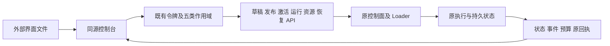

> 历史记录：当前发布已移除前端源码和静态资源服务，以下内容不代表当前交付仍包含页面。

# 常驻控制台实施契约

本功能块交付新的本地浏览器控制台，界面、文件导入和外部客户端共同使用当前控制 API、Loader、调度与持久事实源。界面源码位于独立 console 目录，由明确的 --console-dir 装载，普通界面更新读取磁盘文件，不绑定 Rust 编译快照。



| 决策 | 契约 |
|---|---|
| 入口 | 开启目录装载后 /console/ 提供界面，根路径跳转；API 路径继续原鉴权，静态页面启动不携带凭据 |
| 目录边界 | 目录必须与私有状态分离；Linux 使用目录描述符逐级 no-follow 打开，只发布支持的界面资产，拒绝隐藏/特殊/硬链接文件及路径越界 |
| 更新 | 页面及脚本按请求读取，使用 no-store；普通模块/脚本仍通过声明、草稿及发布装载 |
| 身份 | 控制台令牌仅保存在当前页面内存，不进入 URL、Cookie 或持久浏览器存储；凭据值只由独立管理 API 写入，页面不读取旧值 |
| 声明 | 编辑整份 JSON、模块配置、依赖引用及制品源码；校验与发布分别明确操作，草稿使用 revision CAS，激活使用 generation CAS |
| 精度 | 浏览器解析及序列化保持超出安全整数范围的 JSON 整数，避免预算、版本或游标被无声取整 |
| 运行 | 原任务、稳定会话、子树、检查点、流式事件及原始完成输出可观察；启动与更新都使用原持久命令 |
| 审批及恢复 | 精确展示原审批请求和恢复票据；批准/拒绝、暂停/恢复/取消、停驻及显式模块更新均经既有 API，未知效果需要对账 |
| 预算 | GET /api/v1/budgets 只读分页展示当前宿主持久账本的原限额、已用/预留、活动及阻断事实，不刷新期限、不开户或结算 |
| 权限元数据 | GET /api/v1/access 返回当前有效令牌的作用域，复用原 require 判定，不提供令牌或凭据值；页面可用性与服务鉴权一致 |
| 资源 | 源码制品、运行环境/可选映像、来源及记忆资源通过已有管理入口检查和提交，外部依赖仍由用户安装 |

预算页接口返回 protocol=nofy.budget-page/v1、ledgers（原 BudgetSummary）和 next 游标，after 是不透明的原账本排序键，limit 为 1..64；失败显示错误，不把缺失或未知伪装为空额度。该只读接口覆盖宿主原生持久账本，不推断外部 SDK 自备存储的状态。

整块完成后集中验证静态路径与 API 权限、源码即时更新、预算分页及不变性、声明到发布/激活/运行、审批/事件/恢复界面、无权限控件、恶意文本与大整数、移动视口及浏览器真实操作。沿既有证据核对历史记录，不能以界面存在宣称其它状态迁移或多参考预设已完成。

## 启动与更新

访问配置沿用原 AccessKeyReference 数组，例如在界面目录之外的 access.json 中填写：

```json
[{"token_env":"NOFY_CONSOLE_ACCESS","scopes":["read","edit","publish","resources","execute"]}]
```

由调用环境注入该变量，然后启动同一宿主：

```sh
cargo run -p nofy-agent-host -- \
  --state-dir /absolute/path/to/private-state \
  --access-file /absolute/path/to/access.json \
  --console-dir /absolute/path/to/nofy-build/console
```

默认监听 127.0.0.1:7331，浏览器进入 /console/。控制台目录是显式授信的公开界面源码目录，与私有状态分离；环境变量中的模型凭据仍按原 credential prefix 注入，也可在资源页写入独立凭据。页面刷新后重新输入访问令牌。更改 console 下 HTML、CSS、JS 后刷新页面即可；发布 Agent 模块仍经原声明校验与 Loader。

## 页面与原接口

| 页面 | 读与写路径 |
|---|---|
| 系统与版本 | catalog、systems/history、plan、apply；选择旧发布产生新 generation |
| 声明与模块 | modules、modules/dependencies、validate、drafts、publish、import、releases；模块配置、依赖槽和制品源码在同一 JSON 中编辑 |
| 运行与会话 | runs、runs/id、approvals、actions、cancel、inputs、sessions/turns；原始检查点与完成结果只作观察 |
| 实时事件 | fetch SSE，Authorization 请求头；从最后收到的精确 cursor 重连，暂停读取不取消任务 |
| 恢复与对账 | recovery/root、recovery、recovery/models、recovery/hooks；读取原票据，再显式提交包含真实外部结果的原 ManagedCommand |
| 资源与凭据 | artifacts、runtimes、runtime-images、runtime-sources/acquisitions、credentials、memory/resources、loader/references/unload/cache |
| 预算与用量 | budgets；展示原始 BudgetSummary，不派生新账本或推测未知外部状态 |

运行控制先准备完整 ManagedAction，再显式提交，命令 ID 和请求保留在页面便于查询；不自动重发写请求。批准并继续先记录精确审批决定，再提交可见的 resume 命令。稳定会话从原 Agent 根创建，续轮使用原 source revision 及新运行 binding CAS。通用 JSON 命令区沿原 API 支持其它恢复、人类输入和控制命令；未核实的外部结果不自动填充。

界面事件窗口保留最近 300 条；原数据保存在宿主，可按游标查询和导出每页。版本历史默认展示前 16 条，可通过同一 API 的 after/limit 获取后续；该界面范围不是运行或源码打包配额。模块图绘制前 160 个节点，搜索和完整声明保留所有模块。

## 集中验收命令

```sh
cargo test -p nofy-agent-runtime --features sqlite,workflow,control-file --test budget_view --test governance
cargo test -p nofy-agent-host --lib --test credentials --test http
node --test console/tests/protocol.test.mjs
```

浏览器验收使用 agent-browser 在独立会话和临时状态中真实点击界面，连接本机协议夹具；真实模型记忆证据另外使用已完成的原记录复核，不重复计为本轮推理。实际构建、用例、截图和未覆盖边界写入 docs/verification/resident-console.md。
