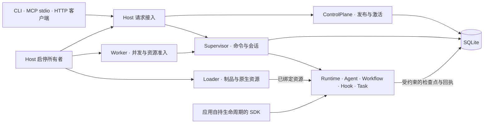
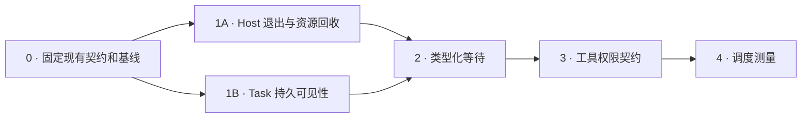

# 常驻 Host 架构与修复计划

Nofy Host 继续作为常驻进程的装配入口和生命周期所有者。它构造控制面、存储、Supervisor 和 Loader，管理请求接入、调度并发及进程资源。会话许可、命令排序、审批、检查点和执行恢复由 Supervisor、Runtime 和 SQLite 共同实现。Host 的优先工作是统一关闭路径，再修正会影响 Host 执行或恢复的内核契约。

## 参考实现与取舍

参考仓库位于本地 `ref/claude-code-clone`，基于提交 `c16284c` 的源码。该项目的打印模式由一个 CLI 进程持有整场会话。`src/steering.ts:288` 的 `StdinIntake` 持续接收 stdin，用户帧进入队列，控制帧即时处理。`src/cli.ts:1205` 为每段执行安装独立的取消控制器，`src/cli.ts:1213` 为该段吸收的命令发出 `started`，结束时再逐条记录 `completed` 或 `cancelled`。EOF 后继续处理队列，输出生命周期与输入连接的寿命有明确边界。

| 决策 | 参考项目的实现 | Nofy 的契约 |
|---|---|---|
| 命令与执行 | 内存队列、进程内 UUID 去重、按执行段发出生命周期帧 | SQLite 中的命令回执区分已接收、已执行和终态。进程内唤醒只加速读取待执行事实。 |
| 取消 | 分别处理排队项取消、活动执行段中断和首段启动前的取消窗口 | 通过已有命令和持久取消请求表达意图。Supervisor 在租约内按目标及安全点执行，客户端断开与命令取消各有独立语义。 |
| 会话恢复 | `SessionStore` 写入 JSONL，打印模式在会话循环退出后追加 transcript | 持久会话和运行可跨连接、跨 Host 重启恢复，恢复依据原命令、检查点、审批和效果回执。 |
| 接入 | `main` 同时持有 stdin、队列、活动取消和输出 | CLI 和 MCP stdio 继续连接同一常驻控制 API。SDK 调用可直接使用 Runtime，由调用方持有执行生命周期。 |

参考实现适合本地单进程交互。其 `UserFrameDeduper` 只保留在内存，`SessionStore.load` 逐行 `JSON.parse`，输出中的 `completed` 也可能早于 transcript 追加。这三个行为不足以构成常驻服务的去重、崩溃恢复和持久确认契约。Nofy 已有跨 CLI 和 MCP stdio 共享会话的集成入口。 [Nofy CLI/MCP 集成测试](../../crates/common/nofy-cli/tests/development.rs) · [SDK 的宿主约定](../runtime-hosting.md)

## 目标拓扑与接口



| 边界 | 实施契约 |
|---|---|
| 请求接入 | 沿用现有请求校验、授权、命令 ID、CAS 和回执。提交事务成功后才唤醒 worker。进入关闭阶段后，拒绝新的执行提交，并允许已进入接入边界的提交确定其持久结果。 |
| 运行调度 | Host 选取候选并管理并发与内存准入。Supervisor 在进入执行前复核 FIFO 队首、运行租约、代次和当前检查点。保留原 `plan` → `prepare` → `apply` 契约与 stale-plan 错误。 |
| 持久等待 | 在 Runtime/Store 内为可调度的暂停写入内部类型化投影。身份来自根运行和当前检查点。审批类还携带请求的运行、线程、步骤、策略与调用 ID。其余等待类型沿用自身恢复条件。公开 `RunOutcome` 继续作为查询结果。 |
| 权限与恢复 | 绑定后的工具由可信边界提供调用级效果分类，用于审批。`recovery_identity` 用于对账与重接。子调用显式获得执行需要的权限和控制句柄，普通可选资源继续经 `TypedExtensions` 注入。 |
| 停机 | 统一执行停止接入与派工、等待已接收工作完成或留下可恢复状态、回收已拥有的资源、报告原始故障及清理结果。资源仍处于使用中时，依据其现有取消与回收契约确定顺序。 |

## 实施顺序与验收



| 阶段 | 问题与改动 | 合并门槛 |
|---|---|---|
| 0 · 基线 | 从 CLI/MCP 提交、Supervisor 执行、状态恢复各走一次原入口。固定命令 ID 重试、断连后回执、停止与取消、旧库打开及历史转移的预期行为。对仓库中将修改的 Rust 符号运行 GitNexus upstream impact。 | 记录测试基线及直接调用方，确认外部 SDK 和嵌入 `run_worker` 的调用契约。 |
| 1A · 可靠停机 | `main` 选中失败的 server 后先执行 `result?`，可在等待 worker 清理前返回。`worker::run` 自身的派工错误及停机阶段 `JoinError` 也可提前丢弃剩余 `JoinSet`。在现有 Host 内聚拢退出路径，保留首个失败，显式停止派工并收齐其余任务和各资源所有者的关闭结果。原有嵌入入口复用同一关闭契约。 [入口](../../crates/common/nofy-agent-host/src/main.rs#L173) · [调度与排空](../../crates/common/nofy-agent-host/src/worker.rs#L119) · [资源清理](../../crates/common/nofy-agent-host/src/lib.rs#L203) | 分别注入服务失败、派工失败、在途任务 join 失败和外部停机。验证每类资源完成清理或返回明确超时状态、已提交命令可在重启后查询、已进入执行的效果遵守原恢复契约。超时与硬退出语义按资源类确认。 |
| 1B · Task 检查点 | `Scope::peek` 在拿到 journal 锁前检查写入错误，可能读到一次提交失败的子任务终态。`spawn` 和恢复路径也先改 journal 再保存。让执行中可读的状态只发布已成功提交的版本，结果未知时要求重新读取检查点或返回检查点错误。覆盖 journal 修改、提交和唤醒的原子可见性。 [Task 路径](../../crates/common/nofy-agent-runtime/src/tasks.rs#L128) · [Journal 提交](../../crates/common/nofy-agent-runtime/src/tasks/journal.rs#L42) | 阻塞并使指定的 save 失败，同步覆盖 `poll/list/wait`、重复 `spawn` 和恢复。读取方只得到已提交视图或明确错误，失败的提交不会被后续 save 顺带发布。 |
| 2 · 类型化等待 | 当前 `RUNNABLE_JOB` 用 SQL 递归解读 `RunOutcome::Paused.reason`，新增包装类型时容易漏掉调度。由 Runtime 维护同事务投影，Host 通过现有候选查询读取。为老库和历史转移实现从权威状态重建，审批决议和取消仍由 Supervisor 核对当前身份、回执和租约。 [待执行查询](../../crates/common/nofy-agent-runtime/src/supervisor/jobs/managed/query.rs#L3) · [历史转移契约](runtime-history-continuity.md) | 覆盖嵌套 Hook、子 Agent、拒绝队首、审批精确匹配、取消、两 worker 竞争或租约过期、重启以及导出导入。对已知旧结构比较新旧候选集合，让未知等待保持待处理。 |
| 3 · 显式权限 | `dispatch_host` 用 recovery identity 和 action 名识别特殊会话控制。先对现有 `ApprovalEffect` 和跨调用权限传播做调用面审计，再在可信绑定处显式分类。把现有许可逐项迁移，外部或未知 dispatch 保持既有审批默认值。 [审批入口](../../crates/common/nofy-agent-runtime/src/agent/dispatch_host.rs#L72) · [ToolDispatch](../../crates/common/nofy-tool-runtime/src/dispatch.rs#L32) | 通过直接调用、Workflow、Hook 和 Task 验证审批矩阵。核对策略下限、未知实现和子层级权限收敛。接管相同命令时仍按原身份进行效果恢复。 |
| 4 · 调度测量 | 当前 worker 每 250 ms 扫描，唤醒时也尝试刷新 Loader。以相同负载采集空闲查询数、入队至领取 p95、Store 锁等待和关闭耗时，再决定是否解耦 Loader 刷新或给进程内变更通知增加调度用途。保留定时扫描作为跨进程恢复来源。 [Worker](../../crates/common/nofy-agent-host/src/worker.rs#L17) | 输入固定的空闲、突发、两进程竞争场景。调优须降低查询或刷新开销，并维持既有入队延迟和恢复覆盖。 |

## 验证与回滚

先执行现有套件，再运行各阶段的故障注入用例。

```sh
cargo test -p nofy-agent-host
cargo test -p nofy-agent-runtime --features sqlite,workflow,control-file
cargo test -p nofy-cli --test development cli_and_official_stdio_client_share_source_publish_run_and_session_state
python3 scripts/check-agent-runtime-boundaries.py
python3 scripts/verify-framework-boundaries.py
```

类型化等待先做增量投影、回填及候选比对，再启用投影查询。切换前验证旧库可打开、未识别等待可诊断、导入后可重建。若支持新旧版本交替运行，旧 writer 写入后必须能识别过期投影并回到旧查询或重建。若无法证明版本交替安全，升级与回滚使用显式停机边界，权威 `RunOutcome`、审批及命令数据继续可读。每一阶段独立交付，允许单独回退。
