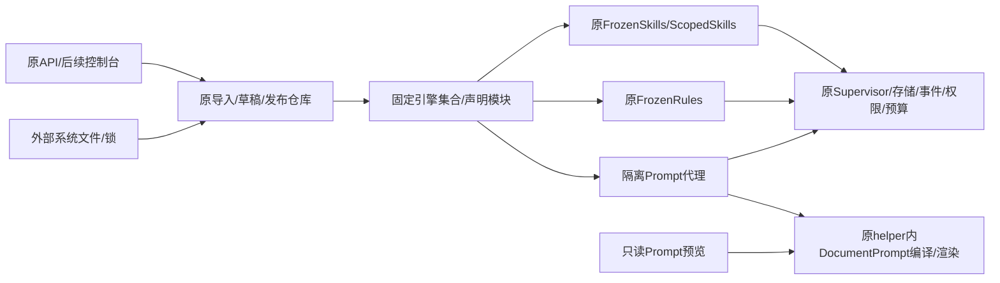
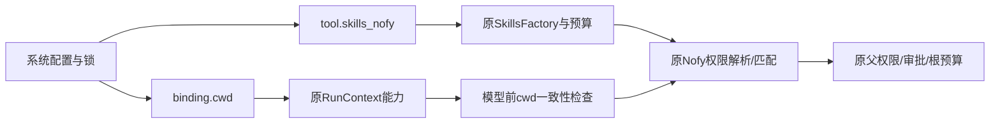
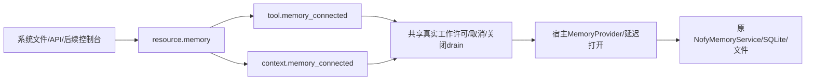
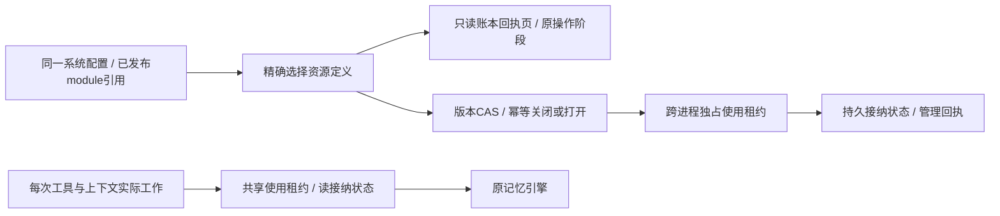

# 声明式能力的装载与隔离

> 2026-11-01 用户纠偏：本文记录此前实现及研究线索，不再授权旧产品兼容方向。最终交付为干净声明式框架与一套预设；旧入口、原SDK描述、旧二进制和格式兼容不再是施工目标。可用能力须脱离旧产品依赖后进入统一模块与Loader路径；本文件后文的原兼容门槛均属历史要求。B2为未验收草案及源码增量，不据此继续扩展兼容工厂。

本规范承接L2f3b4，覆盖常驻宿主与原能力适配的连接；不是原预设或全平台已完成声明。实施顺序：Prompt/规则/Skill → Memory/MCP资源管理 → 原编程预设 → 有状态更新与最终矩阵。角色 C → A → X，按契约阶段推进。

## 当前实现边界（CLEAN4e-M2，优先于后文历史契约）

Host的Prompt、规则、Skill属于独立`nofy-agent-modules`，普通内部闭包6个crate；权限词汇/工具参数含义已从Rust静态实现改为外部artifact程序。`resource.scope_program`由同一Loader装载并经受限helper执行，`tool.skills_scoped`显式依赖该资源，scope字段是槽名字符串。旧permission源码、Read/Bash/MCP DSL及包装器特权已删除，不提供对象配置回退或旧工厂别名。Skill输入采用自有SkillInfo/SkillPackage，列表按明确字节限额、条件路径按成功调用或明确路径上下文激活，参数只提供通用变量且SDK调用同样有界。完整字段和预算见`crates/common/nofy-agent-modules/文件说明.md`及`scope-program-contract.md`；后文厂商别名、旧Schema/原SDK保持不变等条款不适用于当前模块。

记忆为一个`resource.memory`，领域协议属于独立`nofy-memory-types`，引擎自有配置、根目录和注入HTTP客户端。单资源管理与实际使用共享接纳控制，关闭不删除数据、已成功效果或预算，关闭状态和回执跨硬退出恢复。Host已切断旧采样及测试宿主，普通内部闭包16、含build/dev17；唯一编程预设、完整资源管理、C8与最终源码树清理尚未完成，不能以此局部边界通过宣称已交付干净平台。

## L2g1：Prompt、规则与Skill



| 决策 | 契约 |
| --- | --- |
| 复用 | Host安装原nofy-agent适配工厂：prompt.document、context.rules、context.skills、tool.skills；不复制渲染、发现、Skill执行或权限实现 |
| 依赖 | 具体适配只进入下游Host；nofy-agent不启用可选Goal/context/executors特性，默认公共Runtime和仓库外消费者不反向依赖Host或原工具全集 |
| 版本 | 规则和Skill上下文沿用原修订；Host的prompt.document使用隔离协议修订，tool.skills追加替换资源profile修订，原SDK默认工厂不变。定义在系统文件/锁中冻结，新增发布不改变旧任务，不把PID/本机路径放进版本。未交付的L2g1临时锁与新版修订不混用，不重写历史 |
| 外部定义 | Prompt片段、来源、变量schema/值，规则文件内容与来源，Skill正文/元数据及可选执行绑定均在原模块config中；通过原导入/发布/导出管理，不要求用户编辑Rust或重新注册实例 |
| 纯预检 | 校验/编译只做有界结构与语法检查，不生成模板代码或启动进程。预览在隔离helper中编译/计算；两者均不读规则/Skill路径、不发现个人目录、不执行模型/业务工具或解析凭据，文件字段不是服务器读文件接口 |
| Skill语义 | 沿原Skill条件列表、调用格式、变量替换与子Agent执行。model/effort/allowed_tools需要显式execution依赖；原ExactSkillScopeCompiler仅认可精确工具名，未知权限表达式拒绝，不能静默放宽 |
| 运行兼容 | ScopedSkills沿原as_tool、父能力/权限floor、根账本、检查点和恢复路径。旧成功效果不重发，子暂停保留原调用；额外声明不绕过Loader的持久依赖复核 |
| 管理边界 | Prompt预览只需read，执行仍走原execute/审批。预览工具视图由请求显式提供，仅供渲染观察，不是实际运行目录、权限或依赖的证明；运行使用真实工具目录 |
| 后续范围 | 服务器文件发现/显式来源导入、原权限表达式编译、Memory/MCP资源接纳及生命周期、完整原编程预设与有状态Context/Memory/Recipe转换另行闭合，不把已捕获正文或SDK示例冒充这些能力 |

### 预览接口

POST `/api/v1/prompts/preview`，read作用域，body最多2MiB：

```json
{
  "document": {
    "fragments": [{"id":"identity","content":{"kind":"template","text":"Help {{ team }}. Tools: {{ tool_names }}"},"source":{"kind":"definition","reference":"identity","version":"1"}}],
    "variable_schema":{"type":"object","required":["team"],"properties":{"team":{"type":"string"}},"additionalProperties":false},
    "values":{"team":"support"}
  },
  "variables": {},
  "tools": ["lookup"]
}
```

返回原`PromptPreview {text,fragments,tools}`，片段包含原source/text/start_byte/end_byte。请求严格拒绝未知顶层字段，变量沿原保留名/schema/64KiB限制；工具视图最多1024个唯一合法ToolId、名称合计64KiB。使用同一个有界进程执行器，断开不提前释放已开始工作的许可；不新增持久事实源。

GET `/api/v1/prompts/status`（read）即时返回protocol、slots、in_flight、started、helper_bound与stopping，仅为本进程派生诊断，不返回PID/私有路径或模板。helper_bound表示已绑定，不是当前文件或平台探测的替代证明；执行仍验证真实helper。元数据查询不占渲染/管理许可。

### 阶段门槛

1. 原工厂通过真实API枚举、依赖检查、导入、导出与原文件入口可用，旧工厂/release保持。
2. 预览与实际模型请求文本、片段范围/来源一致；保留字、错误变量、超限与权限拒绝，不产生凭据/网络/路径IO。
3. 无模型Skill可作为原Tool程序执行；同一Host发布新正文后旧发布仍返回旧正文，重开/跨目录锁恢复保持。
4. 真实模型/HTTP工具证明ScopedSkill的模型、effort、精确工具收窄、父权限floor和持续预算；暂停/恢复不重发成功效果。
5. 完整Host回归、原适配测试、公共依赖边界和最终冻结/调用图审计通过后结束本阶段。阶段完成不是总目标完成。

### 安全补充：从最终输出限流到隔离执行

原MiniJinja的fuel约束指令次数，不约束单条字符串乘法或捕获块的中间内存。现已用有界writer在最终写出时限制1MiB，并以UTF-8字节、跨片段和循环输出测试验证；这不是完整内存沙箱，不能据此把只读预览视为安全上线完成。

后续实施必须保留完整支持的模板语义，不通过删除运算/循环或更换简化语法缩减目标。生产Host的预览及实际Prompt渲染须使用同一个受管隔离执行器：纯编译不启动进程；执行有明确协议、内存/CPU/墙钟与输入输出上限，取消/断连不能提前释放实际工作许可；不继承凭据/个人目录，不提供文件加载器。超限或执行器缺失须失败关闭。工厂/执行绑定版本须稳定且可迁移，不能把本机路径/PID写入锁；旧入口与默认SDK保持兼容。该执行器、异常/取消回收及完整Host矩阵通过前，L2g1保持施工中，不以当前回环测试或最终输出限流宣称阶段完成。

上述隔离链路已实施，专项证明包括编译时巨大常量、变量乘法、捕获块、内建函数长计算、输出限制、原模型入口零凭据/零派发、取消与关闭wait回收，以及父进程硬退出后无存活计算。父进程已死时只能证明进程停止，不能声称死去父进程完成wait；正常取消/关闭另有PID消失证明。完整冻结回归以闭环计划记录为准。

### 隔离执行契约（实施锁定）

| 边界 | 决策 |
| --- | --- |
| 主进程预检 | 复用原结构/schema校验，使用精确锁定MiniJinja 2.18.0的公开machinery词法/语法接口，仅解析、不生成代码；整份模板最多4096 token。官方源码确认语法解析不调用as_const，常量折叠属于后续编译。依赖不稳定解析API时必须精确锁版本并有语法/恶意常量测试，不自写更小的模板语法 |
| 原SDK | DocumentPromptFactory及原new/preview/render接口继续；额外公开可复用的结构校验，不把Host/进程依赖带入公共Runtime。独立可信Rust调用仍自选原适配 |
| 常驻工厂 | prompt.document由Loader安装有稳定隔离协议修订的适配，使用原DocumentPrompt做实际编译/渲染；其余三种纯规则/Skill工厂仍由native注册。helper路径/摘要是私有启动绑定，不进入模块config/锁；缺helper或平台隔离能力时失败，不回退进程内执行 |
| helper | 在原单线程worker入口的专用render模式内，先应用既有Linux Landlock/seccomp/能力清除，再解码、编译和渲染；512MiB地址空间、2秒CPU、5秒墙钟、无环境变量/网络/新进程/文件加载器，保持原1MiB输出检查 |
| wire | nofy.prompt-render/v1；定义最多2MiB，合计请求4MiB，变量64KiB，唯一工具视图1024项/64KiB；stdout最多16MiB（包含转义后的片段副本），stderr最多64KiB。原渲染语义错误422；helper不可用、退出/超时/超限明确失败，不读取未经验证的完整输出 |
| 生命周期 | 每Loader独立2个实际渲染许可；后台任务持有渲染/HTTP管理许可到进程wait完成。取消、关闭、IO失败和超时均kill并reap；原resident main通过worker关闭路径等待渲染工作排空。排队取消不启动进程 |
| 文件/维护 | helper只授予专用空render目录只读权，不生成逐次scratch/缓存或持久数据；不使用对象/缓存租约，不因资源GC阻断原模型Prompt。原helper仍按启动绑定校验精确可执行文件 |
| helper校验 | 启动绑定完整读取/校验，正缓存仅复用已验证的Unix设备/inode/尺寸/mtime与ctime纳秒身份；变化后重新按打开FD读回、前后身份与路径一致性核验，改坏/替换/符号链接失败。非Unix保守重验；保持可信本地文件系统及停用旧实例的边界，不保证任意外部文件系统篡改 |
| 兼容 | 新隔离适配修订与原SDK进程内factory区分，防止以相同修订隐瞒执行边界。B4以前没有该Host工厂，已验收旧入口/锁不变；L2g1未交付的临时原factory锁若需要使用，应显式从源定义重新编译，不重写其历史快照。相同新版Host之间完整锁跨目录保持 |

验收还须实际证明巨大常量（包含编译期折叠）、变量乘法/捕获块、CPU/超限输出、include/env访问失败；主进程继续响应且后续正常渲染可用。Root模型请求与preview必须共用该执行器，取消后PID消失、许可归还；GC与轻量查询/取消仍可用。不得通过只隔离预览、减少模板语言或修改失败断言关闭门槛。

### 仍需收口的原能力边界

前一检查点发现原Skill先截断正文，再在主进程同步执行无独立预算的参数/元数据替换。本阶段按下述契约补可选预算，不能以正文上限或Jinja隔离替代该路径验收。文件发现导入、原权限表达式、Memory/MCP及完整原预设仍继续，不能将本子阶段当总目标完成。

### Skill替换预算契约

| 边界 | 约定 |
|---|---|
| 原实现 | 原apply_substitutions与插件替换保留签名，统一复用同一替换原语和有序token表；新增显式有界调用，不复制第二套Skill引擎 |
| Host profile | tool.skills选择输入合计1MiB、任意中间/最终文本1MiB、扫描与写出工作量64MiB的固定profile；args另限64KiB UTF-8字节。完整skill envelope也在分配前检查1MiB，错误不回显正文/参数/元数据 |
| 语义 | 保留索引从高到低、indexed先于bare再到完整参数、路径/会话/插件别名顺序及fallback。替换引入的较低索引继续处理，相同或较高索引不重访；跳过未出现索引，避免按自然语言参数词数反复扫描全文 |
| 失败 | 每轮先计扫描、精确输出尺寸和工作量，再分配；只在全部成功后替换调用方字符串，失败不提交部分结果。工作量是可审计字节预算，不宣称CPU墙钟或任意回调抢占 |
| 原回执 | 普通Skill沿原ToolError回执，Scoped准备失败沿原success:false工具结果；调用方模型可处理错误。无模型程序也沿原配对结果完成，不把工具拒绝改造成新的根状态语义，不宣称顶层Completed代表Skill成功 |
| 路径 | 普通Skill工具与ScopedSkills准备都使用相同profile；失败发生在构造子Agent/调用子模型之前，不改权限floor、预算账本、审批或成功效果 |
| 兼容 | 默认SDK工厂与FrozenSkills接口/序列化/修订不变，工厂可显式选择预算。Host工具工厂追加稳定profile修订，ScopedSkills只在启用预算时将profile纳入恢复身份；未交付旧临时Host锁需从源显式重编译，不重写历史。原Shell/插件manifest兼容入口未开启此预算，不以新Host验收宣称所有旧入口已受限 |

验收覆盖原替换回归、别名交叉引入/索引级联/UTF-8/边界恰好值、输入与输出/工作超限的原子失败、长自然语言参数及真实Host普通/Scoped失败后正常继续。不能仅在schema声明maxLength或分配后检查长度。

## L2g1c：显式原权限表达式与路径上下文

绝对cwd只有在从宿主隐式捕获时才成为未声明依赖；显式、锁定的权限比较基准属于系统定义。当前阶段提供声明适配，不假装已建立本地工作区、迁移文件或授予文件系统权限。



| 项目 | 锁定契约 |
|---|---|
| 显式工厂 | 新tool.skills_nofy复用FrozenSkills字段，额外必需scope:{cwd,aliases?}；cwd为绝对权限比较基准，aliases为原工具名映射。每个模块按自身配置构造原NofySkillScopeCompiler，不把宿主state-dir、current_dir、HOME或PID加入身份 |
| 原语义 | 继续原Read/Edit/Grep/Bash链式命令、MCP规则与精确自定义名称；未知表达式失败，不改为简化语言，不把scope Allow当宿主授权 |
| 路径绑定 | 新binding.cwd仅绑定原ToolRuntime Cwd能力，不执行chdir、不建目录、不改变ProcessTool真实工作目录。已有不一致Cwd拒绝覆盖；配置通过原Agent/Tool程序bindings声明，进入原快照与恢复身份 |
| 一致性 | SkillScopeCompiler与SkillToolScope新增默认无操作validate_context，旧实现兼容；ScopedTools在读取动态工具源/子模型前调用，未设置allowed_tools时仍保留原继承工具语义并执行编译器级检查。新声明scope要求运行Cwd不存在或与声明基准相同，工具准入再检查，不使用不同宿主cwd暗中改变含义 |
| 有界与纯预检 | cwd最多4096 UTF-8字节、绝对/无控制字符/无父级跳转；aliases最多1024项、合计64KiB，键和值为合法ToolId。工厂只校验及绑定，不读个人目录/凭据、不启动模型/业务IO；规则沿原1024项/64KiB限制 |
| 兼容 | 原tool.skills、SDK默认工厂、原NofySkillScopeCompiler构造与身份均保持。新工厂独立稳定修订，Host显式使用上一阶段替换预算；新增workspace下游适配依赖，不把产品实现带入默认公共Runtime |
| 可移植范围 | 同一系统/锁可在不同宿主状态目录导入并保留相同身份与语义；实际工作区资源、文件装载/迁移、跨平台路径映射仍须后续明确环境绑定，不用本次权限声明冒充其完成 |

验收须含纯校验、未知/超限配置、旧工厂不变、Read路径越界/Bash链/MCP/嵌套use_tool、cwd冲突在子模型前失败、真实模型/HTTP工具的父权限与审批、导出/异地导入与真实重启恢复；相关集中回归通过前不关闭本子阶段。

### 原匹配器资源门槛：发现与验收

2026-10-31定向语义检查通过，但不能据此发布新声明权限引擎。实际依赖glob 0.3.3的matches_from会递归；独立进程用2MiB线程栈、`*a`重复6000次再接`b`的模式（12001字节）与`a`重复6000次再接`c`的输入（6001字节），在当前真实依赖上栈溢出并退出134。尺寸小于当前规则上限；仅增加输入上限、超时future或Cargo测试栈不能保护宿主。这是底层匹配器复现，不冒称已完成经Host请求的攻击复现。

下一实现必须将实际规则编译/目录匹配/工具准入放入受管执行边界，覆盖原glob与Bash解析，保持完整原语义；纯预检只解析数据/规则语法，不做可能递归的名字匹配。复用既有验证helper与原Nofy引擎，明确CPU/地址空间/墙钟/IO、取消、真实工作许可、关闭drain和父退出语义；缺执行器失败，不回退主进程。不能改成只支持简单模式、仅保护工具调用而遗漏目录过滤，或用新的SDK演示替代实际Host。

声明SDK当前同步validate_catalog/permits_name与实际异步执行路径的接口需要兼容扩展；原默认SDK及已有工厂保持，不在同一修订下隐瞒隔离边界变化。本阶段临时新工厂锁尚未交付，后续修订需显式从原定义重编译，不重写历史。隔离异常下Host继续响应、后续正常请求和全部原矩阵通过前，L2g1c保持施工中。

2026-11-01该门槛已由下述受管匹配协议和冻结验收关闭：Host完整137项、原Agent 612项、Workspace权限677项、原Shell Skill 87项及构建、执行器15项、仓库外消费与依赖边界均通过。实际模型调用使用限额内的12007字节Read规则和6001字节路径，异常仅导致隔离计算失败，宿主可查询且正常新定义能执行；不放宽原16KiB单条规则schema。原四项权限/审批/异地锁导入/二进制重启用例和七项原Prompt隔离用例在完整Host中再次通过。原可信SDK仍可选择进程内匹配，本保证仅属于显式安装隔离执行器的Host，不宣称底层glob已改为非递归。

### 受管匹配协议（实施契约）

| 项目 | 决策 |
|---|---|
| 兼容扩展 | SkillToolScope增加默认异步filter_catalog，默认仍执行原validate_catalog/permits_name；原SDK同步方法保留。隔离scope同步匹配入口失败关闭，实际快照调用异步覆盖，不在父进程调用原glob |
| SDK/Host | DeclaredSkillsFactory可显式绑定ScopeEvaluator，默认可信SDK不变；Host由Loader安装隔离版本，不再在native安装原进程内版本。稳定身份追加nofy.scope-evaluate/v1，不含helper路径/PID；未交付临时锁须从源重编译 |
| 纯预检 | 共用原规则语法解析和ToolId校验；分离原compile的解析部分，不构造/匹配glob。完整编译、目录验证/筛选、调用判定仅在隔离worker内复用原NofySkillScopeCompiler |
| 请求/回复 | 带严格协议的scope配置+原规则+filter/admit操作；1024名字/64KiB、参数及调用身份合计64KiB、请求2MiB、回复512KiB。筛选回复必须为输入的唯一子集，不能构造新工具或修改原dispatch/schema |
| 生命周期 | 原单线程helper先应用既有Linux隔离，再执行匹配；512MiB地址空间、2MiB栈（仅Scope模式）、2秒CPU、5秒墙钟，无环境/文件加载器/网络/新进程。与Prompt复用进程监管原语，独立2个真实工作许可/计数；取消/超限/退出kill+wait，关闭drain，不拿缓存/提交维护锁 |
| 事实源 | 模型前目录过滤和每次工具准入使用同一ScopeEvaluator；原cwd一致性、父权限、审批、预算与成功效果由原运行层继续强制。辅助匹配不携带凭据、运行状态或业务工具能力 |

验收覆盖真实Read深递归、MCP目录匹配耗尽、CPU/输入/输出边界、缺helper不回退、断开调用方仍持工作许可、取消/关闭/父退出回收、维护不耦合及后续正常请求；保留原四项权限/审批/重启/迁移证据并集中重跑。

## L2g2a：声明式原记忆资源（实施契约）



| 决策 | 契约 |
|---|---|
| 兼容 | 原MemoryFactory及InstalledMemory::install保持；新增连接工厂，不用全资源表变化修改所有旧模块的revision |
| 资源 | resource.memory的config为backend、grants、excluded_categories；backend由明确的MemoryProvider纯schema/validate约束。Host使用namespace和显式project_id，不把state-dir/HOME/实际路径放进系统锁 |
| 依赖 | tool.memory_connected/context.memory_connected经connection依赖资源；配置复用原MemoryModuleConfig（不再带手工注册的resource字符串）。工具名、操作、读写和子运行区域、上下文max_items均可声明；请求不得超过资源grants |
| 执行 | 首次实际调用才打开原服务；工具定义复用原schema，操作/上下文复用原MemoryModule，不复制存储或检索算法。每个工厂共享4个真实工作许可，实际任务持有到终态，取消排队不启动，Host关闭拒绝新工作并drain |
| 身份 | provider协议+backend规范身份+grants/排除类别决定稳定资源身份。新增逻辑安装入口，不改变旧安装入口含物理连接的身份；锁可跨状态目录，但配置导入不复制记忆数据或历史状态 |
| Host存储 | 后端在私有state-dir/memory内按namespace摘要存储，project_id由声明固定。原手工记忆/检索/整理先接通；不猜测用户Git目录、不读取HOME、不调用测试默认配置。向量尺寸和索引格式变化需显式迁移，不在旧命名空间静默混用 |
| 时间事实 | 列表updated_at取同一已打开主题文件的真实修改时间，不用读取时刻代替；重复读取不改变时间，支持纪元前秒值。该修正不改写已持久化的旧工具回执 |
| 尚待闭合 | 自动学习需要受管extractor、任务预算与关闭恢复；本阶段不接受capture=true，也不假装已消费持久队列。原SDK捕获保持。真实工作区分支上下文、记忆历史迁移/运行中转换、完整MCP/原预设及新控制台继续后续里程碑 |

验收必须包含纯校验零存储打开、非法/越权配置、原真实读写与上下文、子运行区域、取消/关闭、同进程新声明、持久重开与配置跨目录身份；原记忆全套、Host、原Shell及公共依赖边界集中通过前不关闭本阶段。

当前实现以逻辑项目绑定手工记忆与原无向量检索路径；embedding_dimensions是索引格式，不代表已装载embedding provider。向量提供者、自动学习/会话行为、真实仓库分支上下文、单个资源管理关闭及显式历史迁移仍须后续装配与验收。不能以本轮读写/上下文接通宣称完整原记忆资源或全平台完成。

## L2g2b0：原撤销可靠性门槛

持久资源关闭前先补原服务的撤销状态边界，不改变工具契约、工厂身份或旧配置。此前撤销在校验文件散列和提交规范文件前就移除回执，冲突会永久吞掉回执；规范变更成功后索引失败也无法完成。

现有进程内回执分为待执行和规范变更已成功两个状态。撤销先读取区域，按原 remember/revise/forget 的顺序取得 ScopeWriteGuard，再重查回执；全局缓存锁不跨文件或数据库操作。冲突保留待执行回执，规范操作成功才标记已应用，索引和代际完成后消费一次。索引失败重试只完成派生状态，不再次删除、写入或覆盖后续纠正。两个竞争撤销仍只有一个成功，成功后的旧回执继续按原契约返回 NotFound。

确认忘记并持久化原 tombstone 后立即清除同一服务及共享查询视图中对应区域/文件的所有撤销前像；备份或后续清理失败不恢复这些回执。未确认或散列冲突不清除回执，也不影响其他主题。该清除不声称跨独立服务实例立即擦除内存，亦非内存取证意义上的安全擦除。

原迁移备份回执装载仅在路径真正缺失时返回无备份；目录、悬空符号链接、元数据或内容读取异常均返回错误，不能当作无备份绕过忘记或 GC。合法旧普通文件及可读符号链接维持原行为；不修改回执格式、索引格式或既有迁移版本。

这仍是进程内状态修复，不是持久撤销或热更新完成。持久账本、跨实例失效、已提交/不确定效果的重启恢复、资源关闭与显式迁移仍须后续实现；不得因本阶段回归通过而关闭 L2g2 完整资源里程碑或总目标。

## L2g2b1：显式持久撤销（实施契约）


| 边界 | 决策 |
|---|---|
| 配置与兼容 | 原resource.memory及其完整descriptor/schema/identity保持，不能增加字段后破坏旧锁；新增resource.memory_durable显式启用持久模式（可声明backend.undo_mode=durable）。undo_limits约束使用该声明的新预留，不删除旧记录/回执或暗中改变旧冻结运行的策略 |
| 物理版本 | session保持原nofy.memory-format/v1字节；durable使用v2并标明撤销协议。不得在已有v1命名空间静默转换，旧Host也会按原格式检查拒绝v2，避免不认识持久前像的旧写入者混用；旧状态显式迁移属于后续管理阶段 |
| 事实源 | 前像/接纳/成功回执进入原meta.sqlite的版本化扩展；规范文件与原state.sqlite继续为业务事实。按项目所有者与区域授权查询，不把根目录、运行PID或凭据放入配置锁 |
| 预留 | 在写入观察和规范文件前预留条数与字节；单记录最多1MiB。来源尚未成功的记录不能伪装已发出的撤销回执；既有源操作完成证据可用于恢复 |
| 实际效果 | 新持久撤销复用原路径校验、原原子替换、清单与操作账本，采用roll-forward，不调用会在同操作ID下回滚的旧update/delete分支。旧SDK原分支不变 |
| 删除证明 | 规范删除先移动到该操作ID独占的私有暂存位置并同步，再记录原规范提交；提交证明持久化后才清除暂存前像。不能仅凭目标缺失认定删除成功，也不覆盖冲突/后来重建的主题 |
| 证据与并发 | 同一区域写锁串行化；原state事务一起完成撤销的观察状态与规范操作，防止已撤销观察被当作活跃证据重新学习。尚未完成的规范撤销阻止同区域其他写入，已完成但索引待补的操作不阻止后来纠正；重试不改写后来状态 |
| 成功回执 | 完成索引后，原meta事务同时提升代际与保存成功回执并清空前像。重复持久token返回同一回执，不再次修改文件、证据或代际；原session token仍一次性消费 |
| 忘记 | 先持久化原tombstone，再按真实区域撤销所有相关所有者的未完成前像与受管暂存副本；恢复须复查tombstone，不能利用跨库间隙复活忘记的数据。已完成的成功回执仅保留无前像历史，不重置既有成功效果 |

未完成的原 forget 意图同样围栏该区域的新写入和整理，避免备份清理失败后再学习尚待清除的观察；允许原 forget 重试完成清理，不将未完成状态报告为成功。

SDK需提供显式启用入口；Host必须通过同一声明配置接入并有真实文件/实际CLI重开证据，不能只交付SDK示例。未知协议、错误归属、错误散列、非受管暂存对象、格式变化一律失败关闭。完整历史导入、运行中模式转换、单资源关闭及原学习/向量/分支能力仍按原目标继续，不将本阶段称作完整热更新。

新旧工厂共用同一真实工作许可、计数、关闭/drain及128个逻辑存储客户缓存；扩展不重置资源上限。旧生产者发布锁、根回执与v1记忆必须由真实旧二进制生成并在新宿主直接恢复；不能通过放宽锁验证或重新发布替代该证据。

## L2g2b2：受管记忆资源控制面（实施契约）



采用resource.memory_managed与nofy.memory-format/v3（undo/v1 + memory-control/v1），不修改已有两种工厂的完整描述或物理格式。新命名空间从出生即受管，旧内核无法编译新工厂且原格式检查拒绝v3；v1/v2转换必须后续显式迁移，不能假装旧无租约写入者已被围栏。

SDK提供默认无行为变化的逐工作接纳扩展；受管Host取得的共享租约必须由脱离调用方的真实任务持有，直到规范I/O终态，缓存过的连接不能绕过。关闭仅在独占租约可得时原子提交；忙时不接纳、不取消已有工作、不猜测已关闭，可先用原停驻机制达到边界。打开/关闭有预期版本、命令身份与有界重放回执，跨重开仍生效；不删除记忆、成功效果或历史。受管缓存可在安全关闭后退出，但不把缓存退出当作关闭事实。

控制面按system/release/module及可选workflow program精确选择已发布定义，不接受私有路径或任意后端字典。只读回执分页不创建存储、不执行恢复、不读取正文前像；令牌、区域、阶段、保留字节和原操作证明供后续明确对账使用。页为有界实时视图，不伪装不可变历史快照；未知格式或不完整状态不被当作空。预留处置/源操作对账、历史导入、运行中迁移和完整记忆能力仍继续，读取元数据不代表自动解决不确定效果。
