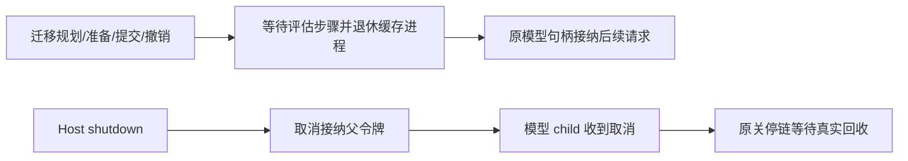

# 运行库迁移后的业务接续契约

本块沿既有 system/Loader、Runtime 位置提供器、Supervisor、Worker 与管理接口，直接验证原有业务在真实物理迁移后的继续能力。不另建执行循环或产品兼容路径，不把复制表的成功外推成全部业务恢复已验证。

## 必须保留的事实

| 场景 | 搬移时状态 | 迁移后直接证据 |
|---|---|---|
| 稳定会话 | 首轮已完成，后两轮已排队，原共享预算已有用量 | 原输入、轮次游标、前轮历史和预算根继续；第二轮读取第一轮，第三轮被原额度阻断；反向搬移不重开额度或延长期限 |
| 审批、邮箱与取消 | 模型已提出工具调用，原审批待决定，两条插话已入队；另一个原运行有持久取消 | 原审批精确回放且拒绝篡改，工具效果一次，插话 FIFO 消费；迁移后的原取消仍先于工具效果生效 |
| 未知根工具效果 | HTTP 效果已发生，Host 实际退出，原预留与待对账调用仍在；恢复命令已接纳 | 无预算/有预算均使用原调用证明执行已接纳命令，未知效果不重发；反向后原回执仍原样回放 |
| 未知 Hook 效果 | before_stop 效果已发生，原效果票据已保存，Host 实际退出，恢复命令已接纳 | 原事件、Scope、存储证明及预算预留继续；原模型和 Hook 均一次，提交后恢复命令可跨反向迁移回放 |
| 未知模型请求 | 原请求已抵达服务、未回报，Host 实际退出；根或工作流子 Agent，普通预算或无预算日志 | 原请求票据、generation、作用域及预留不变，已接纳对账命令在新物理库执行；原请求一次，后续效果一次，反向后历史与回执保留 |

所有搬移都必须创建新的物理 generation；逻辑身份保留。源业务清单在退休后仍等于原计划清单，不能退回旧库继续写。原租约通过实际持久期限判定失效，不直接改写租约或清空预算来制造可迁移状态。

未知效果验收不预先把未知状态结清。原恢复命令在搬移前已被接纳，实际执行发生在搬移后的原 Worker 中；接受回执、原票据和预算预留随库一起迁移。反向时搬移最新数据，完成命令只回放原结果。

## 实现与验证边界

本块先只增加 HTTP 行为用例和共享验收组织，复用已存在的真实进程退出助手，不改生产调度或迁移接口。若集中验证发现实现缺陷，先补充对应入口影响分析及恢复前像，再集中修复受影响范围。

集中行为验收发现模型生命周期缺陷：`Loader::drain_model_workers` 同时取消模型停止令牌。该令牌是 Host 接纳停止令牌的 child，取消它会永久停止模型执行，并不向上传播取消其他 Loader。迁移规划调用这个方法，即使规划被拒绝或准备后来撤销，也不能再执行模型请求。

修复仅调整该方法的排空语义：等待实际评估步骤释放许可，退休缓存评估进程并清空槽位，保持模型接纳开放，后续请求可重建评估进程。真正的 Host shutdown 继续由父令牌向模型 child 传播取消，并由原关停链等待回收；不新增令牌重置、重新装配模型或专用迁移主循环。

补充影响：排空方法图谱 LOW/0 漏掉新增 API 调用，源码确认调用者为 Runtime 迁移 quiesce 与 Host 最终关停；父关停链分析为 CRITICAL（89 符号、3 流程），本块没有修改父关停入口。修复前 production 源码及失败用例整组已私有归档。用例同时要求规划拒绝、准备撤销、迁移提交与反向后接纳仍开放，真正关停后停止标志为真且评估 PID 清零。

影响分析覆盖 submit_managed（CRITICAL，70 符号、37 直接调用、6 流程）与 execute_managed_action（CRITICAL，43 符号、24 直接调用、7 流程）；后者包含默认 Worker。图谱 context 的最初错误路径已用准确 UID 重新定位，不将未找到或同名符号当作无影响。实际新迁移模块不在旧恢复索引中，源码与既有 L7 影响证据共同确定范围。

本机 HTTP/SSE 是协议与持久恢复夹具，不是训练模型或真实上游验收。本块不搬 Catalog、凭据、Loader 或 Memory，不替代完整跨机状态包、全部策略/流程组合、版本化参考预设与发布验收。

实现、接入、文档和全部场景收齐后一次运行本功能块验证；失败集中修复，只补受影响检查。列出的场景及生命周期修复已通过集中验证与定向补验，证据见 ../verification/runtime-history-continuity.md；未扩大为完整平台或所有组合完成。
