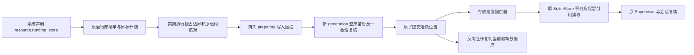

# 运行状态库显式迁移

本功能块把同一常驻实例的完整 Runtime SQLite 搬到声明的另一个物理位置，并沿原控制面、Loader、Supervisor 和 Worker 原位继续。所有主库表与 SQLite 序列完整复制，包含检查点、会话、原版本、更新轨迹、任务/动作、审批、取消、邮箱、预算/预留、模型与工具效果及对账事实。不会逐表筛选业务数据，也不创建空预算替代历史。

本块与规范记忆迁移各自有明确所有权。这里不搬 Catalog、凭据、模块/执行环境或 Memory 文件；跨实例完整状态包仍需组合这些角色，不能凭一次 SQLite 位置切换宣称整个 Host 已可跨机器迁移。



| 决策 | 约束 |
|---|---|
| 逻辑身份 | 与物理路径分开；预算、邮箱及原生效果恢复使用同一个固定身份。既有框架的原身份字节保存为不透明值，不改写回执或为旧产品增加兼容宿主 |
| 位置协议 | Runtime 只接收显式 SqlitePlacement 和带租约的位置许可；默认 SDK 仍可直接提供数据库路径。不存在隐式数据库发现或产品名分派 |
| 事务 | 每笔事务持共享位置许可，按当前位置刷新连接；准备期间用只读事务继续提供观察，写入返回错误。保留引用扫描沿同一位置许可打开独立读快照 |
| 执行 | 默认 Worker 在实际执行期间持实例共享许可；准备要求取得独占许可并核对数据库中没有尚未到期的租约。排队任务、已停驻工作与未知效果按原记录保留；不能以迁移重发未知效果 |
| 数据 | SQLite backup 复制整个 main 数据库；版本、完整性、外键、Schema、所有有序行和类型/字节参与清单。临时连接日志不复制，由新连接重建 |
| 原子事实源 | Loader 私有小型位置指针是唯一活跃位置；准备围栏与完整命令种子在同一次指针写入中持久化，再另写命令文件并复制。提交前在 SQLite 写事务内复核原始数据与执行租约并退役源库；发布指针携带原命令身份，回执未写完时可据此恢复，新的命令先结清前一发布回执 |
| 数据保护 | 默认原数据库与各物理副本永久保留到显式回收；新副本不覆盖已有文件。受管数据库要求匹配位置提供器与原提交权限，元数据缺失或损坏不能回退打开旧库。外部存储 bucket 进入持久保护集；目录、Local 依赖及沙箱实际打开时复查，已缓存声明不例外 |
| 反向与撤销 | 未提交准备可撤销并推进修订；已提交操作通过反向搬移当前最新数据恢复。旧命令只重放原回执，不能重新激活旧副本 |
| 文件与界面 | 目标来自原 system/release/module 声明；导入、API 和控制台使用同一个定义及原发布锁，不额外维护一份后端配置库 |

目标模块是纯声明，构建不得触碰目录或数据库。default 代表当前实例自己的默认数据区域；其他后端明确声明绝对目录，环境由用户准备，不安装依赖或设置包体配额。

```json
{"reference":{"id":"history-volume","version":"1"},"factory":"resource.runtime_store","config":{"backend":{"id":"fast-history","directory":"/data/agent-history"}}}
```

```json
{"reference":{"id":"default-history","version":"1"},"factory":"resource.runtime_store","config":{"backend":{"id":"default"}}}
```

管理路径为 `/api/v1/runtime/storage`：GET 查看位置与阶段；POST `/plan` 与 `/prepare` 选择已发布顶层目标资源；POST `/apply`、`/abort` 及 GET `/transfers/{command_id}` 按原命令恢复。计划选择显式 `scope: instance-runtime`，防止把全实例库搬移误解成只修改一个 Agent。

```json
{"scope":"instance-runtime","target":{"system":"portable-agent","release":"published-digest","module":{"id":"history-volume","version":"1"}}}
```

prepare 追加 `command_id` 和原计划 `fingerprint`；apply/abort 只需要这两个字段。计划保留源修订、完整数据指纹、目标声明摘要和全库统计。准备期间控制台可以读取原状态；需要写入的运行、取消和管理动作在提交或撤销后继续，不能悄悄丢弃写入。

接口边界：`SqliteStore::path()` 返回可失败的当前物理路径快照；`logical_identity()` 返回固定身份，二者不能混用。只读准备阶段不创建缺失数据库，不补写 Schema；损坏状态必须修复原事实。原始路径以及新副本均有显式受管标记，已有未路由句柄也必须在每次事务检查标记。

源库自身保存 `nofy_runtime_placement_v1` 及按表定义的 INSERT/UPDATE/DELETE 守卫。内核新增惰性表时，在同一事务提交前补齐守卫。快照复制全部 main 对象；语义指纹只排除经结构、内容与触发器源码完整核对的这套位置所有权元数据，其他表、SQLite 序列和未知扩展表仍完整计入。退役只改变位置写入状态，不改写业务历史；重复退役或解除只能使用原 authority 与 command，已发布库通过反向迁移复制最新数据。

管理操作先取得实例执行独占许可，排空原生工作池，再取得 Loader 资源租约的独占许可。目标与现有 Catalog/保留声明及运行环境目录授权冲突时，在写保护集和复制前拒绝。保留声明使用独立流式管理扫描，不将交互式引用/GC 的总行数、字节或超时配额作为迁移门槛；未知权限身份不能当作无权限。保护集包括中止后的残留副本，不随撤销而删除。Factory 构建与纯预览继续不访问文件系统。

冲突检查只遍历已发布系统和 Runtime 保留声明；尚未发布的草稿没有执行权限，其不完整配置不阻塞迁移，实际发布时仍经资源接纳检查。数据复制与指针提交持数据独占许可，此关键区内普通运行库事务暂时不可用，位置及命令查询仍可读；副本准备完成后，源库允许只读观察。拒绝写入沿现有 `409/runtime_conflict` 返回；控制锁争用沿 `503/busy` 返回，不能将二者混淆。

阶段影响：transaction_scoped 为 CRITICAL（263 个符号、22 条流程、17 个模块），inspect_retained_modules 为 CRITICAL（14 个符号、2 条流程）；open_inner 为 CRITICAL（22 个符号、5 条流程）。同名 storage_identity 图谱只定位到 Trait，实际预算、邮箱、Hook 恢复及路径消费者已由 Rust 源码补证；SqliteStore 图谱的 LOW/0 和 API 无路由不能当作零风险。

验收在完整实现、接入、控制台、文档与用例收齐后统一运行。范围包括真实全库复制、迁移/反向后的新写入、缓存句柄与多实例刷新、保留引用、准备只读/写入拒绝、源围栏、原预算/邮箱/效果身份、未知效果恢复、停驻继续、真实 CLI 退出重启与命令重放。传输及控制面范围的实际首轮、修复与复用证据见 ../verification/runtime-history-transfer.md；不将此范围通过描述为整个平台或所有跨库业务恢复分支已验收。

业务接续范围由 runtime-history-continuity.md 单独列出直接证据要求，列出场景的实际验证与模型排空修复见 ../verification/runtime-history-continuity.md；L7 的传输通过不自动关闭其它未列出组合。
