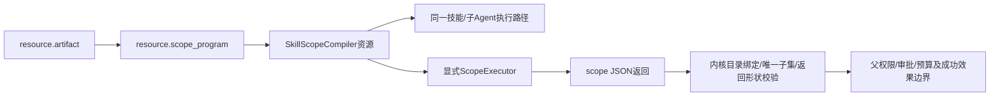

# 外部作用域程序契约

作用域只收窄技能可见工具与调用权限，不是父权限、审批、预算或执行器隔离的替代品。工具类别、参数语义、授权词汇属于外部代码制品，不再以新Rust分类枚举实现。

| 决策 | 契约 |
|---|---|
| 程序来源 | 必须依赖同一Loader的artifact资源，1..16个有序入口；不提供内联源码或旧Rust规则回退 |
| 声明 | source:{kind:artifact,entries,parameters_schema?}、cwd、parameters、limits |
| ABI | 唯一入口scope(input)，input含cwd、parameters、rules和operation |
| 输入 | operation={kind:filter,names}或{kind:admit,call}；规则为有界不透明字符串，语言语义由程序定义 |
| 返回 | {kind:filter,allowed:[工具名]}或{kind:admit,allowed:bool}，未知字段/错误类型失败 |
| 内核责任 | 返回必须是原工具视图的唯一子集；不能新增工具、替换绑定目录或绕过父级约束 |
| 执行边界 | 工厂必须显式绑定ScopeExecutor，缺失/不可用即拒绝；Host不得退回SDK进程内执行 |
| 身份 | 锁定制品摘要、入口代码、参数、目录、限制和执行边界身份；不使用PID或本地helper路径 |

程序只接触传入JSON；引擎从new_raw构造，只安装明确的算术、逻辑、字符串、迭代、数组、映射及函数指针包。不安装Standard、LanguageCore和Time包，sleep/timestamp及其间接调用均无入口，eval禁用；没有文件、网络、环境、进程或工具派发入口。JSON桥保留原生u64，不用字符串哨兵或浮点近似；转换前累计编码预算，避免共享动态值展开后再限额。限制覆盖源码、输入/输出、操作数、深度和进度期限；SDK进程内运行不宣称OS级总内存/故障隔离。默认Host已在受限辅助进程执行，取消/关闭执行kill+wait并drain，许可直到真实工作回收才释放。

默认Host注册resource.scope_program及tool.skills_scoped，后者config.scope为资源槽名字符串，dependencies中同名槽必须指向上述Resource。作用域进入注册表依赖锁定，但委托SkillsFactory时不混入子Agent执行模块。binding.cwd独立属于bindings模块。旧scope对象、Read/Bash/MCP DSL、Rust工具分类及包装器默认特权不保留；未交付开发期锁须从新源声明重编译，不猜测权限转换或提供旧语法兼容层。

Host执行器身份为nofy.scope-program-evaluate/v1，请求携带不可变Program、rules和operation；旧nofy.scope-evaluate/v1协议被明确拒绝。Linux受限helper保留512MiB地址空间、2MiB栈、2秒CPU、5秒墙钟、2MiB请求及512KiB回复边界，两个工作槽与父退出回收由同一Loader管理。纯接纳可验证语法/输入/参数但不执行业务授权代码；实际filter/admit都走helper，无主进程回退。

管理验收覆盖外部代码发布后新运行采用新版本、原待审批运行继续原制品并只产生一次成功效果、generation回滚，以及重开/导入可移植锁和真实CLI硬退出恢复。这不证明运行中作用域可热切换；该能力须沿框架自身的显式版本转换另行验收，不将“仅新运行生效”改称完整热更新。

实施DAG：M1资源/ABI及实际SkillScopeCompiler组合验证 → M2受限Loader执行、版本边界与静态匹配器删除 → M3唯一编程预设的规则/工具/依赖声明、应用/更新/恢复验收。M1是前置契约，不是完整运行产品；不能把未接入Host的SDK能力宣传为控制面已支持，也不为旧产品语法增加兼容层。现有框架已支持的声明与恢复证据仍须核对；开发期静态作用域的转换须明确，不冒称自动迁移。
