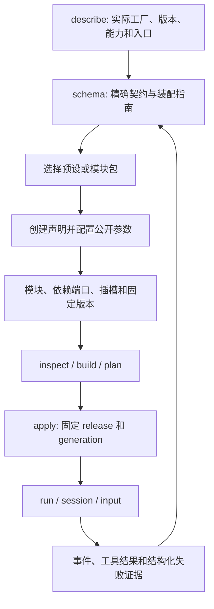

# 通过 MCP 自主装配 Agent

本阶段以外部 Agent 无须读取框架实现源码即可创建、组合、构建、激活、运行并诊断 Agent 为验收目标。源码基线包括已经落地的模块仓库功能，保留同一 Rust 内核、Loader、权限预算、会话和恢复路径。契约修订为 0.6。

## 决策

| 问题 | 实施决定 |
|---|---|
| 字段类型不足以指导装配 | schema 同时返回机器契约、装配说明、依赖/插槽、前提、示例、下一步及恢复办法 |
| 客户端与实例版本不同 | 返回客户端契约和服务端实际版本；未报告信息标记 unknown，不将工厂存在当作环境已满足 |
| 新能力应放在哪里 | 不引入旧宿主；现有内核原语能表达的行为以外部模块包与预设补齐；只有执行/持久性等缺口进入 Rust 内核 |
| 压缩存在但 Host 未接旧域 crate | 优先使用已有 context.programmed 的持久采样与历史变换协议，交付外部策略源码包，保持现有依赖边界 |
| 子代理与输入队列已存在 | 提供 scoped skill 子 Agent、Interject/NextTurn 的实际装配与调用指南，明确其与通用异步任务、会话树的区别 |
| 125 无诊断 | 保留原错误文本，同时贯通受限 stderr、退出码、信号和错误 details 到工具结果/事件/MCP |
| 预设参数只能修改整个 Source | 增加 agent.configure，MCP 可结构化设置公开参数；仍使用原 target 与 revision/digest CAS |
| source 与 project target 含义冲突 | 在共享契约拒绝歧义组合，给出具体字段路径与正确调用模式 |
| 环境缺 cgroup | 指南和能力报告提前声明所需供给；不把参数校验错误当作环境实测，也不隐式改变执行边界 |
| 用户依赖与包交付 | 普通源码和依赖清单，用户自备解释器/库；不安装依赖，不恢复前端 |

## 公开接口

`nofy_describe` 返回内核实际工厂、运行能力和 bootstrap 工作流。`nofy_schema` 支持 operation、factory、preset 或 package 四种明确选择：operation 返回操作契约与调用指南；factory 返回当前安装工厂的描述、配置派生依赖及接线指南；preset 返回公开参数 Schema、默认值和装配步骤，不要求查看 Rust 或预设实现。

装配指南使用 `nofy.assembly-guide/v1`，含 subject、summary、availability、slots、prerequisites、examples、steps、pitfalls 与 recovery。工作流示例中的输入占位和前序结果绑定单独声明，须在实际调用前替换；不把占位符误当作原生 DTO。复杂 NativeJson 参数给出结构化正文示例和显式编码说明。

新增 `agent.configure` 输入为 `{target,agent,settings?,set?,unset?}`。settings 为公开参数的结构化增量，set 为 JSON Pointer 到参数值的映射；至少提供一种。设置保存在源码工程的实际 settings 文件中，清除同一 Source 的临时覆盖，更新源码摘要和清单。托管和本地 Source 使用同一编辑器。

Host 的工厂发现响应同时提供当前开发契约与非破坏性能力事实。环境状态区分 supported、unsupported、unknown、requires_configuration；read 权限不授予任意路径探测。需要实际目录、解释器或委派根的检查由显式资源配置与正常 Loader 路径执行。

## 实施 DAG 与验收

链路 C → A → X：

1. 修订缺口分类和公开装配协议，固定边界及变更入口。
2. 进程诊断贯通、歧义输入/参数配置、已有能力的外部模块接入。
3. describe/schema、CLI/MCP、操作目录、指南及手册同源接入。
4. 同块源码、接入和用例完成后集中构建及回归。
5. 使用新隔离实例验证失败诊断、模型/文件工具、参数与恢复。
6. 调用方仅取得 MCP tools/list、describe/schema 和任务参数，完成新 Agent 的创建、模块组合和真实运行，保存工具调用与实际效果证据。

报告 K1–K10、M1–M7 逐项记录“现有能力、已补齐、环境前提、进一步独立原语”及证据。会话 fork/rewind、通用异步 Agent 通信、PTY 与可选网络代理必须由真实实现和效果证据支撑，不能仅凭工厂名称或指南认定完成。最终范围与证据见缺口验收记录。

## 全范围落地里程碑

用户明确将报告中确认缺失的能力全部纳入。施工顺序为 A（诊断、参数、发现与指南）→ B（进程供给、PTY、stdio MCP 与网络代理）→ C（会话分支与控制接口）→ D（规则权限、问询/计划工具、通用子任务与自动重试）→ E（全部能力的装配指南和盲测）。每块完成源码、接入、手册与用例后集中验证，失败后补验受影响部分。

现有 context.programmed 提供受持久模型回执保护的采样，压缩策略以外部源码包交付；已有 scoped skills 子执行、Interject/NextTurn 和持久 human workflow 同样复用。会话 fork/rewind、PTY、stdio MCP、执行供给和网络代理必须有实际实现与效果证据；在完成前保持未交付状态。网络与进程后端明确区分支持的 OS 供给和可实施保证，不能以隐式放开边界或类似命名替代实现。

顶层输入属性公开所有组合分支可填字段，原 oneOf/allOf 保持严格验证；managed 编辑默认返回摘要与身份，include_source:true 才附带完整源码。这样标准 MCP 网关可直接生成参数，装配过程不会反复吞入整包实现。
