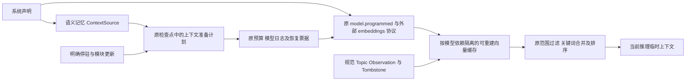

# 声明式语义记忆与可恢复上下文准备

本功能块使用统一 Model、原预算/模型日志和可移植协议源码实现 embedding，通过 context.memory_semantic_connected 接入规范记忆；整块实现、接入、文档和用例收齐后集中验证。不会重写 Agent 主循环或为某个产品增加分支。



| 决策 | 约束 |
|---|---|
| Model 协议 | embedding 仍是显式 Model 绑定：单条 User 消息为文本数组 JSON，settings 含 dimensions/purpose，输出为同序向量数组 JSON；真实 usage 进入原 Model 账本 |
| 外部实现 | 请求、路径、响应顺序和 usage 解码由独立 Rhai 源码及 Schema 定义；凭据由原连接注入，没有第二套 HTTP/鉴权栈 |
| 通用准备 | ContextSource 可选择返回纯准备计划；Runtime 在效果执行前持久化计划、原作用域和已完成贡献，恢复继续原输入；已有无计划来源保持原调用路径 |
| 状态边界 | 准备中及已准备未派发的上下文属于原 pending work；不准在其中替换声明。预算耗尽仍按原预算停驻规则调整同一账本 |
| 修订变化 | 原未确认计划先结清；贡献返回后重新核对 revision，发生变化时丢弃过时贡献并用新的持久作用域准备，不把旧内容送入下一次推理 |
| 取消 | 沿原模型取消轨道；已知取消清理当前准备，显式继续创建新作用域；未知效果保留原计划/票据，不盲重发 |
| 空间身份 | 向量缓存键包含完整 embedding Model 声明/工厂/传递资源身份、维度和参数；换模型、协议或连接不混用旧向量 |
| 数据边界 | 只向 embedding 模型发送本次获准、有效的 Personal/Project chunk；子运行使用原 child_read，不把不可见区域送出后再过滤 |
| 缓存 | 在原可丢弃索引中按空间保存向量，无新增规范存储；块删除/改写通过同库触发器失效向量，索引可按规范对象重建 |
| 排序 | 复用原关键词、范围/分支/状态过滤、权重、时效与 MMR；语义路径显式验证向量，失败不伪装成成功空结果 |
| 运行中更新 | 已完成来源后沿 context_sources 的原停驻、版本、回滚路径；准备中不允许跨过旧效果。整个计划保留在原检查点而非新宿主 |

准备计划包含获准 chunk 的 ID、内容 hash、文本、缓存命中和查询；不包含私有磁盘路径、凭据或安装环境。序列化受原持久消息处理边界约束，不是源码包配额。相同计划的分组和操作 ID 固定，已成功 embedding 走原回执，进程退出或取消不会无声释放未确认效果。

记忆领域职责保持分离：Rust 负责规范事务、所有权、删除优先级和可重建索引；声明选择读写/子运行授权、捕获提取 Model、语义 Model 及协议；上下文仅向当前推理贡献临时材料，不能伪造历史 User 消息作为学习证据。完整跨存储历史迁移、进一步可编程整理职责、多参考预设和最终发布仍在总目标中。

验收覆盖真实默认 Host/API/Worker 与回环 embedding 协议、无关键词重叠的命中、缓存空间切换、范围授权、忘记后无复活、源修订变化、预算保留、取消、真实硬退出后的原票据恢复，以及既有 ContextSource/Memory/Host 行为回归。实际通过范围、首波失败及定向补验见 [验收记录](../verification/semantic-memory.md)。


## 声明和准备计划

可移植样例为 `crates/common/nofy-agent-host/examples/semantic-memory-system.json`。provider 连接需要用户提供与样例协议相符的 Chat/Embeddings 服务以及独立注入的 `MODEL_TOKEN`；`local-model`、`local-embedding` 是待配置名称。样例语义维度为 1024，必须与实际 embedding 模型支持的 dimensions 一致；测试仅在夹具声明中改为二维，不代表远端模型。普通记忆工具与语义来源使用同一 `resource.memory`，存储对象和用户的忘记操作保持一份事实源。

`context.memory_semantic_connected` 依赖 `connection: Resource` 和 `model: Model`。config 必填 dimensions（1..4096），可选 read（默认 project）、child_read（默认空）、max_items（默认 20，最多 100）、batch_size（默认 32，最多 32）、min_score（默认 0）和 settings（默认空对象）。dimensions、purpose 由来源注入，不允许在 settings 重复声明；其他参数由选定 Model 的 Schema 检查。默认协议不把 purpose 发到 HTTP body；需要 document/query 专用字段时修改外部协议。空授权范围直接跳过，不发送 embedding 请求。

通用 `ContextSource::prepare` 只可做纯计算及本地读取；返回 None 时继续原 contribute。返回 JSON 时，持久检查点在效果执行前记录：

```json
{
  "protocol": "nofy.context-source-preparation/v1",
  "revisions": ["original-source-revision"],
  "input_digest": "digest-of-canonical-messages",
  "next": 0,
  "messages": [],
  "pending": {
    "index": 0,
    "scope": "context-source:original-operation-digest",
    "plan": {"source_specific": "immutable-input"}
  }
}
```

该结构存于原 HookProgress，不是新增系统配置。语义计划的 source_specific 实体为 space、dimensions、query、areas、context 和 chunks；每个 chunk 含 area、id/hash/text/cached。模型操作 ID 是 `["memory-embedding/v1", persisted_scope, "embedding:documents:N" 或 "embedding:query"]` 的 JSON；每次准备的 scope 同时进入原预算操作 ID 与 native Model 恢复元数据，跨回合、修订或模型更新不会复用旧回执。完整计划上限 16 MiB 是运行时检查点边界，与源码打包无关；超过边界在模型请求前报错。

## 派生缓存与查询

原派生索引懒创建 `semantic_vectors(space, chunk_id, hash, dimensions, embedding)`，主键为 `(space, chunk_id)`；向量以有限、非零的单位 f32 存储，损坏的缓存拒绝读取。原 chunks 删除/hash 更新触发器退休所有空间的对应项。规范存储更新导致原索引重建时，相关派生向量随之失效；下一次检索按需重算，不要求打包、下载或自动安装外部依赖。

查询使用精确流式扫描和大小为 k 的堆，时间约为 O(n·d + n·log k)，辅助堆为 O(k)，每个候选向量仍需 O(d) 临时解码；这里没有近似索引或大规模性能承诺。向量候选再由现有关键词合并、权重、优先级、时效和 MMR 处理。语义生成失败直接报错，原普通关键词来源仍可由声明单独使用。

共享 Model 接纳要求正数输出上界，协议声明 1 token 预留；embedding 的完成响应仍将真实 output_tokens 记为 0。该预留只影响派发前预算接纳，不伪造实际输出用量。

SDK 的显式取消后继续使用新的准备作用域；默认 Host 的已关闭根任务遵守原不可变回读契约，resume_after_cancel 确认并回读取消结果。继续工作通过同一线程的新提交运行，不重新打开旧根或重发旧效果。

已知失败的准备中 Model 调用由原 model_retry_ticket 与显式 retry_model 授权，票据 scope 必须匹配当前来源计划。普通 resume 回读失败，不重新派发；精确票据只重试失败操作，前面已成功的批次仍复用原回执，完成后重复命令为幂等回读。未知派发仍走 reconcile_model，不用失败重试跳过未知效果。

默认 Host 在失败后使用既有 30 秒 Worker 退避，显式管理重试也等待该窗口；本块未修改生产退避或租约，不宣称恢复时延已优化。
