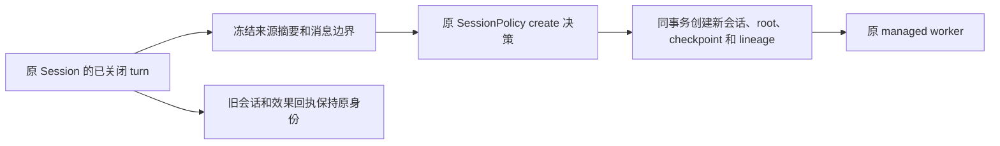

# 会话分支与非破坏回退

分支沿用原有 managed run、SessionPolicy、checkpoint 和预算边界。新会话以历史中已关闭、没有未决效果的 Agent turn 为来源，复制已验证的消息历史与版本身份；新输入走原始 worker。旧工具结果作为历史保留，不复制待执行队列、effect journal、模型重试状态或 OS 进程。

| 决策 | 语义 |
|---|---|
| fork | 以完整历史创建独立分支，可继续原会话 |
| rewind | 在明确消息边界创建分支，保留被回退的历史及已发生效果 |
| tree | 返回父会话、来源 turn、边界及子分支，调用方选择当前分支 |
| 配置 | 使用来源 turn 的精确冻结配置；存在 live 版本时匹配实际版本，不默认套用当前 active release |
| 并发 | 来源会话 revision、来源 turn/live revision 与记录摘要均比较；目标 thread 必须未使用 |
| 预算 | operator 显式创建新的 root 与账本，旧账不退款；模型子任务另走父预算继承，不用此接口绕过额度 |
| 失败 | prepared 决策及命令 ID 沿用 session.start 的持久回执，同 ID 只查询，不能重复创建 |
| 历史边界 | 不允许截断到未匹配 tool call/result 中间，实际模型历史校验仍适用 |
| 保留 | lineage 作为 runtime history 一并持久化和迁移；存在来源引用时保留所需历史 |

开发协议提供 `session.fork`、`session.rewind`、`session.tree`。fork/rewind 均携带 source_session_id、expected_source_session_revision、source_run_id、expected_source_revision、目标 session_id、command_id、新的 ManagedRunRequest NativeJson；rewind 另需 through_message。结果返回原 SessionReceipt 与可查的 lineage，原会话不被覆盖。
