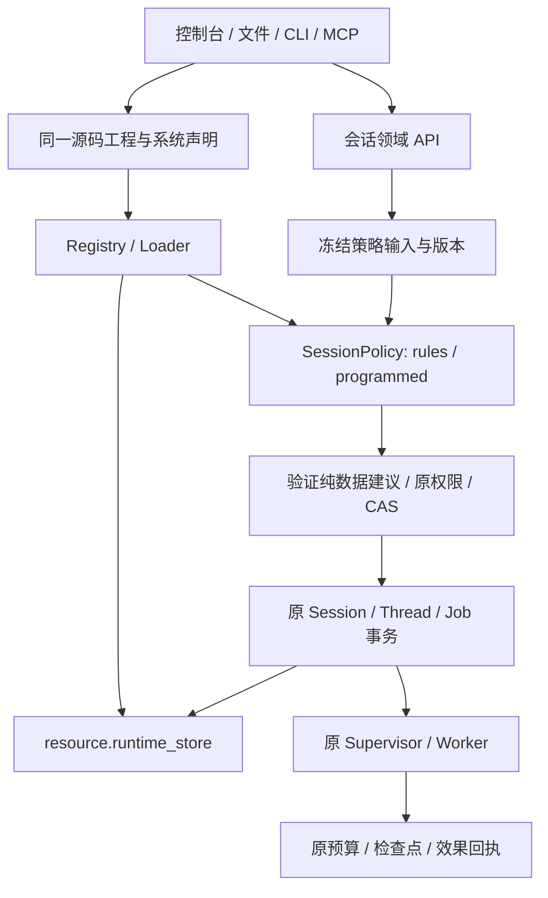
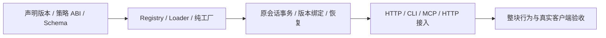

# Session 声明与策略模块化方案

状态：2026-11-04，契约 `0.3`。SessionPolicy、Loader、原会话事务、HTTP、CLI 与 MCP 已实施；实际检查见[Session 记录](../verification/session-modularization.md)与[开发入口记录](../verification/agent-development-cli-mcp.md)。前端按用户要求暂停。操作说明见[会话手册](../manual/sessions.md)。

## 目标与边界

Agent 声明选择会话策略，控制台、CLI 和 MCP 使用相同的声明、会话身份和回执。常规策略修改通过模块配置或外部源码装载，发布后在明确的会话边界应用，无需重新编译 Rust 或重启内核。

| 保留在 Rust 内核 | 由声明与模块决定 |
|---|---|
| Session/Thread/Run 身份、线程租约和 FIFO 接纳 | 展示名称与标签的默认值 |
| 轮次命令幂等、CAS、原子提交及跨退出恢复 | 忙碌时排队或拒绝的策略 |
| 有效版本种子、检查点证明及已成功效果 | 通过显式 ID 或标签选择候选会话 |
| 权限、预算原账本及绝对期限 | 空闲多久建议归档、保留全部历史的规则 |
| 存储归属、迁移及底层受支持协议解码 | 选择已声明的运行存储资源与上下文整理模块 |

会话策略返回纯数据建议。内核重新验证建议、授权、版本与线程归属后提交；策略无法覆盖这些不变量。上下文压缩继续由 ContextPolicy 处理，历史记忆继续使用现有资源/模块；它们与 SessionPolicy 分别声明、共同组合。



## 模块与声明决策

| 决策 | 选择及理由 |
|---|---|
| 新模块种类 | 增加 `SessionPolicy`，序列化名 `session_policy`；生命周期接纳/路由与现有工具 Policy、ContextPolicy 的输入和输出职责不同 |
| Agent 插槽 | 新增可选 `AgentDefinition.session_policy: ModuleRef`；CLI 的 `--slot session` 是 `session_policy` 的别名；单值绑定遵循明确替换规则 |
| 标准工厂 | 拟新增 `session_policy.rules`，以 JSON 配置声明命名、接纳、路由和归档建议 |
| 可编程工厂 | 拟新增 `session_policy.programmed`，复用已有隔离纯 JSON/Rhai Executor；配置与源码在外部，无模型、文件、网络或宿主函数 |
| 会话实例 | 属于内核持久对象；模块定义不包含正在运行的会话、预算或聊天记录 |
| 存储 | 复用 `resource.runtime_store` 的声明归属、引用与迁移路径；SessionPolicy 不持有第二个数据库路径 |
| 版本 | 新 Agent 声明版本拟为 2；CompilationSnapshot、会话策略绑定及交接种子明确记录支持的格式版本，旧编译器拒绝新增字段 |

新版 `ModuleKind::SessionPolicy` 和 AgentDefinition.session_policy 使用以下声明；连接实例需先确认 /sessions/capabilities 支持 v2：

```json
{
  "schema_version": 2,
  "session_policy": {"id":"session-default","version":"1"}
}
```

这是 Agent 字段片段；完整声明仍需 name/model/prompt 等真实必填字段。模块依赖沿现有 ModuleDefinition 图解析，工厂/版本/配置及完整依赖闭包随发布冻结；不按产品名分派。

未绑定策略的声明采用内核最小显式接纳，不提供隐藏的命名/标签路由/归档模块；同样经过统一会话事务。模块化视图的 policy 为 null，仍报告真实版本和原身份。不会另建一套无策略的执行循环。

### 规则工厂

`session_policy.rules` 的配置由 `SessionPolicyRules` 定义：

- naming.prefix：生成展示名称的前缀。会话主键由命令提供或客户端预先生成并保存，不因命名策略变化而改写。
- admission.when_busy：queue 或 reject。queue 仍走原 FIFO；该配置不开放同线程并行执行。
- routing.mode：explicit 使用明确会话 ID；labels 使用 keys 指定的全部标签匹配。缺失标签拒绝匹配，多结果返回 ambiguous，由调用者明确选择。
- history.archive_after_idle_seconds：null 表示保留当前展示状态；十进制字符串表示空闲阈值，策略仅建议归档。归档改变查询展示元数据，保留原对话、账本、检查点与恢复证据。

规则工厂不持有网络、目录或模型依赖。命名、路由与归档均不得自行创建新线程、转移输入或删除历史。

### 可编程工厂与 ABI

`session_policy.programmed` 的配置由 `SessionPolicyProgrammed` 定义：source、parameters，以及 max_operations、timeout_ms、max_input_bytes、max_output_bytes。执行边界复用现有纯执行器；源码通过现有 `$file` 或制品装载。语言入口为 `args`，结果为 `SessionPolicyProposal`。

| 阶段 | 输入与输出约束 |
|---|---|
| create | 输入预先固定的 session_id、首根请求摘要与标签；可建议展示名或拒绝，不能更换身份 |
| admit_turn | 输入原会话 revision、policy revision、请求摘要与忙碌状态；只决定接纳策略，不改写原输入或取消旧效果 |
| route | 输入已发布 program、标签及经授权筛选的候选摘要；只读建议已有候选，不能创建/派发 |
| retention | 输入冻结的 now_ms、最后空闲时间及原状态；只建议归档，不能裁剪持久历史 |

精确输入/结果类型为 `SessionPolicyInput` / `SessionPolicyProposal`。控制值均为无损字符串；parameters 和业务请求正文不按字段名改写。模块不自行读取时钟、随机数、秘密或外部状态；时间与候选由内核冻结输入。无效输出、执行超时或不支持的 ABI 明确失败，不回退为自动允许。

parameters 以 parameters_json 原始 JSON 文本交给程序；create/route 的 session 可为 null。route 排除 closed/archived 会话，忙碌候选是否可接纳取决于声明的排队/拒绝规则；最终 turn 仍重新检查。retention 只给建议：显式 archive 命令由权限、原版本和静止边界决定，不把“未建议归档”误当成用户无权归档。首期不增加隐式后台删除或自动执行归档的路径。

内核同时检查阶段语义：ambiguous 仅用于 route；非 retention 阶段不得建议 archive=true；展示名仅在 create 阶段应用；create/admit_turn 的 session_id 必须匹配原请求，route 的非空 ID 必须属于授权候选。结构 Schema 通过不代替这些领域检查。route 选择目标发布中的策略，不自动迁移候选的配置或切换它的有效策略。

## 状态、版本与事务

会话状态分为三种事实：不可变起点身份；可变元数据 session_revision；可选择的策略 policy_revision。它们与原轮次 binding_revision、源运行 live revision 各自独立。所有写操作携带自己的预期版本和稳定 command_id。

新 Session 状态保存策略模块闭包身份、展示名、标签、open/closed 状态及 archived 标记。threads.active_run 继续是执行归属的唯一事实源，Session 视图从原线程读取 active_run_id。

策略评估在提交事务外使用冻结输入；提交事务内核对会话版本、原线程租约、发布身份及实际前驱。策略输入/输出摘要、选定的模块身份及原命令结果持久化。重放读取原回执；不能重新选择“当前最新策略”。超时返回结果未确认，按原 command_id 查询。

相同 command_id 先核对原请求摘要并读取回执；只有尚未提交的新意图才按当前版本做 CAS，不能因后来 metadata revision 改变而拒绝原成功命令的精确重放。不同内容复用 ID 返回 conflict。start 的准备/拒绝回执可以先于 Session 存在，commands 查询直接按原命令与 session_id 核对，不以前置实例查询成功为条件。

`session start` 是拟新增的领域操作：先解析已发布 program 和首根请求，固定 ID/策略输入，最终将首根受管 Job、会话登记、起点成员及原命令回执在同一运行库事务提交，提交后才唤醒 Worker。策略评估产生的准备记录可恢复；事务未成功不得派发半创建的会话。CLI/MCP 不通过先 run.start 再 session.create 模拟原子创建。

`session create` 仍表示把已有的首个受管 Agent 根显式接纳为会话；策略由该根的冻结声明解析。其首根资格、租约和预算不合并规则沿现有内核检查。后续 API 即使接受直接原生请求，也必须进入同一策略与接纳路径，不能绕过模块约束。

这项约束覆盖同线程的原生 run.start、NextTurn 和 Worker 恢复：通过原 Job 接纳或安全交接准备冻结策略凭据；begin_run 的原线程租约内由 bind_session 核对请求摘要、策略版本与凭据，任何入口均不能跳过。未带受管 Session 权限的普通 SDK 不能取得私有预算别名。策略拒绝保留原排队输入与拒绝事实，不把它标成已经交付。

### 新策略的应用边界

首期 `session reconfigure` 只允许在轮次间的静止边界提交：当前源根已关闭、没有执行中的根、没有未交付的排队输入或未知效果；原检查点与归属证明完整。请求携带 expected_session_revision、source_run_id、expected_source_revision 和选定发布中的策略模块引用。

内核只装载指定策略闭包，不用目标发布覆盖整个 Agent。提交增加 session_revision 和 policy_revision，后继轮次种子冻结该策略身份。模型、Prompt、预算根、历史输入和已成功效果保持各自原事实。正在运行或不满足边界时返回 busy/conflict，不静默安排未来生效。

系统 apply 影响新运行默认配置；已有 Session 不跟随“最新”配置自动变化。策略回滚也是一次带 CAS 的 reconfigure，版本继续递增。变更存储通过既有 runtime-history 显式迁移处理，不由策略切换搬数据库。运行中切换策略不是本首期方案的已交付能力。

### 生命周期操作

close 禁止后续接纳；reopen 恢复接纳。二者在静止边界检查，不隐式取消运行。archive/unarchive 只改变展示标记，归档会话在 unarchive 前拒绝接纳；归档也需静止边界。查询与原运行的恢复对账仍可读取被关闭/归档会话。以上操作均不删除持久历史或重置预算。

## CLI、MCP 与 HTTP 契约

CLI 和 MCP 共享[操作目录](../manual/operations.json)。Session 操作输入/结果在同一 Schema 中定义；普通模块 add/set/bind/detach/remove 同时支持 session/session_policy 插槽。

| 操作 | 状态 |
|---|---|
| session.list/inspect/create/turn/turns/binding | 原生路径已存在；CLI/MCP 仍未实现，模块化版本还需扩展原路径的策略/版本验证 |
| session.start/route/plan/policy/metadata | 已注册；按实现记录验收 |
| session.close/reopen/archive/unarchive | 已注册；按实现记录验收 |
| session.reconfigure/command | 已注册；按实现记录验收 |

`session.binding` 映射现有 GET `/api/v1/sessions/{id}/turns/{run}`，补全原手册遗漏的轮次绑定查询。`turns` 使用精确 sequence 字符串分页，不能用会话 ID 游标代替。

下表全部是**拟新增 HTTP 路径**，不会写入现有 API 索引：

| 方法与路径 | 语义 |
|---|---|
| POST /api/v1/sessions/start | 原子创建首根及会话 |
| POST /api/v1/sessions/route | 只读候选路由 |
| POST /api/v1/sessions/{id}/plan | 基于指定 revision 的只读变化预览 |
| GET /api/v1/sessions/{id}/policy | 当前冻结策略、版本、存储归属摘要 |
| PATCH /api/v1/sessions/{id}/metadata | 带命令/CAS 更新展示名与标签 |
| POST /api/v1/sessions/{id}/close | 关闭接纳 |
| POST /api/v1/sessions/{id}/reopen | 恢复接纳 |
| POST /api/v1/sessions/{id}/archive | 归档展示 |
| POST /api/v1/sessions/{id}/unarchive | 恢复展示 |
| POST /api/v1/sessions/{id}/reconfigure | 静止边界选择新的策略闭包 |
| GET /api/v1/sessions/{id}/commands/{command_id} | 查询原命令准备/提交/拒绝回执 |

已有 turns POST 在模块化实施时扩展版本包络；适配器输入中的 request_json 仍保存原 SessionTurnCommand，expected_session_revision 单独映射。读接口返回模块化视图时明确报告协议能力，当前原生响应不伪装成这种视图。

读/plan/route 需 read；实例写操作需 execute；声明编辑需 edit，发布仍按 publish 和资源约束检查。reconfigure 同时要求对目标发布/模块有 read、对会话有 execute；存储与能力引用按内核进一步验证。归档不构成新的数据访问隔离承诺。

## 实施依赖与验收



角色链为 C → A → X。文档定约为当前里程碑；实现时同一功能块收齐装载、事务、接入、手册和案例后集中验证。

现阶段影响分析覆盖 create_session、submit_session_turn、AgentDefinition，并补充 bind_session。GitNexus impact 返回 LOW/0，但 context 查得 create_session 有 14 个调用、submit_session_turn 有 7 个调用，bind_session 由 begin_run 直接调用，涉及 HTTP、连续预算、轮次种子、根接纳和模块更新回归；这不是零影响证明。Rust 实施按 HIGH 公共契约风险控制，编辑前补充 compile_agent、快照/种子恢复、runtime-store 归属入口分析。实现与失败补验另见验证记录。

验收须包含：

1. 同一 Agent 使用不同策略声明，三种模块添加方式得到相同接线；发现/Schema/help/手册与实际工厂一致。
2. 默认规则与外部 Rhai 源码均可替换，不重编译 Rust、不重启内核；无效策略不会默许接纳。
3. 创建/首根接纳、续轮、路由歧义、命名、忙碌处理、归档及再打开均走原权限和同一事务路径。
4. start 提交前后退出、命令响应丢失和重放均无半会话、重复首根或重复外部效果。
5. 静止边界 reconfigure 与下一轮种子精确绑定；CAS 失败、忙碌和未知效果均不切换，预算/检查点保持连续。
6. 源码只导出声明、模块与依赖清单；历史和存储迁移显式操作，不包运行库、不增加源码包体配额。
7. 原受支持会话状态以明确版本解码/迁移到同一内部模型，保留原不可变凭据和预算身份；迁移有计划、回执、退出恢复和回滚边界。不会为旧产品或开发期接口另建执行器/宿主。
8. CLI、MCP、HTTP 观察同一 revision；真实 Codex 客户端通过模块配置、创建、续轮和策略切换闭环。平台及 pi 预设完成度另按原验收判断。

文件职责见[手册文件说明](../manual/文件说明.md)。本方案不承诺已支持物理历史删除、分支克隆、跨 Agent 合并会话或跨库自动重置预算。

## 原生实现补充

原生入口固定为 nofy.session-control/v1，GET sessions/capabilities 返回实际操作和策略输入/输出 Schema；CLI/MCP 的可用性独立验收。SessionState 与无损原生 JSON 取代早期 HTTP 表示，当前开发期接口不增加旧响应兼容层。

不可变 SessionRecord 新建为 v2，Profile、admission intent 与 operation 回执在原运行库内扩展表保存。原 v1 起点凭据不改写；缺少 v2 profile、初始策略与起点快照不匹配、策略切换缺少原命令回执都拒绝调度。CompilationSnapshot 容器保持版本 1，Agent 的 schema_version=2 表达新插槽，原字段缺省不改变无策略快照的规范序列化。

策略切换保存在独立的会话 policy epoch，后继 seed v2 冻结该 epoch；原 Agent 执行快照、线程、检查点和预算根继续沿原双视图交接。它不替换完整 Agent，也不自动切换存储或归档。直接 Run/NextTurn 的冻结接纳建议在派发前验证；拒绝记录可查询，原输入保持。

命令事务、原权限与恢复为内核能力；rules/programmed 均通过同一 SessionPolicy 与 Loader 装载。外部纯脚本使用实际隔离执行器；标准 Rhai 的 timestamp 入口被纯执行器显式拒绝，时间从冻结输入提供。
