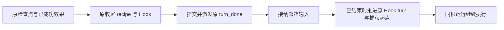

# 收尾与新增输入的持久边界

同一根运行开始收尾后，先完成原BeforeStop recipe、before_stop/subagent_stop及已排队turn_done，再消费普通邮箱输入。活跃模型返回后尚未进入收尾时，已排队输入继续参与当前工作片段。从complete检查点恢复时，保守地先完成原输出的收尾。取消、管理停驻、待处理工具及原事实队列继续使用原执行边界。

| 决策 | 结果 |
| --- | --- |
| 活跃执行中到达、尚未封定收尾的输入 | 继续原turn、输入捕获和交互语义 |
| 待收尾时收到新输入 | 邮箱保持待处理，原输出和事件不被替换 |
| 已结束后首个有效输入 | 启用Hook时原HookProgress.turn递增；需要捕获时起点移到新消息前，与消息和回执同一次checkpoint提交 |
| 同一活跃片段后续输入 | 保持当前turn，保留FIFO与原输入捕获 |
| 拒绝或无效输入 | 不开启新turn |
| 模型步骤与账本 | 不重置步骤、用量、预留、原输入回执、根run/thread或控制命令序列 |
| 恢复 | 已保存的事实operation原样重放；继续使用现有状态Schema，无新增表、字段或旧产品兼容分支 |

AgentHost的私有closing布尔标志在本次执行进入收尾时封定；重建Host时由state.complete恢复，不新增持久字段或数据库结构。接受有效输入后清除标志，原收尾要求进一步工作时也重新开放活跃输入边界。该标志不改变Hook操作编码或DurableTurnReceipt，新的完成片段通过既有turn获得独立事件及捕获身份。

实现范围为Runtime的agent.rs和agent目录下loop_host、input_host、execution、hook_host五份源码；后两处仅初始化私有Host字段。默认Host实际发布、邮箱API、预算更新和恢复沿同一路径验收。源码交付仍为源码加普通依赖清单，外部依赖用户自备。

阶段顺序：行为反例 → 两处执行边界修复 → 原生Host组合验收 → Runtime/Host回归与SDK检查 → 文档和恢复副本。图谱advance同名命中其他trait时，以准确文件context与实际动态调用补证；不能把incoming为空当成无影响。

实际验收、首版回归与恢复证据见[报告](../verification/terminal-input-ordering.md)。
